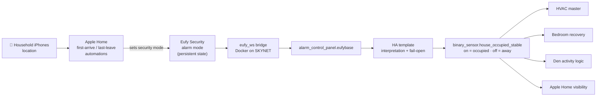
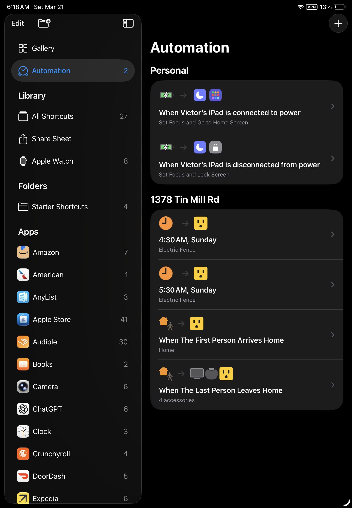
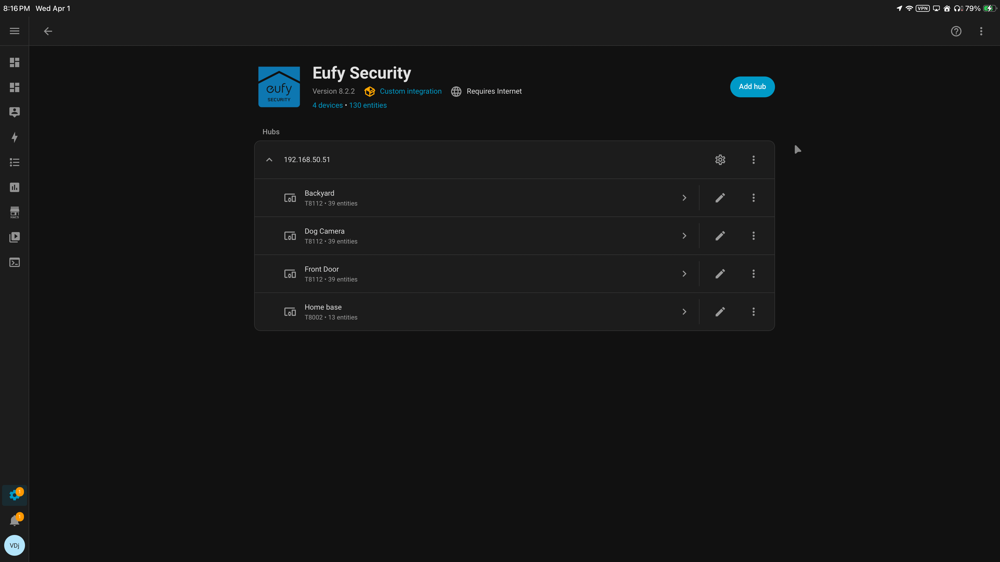
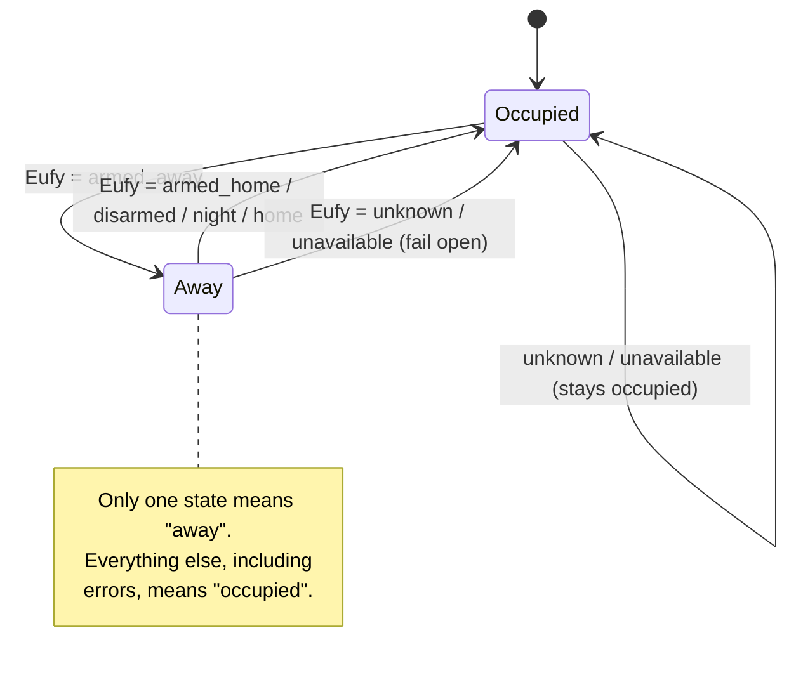

# Presence and Occupancy System

This folder defines the system that decides whether the home is **considered occupied**, and therefore whether the comfort automation layers are allowed to act.

Presence is not treated as a convenience feature.

It is treated as a **permission engine** for the rest of the house.

> Part of the [Home Assistant core automation system](../README.md) · see the [master README](../../README.md) for the full architecture.

---

## Table of Contents

1. [How It Works](#how-it-works)
2. [Purpose](#purpose)
3. [Design Role](#design-role)
4. [The Presence Chain](#the-presence-chain)
5. [Apple Home: Geofence Backbone](#apple-home-geofence-backbone)
6. [Eufy: Security-State Anchor](#eufy-security-state-anchor)
7. [Docker Bridge: Transport](#docker-bridge-transport)
8. [Home Assistant: Interpretation](#home-assistant-interpretation)
9. [Fail-Open Philosophy](#fail-open-philosophy)
10. [Failure Modes](#failure-modes)
11. [What Presence Controls](#what-presence-controls)
12. [Entity Model](#entity-model)
13. [Testing and Monitoring](#testing-and-monitoring)
14. [Design Summary](#design-summary)

---

## How It Works

1. **The last person leaves.** Apple Home sees, from household iPhone locations, that nobody is home.
2. **Apple Home changes the security mode.** Its departure automation sets the Eufy system to **Away** (`armed_away`). When the first person returns, the arrival automation sets it back to Home.
3. **Eufy holds the state.** The security mode is a persistent, household-level fact, not a moving GPS dot.
4. **The Docker bridge carries it.** The `eufy_ws` container on the SKYNET server passes the Eufy mode into Home Assistant as `alarm_control_panel.eufybase`.
5. **Home Assistant interprets it.** A template turns the mode into one clean signal, `binary_sensor.house_occupied_stable`. Anything uncertain counts as **occupied**.
6. **Other layers ask permission.** Bedroom recovery, the den, and the HVAC master logic check that signal before they run.

---

## Purpose

Provide a **stable, resilient occupancy signal** that other automation layers can trust.

This signal decides whether the system is allowed to:

- condition the bedrooms  
- keep the den active  
- run occupancy-sensitive comfort logic  
- shift behavior between home and away states  
- show household presence in Apple Home  

---

## Design Role

This layer does **not** directly control HVAC, appliances, or energy. It answers the first and most important system question:

> **Is the house considered occupied right now?**

Once that answer exists, other systems decide what they are allowed to do. That is why this folder is separate from HVAC:

| Layer | Question it answers |
|---|---|
| **Presence** | *May* comfort zones run? (permission) |
| **HVAC** | *How* should each zone run? (climate behavior) |
| **Safety (Layers 0 / 1)** | Ignores presence entirely: freeze, leak, and dog-temperature protection run whether or not anyone is home |

---

## The Presence Chain

Presence is not taken from a single device or app. It is built as a chain where each link has exactly one job:

| Link | Role | Job |
|---|---|---|
| **Apple Home** | Detection | Uses iPhone location and household membership to detect first arrival and last departure |
| **Eufy Security** | State | Stores the result as a security mode (home / away) |
| **Docker (`eufy_ws`)** | Transport | Exposes that mode reliably to Home Assistant |
| **Home Assistant** | Interpretation | Turns the mode into a stable, automation-grade occupancy signal with fail-safe handling |

This separation makes the system **user-friendly at the front end** and **reliable at the automation layer**.

---

## Apple Home: Geofence Backbone

Apple Home is the entry point for presence detection. It uses iPhone location and household awareness to determine:

- when the **first person arrives** home  
- when the **last person leaves** home  

### Unified Presence Automation View

 
 

This single view represents the full presence automation model. Apple Home manages arrival and departure as a **unified household state**, not as separate per-person automations.

Apple Home is responsible for:

- geofence detection (iPhone location)  
- first-person / last-person household logic  
- triggering home ↔ away transitions  
- starting system-wide state changes (via the Eufy security mode)  

It acts as the **front-end decision layer** for presence.

---

## Eufy: Security-State Anchor

Apple Home detects presence changes, but Eufy provides the **stable backend state**. Home Assistant never relies on raw GPS. It relies on the resulting security mode.

**Source entity:** `alarm_control_panel.eufybase`

Using the security mode has a second benefit: **the security system and the comfort system can never disagree.** If the house is armed for Away, HVAC treats it as away, and the reverse.

---

## Docker Bridge: Transport

The `eufy_ws` container on the SKYNET server connects Eufy to Home Assistant. That makes **Docker part of the presence system**, not just infrastructure.

Without it:

- the Eufy state would not reliably reach Home Assistant  
- occupancy logic would degrade  
- automation permission would become unstable  

Because the bridge is critical, it is watched: `skynet-check` reports Docker container health, and the fail-open rule (below) keeps the house safe if the bridge is down.

---

## Home Assistant: Interpretation

Home Assistant turns the Eufy mode into one binary answer:

| Eufy state (`alarm_control_panel.eufybase`) | `house_occupied_stable` | Meaning |
|---|---|---|
| `armed_away` | **off** | Nobody home → away behavior allowed |
| `armed_home` | on | Occupied |
| `armed_night` / night mode | on | Occupied |
| `disarmed` | on | Occupied |
| `home` | on | Occupied |
| `unknown` / `unavailable` | **on (fail open)** | Can't tell → treat as occupied |

Only **one** state means away. Every other state, including errors, means occupied. That is what makes the signal "stable": it can only go to away for a deliberate, positive reason.

### Why this pattern

Instead of asking *"Where is a device right now?"*, the system asks *"What is the current household state?"*

| Component | Provides |
|---|---|
| Apple Home | Location-based event detection, household-level presence logic |
| Eufy | Persistent home/away state, security-aligned system mode |
| Home Assistant | Stable interpretation, fail-safe handling, reusable automation signals |

---

## Fail-Open Philosophy

If the system becomes uncertain, it does **not** assume the house is empty. **It assumes occupied.**

A false **away** is far worse than a false **home**:

| Error | Result | Cost |
|---|---|---|
| **False away** (people home, system thinks empty) | Bedrooms and den shut off, loss of conditioning, temperature drift, wrong automation behavior | Discomfort, possible unsafe conditions |
| **False home** (house empty, system thinks occupied) | Comfort zones keep running a bit longer | Minor efficiency loss |

> **If uncertain, assume occupied.**

The dogs are protected either way: Layers 0 and 1 (freeze, leaks, 49–86 °F dog limits) do not depend on presence at all.

---

## Failure Modes

What happens when each link in the chain breaks:

| Failure | What Home Assistant sees | Result | Recovery |
|---|---|---|---|
| iPhone location / Apple Home hub offline | Eufy mode stops changing | Last known state holds | Resumes on the next arrival/departure |
| Apple Home automation doesn't fire | Eufy mode not updated | Last known state holds; can be set manually in Eufy or Apple Home | Manual mode change |
| Eufy cloud or base station offline | `unknown` / `unavailable` | **Fail open → occupied** | Automatic when Eufy returns |
| `eufy_ws` container or SKYNET down | `unavailable` | **Fail open → occupied** | `skynet-check` flags Docker; container restarts |
| Home Assistant down | Nothing | Automation paused; manual control remains | HA restart |

Every failure lands in a **safe** state: either the last known good state or occupied. None of them can create a false away.

---

## What Presence Controls

Presence is an **upstream dependency of HVAC, not part of HVAC**.

| Consumer | Uses presence to |
|---|---|
| **Bedroom recovery** | Requires `house_occupied_stable = on` before adaptive recovery runs |
| **Den logic** | Disabled when the house is away |
| **HVAC master** | Uses away to shut down non-essential zones; the living room keeps the dog-safe band |
| **Apple Home** | Shows household home/away status |

What presence does **not** control:

- **Layer 0 safety and Layer 1 dog protection:** always on
- **Energy time engine (CHEAP / STRICT / NORMAL):** runs by the clock, not occupancy
- **Tesla solar-sink charging:** uses the *car's* location ("car is home"), not house occupancy

---

## Entity Model

| Entity | Type | Role |
|---|---|---|
| `alarm_control_panel.eufybase` | Source | Eufy security mode, via the `eufy_ws` bridge |
| `binary_sensor.house_occupied_stable` | **Primary output** | Occupied (on) / away (off), fail-open |
| `binary_sensor.bedrooms_house_occupied_stable` | Compatibility alias | Same value; kept so older bedroom automations keep working |

These give stable automation inputs, backward compatibility, and room for a future redesign without rewriting consumers.

### What this folder contains

- Eufy-based occupancy interpretation  
- stable presence templates  
- fail-open handling logic  
- compatibility entity aliases  

This layer is intentionally **minimal and focused**.

---

## Testing and Monitoring

### Runbook tests

| Test | Expected result |
|---|---|
| Set Eufy to Away | `house_occupied_stable` → off; bedrooms and den shut down; living room holds the dog band |
| Set Eufy to Home | `house_occupied_stable` → on; comfort zones permitted again |
| Stop the `eufy_ws` container | `eufybase` → unavailable; `house_occupied_stable` stays **on** |
| Leave home with all household iPhones | Apple Home sets Eufy to Away; HA follows |

### Ongoing monitoring

- **`skynet-check`** confirms the `eufy_ws` container is running.
- **JARVIS weekly review** checks presence history against HVAC behavior: did bedrooms and the den actually stop when the house was away, and resume when it was occupied?

---

## Stability Goal

This system is not designed for maximum sensitivity. It is designed for **maximum reliability**:

- clean binary state  
- low ambiguity  
- resilience to failure  
- predictable behavior  

> **Usable certainty, not noisy precision.**

---

## Design Summary

This is a **multi-layer occupancy system** that separates:

- **detection** (Apple Home)  
- **state** (Eufy)  
- **transport** (Docker bridge)  
- **interpretation** (Home Assistant)  

The result is a system that is:

- stable  
- resilient  
- safe under uncertainty  
- easy for other systems to consume  
- far more reliable than raw GPS or single-device presence tracking
