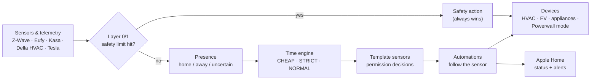
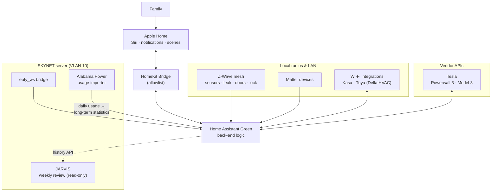
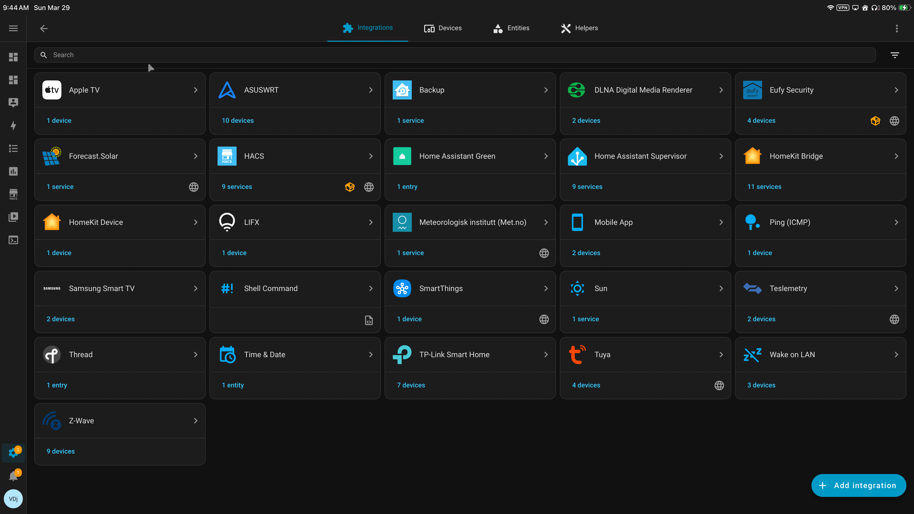
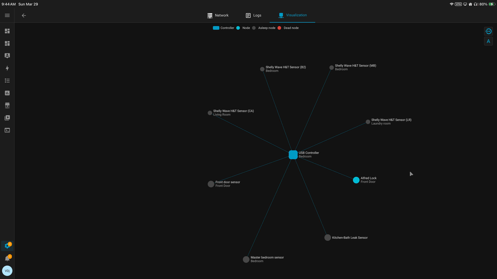
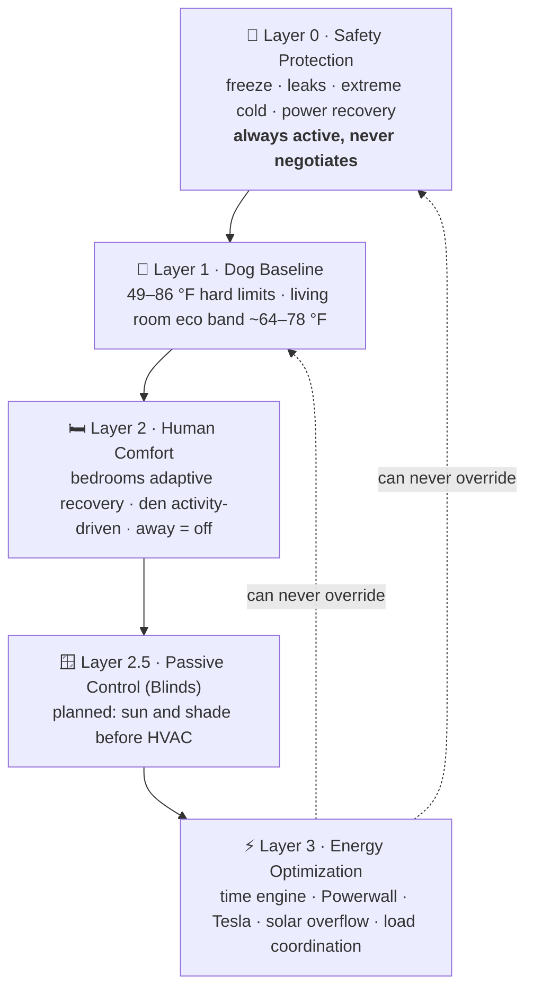
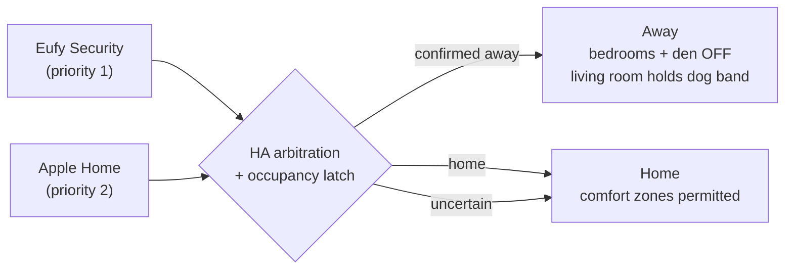
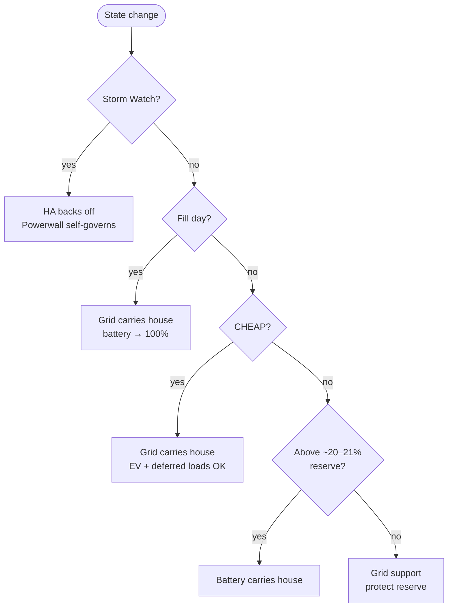
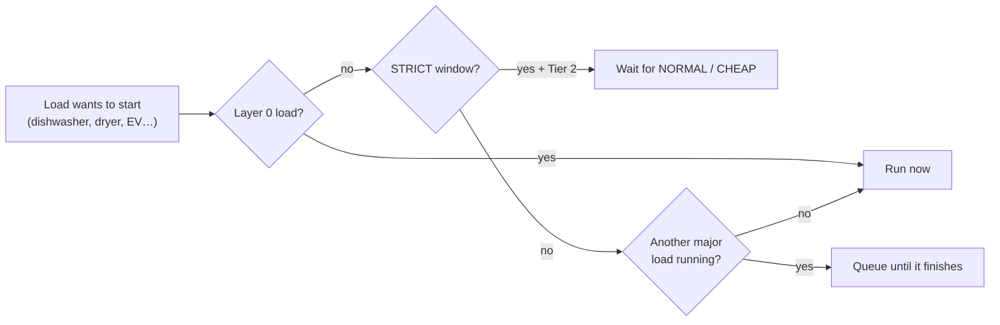

# Home Assistant — Core Automation System

Home Assistant is the **local automation brain** of the Dolomite house. It decides what runs, when it runs, and why, using safety rules, occupancy, electricity prices, and battery state.

It is responsible for:

- safety enforcement  
- HVAC orchestration  
- presence-aware control  
- appliance and load management  
- battery-governed energy logic  
- backend coordination with Apple Home  

This system is designed as a **layered residential automation platform**, not a collection of unrelated smart devices.

> **Documentation checkpoint:** November 12, 2026. See the [master README](../README.md) for the full system, network, SKYNET server, and cost analysis.

---

## Table of Contents

1. [How It Works](#how-it-works)
2. [Role in the Overall Architecture](#role-in-the-overall-architecture)
3. [Platform and Device Strategy](#platform-and-device-strategy)
4. [System Visibility](#system-visibility)
5. [Layered Control Model](#layered-control-model)
6. [Climate Control](#climate-control)
7. [Presence Model](#presence-model)
8. [Entry Validation: Alfred DB1 Z-Wave Lock](#entry-validation-alfred-db1-z-wave-smart-lock)
9. [Energy Control](#energy-control)
10. [Appliance and Load Control](#appliance-and-load-control)
11. [Design Pattern: Logic Lives in Sensors](#design-pattern-logic-lives-in-sensors)
12. [Validation, Monitoring and Backup](#validation-monitoring-and-backup)
13. [Current System State](#current-system-state)
14. [Remaining Work](#remaining-work)

**Subsystem deep dives**

- [Comfort and HVAC](./02-Comfort-and-HVAC/README.md)
- [Presence and Occupancy](./03-Presence-and-Occupancy/README.md)
- [Energy Optimization](./04-Energy-Optimization/README.md)
- [Appliance and Load Control](./05-Appliance-and-Load-Control/README.md)

---

## How It Works

Every decision in the house runs through the same chain:

1. **Sensors report state.** Z-Wave temperature, leak and door sensors, Eufy presence, Kasa power plugs, the Della mini-splits, and Tesla Powerwall and Model 3 telemetry.
2. **Safety is checked first.** If a freeze, leak, or dog-temperature limit is hit, Layer 0 or Layer 1 acts immediately and nothing else can override it.
3. **Presence grants permission.** Home, away, or uncertain decides which comfort zones are allowed to run. When uncertain, the system assumes someone is home.
4. **The time engine sets the mode.** CHEAP, STRICT, or NORMAL, taken directly from Alabama Power's RTA time-of-use plan.
5. **Template sensors decide.** "Powerwall may carry home," "Tesla may charge," "dishwasher may start." Each decision is one sensor.
6. **Automations act.** They follow the sensor: permission on → device on, permission off → device off.
7. **Apple Home shows the result.** People see and control the human-relevant devices; the backend logic stays hidden.



---

## Role in the Overall Architecture

The house follows a **front-end / back-end split**:

| | Apple Home: front end | Home Assistant: back end |
|---|---|---|
| Purpose | People | Physics and cost |
| Handles | Polished UI and remote access (HomePod / Apple TV hubs), Siri voice control, notifications, simple scenes | Local-first automation engine, energy and cost control, HVAC and presence policy, device orchestration, system-wide decisions |
| What it sees | Only allowlisted, human-relevant entities | Everything, including telemetry and internal helpers |

**Apple Home handles people. Home Assistant handles physics and cost.**

Failure behavior:

- If **Apple Home** is unavailable, automation continues.
- If **Home Assistant** is unavailable, manual control remains.
- If the **SKYNET server** is unavailable, Home Assistant keeps running. Only the server-hosted add-ons pause: the Eufy bridge, the Alabama Power usage import, and JARVIS reviews.



---

## Platform and Device Strategy

The system runs on a **Home Assistant Green** connected over **wired RJ45 Ethernet** on the home VLAN for stability. A locally attached **Z-Wave controller** provides low-power mesh communication for infrastructure devices.

### Preferred protocols

The system prefers **Z-Wave** and **Matter** wherever possible. Wi-Fi devices are used only where a device has no better option, such as power-monitoring plugs or the mini-split controllers.

| Protocol | Role | Why | Used for |
|---|---|---|---|
| **Z-Wave** | Infrastructure + sensors | Low-power mesh, strong residential reliability, much longer battery life, fully local (no cloud) | Temperature sensors, leak sensors, door sensors, locks, environmental monitoring |
| **Matter** | Ecosystem + user-facing devices | Cross-platform (Apple / Google / HA), simple onboarding, future-proof standard | User-facing devices that should work in more than one ecosystem |
| **Wi-Fi (local where possible)** | Power monitoring + HVAC | Only option for these devices | Kasa power-monitoring plugs, Tuya-based Della mini-split control |
| **Server bridge** | Cameras + utility data | Keeps heavy or cloud-facing work off the HA Green | Eufy (via `eufy_ws`), Alabama Power usage import |

**Strategy:** Z-Wave for infrastructure, Matter for ecosystem devices, and Wi-Fi only where nothing better exists.

---

## System Visibility

### Integrations Overview

<p align="center">
  
</p>

This view shows the full integration layer of the system, including:

- Tesla Powerwall + energy telemetry  
- Eufy security system  
- Kasa smart plugs with power monitoring  
- Tuya HVAC integration  
- HomeKit bridge  
- Z-Wave network  
- system-level services  

This demonstrates a **multi-vendor, locally orchestrated smart home environment**.

---

### Z-Wave Device Network

<p align="center">
  
</p>

This visualization shows the Z-Wave mesh network centered on the Home Assistant Green.

It represents:

- distributed sensor placement  
- mesh communication paths  
- low-power infrastructure device topology  

This network forms the backbone of:

- safety monitoring  
- environmental sensing  
- presence support  
- automation triggers  

---

## Layered Control Model

The system is built as **layers of priority**. A lower layer always overrides a higher one.

**Priority order:** 1. Dog safety → 2. Human comfort → 3. Energy efficiency → 4. Cost optimization → 5. Battery preservation



### Layer 0 — Safety Protection

Always active. Never negotiates. Independent of presence, power mode, solar, and battery.

- **Freeze protection:** laundry-area freeze heater
- **Leak detection:** Z-Wave leak sensors
- **Extreme cold safeguards**
- **Power-failure recovery:** devices return to a safe, known state after an outage

✔ Test: simulate a temperature below 50 °F and confirm the freeze response.

### Layer 1 — Dog Baseline Protection

Keeps the dogs safe regardless of cost.

- Safe range **49–86 °F**, enforced at all times
- Living room is the baseline zone, held in an eco band of about **64–78 °F**
- Devices: living room mini-split, dog heater plug, dog fan
- **STRICT mode never overrides dog safety**

### Layer 2 — Human Comfort

Zones are conditioned only when presence grants permission.

- **Bedroom 1 and Bedroom 2:** adaptive recovery (reach the target by the time it is needed, not all day)
- **Den:** activity-driven (TV on/off), mirrors the living room mode
- **Away:** bedrooms and den off
- Last-state restore allowed

✔ Test: set Away and confirm the zones shut down; turn the TV on and off and confirm the den responds.

### Layer 2.5 — Passive Control (Blinds) · *planned*

Use sunlight and shade to cut HVAC and lighting demand before any load turns on.

| Condition | Blinds |
|---|---|
| Sleep window, 5 PM – 6 AM | Closed (hard override) |
| Winter STRICT window, daytime | Open for passive heat and daylight |
| Summer STRICT window, daytime | Closed to block heat gain |

The blind motors run on batteries, so the logic keeps movement to a minimum.

### Layer 3 — Energy Optimization

Battery-first control of utility time windows, Powerwall behavior, Tesla charging, solar overflow, and load coordination. See [Energy Control](#energy-control).

---

## Climate Control

The HVAC is a **4-zone Della mini-split** system. It is designed to be safe, predictable, energy-aware, manually overridable, and resilient.

| Zone | Role | Behavior |
|---|---|---|
| Living room | Baseline zone | Always holds the dog-safe band; sets the house mode |
| Bedroom 1 | Comfort | Adaptive recovery when occupied |
| Bedroom 2 | Comfort | Adaptive recovery when occupied |
| Den | Activity | Runs with TV activity; mirrors the living room mode (heat/cool) |

**Energy rules for HVAC**

- Pre-condition **before** a STRICT (peak) window instead of during it.
- Avoid auxiliary / resistive heat; heat pumps only.
- Prefer daytime heating and cooling while solar is producing.
- During outages: 1–2 AC zones in summer, mini-splits only (no space heaters) in winter.

---

## Presence Model

**Presence grants permission, not temperature.** It decides which zones may run; the zone logic decides how.

Sources are merged in priority order, with an **occupancy latch** so a single dropped signal doesn't turn the house off:

1. **Eufy Security** (cameras and home/away mode)
2. **Apple Home** (household member location)
3. **Home Assistant arbitration** (combines the signals and applies the latch)

**Fail-open rule:** if uncertain → **assume occupied**. Comfort is never cut because of a sensor glitch.



---

## Entry Validation: Alfred DB1 Z-Wave Smart Lock

The front door uses an **Alfred DB1 Z-Wave smart lock** as an **entry validation and audit layer**, not just a lock.

> Entry is validated, attributed, and logged, not just detected.

### Core capabilities

- **User-attributed entry (PIN-based):** each unlock identifies who entered, giving per-user accountability.
- **Real-time alerts (Apple Home):** immediate notification when the door is unlocked.
- **System-level logging (Home Assistant):** records *how* the door was unlocked (keypad, Apple Home action, or manual) as the source-of-truth audit trail.
- **Multi-layer fallback access:** physical key backup and emergency battery charge capability.

### Why Z-Wave for the lock

The lock is critical infrastructure, not convenience automation. Z-Wave gives reliable local communication with no cloud dependency, low power use for long battery life, and performance independent of Wi-Fi congestion.

### Why the lock is *not* used for presence

The lock confirms **who entered and how**; it does not decide occupancy. Presence comes from Eufy and Apple Home. This keeps each device in one clear role: critical systems prioritize reliability and auditability, and automation supports awareness, not just convenience.

---

## Energy Control

The house operates as a **battery-governed residential microgrid** on Alabama Power's **RTA (Residential Time Advantage)** plan, with the **EV Night Charging Discount** stacked on top.

### Time engine

| Mode | Hours | RTA price (base) | What Home Assistant does |
|---|---|---|---|
| **CHEAP** | ~9 PM → **4:45 AM** | Economy 10.6092¢, minus 1.7155¢ EV discount (9 PM – 5 AM) | House runs on grid; EV charging and deferred loads allowed |
| **STRICT** | Winter 5–9 AM · Summer 1–7 PM (weekdays) | Winter peak 12.6092¢ · Summer peak **25.6092¢** | Battery carries the house; major loads blocked |
| **NORMAL** | All other hours | Economy 10.6092¢ | Solar first, battery second |

- **4:45 AM buffer:** CHEAP ends 15 minutes before the discount ends and before the 5 AM winter peak starts, so nothing spills into the expensive window.
- Weekends and RTA holidays have no peak period.
- Fuel (ECR), NDR and taxes are added to every kWh; the root README models these at about 3¢/kWh.

### Powerwall governance

Battery **carries the home** when all of these are true:

- not CHEAP
- not Storm Watch
- not a battery fill day
- above the reserve floor (~20–21%)

Battery **stops carrying** when CHEAP is active, Storm Watch is active, or the battery is below reserve.

- **Storm override:** if Tesla Storm Watch activates, Home Assistant backs off completely and the Powerwall manages itself.
- **Fill days:** New Year's Day, Labor Day, Thanksgiving, Christmas. The house runs on grid and the battery fills to 100% to reset winter deficits. All four are RTA holidays with no peak, so the refill is billed at economy rates.



### Tesla Model 3 as the energy sink

The car is the house's flexible load and the destination for extra solar. **Charge permission** is on when any one of these is true:

1. **CHEAP window:** the main charging period, at the discounted night rate
2. **Emergency:** car below 10% → charge until it reaches 30%
3. **Solar sink:** Powerwall at 100% and stable for 10 minutes, solar still producing, car at home

Permission on → charging on. Permission off → charging off.

### Solar behavior (no-export strategy)

1. Solar powers the house.
2. Excess charges the Powerwall.
3. Battery full → overflow goes to the **EV first**, then **HVAC pre-conditioning**, then optional loads.

Exports pay only about 3¢/kWh, so sending solar into the car is worth far more than selling it back.

---

## Appliance and Load Control

Appliances are treated as **managed electrical loads**, not passive devices.

**Core rule: never stack major loads during expensive windows.** Major loads are EV charging, dryer, dishwasher, washer, oven/cooktop, water heater, and HVAC spikes.

This rule matters twice on RTA. Peak energy is expensive, and the plan also charges **$1.50 per kW of the month's highest 15-minute demand**. A dryer running alongside EV charging can add about $7.50 to that month's bill.

| Tier | Loads | Rule |
|---|---|---|
| **Tier 0 · Always on** | Fridge, network, cameras, one mini-split, dog safety | Never shed |
| **Tier 1 · Solar only** | Washer, dishwasher, cooking, extra HVAC zones | Run while solar is producing |
| **Tier 2 · Off during peak** | EV charging, dryer, space heaters | Blocked in STRICT windows |

Examples in production:

- Dishwasher held to the CHEAP window (start-time helper and timer)
- Washer/dryer scheduling
- Load-stacking prevention (a second major load waits for the first)
- Freeze-heater coordination with Layer 0
- Kasa power-monitoring plugs confirm what is actually drawing power



**Goal:** no uncontrolled energy spikes and no peak stacking.

---

## Design Pattern: Logic Lives in Sensors

Every policy decision is a **template sensor or helper**, and automations stay simple:

```text
binary_sensor: "Tesla may charge"            → automation: charger follows it
binary_sensor: "Powerwall may carry home"    → automation: battery mode follows it
sensor:        "Power mode" (CHEAP/STRICT/NORMAL) → everything reads it
```

Why:

- **One place per rule.** Changing a time window means editing one sensor, not ten automations.
- **Testable.** Each sensor can be forced or simulated (time shift, fake battery %, fill day) and its effect observed.
- **Visible.** Apple Home and the dashboard can show *why* something is or isn't running.
- **Reviewable.** JARVIS can compare each sensor's history against the documented rule.

---

## Validation, Monitoring and Backup

### Runbook tests

| System | Test |
|---|---|
| Layer 0 safety | Simulate a temperature below 50 °F → freeze response |
| Presence | Set Away → bedrooms and den shut down |
| HVAC | TV on/off → den responds; den mirrors living room mode |
| Time engine | Time shift → CHEAP / STRICT / NORMAL transitions, 4:45 AM cutoff |
| Powerwall policy | Simulate battery % and a fill day → carry-home logic |
| Tesla permission | Start charging → trigger dishwasher → pause → solar full → resume |
| Solar sink | Simulate full battery (10 min stable) → Tesla allowed |
| Load shedding | Trigger two major loads → second one blocked |
| Blinds (when installed) | Force STRICT → verify open/close by season |

### Weekly health check

- Sensors alive (no long `unavailable` stretches)
- Kasa plugs reporting power
- Shelly and Z-Wave battery levels
- Tesla telemetry current

### Monitoring dashboard

Power mode · Battery % · Solar production · Home load · AC zones · Tesla state

### JARVIS weekly review

The SKYNET server pulls **9 days of history** (a 7-day review with 2 days of overlap) for a curated list of HA entities, every Tuesday and Saturday. It compares three things:

```text
This repo (should happen) → HA-Home-Server repo (is configured) → HA history (actually happened)
```

It then writes an advisory report. Typical findings are a zone that ran unusually often, high humidity in a room, a helper that stopped recording history, or EV charging that needs checking against its allowed windows. **JARVIS is read-only:** it never changes HA configuration, automations, or Tesla/Powerwall settings. Every change is a staged proposal that I review.

Note: an entity that exists but returns no history isn't necessarily broken. Helpers, timers, and entities with no state changes often return nothing.

### Configuration backup

The Home Assistant configuration is version-controlled in Git and backed up to GitHub. Changes are committed, so any automation can be compared or rolled back.

---

## Current System State

The Home Assistant layer is part of a fully built, production-level smart home platform.

| System | Status |
|---|---|
| 4-zone mini-split HVAC | ✅ Complete |
| Layer 0 safety architecture | ✅ Complete |
| Layer 1 dog comfort | ✅ Complete |
| Layer 2 human comfort | ✅ Complete |
| Presence system hardening | ✅ Complete |
| Apple Home bridge integration | ✅ Complete |
| Alabama Power usage import | ✅ Complete (runs on SKYNET) |
| Power monitoring deployment | ✅ Complete |
| Load-shaving system | ✅ Complete |
| Network infrastructure (wired RJ45, VLAN segmentation) | ✅ Complete |
| Layer 3 energy optimization | 🔄 Staged rollout |
| Layer 2.5 blinds | 📋 Planned (hardware not yet installed) |

---

## Remaining Work

The system is no longer in the build phase. It is focused on deployment timing, tuning, hardware additions, and refinement.

### Current priorities

1. Full Layer 3 deployment
2. Washer/dryer automation polish
3. Smart blinds installation (Layer 2.5)
4. Security automation cleanup
5. Energy tuning after rollout, using JARVIS reviews and real Alabama Power bills

---

## Operational Philosophy

- Automation assists, never traps.
- Safety overrides cost.
- Presence grants permission.
- Dogs override efficiency.
- Solar replaces grid, not discipline.
- Manual control always exists.

---

## Final System Identity

**A server-backed, locally controlled, battery-governed residential automation platform** with:

- layered safety architecture  
- presence-driven control  
- energy-aware orchestration on a real time-of-use tariff  
- hardened infrastructure  
- staged, reviewed deployment
