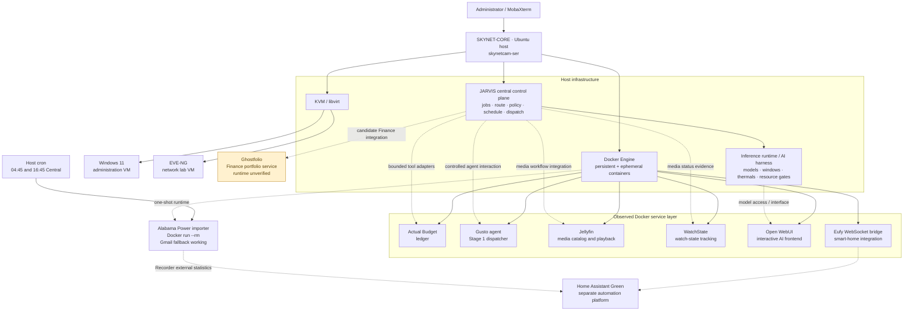
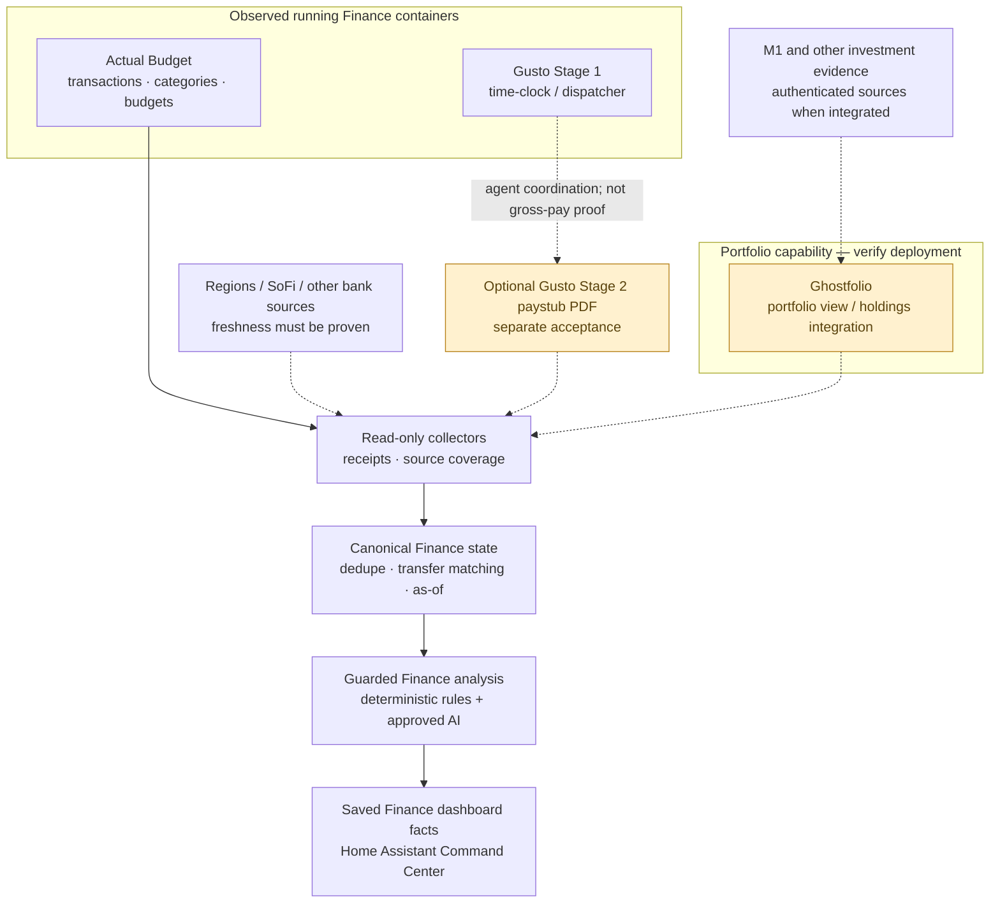
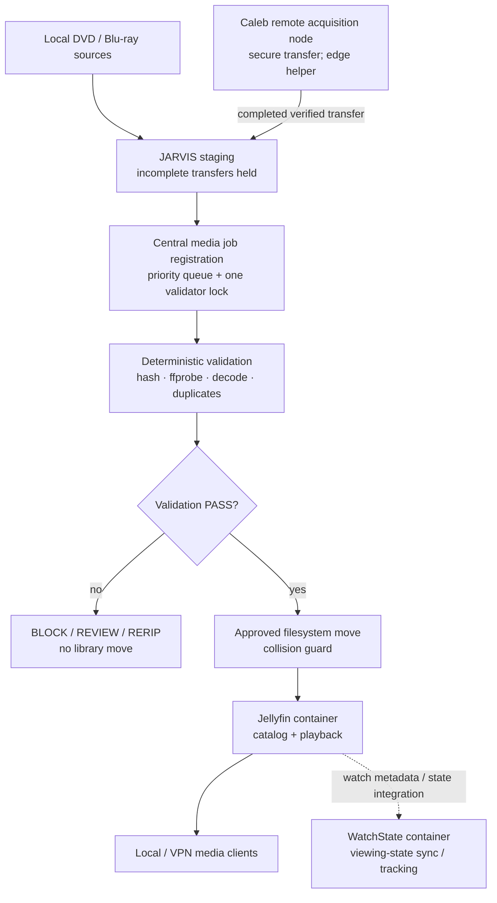
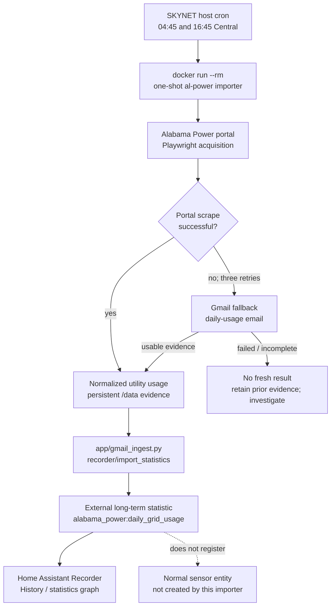
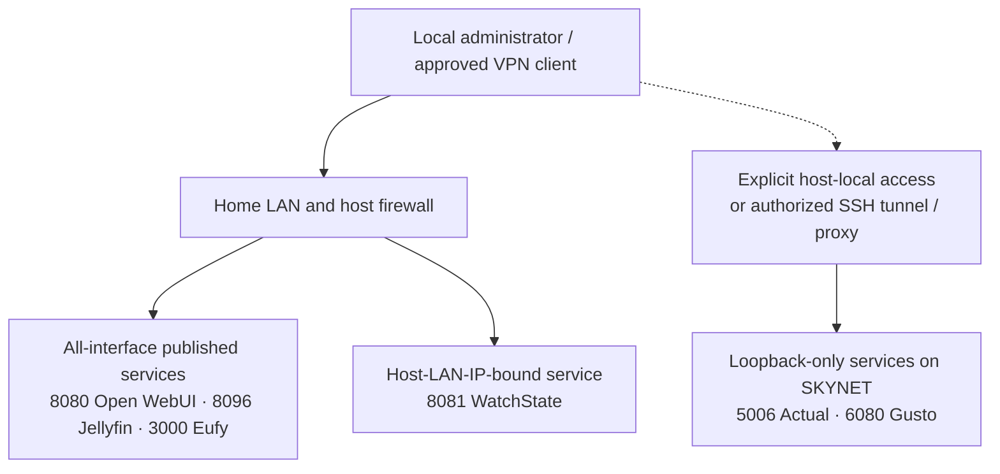

# Docker Infrastructure — SKYNET-CORE

> **The containerized service and tool-hosting layer of SKYNET / JARVIS**
> Finance evidence · Media services · Local AI interface · Smart-home integrations · Host/VM resource boundaries · Governed tool access

| Documentation detail | Value |
|---|---|
| **Repository location** | `03-RDP-VM-Infrastructure/Docker/README.md` |
| **Checkpoint** | November 8, 2026 |
| **Inventory source** | Operator-supplied `docker ps` from `onsiteadmin@skynetcam-ser` |
| **Observed Docker state** | **6 running containers** in the earlier November 8 snapshot; **5** in the later 17:22 CST snapshot (Gusto absent). A separate scheduled Alabama Power container runs ephemerally |
| **Scope** | Infrastructure and integration documentation; not end-to-end JARVIS acceptance |

> [!IMPORTANT]
> ****Docker hosts supporting services, while JARVIS retains centralized control over scheduling, validation, AI execution, and approvals.**

**Ghostfolio** is planned as the digital portfolio tracker for M1 Finance investments and CDs, providing consolidated investment monitoring within JARVIS Finance.

**Alabama Power** is operational but runs differently from persistent containers. Cron launches a temporary Docker container twice daily, which collects usage data and exits automatically. When website scraping fails, Gmail provides a working fallback. Data is published directly to Home Assistant's long-term statistics rather than a traditional sensor entity, explaining why historical graphs work even when HA displays "Entity not found.

---

## Table of contents

1. [Mission and role in the infrastructure](#1-mission-and-role-in-the-infrastructure)
2. [Executive status and service boundaries](#2-executive-status-and-service-boundaries)
3. [Layered infrastructure architecture](#3-layered-infrastructure-architecture)
4. [Observed Docker inventory](#4-observed-docker-inventory)
5. [Container ownership and service roles](#5-container-ownership-and-service-roles)
6. [How containers participate in the JARVIS harness](#6-how-containers-participate-in-the-jarvis-harness)
7. [Finance: Actual Budget, Gusto and Ghostfolio](#7-finance-actual-budget-gusto-and-ghostfolio)
8. [Media: Jellyfin, WatchState and ingest authority](#8-media-jellyfin-watchstate-and-ingest-authority)
9. [Home Assistant, Eufy and utility evidence](#9-home-assistant-eufy-and-utility-evidence)
10. [Local AI and Open WebUI](#10-local-ai-and-open-webui)
11. [Virtual machines and resource separation](#11-virtual-machines-and-resource-separation)
12. [Networking and remote access](#12-networking-and-remote-access)
13. [Persistent storage, secrets and backup](#13-persistent-storage-secrets-and-backup)
14. [Startup, health and failure handling](#14-startup-health-and-failure-handling)
15. [Read-only operations runbook](#15-read-only-operations-runbook)
16. [Deployment and change control](#16-deployment-and-change-control)
17. [Acceptance gates and unresolved inventory](#17-acceptance-gates-and-unresolved-inventory)
18. [Related documentation and design principles](#18-related-documentation-and-design-principles)

---

## 1. Mission and role in the infrastructure

Docker provides a lightweight, independently managed runtime for persistent services that support the SKYNET host, Home Assistant, the media library, and JARVIS extensions. It keeps service dependencies, images, and release lifecycles separate from the Ubuntu operating system and the KVM virtual machines.

The system has **three different responsibility layers**:

| Layer | Responsibility | Examples |
|---|---|---|
| **Ubuntu host / infrastructure** | Docker Engine, KVM/libvirt, disks, systemd, networking, host monitoring and any host-side inference runtime | `skynetcam-ser`, Cockpit, systemd timers, Ollama where host-managed |
| **Containers / service tools** | Maintain application state and expose bounded service interfaces | Actual Budget, Gusto agent, Jellyfin, WatchState, Open WebUI, Eufy WebSocket bridge |
| **JARVIS control plane** | Decide what work is permitted, when it runs, which capability it uses, what evidence counts, and whether an action is authorized | `jarvis-job`, `jarvis-route`, `jarvis-policy`, `jarvis-schedule`, `jarvis-dispatch`, `jarvis-model`, confidence/escalation, media PASS gate |

**Design rule:** A Docker container may **house a tool**, source of records, or a user-facing interface; it does not automatically own the scheduler, grant permissions, approve financial actions, or validate a media import.

---

## 2. Executive status and service boundaries

| Area | Documentation status | Interpretation |
|---|---|---|
| Docker runtime | **Observed running, two snapshots** | Six containers in the earlier Nov 8 capture; five in the later 17:22 capture, with Gusto not listed. A cron-launched importer is short-lived and does not appear when idle |
| Media services | **Observed running** | Jellyfin and WatchState show `healthy`; media ingestion acceptance is a separate matter |
| Smart-home bridge | **Observed running** | `eufy_ws` shows `Up`; this snapshot does not supply a health-check result |
| Local AI interface | **Observed running** | Open WebUI shows `healthy`; inference routing and permissions require separate checks |
| Finance ledger | **Observed running** | Actual Budget shows `healthy`; bank synchronization and reconciled Finance data are **not** proven by this |
| Finance browser agent | **Seen earlier, absent later** | Gusto Stage 1 showed `Up 6 hours` in the earlier Nov 8 list, but was absent from the 17:22 list. Investigate independently; Stage 2 is separate |
| Ghostfolio | **Not observed in `docker ps`** | Desired/known Finance portfolio component; deployment, database, address and health must be verified |
| Alabama Power importer | **Scheduled/runtime and HA publication method verified; Gmail fallback succeeding** | User cron at 04:45 and 16:45 Central launches image `al-power-al-power-importer` with `docker run --rm`. Portal timeouts persist, Gmail recovery reported. Code publishes external Recorder statistics (`alabama_power:daily_grid_usage`) without creating a sensor entity. Operator confirms displayed data accurate; exact newest record timestamp was not independently retrieved |
| JARVIS harness | **Architectural control layer** | Not a single Docker container; verify active services, policies, queue receipts and timers independently |
---

## 3. Layered infrastructure architecture

The RDP/VM infrastructure and Docker share the same Ubuntu host. Docker is an **application runtime**, KVM is a **virtual-machine runtime**, and JARVIS is the **orchestration and authority layer** spanning host services and container-hosted tools.



**Reading the diagram:** Solid lines represent hosting/hierarchy or the stated service role. Dashed arrows represent logical integrations or intended capability paths, **not** proof of live connectivity. Ghostfolio is deliberately outside the confirmed Docker group. The Alabama Power node is outside the six-container group because cron launches it only for a run; the publishing relationship requires a fresh Home Assistant statistics check.

### Architectural non-goals

- Do **not** treat the Windows WSL terminal as the Docker host just because it is where GitHub commands are run. The container inventory was gathered from `skynetcam-ser` over SSH.
- Do **not** start a second Finance scheduler, model router, or approval engine inside a container merely because Finance uses containerized tools.
- Do **not** place Home Assistant Green, the Windows VM, or the EVE-NG VM inside the Docker group; they are separate platforms/workloads.

---

## 4. Observed Docker inventory

**Command at source:** `docker ps` on `onsiteadmin@skynetcam-ser`, November 8, 2026. This table captures the **earlier six-container observation**; a later 17:22 CST run listed **five containers** (all rows below except `gusto-agent`). This is a dated inventory, not a present-tense availability assertion.

| Running container | Image / version observed | Host-side binding | Reported state | Primary consumer |
|---|---|---|---|---|
| `gusto-agent` | `jarvis-gusto-agent-gusto-agent` | `127.0.0.1:6080` → `6080/tcp` | Up 6 hours **earlier**; **not listed later** | JARVIS payroll/time-clock dispatcher |
| `jarvis-finance-actual-actual-1` | `actualbudget/actual-server:26.10.0` | `127.0.0.1:5006` → `5006/tcp` | Up 3 days (**healthy**) | Finance ledger and reconciliation adapters |
| `watchstate` | `ghcr.io/arabcoders/watchstate` | LAN-host binding `:8081` → `8080/tcp` | Up 3 days (**healthy**) | Media watch-state integration |
| `open-webui` | `ghcr.io/open-webui/open-webui:main` | `0.0.0.0:8080`, `[::]:8080` | Up 3 days (**healthy**) | Interactive local AI interface |
| `jellyfin` | `jellyfin/jellyfin:latest` | `0.0.0.0:8096`, `[::]:8096` | Up 3 days (**healthy**) | Media catalog/playback and JARVIS media publication |
| `eufy_ws` | `bropat/eufy-security-ws:latest` | `0.0.0.0:3000`, `[::]:3000` | Up 3 days | Home Assistant camera/security bridge |

**Port observations:**

- `127.0.0.1` is loopback on **SKYNET-CORE**, not the remote WSL laptop. Clients on other machines generally need an explicitly permitted tunnel/proxy to reach those host-only ports.
- `0.0.0.0` and `[::]` bind to all relevant host interfaces; access still depends on host firewall, router rules, and service authentication. **All-interface binding does not itself prove public-internet exposure or VPN-only restriction.**
- `watchstate` uses host port **8081** even though its container-side port is **8080**. It therefore does not collide with Open WebUI's **host** port 8080.
- Image tags such as `latest` and `main` identify mutable release streams; the exact running digest should be captured in a private inventory if reproducibility is required.

### Not established by this snapshot

`docker ps` does **not** show stopped containers, Compose project definitions, volumes, restart policies, host systemd services, or containers on other nodes. It also misses containers that were run with `--rm` and already exited. **The Alabama Power importer is confirmed via cron, its Docker image, on-disk project, recent log, and the external-statistics publishing code**; Ghostfolio, OpenBB, and ARM still require separate deployment discovery.

### Scheduled / ephemeral Docker workloads (verified separately)

| Workload | Evidence collected on Nov 8, 2026 | Operational interpretation |
|---|---|---|
| Alabama Power importer | `onsiteadmin` crontab entry, project files, Docker image, and `al_power.log` | **Installed and scheduled**, but not expected to remain in `docker ps` after completion |
| Cadence | `45 4,16 * * *` (host local time, Central in the supplied session) | Launches daily at **04:45** and **16:45** |
| Runtime | `/usr/bin/docker run --rm ... al-power-al-power-importer` | New one-shot container each run, automatically removed on exit |
| Persistent working data | Bind mount from `/srv/docker/stacks/al-power/data` to `/data` | File state persists outside the disposable container |
| Source availability | Portal: three 30-second navigation timeouts; Gmail: fallback reported successful | **Collection degraded but recovered** through alternate source; do not claim the portal itself works |
| Last observed evidence | `/home/onsiteadmin/al_power.log` modified **Nov 8 at 16:48:53 CST** | Supports a recent scheduled execution; latest reported completion is via fallback |

> **Home Assistant behavior clarified by source code:** This integration publishes **external long-term statistics**, not a `sensor.*` entity. The History view can show the statistics while displaying *Entity not found* for an entity selector. That message alone is **not** an importer failure. The operator confirms the displayed data is accurate. To certify a particular recent daily import, compare the latest statistic timestamp and the source date; a successful worker log by itself does not prove the exact posted record.

---

## 5. Container ownership and service roles

| Domain | Container | What it houses | What it must **not** be assumed to do |
|---|---|---|---|
| Finance | **Actual Budget** | Budget/ledger application and its account/transaction view | Prove bank-feed freshness, gross payroll, loan accuracy, or canonical reconciliation simply by being healthy |
| Finance | **Gusto Stage 1 agent** | Existing payroll/time-clock browser-agent/dispatcher capability (earlier Nov 8 snapshot only) | Establish authenticated paystub PDFs, reliable gross-pay amounts, or continued uptime after it vanished from the later snapshot |
| Finance (proposed/verify) | **Ghostfolio** | Portfolio aggregation/performance presentation if deployment exists | Become the bank ledger, execute trades, or supply verified current holdings without authenticated source coverage |
| AI interface | **Open WebUI** | Human-facing chat interface to approved models/tools | Bypass the central model router, thermal gates, authorizations, or trusted fact checks |
| Media | **Jellyfin** | Media catalog, metadata, and playback | Validate raw disc acquisition or authorize filesystem moves |
| Media | **WatchState** | Viewing/watch-state tracking and interoperability | Replace disc-rip validation, duplicate checks, or the media library move gate |
| Smart home | **Eufy bridge** | WebSocket integration for Eufy security-device events/state | Become the single authority for presence or security policy without corroborating HA logic |
| Energy (scheduled / verified) | **Alabama Power importer** | Ephemeral Playwright/Gmail acquisition; Home Assistant `recorder/import_statistics` publishing for `alabama_power:daily_grid_usage` | Be counted as a persistent container or as a normal HA sensor; historical statistics and sensor state are different data objects |

**Ownership rule:** The application/service **owns its local data and protocol**; the JARVIS control plane **owns task authorization and cross-domain orchestration**; a domain validator **owns its acceptance criteria**.

---

## 6. How containers participate in the JARVIS harness

The harness is a **shared resource-and-safety framework**. A domain requests a capability; JARVIS routes and gates it; a verified adapter talks to the appropriate container service or host process; evidence is recorded; only approved consumers receive accepted results.

```mermaid
flowchart LR
    TRIGGER["Timer / event / approved user request"]
    JOB["jarvis-job<br/>work registration"]
    ROUTE["jarvis-route<br/>capability routing"]
    POLICY["jarvis-policy<br/>authorization / limits"]
    SCHED["jarvis-schedule<br/>allowed windows"]
    DISPATCH["jarvis-dispatch<br/>serialized execution"]
    ADAPTER["Verified domain adapter<br/>bounded service/API operation"]
    TOOL["Container-hosted tool<br/>Actual · Gusto · Jellyfin · etc."]
    RECEIPT["Evidence receipt<br/>timestamps · source · result"]
    GATE["Domain validation<br/>schema · freshness · safety"]
    CONF["Confidence / escalation<br/>human approval when required"]
    OUTPUT["Approved report / dashboard<br/>or gated media action"]

    TRIGGER --> JOB --> ROUTE --> POLICY --> SCHED --> DISPATCH
    DISPATCH --> ADAPTER --> TOOL --> RECEIPT --> GATE --> CONF --> OUTPUT
    GATE -->|"reject / quarantine"| HOLD["Hold state<br/>no privileged action"]
```



> [!NOTE]
> This is the **target/control-plane contract**, not an assertion that every current Docker integration already traverses every depicted component. Confirm actual production CLI names, adapters, receipt semantics, and policy binding on SKYNET before marking a lane accepted.

### Harness controls that containers must respect

| Control | Expected integration behavior |
|---|---|
| Shared routing | Finance, media, events and HVAC register work with the central scheduler/router rather than starting competing AI runtimes |
| Workload isolation | A browser agent or batch task must not monopolize storage I/O, CPU, or memory needed by the host and VMs |
| AI execution gates | Ollama/model calls follow configured windows, queue discipline, thermal limits and lab/media exclusivity where applicable |
| Source-of-truth boundaries | Actual Budget is a ledger; Ghostfolio is a portfolio tool; Gusto Stage 1 is a dispatcher; Jellyfin is a catalog |
| Deterministic facts first | Transaction math, file hashes, media integrity, dates, deduplication and status transitions are calculated/tested outside LLM text |
| Auditability | Preserve job IDs, original source metadata, observed timestamps, errors and human decisions |
| Fail closed | Stale or missing data produces `UNKNOWN`, `REVIEW`, `BLOCK` or a queued retry—not fabricated evidence or unauthorized mutation |
| Recovery | Restarted services must not cause duplicate pay events, duplicate media imports, concurrent rip validators, or lost queue records |

### AI harness is not synonymous with Docker

Historical JARVIS notes describe CPU pinning between the Windows VM and the AI lane, thermal thresholds, `ollama-ceiling`, a workload-credit router, and media/EVE-NG exclusion. Those are **host and JARVIS policy concerns**. This README deliberately does not invent a Docker container for Ollama or for the control plane. Verify the live deployment before assigning them to a runtime.

---

## 7. Finance: Actual Budget, Gusto and Ghostfolio

Finance combines several **different kinds of evidence**, which should remain separate until reconciled. Docker provides some of the application surfaces; the Finance extension and central JARVIS harness perform scheduling, trust decisions and analysis.



### Clear division of responsibility

- **Actual Budget — observed running:** Main accounting/ledger interface. It may present balances, budget categories and transactions, but a healthy web server does not establish that the upstream bank sync ran or that all accounts were collected.
- **Gusto Stage 1 — seen in the earlier snapshot only:** Existing dispatcher/time-clock agent. Browser automation, login recovery, and session locks belong to the agent workflow. It did **not** appear in the later 17:22 CST `docker ps`; verify state without presuming a failure cause. **Stage 2 paystub capture is separate**.
- **Ghostfolio — integration component, runtime not established:** Intended portfolio tracking/aggregation surface for verified investment facts. **No Ghostfolio container name, image, port, database, or health status is supplied.** It may be stopped, deployed elsewhere, or not deployed yet. Verify before documenting deployment specifics.
- **OpenBB/market-data collectors — not shown in `docker ps`:** The Finance architecture may use them, but this snapshot does not show them as Docker services. Treat those source adapters separately until located.

**Finance safety boundary:** `READ → RECONCILE → CALCULATE → REVIEW → RECOMMEND → DISPLAY`. No automatic transfers, purchases, trades, loans or payments merely because a tool exposes a convenient API.

### Ghostfolio discovery / reconciliation

Run the read-only commands in [section 15](#15-read-only-operations-runbook) before adding an actual Ghostfolio deployment row or container diagram arrow. In particular, check stopped containers and Compose projects; don't create an invented Ghostfolio service or port in the documentation.

---

## 8. Media: Jellyfin, WatchState and ingest authority

Jellyfin and WatchState are **observed active Docker applications**. The media-ingest pipeline itself includes host scripts, optical hardware, staging areas, a priority dispatcher, deterministic validation and a PASS-gated final move.



> **Sacred move rule: NO VALIDATION PASS = NO FINAL LIBRARY MOVE.** Neither the Jellyfin container nor WatchState may bypass `jarvis_move_if_valid.py`, duplicate/collision protection or the central queue. An AI recommendation is advisory; filesystem mutation remains deterministic and permission-gated.

**Caleb remote node:** Caleb is a remote intake/edge helper, **not** the central library authority. When its local storage fills, completed raw media may be transferred securely to SKYNET-CORE for staging and validation; catalog visibility does not require a local retained copy. Optional reverse synchronization of validated copies is not evidenced as fully automated.

**Known blocker outside Docker:** The local HP DVD watcher was software-hardened but the optical USB device remained quarantined in the October 2026 handoff; full unattended disc-to-Jellyfin acceptance was deferred. Healthy Jellyfin and WatchState containers do **not** resolve that optical hardware fault.

---

## 9. Home Assistant, Eufy and utility evidence

### Eufy WebSocket bridge — observed running

The `eufy_ws` container provides a WebSocket bridge used to integrate Eufy security state into Home Assistant. Its output can support camera visibility, security-mode automation and presence-aware dashboards. Its mere process uptime is not proof that every camera, account connection, or automation dependency is functioning.

### Alabama Power — cron-managed ephemeral Docker importer (verified November 8)

The earlier Docker README treated the Alabama Power collector as a permanent container. The live investigation established a **different and more precise execution model**: the `onsiteadmin` user's cron starts a temporary Docker container twice a day and removes it when the run finishes. The project lives at `/srv/docker/stacks/al-power` and the locally built image is `al-power-al-power-importer:latest`.

**Installed cron entry (configuration evidence, not a command to paste at the interactive shell):**

```cron
45 4,16 * * * /usr/bin/docker run --rm --env-file /srv/docker/stacks/al-power/.env -v /srv/docker/stacks/al-power/data:/data al-power-al-power-importer >> /home/onsiteadmin/al_power.log 2>&1
```

- **Scheduler:** user crontab, not a Docker restart policy or systemd timer.
- **Working directory:** `/srv/docker/stacks/al-power/`; host-mounted `/data` persists across one-shot container exits.
- **Primary source:** Alabama Power/Southern Company usage portal, collected using Playwright.
- **Fallback:** utility daily-usage email from Gmail after portal acquisition retries fail.
- **Verified publishing implementation:** `app/gmail_ingest.py` sets `STATISTIC_ID` from `HA_AL_POWER_STATISTIC_ID` with default `alabama_power:daily_grid_usage`, defines `import_statistics(records)`, and constructs a Home Assistant `recorder/import_statistics` message. This is a **statistics-only path**, not a normal entity registration.
- **Publication use:** daily utility-grid records for Home Assistant history/energy analysis, independent of Tesla/Powerwall live device telemetry.
- **User confirmation:** the imported Alabama Power historical data visible in Home Assistant is accurate. This is functional evidence, not a separate verification of every individual new source record.
- **Observed incident:** `Page.goto` waited for `networkidle`, timed out after 30 seconds on three attempts, then the worker reported successful Gmail fallback.
- **Last log modification:** November 8, 2026 at 16:48:53 CST. The successful fallback entries are the latest returned log outcomes; their exact per-entry timestamps were not supplied.



### Why Home Assistant displays “Entity not found” while the graph works

**This is an expected UI/data-model distinction for this implementation, not evidence that the scraper is missing.** The source code inspection on November 8 shows:

| Evidence | Code location / interpretation |
|---|---|
| `HA_AL_POWER_STATISTIC_ID` | Optional override for the external statistics identifier |
| `alabama_power:daily_grid_usage` | Default **statistic ID**, with a colon (`:`), not an entity ID like `sensor.alabama_power_daily_grid_usage` |
| `import_statistics(records)` | Publishing function in `app/gmail_ingest.py` |
| `recorder/import_statistics` | Home Assistant Recorder statistics import message |

Home Assistant History can plot these **long-term external statistics** without a corresponding current-state sensor. If an entity-oriented selector tries to find a `sensor.*` object, it may display **Entity not found** even while the external statistical series renders correctly. The user has confirmed that the displayed Alabama Power history is accurate. **Do not delete the statistic or restart the pipeline to “repair” the entity label.**

If a *live sensor* is needed later for other automations, design it as a separate, opt-in publishing feature with stable state, correct kWh units, source-as-of timestamps, and deduplication. Do not relabel a daily historical statistic as instantaneous grid power, and do not create overlapping statistics that double-count usage.

**Operational status:** the importer is **scheduled and executing**, the **primary portal path is degraded**, and the **Gmail fallback reports successful completion**. The most recent *individual data-point* timestamp was not retrieved by the read-only checks; the confirmed accurate graph is separate user-observed evidence. The importer is **not** a seventh continuously running container and should not have permanent `docker ps` uptime/health metrics.

---

## 10. Local AI and Open WebUI

`open-webui` is **observed running** and provides a browser-based interface for local models. It is an access surface, not the deterministic authority behind JARVIS policy.

The broader AI system distinguishes:

- **Open WebUI:** user interface, conversations, and approved model/tool access.
- **Ollama/model runtime:** executes local inference where deployed; actual host/container placement must be checked.
- **JARVIS model resolver/router:** selects capability and enforces workload budgets.
- **JARVIS harness:** windows, VM/media conflict checks, job locks, thermal protection, rollback/cleanup and escalation.
- **Domain policy/validators:** decide whether a Finance recommendation is evidence-backed or whether a media file may move.

**Security principle:** A model's ability to *describe* a command is not authorization to run it. UI-to-tool access must be explicitly permitted and logged; no default write access to finance, production Home Assistant, raw media masters or VMs.

---

## 11. Virtual machines and resource separation

Docker and KVM compete for the same **host** CPU, memory, storage bandwidth and thermal headroom. The observed physical platform in the infrastructure master is a compact Ubuntu host with roughly **32 GB RAM and 4 cores / 8 threads**; allocation is a host-level scheduling problem, not something Docker alone can solve.

| Workload | Runtime | Operational implication |
|---|---|---|
| Windows 11 administrative VM | KVM/libvirt | Administrative browser, RDP and Windows-specific tools; may retain a reserved CPU/memory allocation |
| EVE-NG network lab VM | KVM/libvirt | Heavy network emulation; should yield or block resource-intensive AI according to the verified harness policy |
| Jellyfin and other service containers | Docker | Prefer stable service availability and predictable I/O over uncontrolled batch work |
| Model inference and AI jobs | Host/JARVIS-controlled, actual deployment to verify | Respect core pinning, thermal stops, window guards and container/VM contention |
| Home Assistant Green | Separate HA appliance | Receives integrations and dashboards; not a KVM guest or Docker container on this host in the supplied inventory |

**Historical AI harness policy:** During selected campaigns, Windows VM execution was allocated CPUs 0–3 and AI CPUs 4–7, with restoration afterward. Historical thermal guards include cool-start, shed and stop thresholds. Treat these as **documented harness rules to verify against live configuration**, not proof that every container is CPU-pinned or that the settings are currently active.

---

## 12. Networking and remote access



**Access policy:** The home architecture intends internal-LAN and ASUS Instant Guard VPN access rather than deliberate Internet port forwarding. This document does **not** treat that design intent as an external firewall audit. Verify router/NAT rules, host firewall, app credentials and the actual listening interfaces independently.

**Do not publish:** administrator credentials, cookies, auth tokens, bank account identifiers, private investor positions, raw container environment variables, or SSH keys. Keep public README examples generic when a concrete private address is not required.

---

## 13. Persistent storage, secrets and backup

Containers are replaceable; their persistent service state and host-mounted media are not.

| Data class | Preservation requirement |
|---|---|
| Actual Budget | Ledger/DB and associated configuration; backup and restore verification; preserve account provenance |
| Ghostfolio (if present) | Portfolio database plus any service dependencies; verify real deployment and backup path before claiming coverage |
| Gusto agent | Authorized session/automation state where appropriate; protect browser profiles, credentials, and logs |
| Open WebUI | Application settings and conversation/tool configuration; ensure least-privilege permissions |
| Jellyfin | Metadata, configuration, indexes and mapped content; distinguish `/mnt/media` source files from container metadata |
| WatchState | Viewing-state database/configuration; use documented service export/backup procedures |
| Eufy bridge | Integration config and authentication secrets; avoid putting tokens in the repository |
| Media staging | Immutable raw files and proof markers until PASS-gated import / accepted retention cleanup |

**Do not invent bind-mount paths:** The supplied `docker ps` does not include container mounts, Compose files, Docker volume names or restart policy. Record those only after running the read-only inspection commands below. The media pipeline handoff identifies host `/mnt/media` as the authoritative library root and a Jellyfin `/media` mapping, but the current container mount should still be verified before a storage change.

### Recovery sequence (conceptual)

1. Confirm the Ubuntu host filesystem and Docker daemon are healthy.
2. Restore or restart the minimum affected container only after checking its data volume and dependencies.
3. Verify the application's own health endpoint or functional read—not just `Up`.
4. Verify the relevant JARVIS adapter and evidence freshness.
5. Resume queued work with deduplication, locks and validation; do **not** replay an unsafe write blindly.

---

## 14. Startup, health and failure handling

| Failure condition | Expected action / boundary |
|---|---|
| Container process exits | Inspect exit reason, restart policy, application logs and dependent services |
| Docker reports `Up` but no health result | Run an application-specific read-only functional check; don't label it healthy by inference |
| Docker reports `(healthy)` | Treat as service-level evidence only; source freshness and domain acceptance remain separate |
| Actual Budget is running but bank sync is stale | Finance reports stale/unknown coverage; no trusted current cash flow until reconciled |
| Gusto login expires or container is absent | Inspect the live agent/container state; its approved recovery flow may reauthenticate, but no automatic restart or login success is assumed from the earlier snapshot |
| Ghostfolio missing | Find deployment; don't fabricate a successful portfolio feed or deploy a duplicate instance |
| Alabama Power portal acquisition times out | The cron-started worker retries the portal and reports Gmail fallback. Monitor log freshness and source-as-of; do not declare the portal healthy merely because the fallback works |
| Home Assistant History says `Entity not found` for Alabama Power | **Expected for a statistics-only import**: code publishes `recorder/import_statistics` to `alabama_power:daily_grid_usage` without registering a `sensor.*` entity. Preserve the working statistics; no repair required solely for the selector warning |
| WatchState unavailable | Media viewing-state integration degrades; original file validation and Jellyfin storage are distinct |
| Jellyfin unavailable | Hold publication/refresh where required; do not treat a failed refresh as permission for a second import |
| Eufy bridge unavailable | Mark affected HA security/presence observations degraded and preserve safe automations |
| AI overheats or EVE-NG requires resources | Harness pauses/requeues AI; container-held source data should remain durable |

The previous README said all services automatically restart. **That remains a design goal, not a verified fact from `docker ps`.** Inspect each container's `HostConfig.RestartPolicy` and Compose/systemd deployment before stating that every service automatically recovers after boot.

---

## 15. Read-only operations runbook

> These commands run **on SKYNET-CORE**, not on the `jdubo@Ghost` WSL development environment (where `docker` may not be installed).

```bash
# From WSL: connect to the actual Docker host
ssh onsiteadmin@skynetcam-ser

# Running inventory (current snapshot)
docker ps --format 'table {{.Names}}\t{{.Image}}\t{{.Status}}\t{{.Ports}}'

# Include stopped containers, including a possible Ghostfolio deployment
docker ps -a --format 'table {{.Names}}\t{{.Image}}\t{{.Status}}'

# Compose projects (including stopped projects)
docker compose ls -a

# Targeted Ghostfolio / portfolio search (read-only)
docker ps -a --format '{{.Names}} {{.Image}} {{.Status}}' \
  | grep -Ei 'ghostfolio|portfolio' || echo 'No matching container found'

# Current container CPU / memory usage
docker stats --no-stream

# High-level storage consumption
docker system df

# Example: inspect one container's restart policy and mount DESTINATIONS
# Avoid pasting full inspect output publicly; it can expose environment secrets.
docker inspect --format 'restart={{.HostConfig.RestartPolicy.Name}}' jellyfin
docker inspect --format '{{range .Mounts}}{{.Destination}} ({{.Type}}) {{end}}' jellyfin

# High-level port map for a known container
docker port jarvis-finance-actual-actual-1

# Check host-side jobs that may not run in Docker
systemctl list-timers --all --no-pager \
  | grep -Ei 'jarvis|finance|media|power|event' || true
```

### Alabama Power: scheduled/ephemeral discovery (read-only)

Run on the **SKYNET-CORE host**. These do not invoke a new scrape, change cron, or reveal the `.env` file's contents:

```bash
# Confirm the exact scheduled invocation without printing private env values
crontab -l | grep -E 'al-power|al_power' || true

# Confirm the image exists; this container is removed after each run
docker image ls --format '{{.Repository}}:{{.Tag}}' | grep 'al-power' || true

# Confirm log freshness and inspect recent outcomes (review before sharing)
stat -c 'log modified: %y; size: %s bytes' /home/onsiteadmin/al_power.log
grep -Ei '\[SCRAPE\]|\[FALLBACK\]|\[SOURCE\]|\[DONE\]|\[ERROR\]' \
  /home/onsiteadmin/al_power.log | tail -30

# Verify statistics-only publishing implementation without opening secrets
rg -n 'HA_AL_POWER_STATISTIC_ID|recorder/import_statistics|def import_statistics' \
  /srv/docker/stacks/al-power/app/gmail_ingest.py \
  || grep -nE 'HA_AL_POWER_STATISTIC_ID|recorder/import_statistics|def import_statistics' \
  /srv/docker/stacks/al-power/app/gmail_ingest.py

# Check persistent output directory timestamps, not contents of credentials
find /srv/docker/stacks/al-power/data -maxdepth 1 -type f \
  -printf '%TY-%Tm-%Td %TH:%TM %f\n' | sort | tail -20
```

**Do not** paste `.env`, authentication cookies, downloaded bills, tokens, or unreviewed logs into a public README. A crontab schedule line begins with `45 4,16 * * *` and belongs in `crontab -e`, **not** at a shell prompt; the job is already installed, so no cron changes are required.

### Safe troubleshooting commands

```bash
# Individual container state; do not include sensitive env variables
for name in gusto-agent jarvis-finance-actual-actual-1 watchstate \
            open-webui jellyfin eufy_ws; do
  docker inspect --format '{{.Name}} status={{.State.Status}} health={{if .State.Health}}{{.State.Health.Status}}{{else}}not-configured{{end}} restart={{.HostConfig.RestartPolicy.Name}}' "$name"
done

# Example targeted log inspection, reviewed locally before sharing
# Logs may contain access tokens, account names or internal addresses.
docker logs --tail 50 --timestamps jellyfin
```

**Change-control boundary:** Do not run `docker compose up -d`, `docker restart`, `docker rm`, a volume prune, or a new Ghostfolio installer simply to satisfy a README entry. First identify the existing deployment, capture config/volumes and confirm compatibility with the central JARVIS policies.

---

## 16. Deployment and change control

The exact current Compose files, image pinning and restart policies are **not in the provided Docker snapshot**. New or changed container deployments should follow this sequence:

1. **Inventory:** Record source Compose/project, image digest, names, ports, network, mounts, owners and secrets location privately.
2. **Assess:** Map the container to a specific JARVIS domain adapter and least-privileged use case.
3. **Protect:** Confirm backup/restore, data migrations, user permissions and rollback path.
4. **Avoid collisions:** Check host ports (not merely container ports), CPU/RAM, I/O, and VM/AI-window contention.
5. **Deploy explicitly:** Require authorized approval before installing a new service or granting it host mounts.
6. **Validate:** Prove functional reads, source freshness, error handling, recovery and expected behavior after restart.
7. **Document:** Update the dated inventory and evidence matrix, without converting a diagram or successful container startup into end-to-end production acceptance.

### Illustrative Compose **pattern**, not a live deployment file

```yaml
# Example only: not an export from SKYNET-CORE.
services:
  example-internal-tool:
    image: example/tool:<pinned-version>
    restart: unless-stopped
    ports:
      - "127.0.0.1:<host-port>:<container-port>"
    volumes:
      - ./persistent-tool-data:/app/data
```

Replace placeholders after discovering a real service. Do not paste this directly into production; the values are deliberately non-executable placeholders.

---

## 17. Acceptance gates and unresolved inventory

| Verification | Evidence needed to close | Current state |
|---|---|---|
| All six containers inventoried | `docker ps`, image, port and service ownership | **Observed** November 8 |
| Container restart policies | `docker inspect`/Compose evidence; reboot or controlled restart validation | **Not supplied** |
| Actual Budget Finance readiness | Verified bank freshness, ledger coverage, reconciliation receipts, canonical snapshot | **Not established by Docker health** |
| Gusto Stage 1 operational readiness | Read-only agent health, authorized session recovery and safe browser locking | **Earlier container running; absent from 17:22 snapshot; needs status check** |
| Ghostfolio runtime | `docker ps -a`, Compose inventory, application health and authenticated portfolio coverage | **Unverified / absent from running list** |
| Ghostfolio relationship to Finance | Broker source and aggregator separation, receipt mapping, coverage, no trading permissions | **Architecture documented; integration unverified** |
| Jellyfin and WatchState | App-level checks and media status integration | **Containers healthy; domain checks separate** |
| Media end-to-end acceptance | Completed physical/remote acquisition → validation PASS → import → refresh | **Pending from prior media handoff** |
| Eufy-to-HA availability | WebSocket bridge function and HA integration/entity freshness | **Container running; functional check needed** |
| Alabama Power collection | Cron, one-shot image, logs, fallback status, source-as-of and HA latest statistic | **Cron/runtime and Gmail fallback verified Nov 8; portal failing; user confirms accurate historical data; latest individual source-as-of remains to verify** |
| Alabama Power HA statistics publication | Confirm `app/gmail_ingest.py` sends `recorder/import_statistics`, and distinguish an external statistic from a normal sensor | **Code path verified Nov 8** — `alabama_power:daily_grid_usage` is a statistic ID; **Entity not found** in the entity selector is not a collector outage |
| Open WebUI model/tool guards | Effective permissions, model routing and tool audit | **Container healthy; policy check needed** |
| Network exposure | Host firewall, NAT, VPN, TLS/authentication and port-binding audit | **Partially documented; audit needed** |
| Backups / restore | Actual bind mounts, persistent volumes, tested recovery | **Not supplied** |

**Discovery priority:** Verify Ghostfolio’s location and Gusto’s current status; for Alabama Power, verify **the latest Home Assistant statistic timestamp and source date** when a formal freshness SLA is needed, rather than searching for a permanent container or a nonexistent sensor entity. Capture private Compose/mount/restart-policy details separately. None of these checks requires disrupting working services.

---

## 18. Related documentation and design principles

### Repository navigation

- [RDP / VM Infrastructure — master architecture](../README.md)
- [Ubuntu host system](../Host-System/README.md)
- [KVM / virtualization](../Virtualization/README.md)
- [JARVIS platform documentation](../Jarvis/)
- [JARVIS Finance subsystem](../Subsystems/Jarvis_Finance/README.md)
- [JARVIS Media Pipeline](../Subsystems/Media-Pipeline/README.md)
- [Local Events Intelligence Board](../Subsystems/Local-Events/README.md)
- [Home Assistant integration](../Subsystems/Home-Assistant-Integration/README.md)

### Permanent principles

| Principle | Practical meaning |
|---|---|
| **Tools live in containers; decisions live in the harness** | Hosted applications offer capabilities, but JARVIS owns routing, policy and acceptance |
| **Observed ≠ accepted** | `Up` or `(healthy)` does not prove fresh data or a validated cross-system workflow |
| **Never infer what `docker ps` cannot show** | Stopped services, Compose definitions, host daemons, remote nodes, and `docker run --rm` one-shot jobs require separate evidence |
| **One authoritative source per fact type** | Budget ledger, portfolio, payroll event, market quote and media file state are distinct |
| **No unvalidated library move** | Media content enters Jellyfin's canonical library only after deterministic PASS |
| **No unapproved financial execution** | Financial tools can inform decisions, not place trades, transfer funds or pay debts automatically |
| **Preserve HA and VM stability** | AI work respects resource constraints, heat, maintenance windows and critical integrations |
| **Private data stays private** | Store credentials, logs, portfolios, balances, precise local network details and tokens outside public documentation |

**Long-term design:** SKYNET remains a coherent infrastructure platform not six unrelated containers and not six separate agent schedulers. Docker supplies durable tools; KVM supplies isolated operating systems; JARVIS supplies shared governance; Home Assistant supplies the automation and visualization surface.
