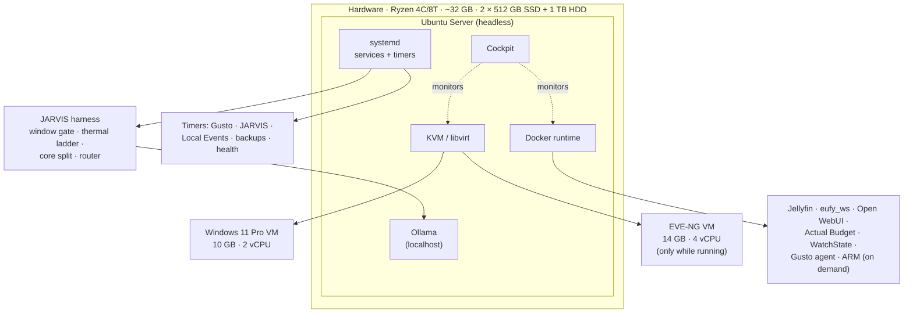
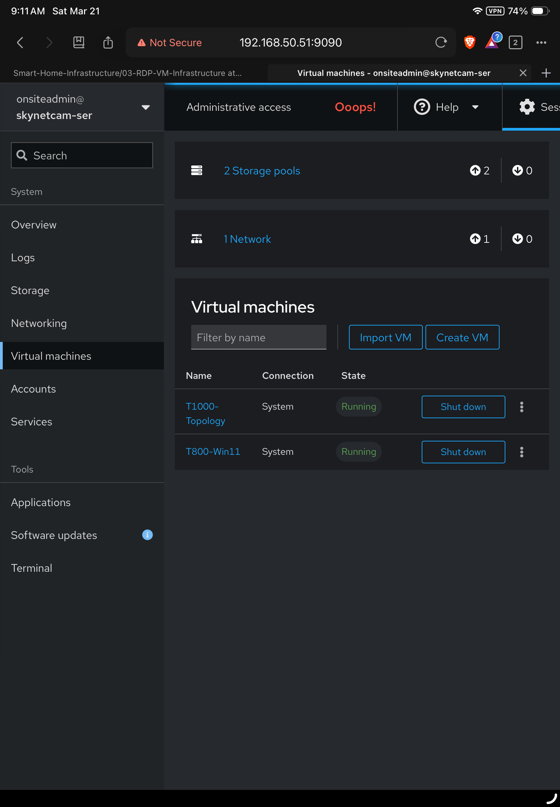
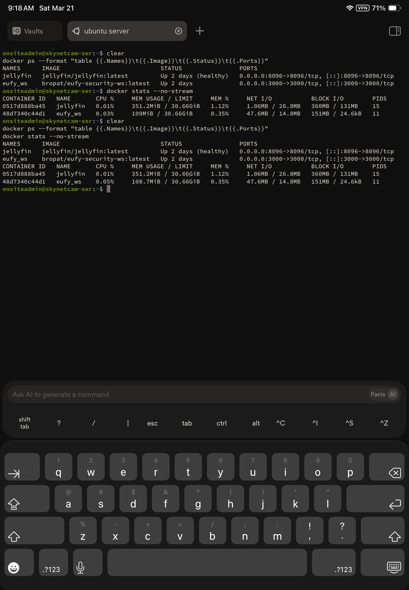
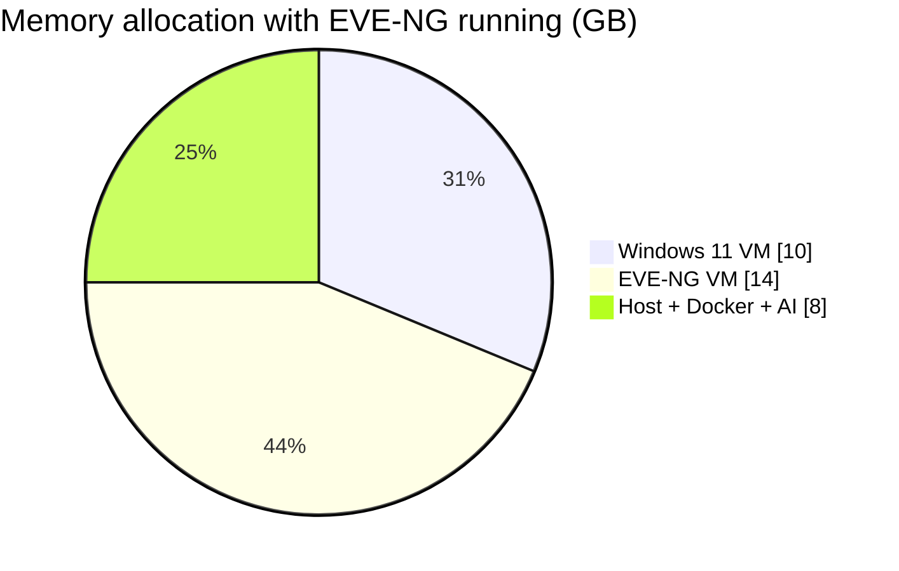
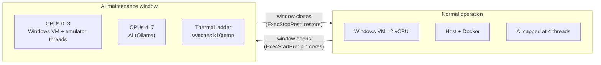
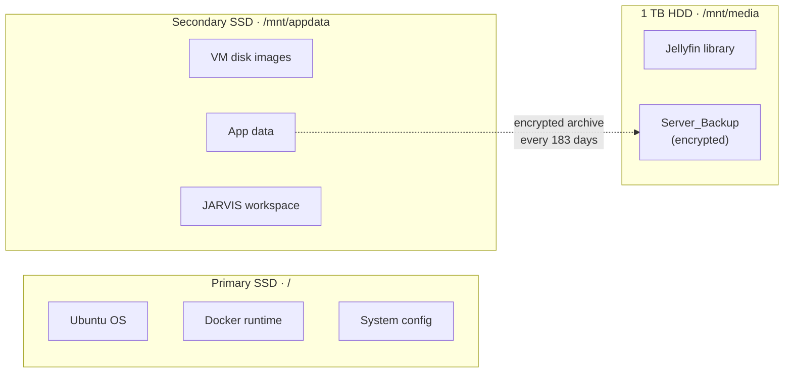
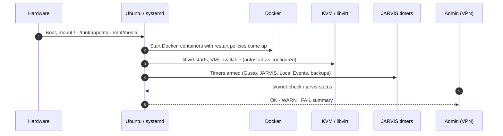

# Host System

This directory documents the **host system layer** of the SKYNET infrastructure server (`skynetcam-ser`).

The host is the foundation of the whole environment. It keeps every service running, divides CPU, memory and storage between workloads, and makes sure virtual machines, containers and local AI coexist without interfering with each other.

Unlike a traditional desktop, the host is a **dedicated infrastructure node** built for stability, uptime and controlled resource sharing.

> Part of the [RDP / VM / JARVIS infrastructure](../README.md) · see the [master README](../../README.md) for the full system.

---

## Table of Contents

1. [How It Works](#how-it-works)
2. [Role of the Host System](#role-of-the-host-system)
3. [Hardware Platform](#hardware-platform)
4. [Host Operating System](#host-operating-system)
5. [Infrastructure Management (Cockpit)](#infrastructure-management-cockpit)
6. [Container Runtime](#container-runtime)
7. [Resource Allocation Strategy](#resource-allocation-strategy)
8. [CPU, AI and Thermal Governance](#cpu-ai-and-thermal-governance)
9. [Storage Coordination](#storage-coordination)
10. [Scheduled Services (systemd)](#scheduled-services-systemd)
11. [Operational Behavior](#operational-behavior)
12. [Health Checks](#health-checks)
13. [Backup and Recovery](#backup-and-recovery)
14. [Security Model](#security-model)
15. [Stability Design](#stability-design)

---

## How It Works

The host runs four kinds of work side by side and keeps each one in its lane:

| Workload | Runs as | Example | Host's job |
|---|---|---|---|
| **Always-on services** | Docker containers | Jellyfin, Eufy bridge, Open WebUI, Actual Budget | Keep them up, restart them on failure |
| **Full operating systems** | KVM virtual machines | Windows 11 admin VM, EVE-NG lab | Give them fixed CPU, memory and disk |
| **Scheduled jobs** | systemd timers | Gusto agent, JARVIS reviews, Local Events, Alabama Power import | Run them on time, log results |
| **Local AI** | Ollama, behind the JARVIS harness | Weekly HA review, finance, event enrichment | Cap CPU and heat so AI never starves the VMs |

---

## Role of the Host System

The host is the **control and execution layer** beneath all higher-level services. It is responsible for:

- managing CPU and memory allocation across workloads  
- keeping system, VM, application and media data on separate storage  
- running the Docker runtime for persistent services  
- supporting KVM-based virtualization  
- governing local AI so it can't overheat the machine or crowd out the VMs  
- running scheduled jobs through systemd  
- providing monitoring and management interfaces  
- making sure every service recovers automatically after a restart  

This lets the system work as a **24/7 infrastructure platform** rather than a user-operated machine.

---

## Hardware Platform

| Resource | Specification |
|---|---|
| Form factor | Mini desktop server |
| CPU | AMD Ryzen, 4 cores / 8 threads, all allocated to Ubuntu |
| Memory | ~32 GB RAM |
| Storage | 2 × 512 GB SSD + 1 TB HDD |
| Network | Wired to the Cisco 2960-C on VLAN 10 (home), with a lab-side attachment for VLAN 50 (EVE-NG) |

---

## Host Operating System

### Ubuntu Server

The host runs **Ubuntu Server 24.04** in a headless configuration. This provides:

- low-overhead operation  
- direct access to Linux-native virtualization (KVM)  
- native Docker support  
- systemd for services, timers, and encrypted credentials  
- a stable long-term runtime for automation services  

No desktop environment is installed, so all resources go to infrastructure workloads.

---

## Infrastructure Management (Cockpit)

  

**Cockpit** is the primary web management interface for the host. The screenshot shows:

- active virtual machines running on the host  
- system-level visibility into infrastructure workloads  
- centralized control of VM lifecycle and system resources  

Cockpit provides:

- real-time CPU and memory monitoring  
- storage and disk management  
- VM control through libvirt  
- service visibility across the host  

It removes the need for a separate hypervisor dashboard. Cockpit is reachable **only over the VPN**. Day-to-day terminal work happens over SSH through **MobaXterm**.

---

## Container Runtime

  

Docker containers run directly on the host and provide persistent support services.

| Container | Purpose | Lifecycle |
|---|---|---|
| Jellyfin | Media server | Always on |
| eufy_ws | Eufy security bridge to Home Assistant (presence + cameras) | Always on |
| Open WebUI | Chat front end for local models (read-only JARVIS tools) | Always on |
| Actual Budget | Financial ledger | Always on |
| WatchState | Media watch-state sync | Always on |
| Gusto agent | Shift time-clock automation | Always on |
| ARM | Automatic disc ripping for the media pipeline | **On demand** (normally stopped) |
| Alabama Power importer | Daily usage import into HA long-term statistics | **Scheduled job** (starts, runs, exits) |

The host is responsible for:

- keeping containers up and honoring restart policies  
- managing container resource usage  
- isolating container workloads from virtual machines  

Containers are a deployment boundary, **not a security boundary**: published ports and bind mounts are reviewed like any other host service.

---

## Resource Allocation Strategy

The host is deliberately balanced so several workload types can run at once.

### Memory (~32 GB)

| Workload | Allocation | Notes |
|---|---|---|
| Windows 11 VM | ~10 GB | Admin workstation |
| EVE-NG VM | ~14 GB | **Only while running**; the lab has priority over AI campaigns |
| Host + Docker + local AI | ~8 GB | Grows to ~22 GB whenever EVE-NG is off |

### CPU (8 threads)

| Workload | Allocation |
|---|---|
| Windows 11 VM | 2 vCPU |
| EVE-NG VM | 4 vCPU |
| Host + Docker | Remaining threads |
| Local AI | Governed by the AI harness (below) |

This prioritizes lab performance for EVE-NG, responsiveness of the Windows admin environment, and consistent performance for always-on services.

---

## CPU, AI and Thermal Governance

Local AI is the heaviest and hottest workload on this machine. In testing, an 8B model with a large prompt pushed the CPU to **about 94–95 °C** and used nearly all threads. The host therefore treats AI as a **governed** workload, never a free-for-all.

| Control | What it does |
|---|---|
| **Small prompts** | Python compresses evidence first; models only see short briefs |
| **CPU ceiling** (`ollama-ceiling`) | Normal AI limit is 4 threads (400%), with a temporary boost to 6 or 8 for a deliberate large job, then back to normal automatically |
| **Window gate** | Heavy AI campaigns run only in maintenance windows: Wed 00:00–06:00, Fri 00:00–04:00, Sun 00:00–06:00 |
| **Core split** | During a campaign the Windows VM is pinned to CPUs 0–3 and AI to CPUs 4–7, then restored (`virsh vcpupin` + systemd `AllowedCPUs`) |
| **Thermal ladder** | CPU temperature (k10temp) is watched during inference; jobs slow down or stop before the CPU stays near its limit |
| **Guards** | A failing model is retired for the window; crashes are capped at 3 strikes per job |
| **Lab priority** | When EVE-NG is running, AI campaigns yield |

---

## Storage Coordination

The host uses separate storage tiers so that one workload's disk activity can't slow down another.

| Device | Mount | Holds |
|---|---|---|
| **Primary SSD** | `/` | Ubuntu OS, Docker runtime, system configuration |
| **Secondary SSD** | `/mnt/appdata` | VM disk images (Windows ≈ 150 GB, EVE-NG ≈ 170 GB), application data, the JARVIS workspace |
| **1 TB HDD** | `/mnt/media` | Jellyfin media library, bulk non-critical data, and the **`Server_Backup`** recovery archive |

This separation means:

- VM disk I/O does not impact system services  
- media streaming does not affect automation workloads  
- the recovery backup lives on a **different physical drive** from the data it protects  
- performance stays predictable across all layers  

`skynet-check` watches the free space on `/`, `/mnt/appdata`, and `/mnt/media`.

---

## Scheduled Services (systemd)

Recurring work runs as **systemd services and timers**, not ad-hoc cron jobs, so every run is logged in the journal and its result can be checked.

| Area | Examples |
|---|---|
| Gusto | Shift lifecycle and dispatcher timers; the agent container |
| JARVIS | HA history pull and weekly review, HVAC audits, AI window gate, thermal control |
| Local Events | Event discovery and Home Assistant board refresh |
| Finance | Source collectors and reconciliation (with reauthentication via encrypted systemd credentials) |
| Media / ARM | Disc-watch autostart and supervisor |
| Host | Backup age check, health checks, package updates |

`jarvis-status` lists the next scheduled runs and every shortcut command on the host.

---

## Operational Behavior

At boot the server brings itself fully online without manual steps:

1. Host boots and mounts all three drives.
2. Docker services start automatically.
3. Virtual machines become available.
4. systemd timers are armed for scheduled work.
5. Cockpit and the health-check commands provide visibility.
6. Infrastructure services stay continuously available.

---

## Health Checks

Three commands give a fast view of the whole host:

| Command | What it shows |
|---|---|
| **`skynet-check`** | One-screen OK / WARN / FAIL summary: load, memory, disks, CPU temperature, failed systemd units, Gusto status, Docker containers, VMs, backup age, pending updates. `-v` adds detail; `--full` also runs the full legacy report. Exit codes 0 / 1 / 2 make it scriptable. |
| **`jarvis-status`** | Runs `skynet-check`, shows upcoming JARVIS timers, and lists every shortcut command grouped by area |
| **`node-status`** | The original detailed system report, including primary and secondary backup status |

Expected exceptions are handled explicitly, not ignored. For example, ARM is expected to be stopped between discs, and a retired test unit is excluded from failure counts.

---

## Backup and Recovery

- **One rolling recovery backup** of application data, configs, Compose files and scripts is kept as a **GPG-encrypted (AES-256)** archive with a `.sha256` checksum in `/mnt/media/Server_Backup`.
- It is refreshed every **183 days**. The previous backup is deleted only after the new one passes its checksum and a test decrypt, so at least one good backup always exists.
- `skynet-check` and `node-status` both report the backup's age and when the next one is due, and warn if it becomes overdue.
- The automated 183-day job is being finalized; the current backup is already in place and monitored.
- Home Assistant's configuration is backed up separately to GitHub.

---

## Security Model

- **VPN-only access.** Cockpit, SSH, RDP, Jellyfin, EVE-NG and JARVIS dashboards are reached through ASUS Instant Guard. Nothing is port-forwarded to the internet.
- **Local AI stays local.** Ollama listens on localhost only.
- **Secrets stay out of the repo.** Service credentials are kept in protected environment files or **systemd encrypted credentials**, never in Git.
- **Lab isolation.** The EVE-NG VM sits on VLAN 50; being attached to both VLANs doesn't mean the host routes between them.
- **Containers and VMs are not automatic security boundaries.** Bridges, published ports and guest NICs are verified individually.

---

## Stability Design

The host is designed to prevent common failure modes:

| Risk | How it is contained |
|---|---|
| Windows updates or reboots | Run inside the VM; infrastructure keeps running |
| Container crash | Restart policy brings it back; VMs unaffected |
| Lab experiments | Isolated VM on VLAN 50; production services untouched |
| AI overheating the CPU | Thread ceiling, window gate, core split, thermal ladder |
| Disk contention | Separate drives for system, VMs/app data, and media/backup |
| Data loss | Encrypted recovery backup on a separate drive, plus HA config in Git |
| Silent failures | `skynet-check` reports failed units, stopped containers, overdue backups |

The result: automation keeps running, services recover automatically, and system behavior stays predictable.

---

## Why the Host Layer Matters

The host is what turns a collection of tools into a **cohesive infrastructure platform**. It ensures:

- continuous uptime for smart home support services  
- controlled interaction between containers, VMs and local AI  
- reliable execution of scheduled automation  
- centralized management and health checks for every component  
- a recoverable system, not just a running one  

Without this layer, the system would behave like a workstation.

With it, the system behaves like a **dedicated 24/7 infrastructure server**.
