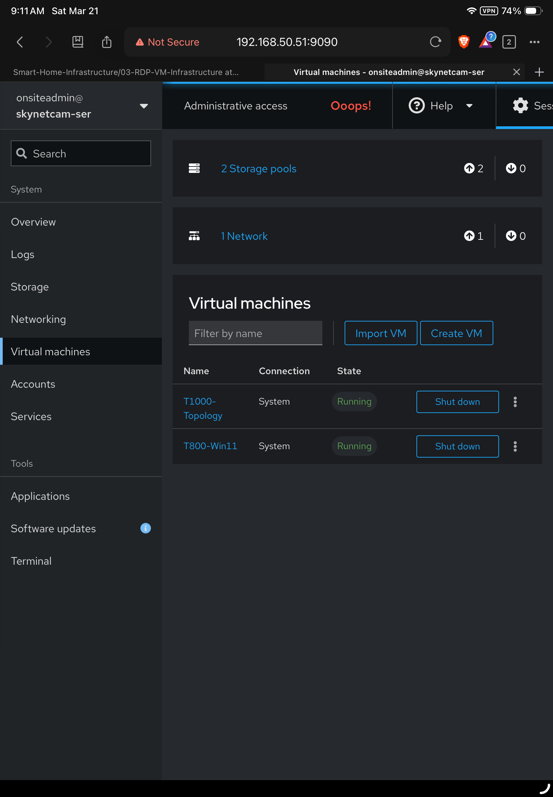
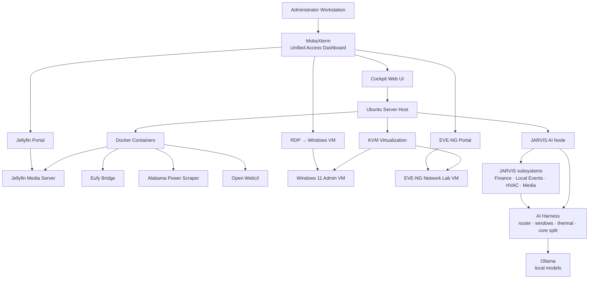
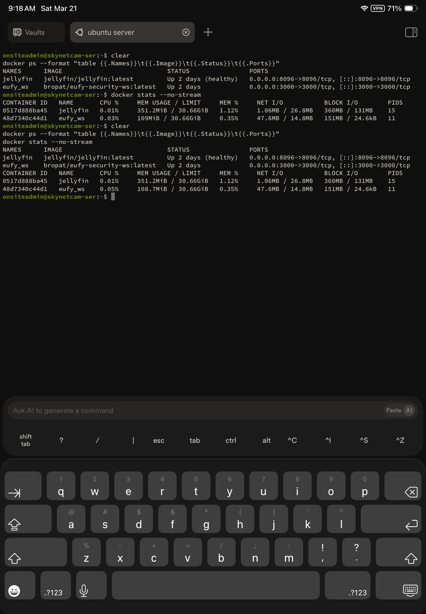
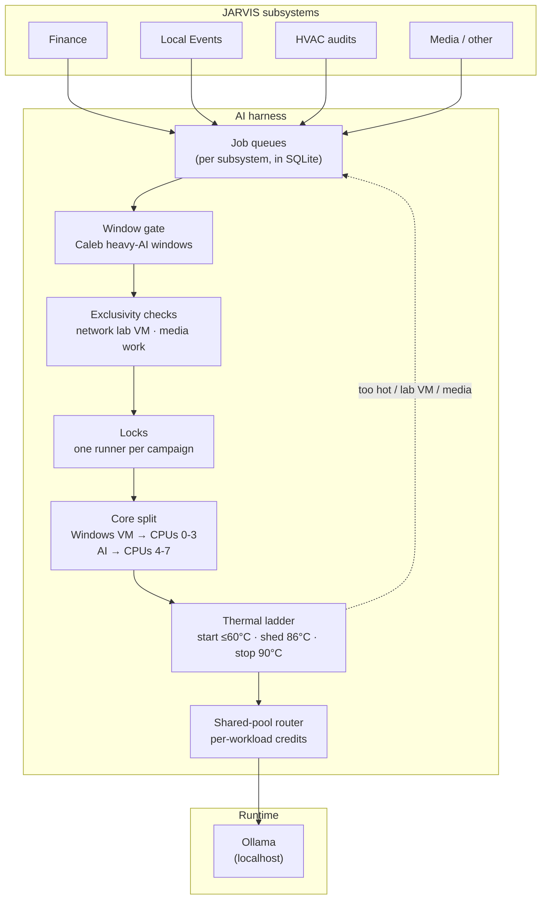
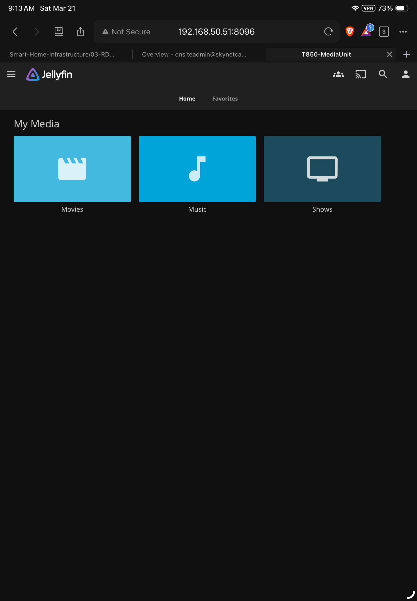

# RDP Infrastructure Server

> **SKYNET infrastructure · Virtualization · Containers · Network engineering · JARVIS AI**
> Local-first services · Governed AI execution · Shared control plane · Home Assistant integration

This server functions as a **central infrastructure node** within the smart home lab environment and provides the compute platform for automation support services, network simulations, local AI workloads, and development workflows.

**Repository location:** `03-RDP-VM-Infrastructure/README.md`
**Documentation checkpoint:** November 3, 2026 · **System:** SKYNET / JARVIS
**Document role:** Master infrastructure architecture and navigation
**Acceptance boundary:** Architecture documentation and dated test findings; not a live operational health report.

> [!IMPORTANT]
> This is the **master infrastructure page**. JARVIS Finance, Local Events, HVAC, Media and CCNA-Jarvis are domain extensions that reuse the central JARVIS control plane. Do not infer that every subsystem or model workflow is production accepted just because an architecture diagram, scheduler, dashboard or local test exists.

## Table of contents

<!-- TOC_START -->
- [1. Architecture and operating model](#1-architecture-and-operating-model)
- [2. Layered system architecture](#2-layered-system-architecture)
- [3. Physical hardware and resource allocation](#3-physical-hardware-and-resource-allocation)
- [4. Ubuntu host and service orchestration](#4-ubuntu-host-and-service-orchestration)
- [5. Docker and container services](#5-docker-and-container-services)
- [6. KVM virtualization](#6-kvm-virtualization)
- [7. Virtual machine workloads](#7-virtual-machine-workloads)
- [8. JARVIS core architecture](#8-jarvis-core-architecture)
- [9. Operations and service management](#9-operations-and-service-management)
- [10. Storage layout and isolation](#10-storage-layout-and-isolation)
- [11. Access portals and dashboard boundaries](#11-access-portals-and-dashboard-boundaries)
- [12. Administrative access with MobaXterm](#12-administrative-access-with-mobaxterm)
- [13. Complete system hierarchy](#13-complete-system-hierarchy)
- [14. Operational workflow](#14-operational-workflow)
- [15. Design rationale and engineering benefits](#15-design-rationale-and-engineering-benefits)
- [Operational checks and acceptance gates](#operational-checks-and-acceptance-gates)
<!-- TOC_END -->

## Executive summary

The host combines Ubuntu infrastructure hosting, Docker services, KVM virtual machines, network engineering labs, the governed JARVIS AI node, and centralized administration. The design retains a **single shared control plane** for AI operations, while preserving deterministic collectors and read-only dashboards when model execution is deferred.

| Layer | Primary function | Operational boundary |
|---|---|---|
| Ubuntu host | Services, storage, networking, orchestration | Headless management and systemd |
| Docker | Media, camera integration, utility collectors and Open WebUI | Independent service lifecycles |
| KVM | Windows administrative desktop and EVE-NG lab | Workload isolation; lab has priority over AI campaigns |
| JARVIS core | Job registration, policy, routing, schedules and confidence | One central harness for all domains |
| Domain extensions | Finance, Local Events, HVAC, media and study tools | No second independent scheduler or AI authority |
| Presentation | Cockpit, service portals and Home Assistant views | Dashboards display saved outputs, not uncontrolled model calls |

---

---

## 1. Architecture and operating model
The server runs multiple workloads while maintaining **low operational complexity and centralized management**.

Primary roles of the infrastructure node include:

* hosting support services used by Home Assistant
* running containerized integrations and automation tools
* providing a Windows administrative workstation
* supporting a full CCNA / CCNP network simulation lab
* hosting a residential media streaming server
* running local AI models for JARVIS subsystems (Finance, Local Events, HVAC, Media)
* acting as a development platform for automation scripts

The environment is intentionally designed to **minimize operational complexity** through a limited number of management portals and centralized access.

### System interfaces and screenshots

<p align="center">
  
  
</p>

---
### Remote access and security model

All infrastructure services are **restricted to the internal network** and are not exposed to the public internet.

Remote access is provided through **ASUS Instant Guard VPN**, which creates a secure tunnel into the home network.

#### Access Flow

```
Remote device (iPad / iPhone / laptop)
        │
        ▼
ASUS Instant Guard VPN tunnel
        │
        ▼
Home LAN
        │
        ├── Cockpit · Jellyfin · EVE-NG · RDP
        └── JARVIS dashboards (Home Assistant iframe views)
```

#### Key Characteristics

- No port forwarding or public exposure
- All services (Cockpit, Jellyfin, EVE-NG, RDP, JARVIS dashboards) are **VPN-only**
- AI model endpoints listen on localhost behind the JARVIS router and are never published to the LAN or internet
- Devices behave as if they are on the local LAN when connected (full Layer 3 access to internal resources)
- Seamless integration with mobile devices (iPad / iPhone)

This model ensures:

- minimal attack surface
- secure remote administration
- full access to infrastructure from anywhere without exposing services publicly


---

## 2. Layered system architecture
The infrastructure follows a layered architecture separating:

* hardware resources
* host operating system
* container services
* virtual machines
* the JARVIS AI layer
* management interfaces



This architecture allows the entire infrastructure environment to be accessed from **a single operational interface**.

---

### Subsystem navigation and repository map

This infrastructure layer is organized into dedicated subsystems for clarity and separation of concerns:

- **Docker Layer**
  Containerized service infrastructure (Eufy bridge, Jellyfin, Alabama Power scraper, Open WebUI)
  → [`Docker/README.md`](./Docker/README.md)

- **Host System**
  Ubuntu Server foundation, resource management, and system orchestration
  → [`Host-System/README.md`](./Host-System/README.md)

- **Virtualization Layer**
  KVM-based virtual machines including Windows Admin VM and EVE-NG lab
  → [`Virtualization/README.md`](./Virtualization/README.md)

- **JARVIS AI Platform**
  Local AI node, model runtime, router and harness policy
  → [`Jarvis/`](./Jarvis/)

- **JARVIS Subsystems**
  Domain services that run on the AI node

  | Subsystem | Purpose | Page |
  |---|---|---|
  | JARVIS Finance | Local-first financial evidence, reconciliation and guarded advisory AI | [`Subsystems/Jarvis_Finance/README.md`](./Subsystems/Jarvis_Finance/README.md) |
  | Local Events | Rolling 30-day, distance-aware event board for Home Assistant | [`Subsystems/Local-Events.md`](./Subsystems/Local-Events.md) |
  | Media Pipeline | Disc ingest, ripping and Jellyfin library automation | [`Subsystems/Media-Pipeline.md`](./Subsystems/Media-Pipeline.md) |
  | Caleb Remote Node | Remote node and its heavy-AI maintenance windows | [`Subsystems/Caleb-Remote-Node.md`](./Subsystems/Caleb-Remote-Node.md) |
  | CCNA-Jarvis | Network-engineering study and lab assistant | [`Subsystems/CCNA-Jarvis.md`](./Subsystems/CCNA-Jarvis.md) |
  | Home Assistant Integration | How JARVIS publishes entities and dashboards into HA | [`Subsystems/Home-Assistant-Integration.md`](./Subsystems/Home-Assistant-Integration.md) |

---

Each subsystem represents a core component of the infrastructure stack and is documented independently to reflect real-world system design practices.

---

## 3. Physical hardware and resource allocation
The infrastructure stack runs on a dedicated mini desktop server.

#### Hardware Platform

Mini Desktop Ryzen Server

#### System Resources

| Resource | Specification                                  |
| -------- | ---------------------------------------------- |
| CPU      | 4 cores / 8 threads, all allocated to Ubuntu   |
| Memory   | ~32 GB RAM                                     |
| Storage  | 2 × 512 GB SSDs and 1 TB HDD                   |

The system is capable of running **multiple virtual machines, containers and local AI models simultaneously while maintaining low system load**.

---

Memory Allocation
* Windows 11 VM: 10 GB
* EVE-NG VM: 14 GB (only while running)
* Host + Docker + AI models: Remaining (~8 GB, more while EVE-NG is off)

---

CPU Allocation
* Windows 11 VM: 2 vCPU
* EVE-NG VM: 4 vCPU
* Host + Docker: Remaining threads
* AI models: governed by the AI harness (see [CPU and thermal policy](#cpu-and-thermal-policy))

---
Storage Allocation
* Windows 11 VM: 150 GB
* EVE-NG VM: 170 GB
* Remaining SSD storage: reserved for host system, Docker, AI models, and future expansion
* 1TB HDD: dedicated to Jellyfin media storage

---

## 4. Ubuntu host and service orchestration
### Ubuntu Server

Ubuntu Server runs directly on the hardware and acts as the infrastructure layer for all services.

The host system is responsible for:

* virtualization via **KVM**
* container runtime via **Docker**
* local AI runtime via **Ollama**
* scheduled automation via **systemd timers**
* storage management
* networking configuration
* service orchestration
* system monitoring

The host operates as a **headless infrastructure server** without a graphical desktop environment.

---

## 5. Docker and container services
### Container runtime

<p align="center">
  
</p>


Services that require continuous operation but minimal resources run in **Docker containers**.

Containerization allows services to operate independently while maintaining efficient resource usage.

#### Containerized Services

| Service               | Purpose                                                  |
| --------------------- | -------------------------------------------------------- |
| Jellyfin              | Media streaming server                                   |
| Eufy Bridge           | Integrates Eufy cameras with Home Assistant              |
| Alabama Power Scraper | Collects daily utility usage data for automation         |
| Open WebUI            | Chat front-end for local models (uses JARVIS read-only tools) |

Containers provide several advantages:

* minimal resource overhead
* simplified deployment
* service isolation
* fast restart and recovery

---

## 6. KVM virtualization
The server uses **KVM virtualization**, integrated directly into the Linux kernel.

KVM allows the system to run full operating systems with near-native performance.

Virtual machine disk images are stored on a dedicated SSD to maintain consistent performance.

---

## 7. Virtual machine workloads
### Windows 11 administrative VM

Operating System

Windows 11 Pro

Purpose

* infrastructure administration environment
* browser access to service portals
* Windows-only development tools
* SSH and remote access utilities

Access Method

Remote Desktop Protocol

Typical access flow

```
Administrator → RDP → Windows VM
```

Once connected, the Windows VM functions as the **primary workstation environment** for managing the infrastructure stack.

<p align="center">
  
</p>

---

### EVE-NG lab VM

Platform

EVE-NG (Emulated Virtual Environment – Next Generation)

Purpose

* CCNA / CCNP network labs
* router and switch simulation
* firewall testing
* enterprise topology experiments
* Hybrid network topology

Supported lab devices include:

* Cisco IOS routers
* Cisco Nexus switches
* firewall appliances
* Linux hosts

This environment provides a **full enterprise network simulation platform within the home lab**.

> The lab VM and loaded AI models are **mutually exclusive** (see [AI harness](#8-jarvis-core-architecture)). The lab VM does not autostart; while it runs, AI execution is skipped and queued work waits.

---

## 8. JARVIS core architecture
The server also runs **JARVIS**, a local-first AI platform. Models run on the host through **Ollama**. Every request goes through one shared control layer, the **AI harness**, so AI work never competes uncontrolled with the VMs, media services or the network lab.

### What JARVIS is — and is not

JARVIS is a **governed orchestration and reasoning layer** on the Ubuntu host. It does not replace Home Assistant, Cockpit, the budget ledger, public-market collectors or the hypervisor. Domain extensions register jobs and evidence with shared services; they do not receive blanket authority to modify production systems.


The command names reflect the documented JARVIS architecture and need to be checked against deployed versions when auditing operational readiness. This diagram describes an intended governed path, **not** a claim that every Finance or other domain task is end-to-end accepted.

### Domain extensions and separation of responsibilities

| Extension | Core responsibility | Governing boundary |
|---|---|---|
| [Finance](./Subsystems/Jarvis_Finance/README.md) | Private financial evidence, market sources, budgets and decision support | Advisory/read-only; accepted data and model validation required before publication |
| [Local Events](./Subsystems/Local-Events.md) | Event discovery and distance-aware Home Assistant board | Deterministic event filtering and separately scheduled semantic enrichment |
| HVAC audits | Recovery, comfort and runtime engineering evidence | Existing Source A/B/C/D audit workflow; model interpretation on weekly audit, not on dashboard loads |
| [Media pipeline](./Subsystems/Media-Pipeline.md) | Disc-watch and media library operations | Optical drive, ripping and transcode exclusivity |
| [CCNA-Jarvis](./Subsystems/CCNA-Jarvis.md) | Networking questions and network lab assistance | Study/lab domain; no implicit production network access |
| [Home Assistant integration](./Subsystems/Home-Assistant-Integration.md) | Entities and embedded dashboards | Publish accepted saved data; production changes require approval |

> [!NOTE]
> **Integration is not acceptance.** JARVIS Finance's October 29 handoff describes an operational dashboard and some validated source collectors, but does **not** establish the complete fresh collection → reconciliation → deterministic decisions → guarded Chief → dashboard publication path. See the Finance README for its workstream-level status and evidence.

### Engineering principles

| Principle | Meaning on this node |
|---|---|
| Local first | Models, data and prompts stay on the server; nothing is exposed outside the LAN |
| One control plane | All subsystems share one router, one window policy and one thermal policy instead of each running its own |
| Deterministic facts first | Python/SQL own dates, numbers, distances and scores; models add semantic fields only |
| AI is a queued stage | Collection, scoring and dashboards keep working when AI is paused; AI work waits in a queue |
| Respect the host | AI yields to the network lab, media work and heat |
| Measure before scaling | Model choice and concurrency are decided from measured throughput and thermals |

### Local models and inference runtime

| Component | Role |
|---|---|
| **Ollama** | Model runtime, listening on localhost only |
| **JARVIS AI shared-pool router** | Front door for every AI request; enforces per-workload budgets |
| **ollama-ceiling** | Sets the AI CPU ceiling: normal 400% (4 threads), temporary boost to 6 or 8 for a deliberate large-model job, then automatically back to normal |
| **Open WebUI** | Interactive chat against local models |

**Installed model families (by use):**

| Use | Models |
|---|---|
| Small, fast classifiers | gemma3:1b, phi3:mini, llama3.2:3b |
| Embeddings / routing | embeddinggemma |
| Larger reasoning | phi4:14b, qwen2.5:14b, qwen3:30b-a3b, mistral:7b, llama3:8b |
| Finance specialist | Fin-R1 |
| Code | deepseek-coder, codellama |

### Shared AI execution harness

The harness is the set of controls every AI workload passes through. A subsystem only says what it wants to run; the harness decides **whether, when, where and how much**.



#### Harness layers

| Layer | What it does | Implementation |
|---|---|---|
| **Queues** | Subsystems queue AI work instead of calling models directly; work survives pauses and restarts | Per-subsystem job tables (e.g. `ai_jobs`) with pending / running / completed / failed / skipped |
| **Window gate** | Heavy AI campaigns covered by the Caleb policy run in scheduled maintenance windows | `jarvis-caleb-ai-window-open`: Wed 00:00–06:00, Fri 00:00–04:00, Sun 00:00–06:00 |
| **Exclusivity** | AI yields to the network lab VM and to disc ripping / transcoding | VM state check + process checks before and during each run |
| **Locks** | Only one runner per campaign; refreshes never overlap | `flock` lock files |
| **Core split** | During a campaign the Windows VM is pinned to CPUs 0–3 and AI to 4–7, then restored | systemd `ExecStartPre` / `ExecStopPost` with `virsh vcpupin` and a runtime `AllowedCPUs` setting |
| **Thermal ladder** | Start only when cool; drop a worker when hot; stop everything at the limit and cool down | Tctl sampling every few seconds |
| **Budgets** | Each workload gets a CPU budget in credits (25% each); requests wait for free credits | Shared-pool router, `X-Jarvis-Workload` header |
| **Recovery** | Interrupted jobs are requeued, models unloaded, CPU layout restored | Supervisor cleanup + systemd stop hooks |
| **Guards** | Failing models are retired for the window; crashes are capped at 3 strikes per job | Per-job model attribution and failure-rate checks |

#### CPU and thermal policy

The host has **4 physical cores / 8 threads**. During AI campaigns the cores are split:

| CPUs | Owner |
|---|---|
| 0–3 (cores 0–1) | Windows 11 VM and its emulator threads |
| 4–7 (cores 2–3) | AI runtime and AI supervisors |

The following measurements are historical evidence from a strict core-split test (Sep 2, 2026) at a 400% AI ceiling:

| Workload on CPUs 4–7 | Peak | Outcome |
|---|---|---|
| llama3.2:3b | 92.1 °C in 28 s | Thermal stop |
| embeddinggemma | 87.9 °C | Completed, too close to the limit for long runs |
| phi3:mini + embeddinggemma | 74.6 °C | Completed comfortably |

On this hardware, small models run **one at a time with full threads**. A documented Nov 3, 2026 test showed that splitting the 4 AI threads between two models made both time out. A second model is kept on standby and takes over automatically if the primary fails.

#### Scheduling

| Kind | When | Examples |
|---|---|---|
| Collection / refresh (no heavy AI) | Daytime schedules | Local Events refresh Mon/Wed/Fri 08:00 |
| Nightly hygiene (no AI) | Overnight | Local Events quality gate 00:20 |
| Heavy-AI campaigns | Window gate only | Local Events AI backlog Wed/Fri/Sun 00:00–04:00 |
| Weekly reviews | Fixed weekly slots | Finance weekly questions, HVAC weekly audit |

---

## 9. Operations and service management
The Ubuntu host is managed using **Cockpit**, a browser-based infrastructure control panel.

Cockpit provides:

* CPU and memory monitoring
* disk and storage management
* network configuration
* service management
* system logs
* operating system updates
* virtual machine management via libvirt

Example access endpoint:

```
https://server-ip:9090
```

Cockpit eliminates the need for separate hypervisor dashboards or container management tools.

AI and automation jobs are systemd services and timers, so they appear in Cockpit's service view and the system journal like any other service.

---

### Jellyfin media server

The system includes a self-hosted Jellyfin media server running in a Docker container.

Jellyfin provides:
• centralized media library management
• streaming to local and remote clients
• hardware-accelerated playback (when available)
• user profile and access control
• metadata aggregation (posters, descriptions, subtitles)

Example access endpoint:
http://server-ip:8096

Jellyfin operates on a dedicated storage volume to prevent interference with virtual machine workloads and system performance.

<p align="center">
  
</p>

---

### EVE-NG network engineering laboratory

The infrastructure includes an EVE-NG virtual machine used for network engineering labs and testing.

EVE-NG provides:
• emulation of enterprise network devices (Cisco, Fortinet, etc.)
• topology-based lab design and testing
• support for hybrid environments (virtual + physical devices)
• persistent lab environments for CCNA/CCNP-level scenarios
• browser-based access to console sessions

Example access endpoint:
http://server-ip

EVE-NG allows the infrastructure to function as a full network simulation lab without requiring dedicated physical hardware for every scenario.

---
## 10. Storage layout and isolation
The infrastructure uses multiple SSD drives with clearly defined roles.

| Drive             | Purpose                                                          |
| ----------------- | ---------------------------------------------------------------- |
| System SSD        | Ubuntu Server operating system, container runtime, AI models and application data |
| VM Storage SSD    | Virtual machine disk images                                      |
| Media Storage HDD | Jellyfin media library                                           |

Separating storage workloads ensures stable disk performance for virtual machines and media streaming.

---

## 11. Access portals and dashboard boundaries
To reduce operational complexity, the infrastructure limits access to **four primary portals**.

| Portal   | Service    | Purpose                    |
| -------- | ---------- | -------------------------- |
| Portal 1 | Cockpit    | Infrastructure management  |
| Portal 2 | Windows VM | Administrative workstation |
| Portal 3 | EVE-NG     | Network simulation lab     |
| Portal 4 | Jellyfin   | Media server               |

JARVIS dashboards are not a fifth portal: they're embedded in **Home Assistant** views (iPad kiosk and phone), so day-to-day use doesn't add another place to log in.

This approach ensures the system remains **easy to manage and operationally predictable**.

---

## 12. Administrative access with MobaXterm
All infrastructure services are accessed through a centralized dashboard.

#### MobaXterm unified management

MobaXterm acts as the **single operational gateway** to the entire environment.

Capabilities include:

* SSH access to the Ubuntu host
* multi-tab terminal sessions
* infrastructure portal bookmarks
* built-in SFTP file transfer
* integrated RDP client
* WSL sessions for Git and documentation work
* session management for multiple services

Through MobaXterm administrators can directly access:

* Cockpit infrastructure management
* Windows administration VM
* EVE-NG network lab portal
* Jellyfin media server
* JARVIS service logs and AI campaign status (via SSH)

This design allows the entire system to be managed from **a single application interface**.

---

## 13. Complete system hierarchy
```
Physical Server
│
└── Ubuntu Server (Host OS)
    │
    ├── Cockpit
    │      (Infrastructure management)
    │
    ├── Docker Containers
    │      │
    │      ├── Jellyfin
    │      ├── Eufy Bridge
    │      ├── Alabama Power Scraper
    │      └── Open WebUI
    │
    ├── KVM Virtual Machines
    │      │
    │      ├── Windows 11 Pro VM
    │      │        (RDP workstation)
    │      │
    │      └── EVE-NG VM
    │               (network lab)
    │
    └── JARVIS AI Node
           │
           ├── AI Harness
           │      ├── Window gate (Caleb heavy-AI windows)
           │      ├── Lab-VM / media exclusivity
           │      ├── Core split + thermal ladder
           │      └── Shared-pool router (per-workload credits)
           │
           ├── Ollama (localhost model runtime)
           │
           └── Subsystems
                  ├── JARVIS Finance
                  ├── Local Events
                  ├── Media Pipeline
                  ├── HVAC review / audits
                  └── CCNA-Jarvis
```

---

## 14. Operational workflow
Typical administrative workflow:

1. Launch **MobaXterm dashboard**
2. Connect to **Ubuntu host via SSH**
3. Open **Cockpit** for system monitoring
4. Launch **Windows VM via RDP** when Windows tools are required
5. Access **EVE-NG** for networking labs
6. Access **Jellyfin** for media services
7. Check **JARVIS** timers, queues and campaign summaries over SSH when needed

This workflow allows the infrastructure to remain **organized, centralized, and easy to operate**.

---

## Operational checks and acceptance gates

This page describes the design and dated observations. A current acceptance audit should collect timestamped output from the actual host, not infer health from saved Markdown.

| Area | Check | Evidence needed |
|---|---|---|
| Host | `systemctl --failed`, `uptime`, `free -h` | Failed units, load and available memory |
| Virtualization | `virsh list --all` | Windows/EVE-NG state and exclusivity |
| Containers | `docker ps --format 'table {{.Names}}\t{{.Status}}'` | Running containers and restart state |
| AI runtime | `ollama list` | Models available locally, not proof of successful inference |
| Timers | `systemctl list-timers --all` | Active timer units and next/last runs |
| Thermal protection | Review harness journals and CPU-temperature history | Start / shed / stop boundaries actually enforced |
| JARVIS domains | Inspect each domain's dated receipt and acceptance record | Freshness, failure recovery and policy clearance |
| GitHub media | Verify the five `Screenshots/` paths in repository | Image links render on the published README |

**Publication rule:** GitHub tracks documentation, code, diagrams and sanitized screenshots. Do not commit credentials, account balances, private transaction records, tokens, live service secrets or private machine logs.

---

## 15. Design rationale and engineering benefits
Key benefits of the infrastructure design include:

* centralized operational access
* minimal management portals
* efficient hardware resource utilization
* clear separation of containers and virtual machines
* scalable virtualization environment
* integrated platform for automation development and network engineering labs
* local AI that shares the host safely through one harness instead of competing with other workloads

The system demonstrates how a **single server can support multiple infrastructure roles, including governed local AI, while maintaining operational simplicity**.

---
