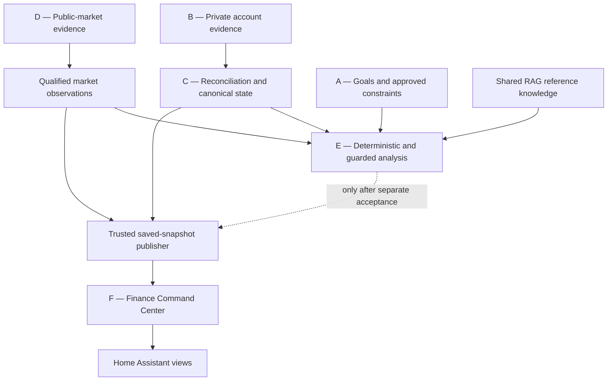

# Architecture and Central Control Plane

**Maps to parent README:** Sections 1–4
**Evidence basis:** JARVIS Finance architecture documentation through October 29–30, 2026. This page is a design and evidence summary, not a live host inspection.

## Purpose

JARVIS Finance is a financial decision-support domain inside the existing JARVIS platform. It is not a second scheduler, a replacement ledger, a bank, a brokerage, or an autonomous trading system.

The design reuses shared JARVIS capabilities wherever they are available and verified:

- Job registry and scheduler
- Routing and capability selection
- Central policy checks
- Confidence, uncertainty, and escalation handling
- Model capability resolution
- Shared logging and operational controls

**Important:** These are the intended shared control-plane responsibilities. Each Finance integration must still prove its actual registry, router, and policy bindings before it can claim production acceptance.

## Workstream map

| Workstream | Responsibility | Main folder |
|---|---|---|
| A | Strategy, goals, and constraints | `../05-A-Strategy-and-Policy/` |
| B | Private account and debt evidence collection | `../02-B-Account-Collectors/` |
| C | Normalization, reconciliation, and canonical state | `../04-C-Consolidation/` |
| D | Public-market and reference-data collection | `../03-D-Market-Watch/` |
| E | Deterministic calculations and guarded AI analysis | `../07-E-Finance-Intelligence/` |
| F | Saved-snapshot dashboard and Home Assistant views | `../08-F-Command-Center/` |
| Shared | Reference knowledge, operations, governance, and evidence | Folders `06`, `09`, `10`, and `11` |

## End-to-end flow

## Non-negotiable boundaries

1. B and D collect different classes of evidence. Public market observations are not private holdings or bank balances.
2. C reconciles private financial facts; it does not create source facts that were never collected.
3. A supplies goals and policy, not current account balances or APRs.
4. RAG supplies cited explanatory references, not automatic authority.
5. E may produce bounded analysis only after deterministic and policy gates pass.
6. F renders saved, accepted data. Page refresh is not a collection or reasoning trigger.
7. Financial execution remains disabled: no trades, transfers, payments, borrowing, or account changes.

## Current integration posture

The architecture is documented, but end-to-end production acceptance has not been established. The principal dependency is proving fresh B/D inputs, accepted C reconciliation, policy-bound E behavior, and a truthful F snapshot in one traceable flow.

See the [parent architecture](../README.md#3-end-to-end-architecture) and [central control-plane section](../README.md#4-central-jarvis-control-plane).
