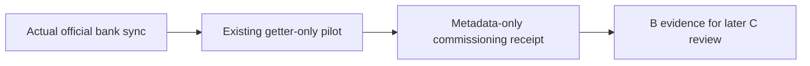

# Actual / Simply Budget — Daily Collection

**Evidence basis:** JARVIS Finance Actual Daily Commissioning Kit v1, October 30, 2026.

## Intended sequence

The commissioning kit adds an official Actual CLI bank-sync step ahead of the existing getter-only extraction pilot:

The bank-sync stage is an intentional write to the Actual ledger because it imports legitimate bank transactions. The subsequent extraction pilot remains getter-only. This is not a general permission for JARVIS to modify accounts or perform financial actions.

## Evidence at package creation

- The existing pilot authenticated and extracted 10 accounts and 315 transactions twice.
- The latest known transaction in that evidence was dated October 22, 2026.
- The pilot reported zero duplicate transaction IDs and 305 uncategorized transactions.
- The source freshness field was `NOT_VERIFIED`; those snapshots must not be represented as current bank state.
- A saved Actual payroll classification rule for N Consulting LLC existed; its next imported results still needed verification.

## Commissioning package behavior

- Uses an isolated official Actual CLI stage.
- Runs bank sync before the existing getter-only extraction.
- Uses a lock to prevent overlapping runs.
- Stores credentials locally in private, permission-restricted files.
- Stops on an ambiguous bank-sync response. Do not blindly retry: a failed full-account sync may have imported some transactions already.
- Writes metadata-only receipts and private logs.
- Does not publish a production C snapshot or dashboard data.

## Schedule status

The package defines a daily **06:40 America/Chicago** systemd timer. The installer creates it disabled by default; enabling it is a separate operator action after a successful supervised run. The package and schedule definition alone do not prove that the timer was installed, enabled, or successful unattended.

## Acceptance required

- [ ] Confirm the official bank-sync result and inspect any partial-import condition.
- [ ] Confirm the getter extraction is authenticated and has zero duplicate transaction IDs.
- [ ] Verify Regions and SoFi account coverage and upstream posting dates.
- [ ] Verify payroll classification behavior using actual imported receipts.
- [ ] Confirm owned-account transfers are not counted as income.
- [ ] Verify the timer state and a real unattended receipt before claiming daily collection.

**Privacy:** Never publish Actual sync IDs, passwords, account identifiers, raw transaction exports, or private run logs.
