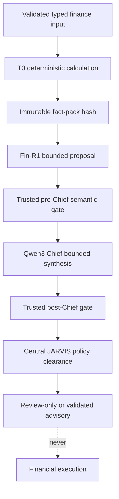

# E — Finance Intelligence, Deterministic Decisions, and Chief

**Maps to parent README:** Sections 10–11

## Purpose

E is an assurance pipeline that turns validated financial inputs into deterministic calculations and, only after separate gates, bounded model-assisted explanations. It is not a free-form model prompt connected directly to the dashboard.

## Decision sequence

## Design basis and current status

- Finance Decision Contract `v1.0.0-rc.1` received design-only approval for isolated implementation and testing.
- Money is represented as exact integer cents.
- Rates are typed values with explicit units such as APR, APY, or YTM.
- Evidence carries basis, state, and citations; unsupported values remain unknown rather than invented.
- The approved technical defaults include 24-hour ceilings for spendable cash and quoted rates, and debt tie-breaking by higher APR then stable debt ID.
- Targeted synthetic experiments passed some gates, but later adversarial work exposed semantic mismatches. The general runtime has not earned production acceptance.

## Required gates

- General deterministic engine independent of fixture IDs
- Full arithmetic and semantic-negative acceptance
- Trusted central router, policy, confidence, and escalation bindings
- Validated fact-pack hash and source lineage
- Bounded RAG citations
- Separately authorized guarded Fin-R1 / Qwen3 testing
- Independent evaluation and Master end-to-end acceptance

Financial execution remains disabled.

See [decision contract](decision-contract.md), [five intelligence lanes](five-lanes.md), and the [parent E section](../README.md#10-e--finance-ai-deterministic-decision-contract-and-chief).
