# JARVIS Finance

> **A local-first financial intelligence subsystem for SKYNET / JARVIS**  
> Evidence collection · Reconciliation · Deterministic calculations · Guarded AI reasoning · Market intelligence · Home Assistant visualization
> ## JARVIS Finance Command Center

.png>)

*JARVIS Finance Command Center — Main Dashboard Overview.*

<!-- Dashboard screenshot intentionally omitted until a sanitized image is uploaded.
     When ready, add 03-RDP-VM-Infrastructure/Subsystems/Jarvis_Finance/assets/finance-command-center.png,
     then uncomment the Markdown image line below. Never publish live balances,
     personal names, account numbers, tokens, or private LAN addresses. -->

<!--  -->

<p align="center"><em>The JARVIS Finance Command Center — Finance Chief · Market Watch · Cash Flow & Debt · Strategy Lab</em></p>

---

## Table of contents

1. [Mission and design philosophy](#1-mission-and-design-philosophy)
2. [Executive status and workstreams](#2-executive-status-and-workstreams)
3. [End-to-end architecture](#3-end-to-end-architecture)
4. [Central JARVIS control plane](#4-central-jarvis-control-plane)
5. [B — Financial account collectors](#5-b--financial-account-collectors)
6. [D — Market Watch and public-data acquisition](#6-d--market-watch-and-public-data-acquisition)
7. [C — Consolidation and canonical financial state](#7-c--consolidation-and-canonical-financial-state)
8. [A — Strategy, constraints, and long-term planning](#8-a--strategy-constraints-and-long-term-planning)
9. [Reference knowledge and RAG](#9-reference-knowledge-and-rag)
10. [E — Finance AI, deterministic decision contract, and Chief](#10-e--finance-ai-deterministic-decision-contract-and-chief)
11. [Five finance intelligence lanes](#11-five-finance-intelligence-lanes)
12. [F — Finance Command Center and Home Assistant](#12-f--finance-command-center-and-home-assistant)
13. [Data contracts, provenance, and freshness](#13-data-contracts-provenance-and-freshness)
14. [Scheduling and unattended operations](#14-scheduling-and-unattended-operations)
15. [Normal processing and failure recovery](#15-normal-processing-and-failure-recovery)
16. [Privacy, integrity, and trust boundaries](#16-privacy-integrity-and-trust-boundaries)
17. [Observability and operations](#17-observability-and-operations)
18. [Implementation roadmap](#18-implementation-roadmap)
19. [End-to-end acceptance criteria](#19-end-to-end-acceptance-criteria)
20. [Repository layout and documentation maintenance](#20-repository-layout-and-documentation-maintenance)
21. [Evidence and provenance](#21-evidence-and-provenance)
22. [Glossary and project principles](#22-glossary-and-project-principles)

---

## 1. Mission and design philosophy

JARVIS Finance is a **decision-support domain inside the existing JARVIS platform**, not a replacement accounting application, bank, brokerage, trading bot, or second AI infrastructure stack.

It is intended to answer questions that individual financial tools cannot answer in isolation:

- **Financial health:** What cash has actually arrived? Which obligations are covered? Where did funds go, and how complete is the evidence?
- **Debt strategy:** Which verified liabilities need attention, how do payoff scenarios compare, and what is affordable without undermining required payments?
- **Capital allocation:** Should the next available dollar support emergency reserves, project obligations, debt, retirement, or another goal?
- **Investing:** What do actual holdings and verified market observations imply, and what deserves further research rather than an automatic trade?
- **Long-term planning:** Are housing, real-estate, savings, and investment goals consistent with verified cash flow and liquidity?
- **Accountability:** Which recommendations were made, on what evidence, for how long, and what happened afterward?

### Non-negotiable engineering principles

| Principle | Implementation implication |
|---|---|
| Reuse the central JARVIS infrastructure | One job registry, router, policy, scheduler, model capability resolver, confidence and escalation framework; Finance is a domain, not a competing control plane. |
| Reuse mature finance software | Prefer an existing ledger and established portfolio/research tools over building a second bookkeeper. |
| Deterministic facts first | Python/SQL calculate totals, time periods, interest, allocations, and proof certificates; language models do not invent arithmetic. |
| Evidence is not authority by itself | Original statements, bank postings, user policy, market filings, and educational PDFs have different, claim-specific authority. |
| Separate data layers | Raw source → immutable receipt → normalized facts → reconciled state → validated decisions → display. |
| Fail closed | Unknown, stale, incomplete, conflicted, or failed validation is **not** silently converted into a trustworthy recommendation. |
| Read-only by default | Financial AI may analyze and suggest; it cannot trade, transfer, borrow, pay, or change accounts. |
| Keep private facts private | Raw bank data, credentials, personal goals, detailed loan balances, and private run receipts stay outside GitHub. |
| Preserve earlier accepted work | No unreviewed redesign of the dashboard, central control plane, RAG registry, or existing Gusto Stage 1 agent. |

**V1 safety boundary:** `READ → CALCULATE → ANALYZE → VALIDATE → RECOMMEND → STORE / DISPLAY` — **not** `READ → BUY / SELL / TRANSFER / PAY`.

---

## 2. Executive status and workstreams

The project is organized into **A–F**, with a shared Finance RAG knowledge layer. *Specialist closure* and *end-to-end operational acceptance* are intentionally different concepts.

| Workstream | Responsibility | Verified status as of Nov 17, 2026 | Next acceptance dependency |
|---|---|---|---|
| **A: Financial Strategy & Intent** | User goals, policy, debt priorities, reserves, real estate | Owner intent registry + bill schedule in use by the bills guard; catch-up plans recorded with owner-stated dates | Bind policy to the typed decision contract (still design-only) |
| **B: Account Collectors** | Bank inflows, Actual Budget ledger, debt, payroll evidence | **OPERATIONAL.** SimpleFIN Bridge → Actual imports twice daily with receipts; automated bank re-auth job; curated categorization rules (v2.1) | Add the remaining accounts (installment loan, HSA after transfer, peer-payment app); student-loan monthly refresh |
| **C: Consolidation** | Canonical state, transfer matching, reconciled snapshots | **OPERATIONAL (ledger-based).** Own-account moves linked as real transfers twice daily; duplicate/stale cleanup; loans off-budget; bills verified from the ledger 16/18; integrity scan twice daily | Exempt debt/transfer group from the wrong-way category check; full typed snapshot contract |
| **D: Market Watch** | Public filings, rates, indices, ETF data, public portfolios | **OPERATIONAL.** ARKK / Treasury / FDIC / FRED twice daily, M1 public pies twice daily, Form 4 twice daily, 13F new-filing watcher daily (installed Nov 17) | Automate the 13F quarter-over-quarter compare; list all 13F form types (amendment check) |
| **E: Finance Intelligence** | Deterministic engine, Fin-R1, Qwen3, trusted validation | **WEEKLY HARNESS OPERATIONAL (advisory).** T0 math → Phi-4 → Fin-R1 → Qwen3 Chief with fact-lock gate, Sundays; first full run Nov 2 answered all 4 questions. Typed decision contract still design-only | General deterministic engine (G4), central policy binding (G6) |
| **F: Dashboard & HA** | Finance Command Center and Home Assistant iframe views | **OPERATIONAL.** Live snapshot published twice daily; Data Freshness tiles; alerts panel + guard-checked Upcoming Bills | Owner notifications (channel being chosen: private email from SKYNET or HA phone push) |
| **Finance RAG V0.8E** | Source-of-truth reference PDFs and search | **10-document indexing and retrieval accepted**; Phi-4 reads it in the weekly harness | Page-cited retrieval acceptance in Chief answers |

### What works today, verified on SKYNET

- **Unattended daily pipeline** (America/Chicago): bank re-auth → Actual import → auto-link transfers → market refresh → bills guard → alerts feed → snapshot publish → doctor health check. See [section 14](#14-scheduling-and-unattended-operations) for the installed timers.
- **Ledger accuracy fixes:** account starting balances excluded from spending, split paychecks grouped into one pay event, one-offs removed from everyday spending, own-account money no longer counted as income (integrity score raised from 32 to 53/56).
- **Bills guard v1.4:** on-time checks, catch-up plans, Pay-in-4 tracking, 7-day funds check, returned-payment detection, and **two-sided payment proof**. A payment counts as confirmed when both the bank debit and the lender-side credit are seen. A bank debit that pairs with a lender credit is claimed by that bill, so payments to one creditor with several accounts are not double-counted. 17 self-tests.
- **Alerts feed** `jarvis.finance.alerts.v1` (hourly): urgent / reminder items, bill states, plans, funds, bank connections, data freshness, snooze; served read-only to the dashboard.
- **Data freshness:** per-source limits set by publication cycle (FDIC monthly, 13F quarterly, Form 4 by last check). All tiles CURRENT at the Nov 13 check.
- **Market Watch:** 13F watcher found the Q3 2026 filings from two of three tracked managers on Nov 13 and Nov 16. The third manager's latest original 13F-HR is still Q1 and is flagged for an amendment/form-type check.
- **Weekly AI questions** on Sundays and an on-demand Open WebUI finance model; answers carry a *from your data* or *hypothetical* label.
- Gusto Stage 1 remains a separate time-clock / dispatcher service.

### What is still not proven

- The **typed decision contract** (G4) and **central JARVIS policy binding** (G6) are design-only; the weekly harness uses its own fact-lock gate instead.
- **Coverage gaps:** an installment loan, the HSA (transfer in progress) and a peer-payment app are not yet in the ledger; the mortgage servicer's lender-side feed depends on a weekly-limited re-authentication.
- **Owner notifications:** the alerts feed exists, but nothing delivers it off the dashboard yet. Home Assistant discovery (Nov 17) confirmed packages are enabled and documented the HomeKit Bridge pattern; the owner prefers a private channel over shared Apple Home notifications.
- **Formal recovery tests (G8):** last-good is kept on failure, but the full adverse-case suite has not been run.

### Sources of truth and local storage (harness implementation)

Every number the harness reports traces back to one of six source types, all stored on SKYNET. Models never act as a source of truth. They only quote values that trusted code has already computed from these sources.

| # | Source of truth | What it is authoritative for | Local storage (placeholders) | Feeds |
|---|---|---|---|---|
| 1 | **Actual Budget ledger** (bank sync, read-only) | Account balances, transactions, transfers, categories | Actual server container; data under `FINANCE_PRIVATE/.private/actual-data` | B → C |
| 2 | **Owner intent registry** | Goals, bill schedules and match rules, debt terms, priorities, reserve policy, change log | `FINANCE_PRIVATE/finance_intent_v1/intent_registry.json` | A → C, E, F |
| 3 | **Captured statements** | Balances and terms not in the ledger (e.g., student-loan page captures, loan statements) with source receipts | `FINANCE_PRIVATE/` capture folders, receipts carry SHA-256 and effective date | B → C |
| 4 | **Public market data** | Treasury yields, FDIC rates, ETF holdings, 13F/Form 4 filings, public pie weights, index history | `FINANCE_PRIVATE/dashboard/market_watch_view.json`, `FINANCE_PRIVATE/finance_e_v1/market_history/` (raw CSVs + stats) | D → E, F |
| 5 | **Finance RAG reference corpus** | Principles and definitions only (HSA, fixed income, index funds, annual reports), never facts about the owner | Local RAG store: 10 registered PDFs, 279 page-documents | E (Phi-4) |
| 6 | **Harness configuration** | Stated planning assumptions: payment reserve, buffer, savings options, planned payments, side-income target, stock-scenario source | `FINANCE_PRIVATE/finance_e_v1/weekly_questions_config.json` | E |

**Derived (computed, not sources):** consolidated snapshot and bill status (`FINANCE_PRIVATE/recurring_v1/`), ledger facts (`FINANCE_PRIVATE/finance_e_v1/qa/ledger_facts.json`), deterministic T0 math (exact cents), and the published dashboard files (`FINANCE_PRIVATE/dashboard/`: `weekly_static.json`, `money_plan.json`, `insights.json`).

**Precedence when sources disagree:** ledger (1) > captured statement (3) > owner-stated (2, 6). Disagreements are shown as warnings, never silently resolved. Unknown values stay unknown and are never treated as zero.

**How the harness uses them**

- **Read-only.** Collectors and the harness read the ledger. Nothing writes back to banks or Actual transactions.
- **Deterministic first.** T0 code computes every figure before any model runs. Each weekly question then goes through Phi-4 (reads the RAG corpus for principles), Fin-R1 (reviews the computed figures), and Qwen3 Chief (writes the answer). A fact-lock gate removes any number that does not appear in the computed evidence.
- **All local.** Models run on SKYNET through Ollama. Only public market data is fetched from the internet, and private data never leaves SKYNET.
- **Labelled by basis.** Each answer section is marked *from your data* or *hypothetical* (scenarios, market history, public-subject portfolios).
- **Stored safely.** Writes are atomic with owner-only permissions (`0600`). Installers keep timestamped backups with a rollback path and print no amounts.

Code lives under `FINANCE_ROOT` (collectors, publisher, harness, dashboard). Private data lives under `FINANCE_PRIVATE`. Only `FINANCE_ROOT` content that passes the section 16 rules may be published.


---

## 3. End-to-end architecture

The end state is a **shared financial evidence pipeline** with independent personal-finance and market-data branches. Market evidence is not automatically a personal holding or cash balance.

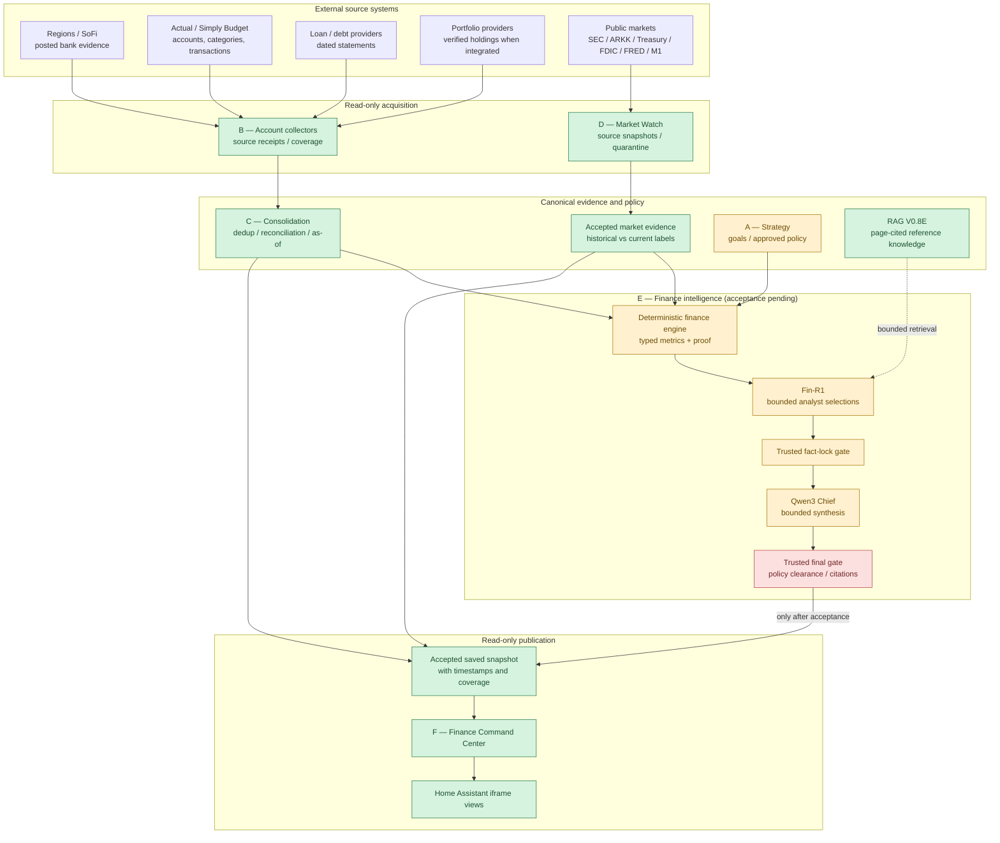

**Diagram key (Nov 17, 2026):** green = operating unattended with verified receipts; amber = operating in the weekly advisory harness, formal contract acceptance pending; red = central policy clearance not established. These colors represent documented status, not live service health.

### Architectural boundaries

1. **B** ingests private account evidence. **D** ingests public-market evidence. Both produce provenance-aware observations.
2. **C** deduplicates and reconciles private financial facts. Market events retain their separate identity, date basis, and publication restrictions.
3. **A** contributes approved goals and policy, never fictitious balances.
4. **RAG** contributes reference explanations and citations, not current account data or fresh quotes.
5. **E** reasons only over facts and bounded retrieved passages accepted by trusted adapters. Models cannot grant themselves policy approval.
6. **F** reads previously saved validated outputs; it does not run acquisition or inference on an HTTP page request.

---

## 4. Central JARVIS control plane

Finance should register domain work in the **existing** control and orchestration framework rather than adding Finance-specific replacements.

### Existing architecture (target integration path)

```mermaid
flowchart LR
    TRIG["User / event / timer"] --> JOB["jarvis-job<br/>job registry"]
    JOB --> ROUTE["jarvis-route<br/>router"]
    ROUTE --> POLICY["jarvis-policy<br/>policy gate"]
    POLICY --> SCHED["jarvis-schedule<br/>scheduler"]
    SCHED --> DISPATCH["jarvis-dispatch<br/>dispatcher"]
    DISPATCH --> CAP["jarvis-model<br/>capability resolver"]
    CAP --> WORK["Finance domain task"]
    WORK --> RESULT["Immutable result<br/>and evidence receipt"]
    RESULT --> CONF["jarvis-confidence<br/>assessment"]
    CONF --> ESC["jarvis-escalation<br/>escalation / review"]
```

Other existing interfaces include `jarvis-service`, `jarvis-confidence-observe`, `jarvis-confidence-source`, and `jarvis-confidence-scan`. Their **actual production names, versions, policy bindings, and receipt semantics must be verified on SKYNET** before a Finance Chief report can be centrally cleared. Historical CLI names are discovery hints, not approval receipts.

### AI capabilities, not hard-coded model dependencies

| Capability | Model or subsystem mentioned in project design | Intended role | Authority |
|---|---|---|---|
| `finance-analysis` | Fin-R1 7B | Analyze verified financial facts and propose bounded decisions | Advisory proposals only |
| `chief` | Qwen3-30B-A3B-Instruct-2507 | Cross-domain prioritization and explanations | Advisory proposals only |
| `coding-local` | DeepSeek Coder | Build scripts, tests, validators, connectors | Development capability; not financial authority |
| Embedding / retrieval | EmbeddingGemma + central JARVIS RAG | Find passages and prior evidence | Retrieved text remains lower-trust data |
| T0 trusted calculators | Python / SQL / validated deterministic rules | Totals, debt math, unit conversion, schedule and threshold checks | Trusted only after implementation and test acceptance |

**No second Finance model router, policy system, or confidence evaluator should be created.** The Finance-specific decision contract may enforce additional domain invariants; it cannot replace central JARVIS approval.

---

## 5. B — Financial account collectors

**Role:** Observe and normalize *actual, dated financial records* while preserving account provenance, source freshness, and collection uncertainty. Collectors are not debt advisers or transaction executors.

### Source inventory and current evidence

| Source / lane | Intended evidence | Most recent verified result (Nov 2026) | Remaining qualification |
|---|---|---|---|
| **Regions** | Posted deposits, transactions, balances | Imported twice daily via SimpleFIN; savings reconciles to the bank to the cent | Daily re-auth prompts; automated re-auth uses stored keywords (encrypted on SKYNET) |
| **SoFi** | Checking/savings, split payroll, transfers | Imported twice daily; split paychecks grouped into one pay event | None blocking |
| **Actual Budget** | Ledger, categories, transfers | **OPERATIONAL:** twice-daily import with receipts; rules v2.1 categorize on import; transfers linked automatically | Rename/off-budget housekeeping for new investment accounts |
| **Card / auto / mortgage lenders** | Lender-side payment credits | Card and auto loan confirmed from both ends; mortgage confirmed from the bank side | Mortgage servicer feed needs re-auth (weekly limit) |
| **Investment / HSA** | Holdings, contributions | Brokerage + rollover IRA linked off-budget; HSA transfer in progress | Add HSA when the provider exposes it |
| **Nelnet** | Student-loan balances | Repayment expected after grace period; tracked as a planned obligation | Monthly authenticated collector not demonstrated |
| **Gusto Stage 1** | Time-clock / schedule dispatcher | Running; separate from finance | Preserve unchanged; not payroll acquisition |
| **Gusto Stage 2** | Optional paystub PDFs | Deferred | Not a blocker; payroll is evidenced by bank deposits |
| **Peer-payment app** | Transfers and app payouts | Connection removed after a broken link | Re-add; monthly CSV import as a fallback |
| **PayPal** | Bill payments routed through PayPal | Not linkable via SimpleFIN | Handled by rules on the funding accounts |
| **Rocket Money** | Older aggregator proposal | Removed from Collector B | **Out of scope** |

**Ledger decision:** The most recent Collector B closeout identifies **Actual/Simply Budget as the preferred aggregation / ledger path**, subject to verified data freshness. The historical architecture notes also contain a *Firefly III-first proposal*; that older proposal is **not evidence of an accepted Firefly ledger migration**. Avoid two conflicting authoritative ledgers.

### Income and payroll reconciliation

Bank postings determine **cash received**, while an authentic payroll record—if available—determines **gross earnings** and documented deductions. Splits across accounts must be joined to **one payroll event**, not counted independently as additional salaries.

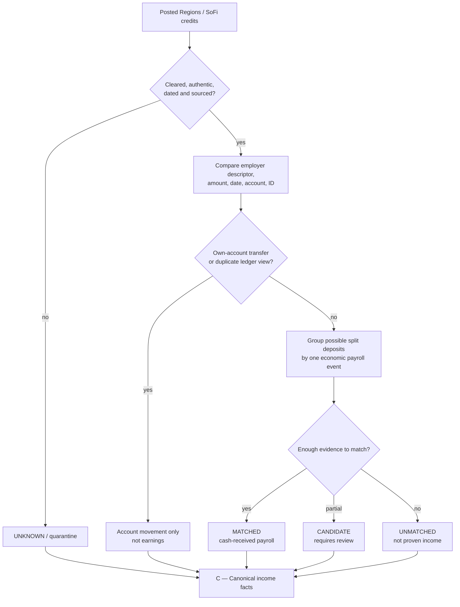

**Required invariants**

- Preserve original transaction IDs, posting dates, source account IDs, and observed timestamps.
- Reconcile gross, net, and destination amounts separately; **never** treat the first destination deposit as total take-home pay.
- Exclude bank-to-bank transfers, refunds, duplicates, and unconfirmed credits from earned income.
- Emit `MATCHED`, `CANDIDATE`, or `UNMATCHED` with supporting evidence. A previously discussed **95% matching target is aspirational**, not a measured confidence result.
- If no authentic gross-pay source exists, report **`gross_pay_status = UNKNOWN`**. Estimates must be explicitly hypothetical.
- Treat incomplete ledger coverage as **unknown scope**, not proof that other accounts or bills do not exist.
- Do not restart Gusto Stage 2 Chromium/CDP debugging as a mandatory prerequisite for the bank-based V1 pipeline.

**Collector B status:** specialist chat closed with exceptions (Oct 29). The freshness obligations it deferred were met by the Nov 3 milestone: twice-daily SimpleFIN → Actual import with `RECEIPT_STATUS=PASS`. The remaining items are account coverage, listed above.

---

## 6. D — Market Watch and public-data acquisition

**Role:** Collect original public-market observations and preserve source-specific meanings. D is an evidence producer, **not** a trading engine, holdings importer, Finance Chief opinion, or dashboard publisher.

### Verified evidence through November 17, 2026

| Feed | Installed schedule | What it represents | Latest verified result / remaining gate |
|---|---|---|---|
| **ARKK official holdings** | 07:00 / 19:00 daily | ETF holdings, **not** any private person's positions | CURRENT (within the 5-day limit) |
| **U.S. Treasury par-yield curve** | 07:00 / 19:00 daily | Published reference par yields | CURRENT |
| **FDIC national CD reference** | Inside the refresh job | National reference averages, **not** offers | CURRENT within its 40-day monthly limit |
| **FRED S&P 500 / Nasdaq-100** | 07:00 / 19:00 daily + before each weekly run | Price indices; no implied dividends / total return | CURRENT (soft-fail keeps last good) |
| **SEC Form 13F** | New-filing watcher daily 06:30 (Nov 17) | Delayed quarterly institutional holdings | New Q3 filings detected; **compare step not yet automated**; one manager flagged for a form-type/amendment check |
| **M1 public pies** | 06:50 / 18:50 daily | Public allocation targets, not client holdings | CURRENT |
| **SEC Form 4** | 06:55 / 18:55 daily | Insider filing observations | **Fixed Nov 13** (run-folder bug); FORM4=PASS |

### Why 13F treatment is intentionally conservative

- Reported rows with repeated nominal security identity are **not summed or silently merged**.
- XML manager, discretion, and voting fields may distinguish rows. Partial or ambiguous comparisons are **quarantined**.
- Original/amended `13F-HR/A` quarters need explicit amendment context; a missing comparison is not a signal.
- A previous isolated v1.1 diagnostic evaluated **22 filings** and generated **1,376 candidate event records with 0 publishable events**. Candidates do **not** become buy/sell alerts because a test returned zero exit.
- Price-level returns must not be represented as dividends-inclusive total returns.

### Market Watch source processing

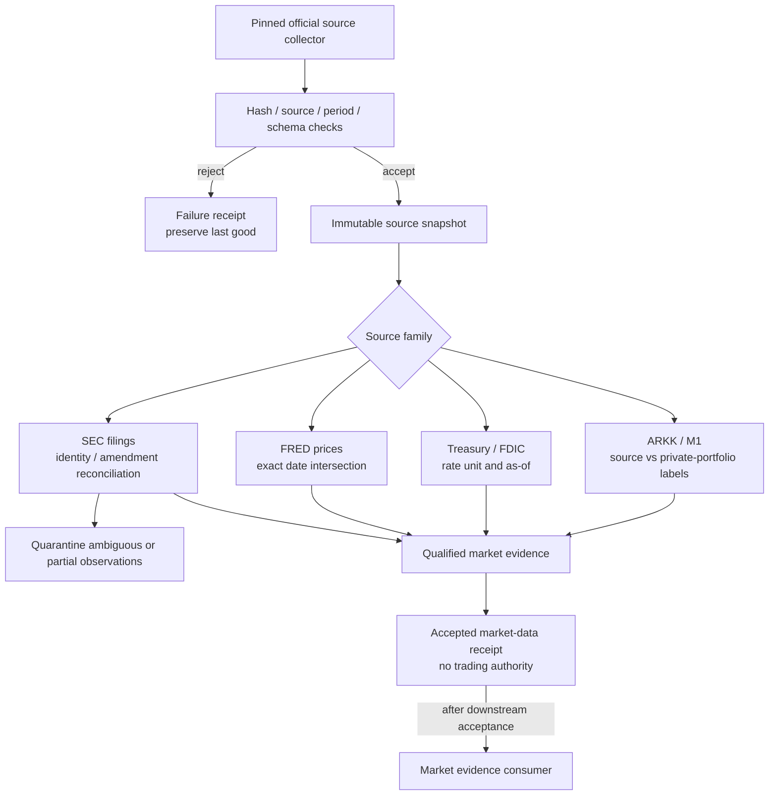

### Market Watch deployment state

The Oct 29 handoff noted the v1.8.1 timers were prepared but not shown as installed. **As of Nov 13, `jarvis-marketd-refresh` runs unattended twice daily** with soft-fail behavior that keeps the last good snapshot. The original Mon/Wed/Fri proposal was replaced by the twice-daily schedule in [section 14](#14-scheduling-and-unattended-operations).

Still open: automate the 13F quarter-over-quarter compare, list all 13F form types (amendments), and reconcile the collection-only policy exception with the central JARVIS policy record.

---

## 7. C — Consolidation and canonical financial state

**C is the primary remaining integration dependency.** It must translate accepted collector output into consistent, traceable facts without erasing uncertainty or confusing account cash with portfolio, market, or hypothetical values.

### Target responsibilities

1. Load accepted source records and integrity receipts; never interpret an absent source as a zero balance.
2. Normalize money, account identity, loan obligations, transaction units, time zones, and reporting periods.
3. Deduplicate economic events across bank views and aggregators.
4. Match split deposits and two-sided own-account transfers; preserve unmatched single legs for review.
5. Reconcile statement balances against available/cleared amounts according to the fact being asserted.
6. Separate **cash received**, **gross compensation**, **available liquidity**, **earmarks**, **debt**, **private holdings**, and **public market observations**.
7. Preserve data-as-of, observed-at, source hash, coverage, reconciliation status, and missing parents.
8. Produce a validated, read-only financial state for calculations and a separate saved dashboard-view snapshot.

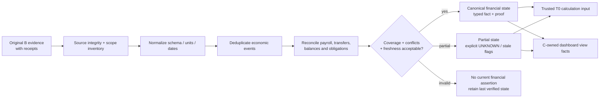

### Required accounting rules

| Category | Invariant |
|---|---|
| Transfers | Both sides refer to one economic event; household income and net worth do **not** increase. |
| Payroll | One pay event may have multiple destination credits; gross payroll is not inferred from net bank receipts. |
| Credit cards | Avoid counting both card purchase and later card payment as separate household expense on a cash-flow basis. |
| Debt | Principal, interest, posted charges, and future scheduled obligations remain separate. |
| Savings buckets | Earmarking cash is an allocation movement, not new income; reserve release at payment must avoid double subtraction. |
| Investments | Contributions and principal redemptions are not investment earnings by definition. |
| Public market data | ARKK, 13F, M1 public pies, rate references, and benchmark indices are not private asset positions. |
| Coverage | A valid extract from one account cannot prove all household accounts, payroll destinations, or expenses have been collected. |
| Data timing | Source effective/as-of time and collection time are separate; re-ingesting an old statement does not refresh its balance. |
| Unknowns | Missing balances, APRs, legal terms, or fund availability remain UNKNOWN rather than fabricated constants. |

### Canonical evidence model (illustrative, not an implemented wire schema)

The approved strict schema lives in the Decision Contract package. This diagram is **conceptual**, not a substitute schema for that package.

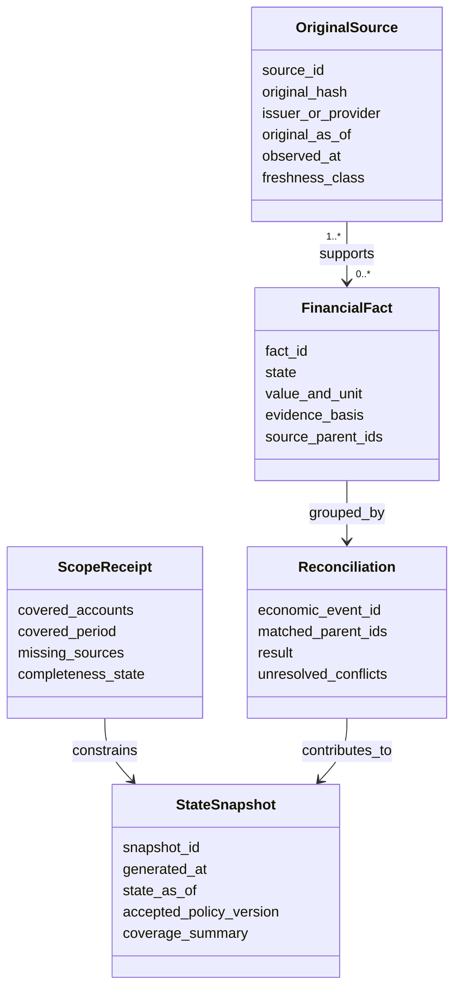

### Acceptance proof required from C

A reproducible **same-input → same-result** run with complete provenance, cross-account reconciliation receipts, explicit partial-coverage handling, and a saved snapshot that the dashboard can consume **without re-running collectors or models**.

---

## 8. A — Strategy, constraints, and long-term planning

A stores the *reason for decisions*: financial goals, priorities, risk boundaries, and the constraints that should govern suggestions. It is **not** a substitute for actual account evidence.

### Strategy and policy topics

- Required current bills and debt minimums before optional allocations.
- Emergency reserve and project/operating earmarks as **separate accounting buckets**.
- Expensive-debt identification and approved prioritization, conditioned on verified rates and balances.
- Financial health under baseline income and separately modeled variable-income scenarios.
- Future allocation to reserves, project funds, debt, retirement, HSA, dividends, and longer-term assets.
- Investment recommendations subordinated to liquidity and debt commitments.
- Home preservation, real-estate cash-flow readiness, and loan-financing constraints.
- No automatic modification of priorities, payment schedules, project-purpose labels, or financial accounts.

**Approved contract technical defaults (design approval only):** maximum **24-hour age** for spendable-cash evidence used in affected decisions; maximum **24-hour age** for quoted-rate evidence; when otherwise qualifying debts have equal balances, tie-break **higher APR**, then **stable debt ID**. These do not imply that all source feeds refresh every 24 hours or that a stale fact may be used for current advice.

### Real-estate strategy V1.4 — policy-level view

The private strategy outlines **four roles**: preserve the family home, acquire a first income property, consider a second only after proven performance, and eventually establish a final long-term residence. Planning milestones include a **first-rental target around 2030** and a **family-home payoff target around 2031**, subject to verified finances. Exact property balances, family terms, contribution amounts, and acquisition budgets belong in the **private policy profile**, not this public README.

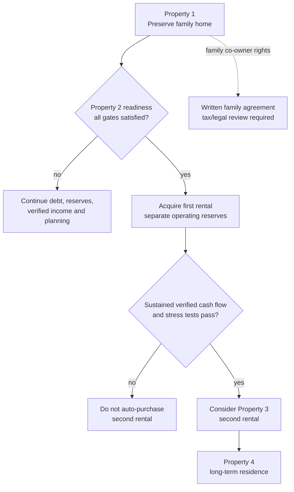

**Property purchase gates:** verified sustainable income, debt reduction progress, preserved existing mortgage plan, ongoing baseline investing where affordable, separately funded down payment/closing/repairs/emergency reserves, realistic positive property cash flow, stress tests for vacancy/repairs/income disruption, and actual lender eligibility.

**Co-owner contributions are not automatically third-party rental income.** Track them as a distinct family-property contribution until a qualified legal/tax treatment has been established. A financial model cannot determine that status from a family arrangement alone.

---

## 9. Reference knowledge and RAG

**V0.8E document registration, indexing and search retrieval: ACCEPTED.** The corpus supports explanation, evidence discovery, historical filings and context. It does **not** establish live balances, current rates, eligibility, or automatic Chief retrieval.

### Accepted corpus

| Source ID | Document/context | Physical / indexed pages | Authority boundary |
|---|---|---:|---|
| `sec_form4` | SEC Form 4 reporting interpretation | 12 / 12 | Filing mechanics, not live private holdings |
| `sec_form13f` | SEC Form 13F reporting interpretation | 14 / 14 | Historical lag, omissions, disclosures |
| `berkshire_2025_annual` | Berkshire Hathaway annual report | 154 / 151 | Period-specific historical issuer facts |
| `pershing_2026_interim` | Pershing Square interim report | 59 / 59 | Published historical fund context |
| `arkk_2026_annual` | ARKK annual report | 3 / 3 | Fund reporting, not current private positions |
| `arkk_2025_prospectus` | ARKK prospectus | 13 / 13 | Product structure, fees, risks as of source period |
| `fidelity_dividends_2026` | Fidelity dividend / distribution reference | 14 / 13 | Educational/disclosure context |
| `jarvis_bonds_fixed_income` | Bonds and fixed income | 4 / 4 | JARVIS-authored education only |
| `jarvis_cds_hsa_investing` | CDs and HSA investing | 4 / 4 | JARVIS-authored education only |
| `jarvis_blended_hsa_strategies` | Blended strategies and HSA playbook | 6 / 6 | JARVIS-authored hypothetical examples only |
| **Total** | **10 PDFs; 46 chunks newly indexed** | **283 / 279** | **Retrieval accepted; model consumption not yet accepted** |

**Registry:** `finance/source_of_truth/market_watch/manifest_v08e.json` (10-document extension); original seven-document `manifest.json` is preserved unchanged. **Central search interface:** `/usr/local/bin/jarvis-search`. **Central vector DB:** `/var/lib/jarvis/vector/jarvis_vectors.db`. These paths are architectural references, not GitHub-hosted database content.

### Required RAG consumption path

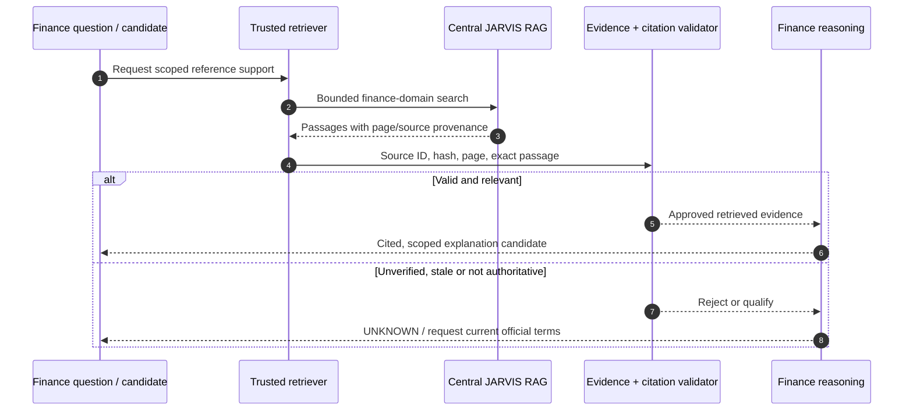

Official current rules and actual custodian/provider documents outrank JARVIS-authored examples. Page citations must resolve to exact bytes and entail the claims they support. **Indexed ≠ cited ≠ correct ≠ production approved.**

---

## 10. E — Finance AI, deterministic decision contract, and Chief

**E is an assurance pipeline**, not a free-form prompt chained directly to a dashboard. Its general decision runtime remains unaccepted even though the contract design was approved for isolated testing.

### Approved design basis

- **Candidate:** authoritative typed financial-decision contract `v1.0.0-rc.1`.
- **User-approved scope:** isolated implementation and testing only.
- **Candidate archive SHA-256:** `ae45300455c23cd4bc7832598a366900740a251acc2d6e92a025e5892f3c41d3`.
- **Approved technical defaults:** 24-hour spendable cash, 24-hour quoted-rate ceilings, debt tie-break higher APR then stable ID.
- **Version rule:** preserve candidate bytes and separate approval receipt; approval does not rewrite historical draft metadata.
- **Financial execution authority:** always **false**.

### Typed contract components

| Document type | Role |
|---|---|
| `FINANCE_INPUT` | Trusted adapter's validated facts and policy references |
| `MODEL_PROPOSAL` | Bounded Fin-R1 or Qwen3 candidate/template/proof selections |
| `FINANCE_OUTPUT` | Trusted deterministic gate's validated metrics, decisions and proof certificates |
| `USER_PROFILE` | Versioned intentions and separately labeled user-reported facts |

Money is represented as **exact integer cents**; financial rates as typed decimal strings with explicit units (APR, APY, YTM, etc.); evidence uses state/basis/citations; unsupported numbers remain null with the correct typed reason. Date/cadence logic distinguishes weekly, biweekly, semimonthly, monthly, irregular and unknown schedules.

### Required reasoning sequence

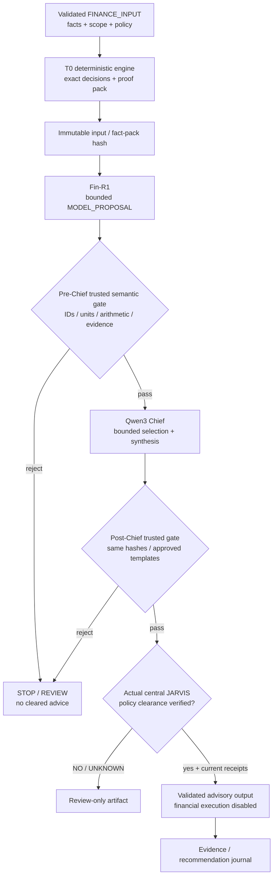

**The two AI models should select from validated decisions; they must not manufacture source facts, monetary amounts, rates, approval receipts, eligibility claims, or arbitrary executable instructions.** A syntactically valid JSON proposal can still be semantically wrong.

### Evidence from previous experiments

| Validation event | Evidence and limitation |
|---|---|
| V0.9C.3 | A live synthetic failure **stopped before Chief** when Fin-R1 output contained cadence, currency, and transfer-classification defects. |
| V0.9C.4 | Synthetic fact-locked Fin-R1 → Qwen3 targeted gates passed; one analyst/Chief attempt each. Saved result remained **`REVIEW_REQUIRED`**. |
| V0.9C.4 quality | Internal heuristic **100/100** did **not** measure independent benchmark lift. Human review found misleading cash-flow explanation and a savings-cadence discrepancy requiring correction. |
| V0.9C.5 R2.1 | Independent adversarial set yielded **5/14 correct classifications**; 9 semantic mismatches remained despite later unit-test improvements. |
| R3 Stage 1 | Case-specific typed-decision/rendering protection for a pinned synthetic fixture, not a general finance engine. |
| Contract archive | **40 synthetic cases**, **15 semantic negatives**, schema and source-integrity checks in an offline specification package. Passing package consistency does not establish runtime semantic rejection. |

### E's remaining mandatory gates

1. Verify host-local source/policy/version hashes and exact dependency environment.
2. Implement a **general** deterministic engine independent of fixture case IDs.
3. Pass **100%** of required deterministic arithmetic and decisions, reject **all 15** semantic counterexamples, and pass independent boundary/adversarial tests.
4. Verify actual central router/policy/confidence/escalation bindings; no `TEST_STUB` for production clearance.
5. Prove bounded, page-cited use of V0.8E references in real Chief responses.
6. Separately authorize and perform a guarded synthetic Fin-R1 → Qwen3 run, after offline engine acceptance.
7. Compare performance with an independent same-input baseline, rather than equating prompt compliance to reasoning improvement.
8. Return a separate tested handoff for Master end-to-end acceptance. **Design approval alone does not grant production approval.**

---

## 11. Five finance intelligence lanes

These are the desired *consumer capabilities*. Their existence in this README does **not** claim all five are implemented or continuously operating.

| Lane | Core question | Deterministic inputs | Potential advisory output |
|---|---|---|---|
| **F1 — Market Intelligence** | What changed publicly? | Qualified public source events, period-consistent index/rate data | Important changes, provenance, uncertainty, expiration |
| **F2 — Debt Strategy** | What repayment action is affordable? | Verified balances, APR types, due dates, income, protected reserves | Scenario comparison, contractual-risk flags, debt priority |
| **F3 — Future Allocation** | Where should *verified available* funds go next? | Cash headroom, obligations, goals, portfolio constraints | Bounded alternatives, gaps and tradeoffs |
| **F4 — Portfolio Opportunities** | Which opportunities merit research or monitoring? | Verified private exposure + independently labeled market context | Up to four research/hold/rebalance/avoid candidates, **not orders** |
| **F5 — Financial Health** | Can the current plan actually work? | Posted income, spending, scheduled bills, debt, reserves | Cash-flow trends, forecast risks, missing-evidence flags |

### Cross-lane arbitration

A possible market opportunity can be objectively attractive yet currently **unaffordable**. Debt, reserve, and investment lanes should not issue mutually conflicting spending instructions. A future Capital Arbiter will compare **validated** priorities against policy and liquidity, then present a review-only explanation.

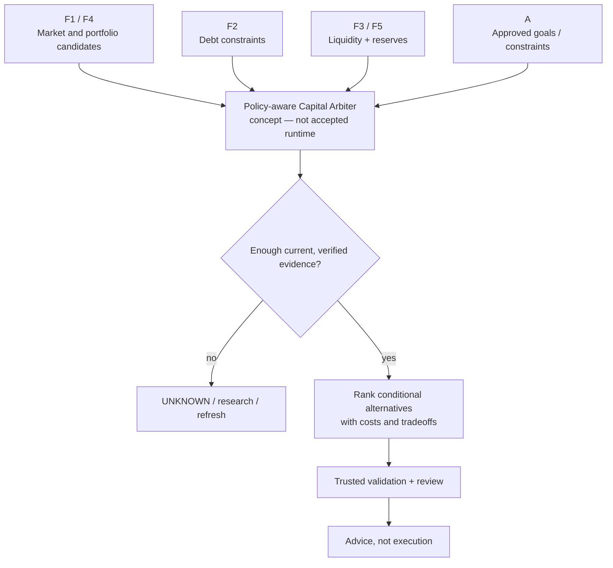

### Learning and accountability — planned

An eventual **Decision Journal** should record accepted evidence hashes, source dates, calculations, alternative options, explanation, expiration, actual user-approved action (if any), and later outcomes. A **paper portfolio** may test the quality of investment ideas without trading real assets. These are design goals, not accepted live capabilities.

---

## 12. F — Finance Command Center and Home Assistant

**F dashboard: OPERATIONAL.** A live snapshot is published twice daily; the four Home Assistant iframe views read only saved files.

### Delivered interface

| View | Presentation | Verified state (Nov 2026) |
|---|---|---|
| **Finance Chief** | Weekly report, limitations, review-only suggestions | Weekly Questions pinned; Chief brief Sundays |
| **Market Watch** | Market snapshots, filings, Data Freshness tiles | All sources mapped with per-source freshness limits |
| **Cash Flow & Debt** | Inflows, spending, reserves, debt | Monthly Money Plan; debts outside Actual labelled |
| **Command Center** | Alerts panel, Upcoming Bills (guard-checked), Goals & Constraints | Alerts patch v1.3 live: it hides dashboard elements rather than removing them, after v1.0–1.2 emptied the page |

**Deployment architecture:** `jarvis-finance-command-center.service` on SKYNET-CORE serves the dashboard on port 8792 on the local network. Home Assistant shows it as iframe views (`type: panel`). A read-only aux endpoint serves the alerts feed from a whitelist. **JARVIS never changes Home Assistant configuration;** any HA additions are handed to the owner as YAML to review and install.

> [!NOTE]
> A sanitized dashboard screenshot can be added at `assets/finance-command-center.png` next to this README and enabled by uncommenting the image link near the top. Do not publish internal hostnames, IPs, personal balances or account identities.

### Publication contract

- **Schema:** `jarvis.finance.dashboard_snapshot.v0_1`.
- **Default private saved file:** `~/.local/share/jarvis-finance-private/dashboard/latest.json`.
- **Reader:** local Finance dashboard only.
- **Producer:** an accepted, trusted snapshot publishing step that consumes validated C/D/E outputs.
- **Required metadata:** original as-of dates, observation times, scope coverage, reconciliation status, source lineage, last-good vs latest-attempt state, staleness and advisory clearance.
- **Forbidden on page refresh:** new bank pulls, live market collection, model inference, financial transactions, scheduler changes, or source edits.

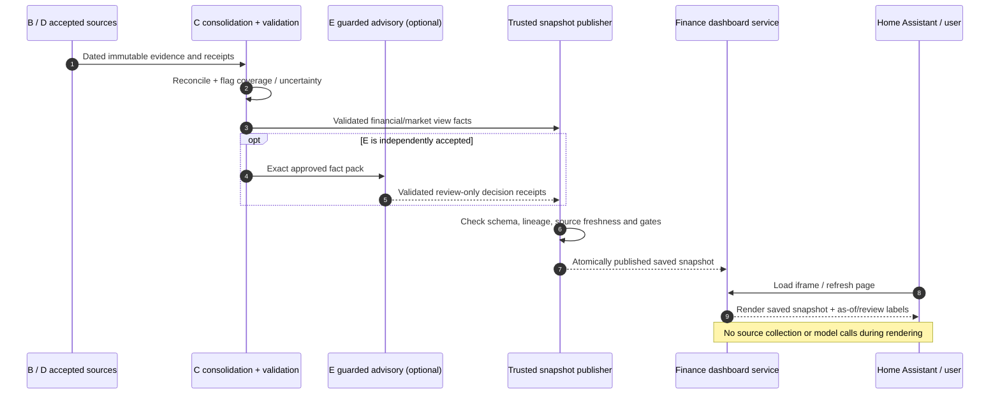

### Dashboard acceptance boundary

A green web service is **not** proof that the displayed amounts are verified, recent, or complete. The legacy May CSV is expressly unsuitable as a current snapshot. Until a validated file is published, empty financial panels and a waiting Chief report are correct behavior.

---

## 13. Data contracts, provenance, and freshness

### Evidence hierarchy is claim-specific

For a particular claim, compare source subject/account, fact type, unit, period, jurisdiction, integrity and relationship to original records **before** claiming one document outranks another. Examples:

- Authenticated issuer statement → authoritative for its own statement-period balance.
- Posted bank record → authoritative for a specified settled receipt/availability claim.
- Payroll source record → authoritative for earnings/deductions; bank posting → authoritative for actual cash receipt.
- Accepted user policy → authoritative for preferences and goals, **not** current cash or APR.
- Deterministic computed fact → inherits the authority and uncertainty of its parents.
- Research PDF → explanatory context only, unless it is itself the relevant original source.

### Facts need more than values

A trusted number must remain attached to a **source**, **original period**, **observation time**, **basis**, **unit**, **coverage state**, and **reconciliation state**. The consumer must know whether a value is `VERIFIED`, `USER_REPORTED`, `SCENARIO_ASSUMPTION`, or unknown/conflicted.

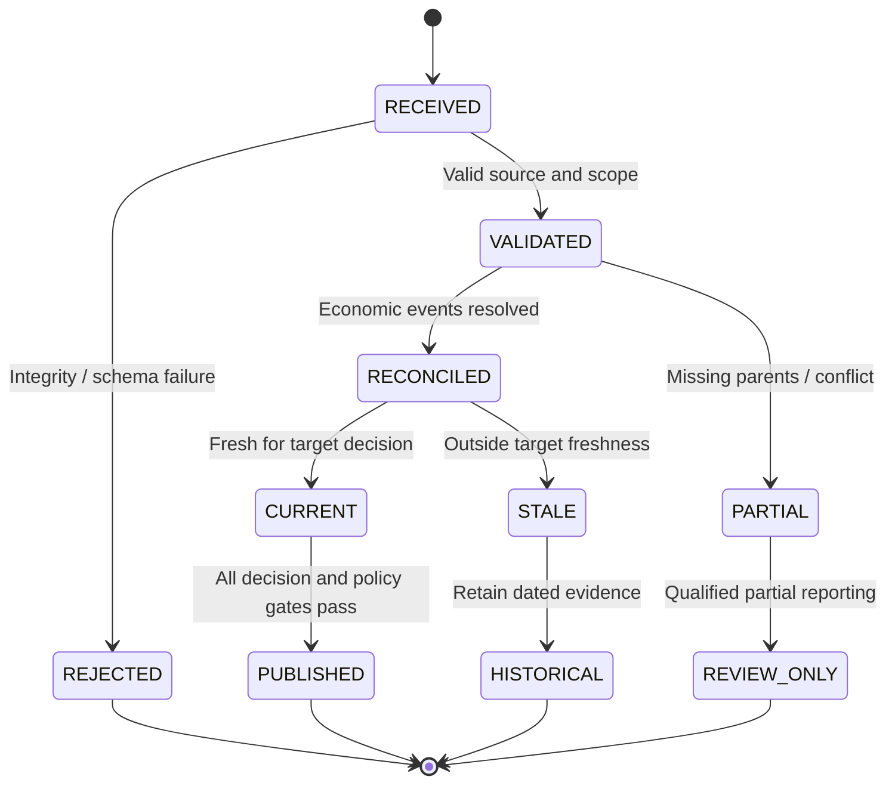

**Do not conflate the document's validity with currency.** A correctly parsed six-month-old account extract is still old. A fresh scraper execution timestamp does not make old reference rates executable or old loans current.

### Freshness classes

| Class | Meaning | Correct behavior |
|---|---|---|
| `FRESH` | Source current within the claim's configured window | May be considered with other completeness, suitability and policy gates |
| `AGING` | Approaching expiry (where defined) | Warn; review before important downstream decisions |
| `STALE` | Outside the applicable window | Keep historical label; do not silently use as current decision input |
| `UNKNOWN` | Timing/source cannot be established | Block affected determinate claims |
| `UNAVAILABLE` | Collection failed or source absent | Retain last-good with its old as-of; report missing coverage |
| `CONFLICT` | Two material claims disagree unresolved | Block dependent decision until reconciled |

The accepted **24-hour** technical ceilings apply only to the approved decision-contract categories **spendable cash** and **quoted rates**, not indiscriminately to Treasury historical curves, monthly loan statements, quarterly 13F filings, or source-appropriate publication cycles.

### Publication is a separate trust gate

A snapshot should be marked publishable only when its sources, contract version, immutable receipts, reconciliation, scope, policy clearance and destination permissions pass. A source can be *valid for historical display* but *not usable for a present-tense recommendation*.

---

## 14. Scheduling and unattended operations

**Schedule policy:** use `America/Chicago` consistently, retain Tuesday as a discretionary JARVIS rest day, and reserve weekends for separately inventoried heavy processing. The presence of a schedule in documentation does not prove it is installed.

### Installed timers: verified unit list (Nov 13, plus the 13F watcher on Nov 17)

| Time (America/Chicago) | Unit | Activity |
|---|---|---|
| 05:20 / 17:20 + every 3 h at :40 | `jarvis-bridge-reauth@daily` / `@reactive` | SimpleFIN Bridge re-auth (per-institution attempt caps: max 2 per day; mortgage servicer Mon/Wed/Fri) |
| 06:30 | `jarvis-finance-sec13f-watch` | SEC 13F new-filing watcher |
| 06:40 / 18:40 | `jarvis-finance-actual-auto` | Bank import into Actual; rules categorize on import |
| 06:50 / 18:50 | `jarvis-finance-m1` | Public pie targets |
| 06:55 / 18:55 | `jarvis-finance-form4` | SEC Form 4 chain |
| 06:58 / 18:58 | `jarvis-finance-auto-link` | Transfer twins merge + own-account moves → real transfers (max 20/run, journaled) |
| 07:00 / 19:00 | `jarvis-marketd-refresh` | ARKK, Treasury, FDIC, FRED |
| 07:05 / 19:05 | `jarvis-finance-bills-guard` | Bills guard v1.4 |
| hourly :12 (integrity scan 07:12 / 19:12) | `jarvis-finance-alerts` | Builds the alerts feed |
| 07:20 / 19:20 | `jarvis-finance-master-projection` | Publishes the dashboard snapshot |
| 07:35 / 19:35 | `jarvis-finance-doctor` | Health check (warn-only) |
| Sunday 13:10 | `jarvis-finance-weekly-questions` | Weekly AI questions (Phi-4 → Fin-R1 → Qwen3, about 2.5 h on CPU) |
| Sunday 20:10 | Chief brief | Weekly Chief summary |

Wrapper behavior: explicit Central timezone, exclusive locks (collectors wait for the import lock), soft-fail with last-good retained, journaled writes with undo. Heavy AI work is kept to the weekend.

**Open:** the Tuesday rest-day policy and the twice-daily collectors have not been reconciled. Decide whether collection may run on Tuesday, or exempt read-only collection explicitly.

The authoritative inventory is `systemctl list-timers` on SKYNET, not this table.

---

## 15. Normal processing and failure recovery

### Desired end-to-end operation

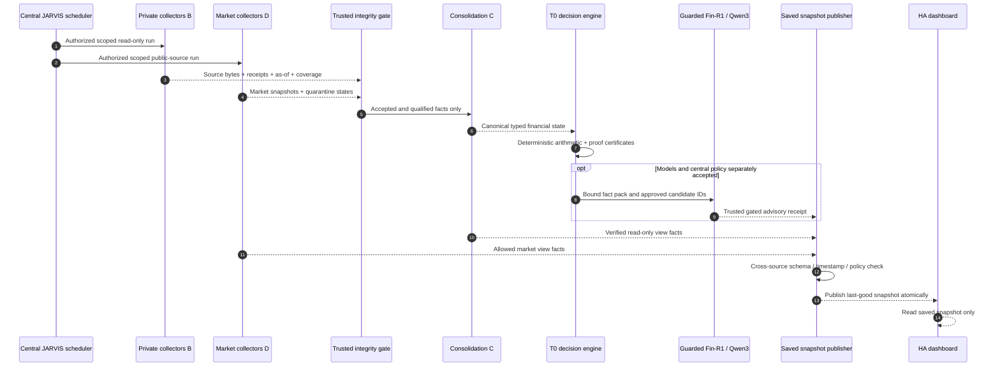

### Fail-closed behavior

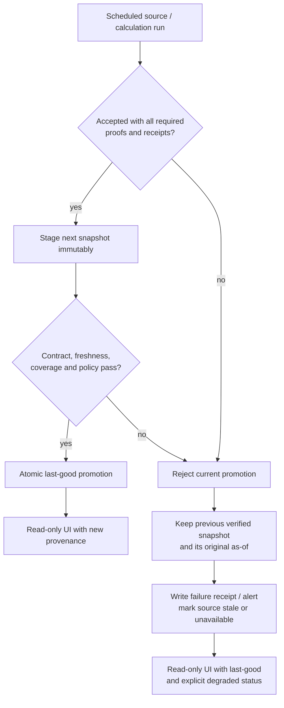

A failed refresh must not destroy or relabel the previous result as current. A model timeout must not turn an unvalidated free-text recommendation into a report. Every retry must be idempotent, and the acceptance test must demonstrate that no duplicate alerts or phantom events were introduced.

---

## 16. Privacy, integrity, and trust boundaries

### Who JARVIS tracks

JARVIS Finance tracks two kinds of subjects. They are stored and handled differently.

**Public subjects (Market Watch, Workstream D): public disclosures and reference data only**

| Subject | What is tracked | Source |
|---|---|---|
| Joseph Carlson (public commentator) | Target weights of his public M1 growth and dividend pies. Weights only: not his holdings, trades, or returns | Public M1 pie pages |
| ARK Invest (ARKK) | Published fund holdings | ARK public holdings files |
| Institutional filers | Quarterly 13F holdings of the configured filers | SEC EDGAR |
| Company insiders | Form 4 insider transactions for watched tickers (optional) | SEC EDGAR |
| U.S. Treasury | Daily par yield curve (e.g., 6-month bill) | U.S. Treasury |
| FDIC | National average deposit and CD rates | FDIC |
| Market indexes | S&P 500 and Nasdaq-100 daily closes for rolling 3- and 5-year history | FRED (St. Louis Fed) |

Public subjects are reference points for hypothetical comparisons. They are not instructions to buy or sell. JARVIS never copies a public subject's trades. A tracked commentator's portfolio is a labeled stand-in, not a recommendation. No public subject's data is treated as current user holdings. this is more for tracking the market and using that historical data in Harness predictions / strategies. 

**The owner (private, SKYNET only)**

The owner's own bank, card, loan, payroll, HSA, and household-obligation records, including any family or co-signed arrangements. This data never leaves private SKYNET storage. It appears in this repository only as architecture, schemas, and synthetic examples.

### Public repository versus SKYNET private storage

| May belong in public `03-RDP-VM-Infrastructure/Subsystems/Jarvis_Finance/` | Must stay in private SKYNET storage |
|---|---|
| Architecture diagrams, schemas without private examples | Actual bank/loan/payroll records and bank transaction IDs |
| Sanitized screenshots and illustrative fixtures | Real income, balances, debt principal, family property agreement |
| Test code, redacted test outcomes and design receipts | Browser session cookies, Gusto PDFs, credential material |
| Public RAG document IDs and safe code/documentation references | Private source receipts, account mapping, source originals |
| Nonsecret service/interface descriptions | `.env`, secrets, live backup dumps, tokenized URLs, private LAN topology |
| Public-subject watch lists and public disclosure snapshots | The owner's identity-linked financial data and household arrangements |

### Design-level trust boundaries

- Source receipts should carry original-byte SHA-256 and actual source effective dates.
- Source-document text, even retrieved through RAG, is untrusted content and may contain prompt-injection instructions. Ignore those instructions.
- Model processes must not write trusted approvals, alter manifests, fabricate source receipts, or promote snapshot publication.
- Required financial evidence and central policy clearance must be checked by independently trusted code.
- Preserve read-only finance V1 even if a model proposes a purchase, payment, account change, or additional borrowing.
- Treat public market reference rates, public-subject portfolios, and synthetic examples as not executable and not current user holdings.

Safe configuration examples should use `SKYNET_HOST`, `FINANCE_ROOT`, and other placeholders rather than real credentials or private LAN information.

---

## 17. Observability and operations

### Operational signals the Master should display or log

| Signal | Why it matters |
|---|---|
| Collector last **attempt** and last **success** | A service can run without producing valid evidence. |
| Source original `as_of` / observed time | Separates an old rate or balance from fresh ingestion. |
| Source/account coverage | Identifies missing Regions, SoFi, budget or loan families. |
| Reconciliation status | Prevents duplicated income, cross-account transfers and loan double counting. |
| Quarantine count/reason | Makes ambiguous SEC filing identity and failed schema checks visible. |
| Last-good snapshot hash and age | Supports precise failure recovery. |
| Decision contract/policy/model versions | Ensures replayability and correct approval lineage. |
| RAG citation/source validity | Prevents merely retrieved text from becoming an authoritative claim. |
| Chief acceptance state | Distinguishes draft, review-only and cleared advisory. |
| Timer/lock/run receipt | Demonstrates true unattended operation and prevents duplicate jobs. |
| Dashboard snapshot status | A healthy UI can still be empty or show dated historical evidence. |

### Safe, read-only operator checks (examples)

```bash
# Run from SKYNET-CORE in an authenticated shell. These commands inspect only.
systemctl status jarvis-finance-command-center.service --no-pager
systemctl is-enabled jarvis-finance-command-center.service
systemctl list-timers --all | grep -E 'jarvis-marketd|gusto|finance' || true

# Check specific Market Watch units without enabling or starting them.
systemctl is-enabled jarvis-marketd-check.timer jarvis-marketd-refresh.timer 2>&1 || true
systemctl is-active jarvis-marketd-check.timer jarvis-marketd-refresh.timer 2>&1 || true

# A timestamp on a local snapshot is not proof of its upstream source's as-of time.
# Never paste raw private snapshot contents into public issue threads.
```

The canonical Market Watch v1.8.1 specialist handoff contains a scoped, hash-checked `install.sh` process. **Do not run `activate` from this README alone**; activation and acceptance are separate operational approvals.

---

## 18. Implementation roadmap

We use **two functional finish lines** to avoid making valuable read-only financial reporting wait on optional payroll PDFs or every market/AI feature.

### Delivery sequence and dependencies

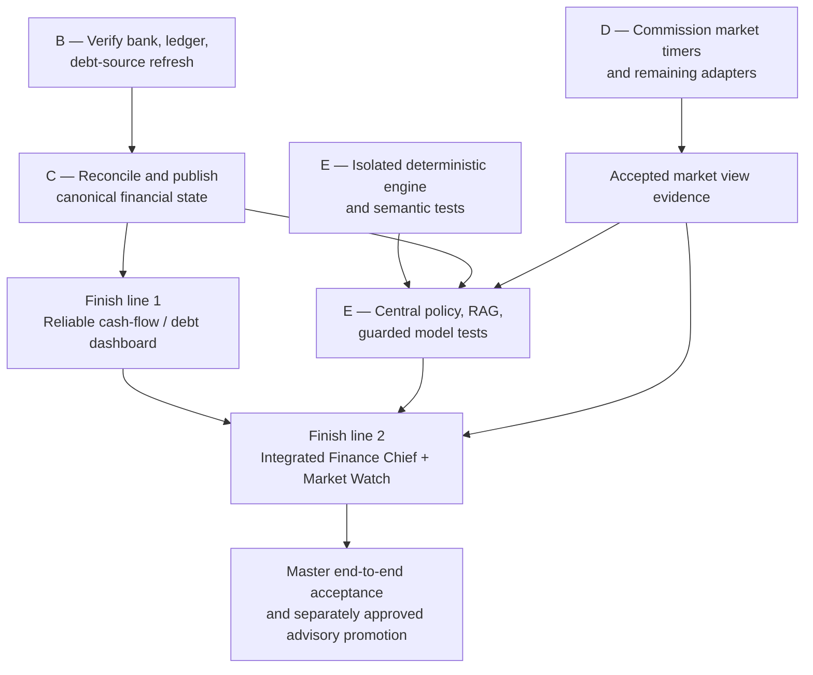

### Finish line 1: useful, validated financial visibility (**reached Nov 3, 2026**)

- [x] Regions and SoFi posted deposits imported with posting dates and account provenance (twice daily).
- [x] Actual fresh upstream bank sync, unattended import, receipts (`RECEIPT_STATUS=PASS`).
- [ ] Nelnet monthly source evidence (tracked as a planned obligation until repayment starts).
- [x] Ledger-based transfer and payroll reconciliation (split paychecks grouped; own-account moves linked as transfers).
- [x] Snapshot published twice daily with as-of and freshness labels.
- [x] Cash Flow & Debt and non-AI dashboard panels verified (HTTP 200 on the published files; visual check).

### Hardening round 2 (Nov 13–17, 2026)

- [x] Curated categorization rules v2 / v2.1 (journaled, undoable; scoped rules for side-income deposits).
- [x] Duplicate/stale cleanup, transfer auto-link, budget doctor (loans off-budget).
- [x] Bills guard v1.4 with two-sided payment proof; alerts feed v1; dashboard alerts panel.
- [x] Freshness thresholds by publication cycle; Form 4 repaired; 13F new-filing watcher.
- [ ] Owner notification channel (private email from SKYNET or HA phone push).
- [ ] Remaining accounts: installment loan, HSA, peer-payment app.

### Finish line 2: full evidence-backed Finance Intelligence

- [x] D timer activation and repeated unattended receipts.
- [ ] Automated 13F compare and amendment handling.
- [ ] E general decision engine; all mandatory cases and semantic negatives.
- [ ] Real JARVIS router/policy/confidence/escalation binding and approval receipts.
- [ ] Bounded, page-cited RAG use in Chief answers (Phi-4 reads the corpus today; citation acceptance not yet tested).
- [x] Weekly guarded Phi-4 → Fin-R1 → Qwen3 run with fact-lock gate (first full run Nov 2).
- [ ] Independent holdout evaluation of model answers.
- [ ] Adverse-case and restart/recovery acceptance.

### Defer rather than block V1

- Gusto Stage 2 payslip-PDF automation (optional; separately preserved).
- Ghostfolio/portfolio engine and OpenBB research integration unless needed to establish a verified current holdings/rates claim.
- Firefly migration: historical proposal only; avoid a competing ledger without explicit approval.
- Paper portfolio, automated learning, and broader capital arbitration until deterministic and policy gates have passed.
- Automated execution of trades, loans, transfers and payments: **out of scope** for Finance V1.

---

## 19. End-to-end acceptance criteria

**Master acceptance** requires operational evidence—not a consolidated screenshot, passing archive verifier, or one-off successful script.

| Gate | What must be proved | Status (Nov 17, 2026) |
|---|---|---|
| **G0: Specialist contracts** | Version/hash, source ownership, no incompatible changes | Partial: every installer self-tests, backs up and has a rollback path |
| **G1: Collector health** | Unattended successful refresh, source time and scope | **PASSED for connected sources** (twice-daily receipts; re-auth automated); coverage gaps listed in section 5 |
| **G2: Reconciliation** | No duplicate paycheck / transfer / card / loan counting | **PASSED (ledger-based):** transfers linked, split pay grouped, two-sided bill proof, integrity 53/56 |
| **G3: Canonical snapshot** | Schema, coverage, lineage, stale/unknown handling, last-good | **Operational:** freshness per source; last-good retained on soft-fail |
| **G4: Deterministic engine** | 40 cases + semantic negatives + boundaries | **OPEN** (weekly harness uses T0 math + fact-lock instead) |
| **G5: RAG + AI** | Cited retrieval, guarded models, independent scoring | Partial: guarded weekly run operating; citation acceptance and holdout scoring open |
| **G6: Central policy** | Route/confidence/escalation binding, approval receipt | **OPEN** |
| **G7: Dashboard evidence** | Views read saved truthful data; no collection on refresh | **PASSED** |
| **G8: Recovery** | Failure, timeout, stale data, restart, idempotent re-run | Partial: soft-fail, locks, journals and undo in place; formal adverse suite not run |
| **G9: Release authorization** | Separate review and advisory-only approval | Operational advisory use approved by the owner (Nov 3); formal Master sign-off not granted |

### Mandatory adverse-case tests

- Duplicate aggregator view of the same deposit; own-account transfer with one missing leg.
- Biweekly versus semimonthly payroll, partial destination coverage, missing gross-pay document.
- Overlapping statement periods and stale current-cash observations.
- Incorrect money units, APR versus APY confusion, one-cent threshold boundaries and invalid JSON.
- Missing Nelnet refresh or a loan-group disagreement; insufficient debt APR coverage.
- Ambiguous SEC 13F repeated identity/amendment and zero publishable alerts.
- Historical FRED price levels mistaken for investment total returns.
- Model-generated unsupported balance, interest rate, eligibility, HSA rule, or fabricated citation.
- Model timeout, stale RAG response, missing policy binding, altered fact-pack hash.
- Second scheduled run, last-good checkpoint after a forced failed refresh, duplicate-alert suppression.
- Restart of scheduler/dashboard without a silent restart of prohibited models or source acquisition.

**Acceptance means:** the system can produce reproducible, current-or-honestly-qualified reports end to end, with source lineage, bounded advice, appropriate degraded behavior, and **zero financial execution authority**.

---

## 20. Repository layout and documentation maintenance

The following tree distinguishes **known paths** from **documentation or future integration targets**. It is not a claim that every proposed folder or file exists on SKYNET.

```text
<repository-root>/
└── 03-RDP-VM-Infrastructure/
    └── Subsystems/
        └── Jarvis_Finance/
            ├── README.md                      # this page
            └── assets/
                └── finance-command-center.png # ADD sanitized image when ready

SKYNET-CORE (separate working tree and private state)
$HOME/rdp-scripts/Jarvis/
└── finance/
    ├── dashboard/command_center/v0_1/        # deployed UI
    ├── source_of_truth/market_watch/
    │   ├── manifest.json                    # seven-document historical registry
    │   └── manifest_v08e.json               # accepted ten-document extension
    ├── market_watch/ops/v1_8_1/             # proposed collection-timer receipts
    ├── ops/tools/                           # versioned lab and collector utilities
    └── _staging/                            # isolated candidate evidence; not public

$HOME/.local/share/jarvis-finance-private/
└── dashboard/latest.json                    # intended accepted private snapshot

/var/lib/jarvis/vector/jarvis_vectors.db     # central private RAG store
```

### Screenshot instructions

1. Capture the approved four-view Finance Command Center screenshot.
2. Mask financial figures, names, account identities, device IPs, internal hostnames, private folders and service tokens.
3. Save it as `03-RDP-VM-Infrastructure/Subsystems/Jarvis_Finance/assets/finance-command-center.png`.
4. Commit the sanitized screenshot, then uncomment the Markdown image line near the top of this README to display it on GitHub.

### Updating this document

On every accepted specialist handoff, update: **as-of date**, workstream status table, latest proven evidence, outstanding gates, and any changed contract or source schema. Do not convert a planned feature into a green status just because code was uploaded or a demo passed. Major implementation changes require their own specialist records and Master review.

---

## 21. Evidence and provenance

This README is based on specialist documentation and terminal evidence through **November 17, 2026** (earlier checkpoint: October 29, 2026). The dated source set includes:

| Record | Scope and disposition |
|---|---|
| **Finance Architecture & Build Plan** | Original control plane, model capabilities, five lanes, software integration options and safety philosophy; contains historic options that do not all represent accepted implementation |
| **Real Estate Strategy V1.4** | Private four-property intent and policy gates, not verified present-tense account facts |
| **JARVIS Finance RAG V0.8E OneNote Handoff** | Ten-document registration/index/retrieval **accepted**; Chief citation and automatic retrieval **not accepted** |
| **Finance Dashboard V0.1 Handoff** | Local service and HA UI **accepted**; schema-driven current financial content **pending** |
| **Finance Decision Contract v1.0.0-rc.1 + approval receipt** | Exact candidate archive hash, separately recorded **design-only approval**, technical defaults and no execution rights |
| **Finance AI Validation Master Handoff — Oct 25** | Offline candidate proof with outstanding semantic, runtime, policy and model acceptance gates |
| **Collector B OneNote Closeout — Oct 29** | Specialist chat closed with Gusto Stage 2 deferred; recurring bank/Actual/Nelnet collection still unverified |
| **Market Watch D v1.8.1 Rebuilt Handoff — Oct 29** | Live source-collection evidence and prepared timer release; **server activation/unattended acceptance not yet verified** |
| **Market Watch D v1.1 shadow README / SKYNET transcript — Oct 27** | Historical staged SEC alignment and 15/15 regression tests, with zero publishable SEC events |
| **Nov 3 Operational Milestone** | Daily SimpleFIN → Actual sync with receipts, ledger bill verification, ledger facts v1.2, first full weekly AI run (all 4 answered), money plan panel |
| **Hardening Round 2 + Alerts Handoff: Nov 13** | Installed timer inventory, rules v2, transfer auto-link, budget doctor, alerts feed v1, dashboard alerts panel lesson, freshness fix, Form 4 repair, re-auth permission fix |
| **SKYNET terminal evidence: Nov 17** | 13F watcher install (daily 06:30), bills guard v1.4 (17 tests), rules v2.1 scoped rule (9 tests), Home Assistant read-only discovery (packages enabled, HomeKit Bridge layout) |

Where these sources disagree in maturity, use the **latest explicit acceptance claim** in the relevant specialist lane. For example, the historical Firefly-first proposal does not override the later Collector B Actual/Simply Budget preference; similarly the Market Watch v1.8.1 live source successes do not prove timers were activated.

**Recommended documentation policy:** preserve detailed unredacted handoffs privately; publish summaries, schema names, sanitized test results and selected nonsecret hashes here. Do not link to private source documents with public repository URLs unless their disclosure has been reviewed.

---

## 22. Glossary and project principles

| Term | Meaning |
|---|---|
| **As-of** | When the underlying financial or market fact was valid/effective. Not the time the parser ran. |
| **Observed at** | When JARVIS collected or inspected a source. Does not refresh old source facts. |
| **Last-good** | Most recent verified accepted snapshot; not necessarily current. |
| **Scope coverage** | Which accounts, dates, transactions, obligations, markets or providers a result actually includes. |
| **Fact lock** | Independent trusted gate that prevents model proposals from altering verified facts or validated decision options. |
| **Typed decision** | Validated structured decision with units, proof, uncertainty and permitted recommendation meaning. |
| **Synthetic fixture** | Artificial test inputs, not actual user holdings, earnings or debts. |
| **Shadow-only** | Data staging or evaluation without production publication, advice clearance or execution authority. |
| **Review-only** | Human-inspectable candidate; not a fully cleared current recommendation. |
| **RAG** | Retrieval-augmented generation using a cited, source-identified reference corpus. |
| **Public portfolio target** | Published allocation example (e.g., M1 pie or ETF holdings); not authenticated ownership by the user. |
| **Central policy clearance** | Verified result of actual JARVIS governance checks; not something Fin-R1/Qwen3 can self-declare. |

### The project in one sentence

> **Actual/Simply Budget and verified financial sources explain what happened; Market Watch explains what public markets reported; deterministic code proves what the numbers mean; Fin-R1 and Qwen3 propose what may matter; JARVIS validates and prioritizes those proposals; Home Assistant displays only what has passed the appropriate trust gates.**

**JARVIS Finance remains an evidence-first, human-controlled advisory subsystem.** Its successful future integration will be measured by verified source coverage, reliable reconciliation, transparent uncertainty, reproducible decisions, resilient scheduling, and honest dashboard publication—not by the number of connected services or model outputs.
