# JARVIS Finance

> **A local-first financial intelligence subsystem for SKYNET / JARVIS**  
> Evidence collection · Reconciliation · Deterministic calculations · Guarded AI reasoning · Market intelligence · Home Assistant visualization
> ## JARVIS Finance Command Center

.png>)

*JARVIS Finance Command Center — Main Dashboard Overview.*

<!-- Dashboard screenshot intentionally omitted until a sanitized image is uploaded.
     When ready, add 03-RDP-VM-Infrastructure/Subsystems/Jarvis_Finance/assets/finance-command-center.png,
     then uncomment the Markdown image line below. Never publish live balances,
     personal names, account numbers, tokens, or private LAN addresses. -->

<!--  -->

<p align="center"><em>The JARVIS Finance Command Center — Finance Chief · Market Watch · Cash Flow & Debt · Strategy Lab</em></p>

**Documentation checkpoint:** October 29, 2026 · **System:** SKYNET-CORE / JARVIS · **Repository location:** `03-RDP-VM-Infrastructure/Subsystems/Jarvis_Finance/README.md`<br>
**Overall state:** **Integration in progress — NOT end-to-end production accepted**  
**Financial execution:** **DISABLED — advisory and observation only**

> [!IMPORTANT]
> This page documents the architecture, delivered components, observed test evidence, and outstanding integration work. A passing unit test, source scrape, running container, or dashboard page **does not** independently prove a fresh, reconciled, production-ready financial pipeline. Status labels refer to the dated handoffs listed in [Evidence and provenance](#21-evidence-and-provenance), not a live status query.

---

## Table of contents

1. [Mission and design philosophy](#1-mission-and-design-philosophy)
2. [Executive status and workstreams](#2-executive-status-and-workstreams)
3. [End-to-end architecture](#3-end-to-end-architecture)
4. [Central JARVIS control plane](#4-central-jarvis-control-plane)
5. [B — Financial account collectors](#5-b--financial-account-collectors)
6. [D — Market Watch and public-data acquisition](#6-d--market-watch-and-public-data-acquisition)
7. [C — Consolidation and canonical financial state](#7-c--consolidation-and-canonical-financial-state)
8. [A — Strategy, constraints, and long-term planning](#8-a--strategy-constraints-and-long-term-planning)
9. [Reference knowledge and RAG](#9-reference-knowledge-and-rag)
10. [E — Finance AI, deterministic decision contract, and Chief](#10-e--finance-ai-deterministic-decision-contract-and-chief)
11. [Five finance intelligence lanes](#11-five-finance-intelligence-lanes)
12. [F — Finance Command Center and Home Assistant](#12-f--finance-command-center-and-home-assistant)
13. [Data contracts, provenance, and freshness](#13-data-contracts-provenance-and-freshness)
14. [Scheduling and unattended operations](#14-scheduling-and-unattended-operations)
15. [Normal processing and failure recovery](#15-normal-processing-and-failure-recovery)
16. [Privacy, integrity, and trust boundaries](#16-privacy-integrity-and-trust-boundaries)
17. [Observability and operations](#17-observability-and-operations)
18. [Implementation roadmap](#18-implementation-roadmap)
19. [End-to-end acceptance criteria](#19-end-to-end-acceptance-criteria)
20. [Repository layout and documentation maintenance](#20-repository-layout-and-documentation-maintenance)
21. [Evidence and provenance](#21-evidence-and-provenance)
22. [Glossary and project principles](#22-glossary-and-project-principles)

---

## 1. Mission and design philosophy

JARVIS Finance is a **decision-support domain inside the existing JARVIS platform**, not a replacement accounting application, bank, brokerage, trading bot, or second AI infrastructure stack.

It is intended to answer questions that individual financial tools cannot answer in isolation:

- **Financial health:** What cash has actually arrived? Which obligations are covered? Where did funds go, and how complete is the evidence?
- **Debt strategy:** Which verified liabilities need attention, how do payoff scenarios compare, and what is affordable without undermining required payments?
- **Capital allocation:** Should the next available dollar support emergency reserves, project obligations, debt, retirement, or another goal?
- **Investing:** What do actual holdings and verified market observations imply, and what deserves further research rather than an automatic trade?
- **Long-term planning:** Are housing, real-estate, savings, and investment goals consistent with verified cash flow and liquidity?
- **Accountability:** Which recommendations were made, on what evidence, for how long, and what happened afterward?

### Non-negotiable engineering principles

| Principle | Implementation implication |
|---|---|
| Reuse the central JARVIS infrastructure | One job registry, router, policy, scheduler, model capability resolver, confidence and escalation framework; Finance is a domain, not a competing control plane. |
| Reuse mature finance software | Prefer an existing ledger and established portfolio/research tools over building a second bookkeeper. |
| Deterministic facts first | Python/SQL calculate totals, time periods, interest, allocations, and proof certificates; language models do not invent arithmetic. |
| Evidence is not authority by itself | Original statements, bank postings, user policy, market filings, and educational PDFs have different, claim-specific authority. |
| Separate data layers | Raw source → immutable receipt → normalized facts → reconciled state → validated decisions → display. |
| Fail closed | Unknown, stale, incomplete, conflicted, or failed validation is **not** silently converted into a trustworthy recommendation. |
| Read-only by default | Financial AI may analyze and suggest; it cannot trade, transfer, borrow, pay, or change accounts. |
| Keep private facts private | Raw bank data, credentials, personal goals, detailed loan balances, and private run receipts stay outside GitHub. |
| Preserve earlier accepted work | No unreviewed redesign of the dashboard, central control plane, RAG registry, or existing Gusto Stage 1 agent. |

**V1 safety boundary:** `READ → CALCULATE → ANALYZE → VALIDATE → RECOMMEND → STORE / DISPLAY` — **not** `READ → BUY / SELL / TRANSFER / PAY`.

---

## 2. Executive status and workstreams

The project is organized into **A–F**, with a shared Finance RAG knowledge layer. *Specialist closure* and *end-to-end operational acceptance* are intentionally different concepts.

| Workstream | Responsibility | Evidence-backed status as of Oct 29, 2026 | Next acceptance dependency |
|---|---|---|---|
| **A — Financial Strategy & Intent** | User goals, policy, debt priorities, reserves, real estate | Strategy documented; typed decision contract **design approved** | Bind accepted profile and policy to verified sources, without treating goals as balances |
| **B — Account Collectors** | Bank inflows, Actual/Simply Budget, debt, payroll-related evidence | Specialist conversation **closed with exceptions**; partial read-only evidence | Demonstrate fresh Regions/SoFi deposits, daily budget extraction, monthly Nelnet refresh and coverage receipts |
| **C — Consolidation** | Canonical financial state, transfer matching, reconciled snapshots | **End-to-end acceptance not evidenced** | Reconcile accepted B inputs; publish source-aware, schema-valid snapshot |
| **D — Market Watch** | Public filings, rates, indices, ETF data, public portfolios | Several **live collection paths accepted**; v1.8.1 timer release locally tested | Activate and prove unattended timer execution; finish M1, Form 4 and recurring 13F adapters |
| **E — Finance Intelligence** | Deterministic decision engine, Fin-R1, Qwen3, trusted validation | Contract design **approved for isolated testing**; general runtime acceptance **blocked** | Pass semantic engine gates; bind central policy and RAG; guarded model and end-to-end tests |
| **F — Dashboard & HA** | Finance Command Center and Home Assistant iframe views | **UI/deployment accepted**; finance data integration **pending** | Map accepted snapshot and review-only Chief evidence without running models on page loads |
| **Finance RAG V0.8E** | Source-of-truth reference PDFs and search | **10-document indexing and retrieval accepted** | E must prove bounded retrieval and source-cited model use |

### What already works — within its documented scope

- Finance Command Center local service and its **four Home Assistant views** have been visually verified. Dashboard checks recorded **44 Python tests** on SKYNET and **7 JavaScript tests** in the build environment.
- The Finance RAG reference corpus has **10 registered PDFs**, **279 searchable page-documents**, and successful retrieval from the new educational sources.
- Market Watch has observed live official-source pulls for ARKK holdings, U.S. Treasury references, FDIC national reference rates, and FRED benchmarks; SEC 13F historical XML analysis has been staged and qualified.
- The Finance decision contract has a **separate, hash-bound design approval**, but its general decision engine has not earned production acceptance.
- Gusto Stage 1 remains operational as a **time-clock / dispatcher** service. It must not be confused with optional Gusto Stage 2 payroll-PDF capture.

### What does **not** yet work as one accepted system

No evidence supplied so far demonstrates the entire path from **unattended fresh account acquisition → canonical reconciliation → general deterministic decisions → guarded Fin-R1/Qwen3 → accepted current dashboard publication**. The missing proof is the Master integration task, not a reason to discard completed specialist work.

---

## 3. End-to-end architecture

The end state is a **shared financial evidence pipeline** with independent personal-finance and market-data branches. Market evidence is not automatically a personal holding or cash balance.

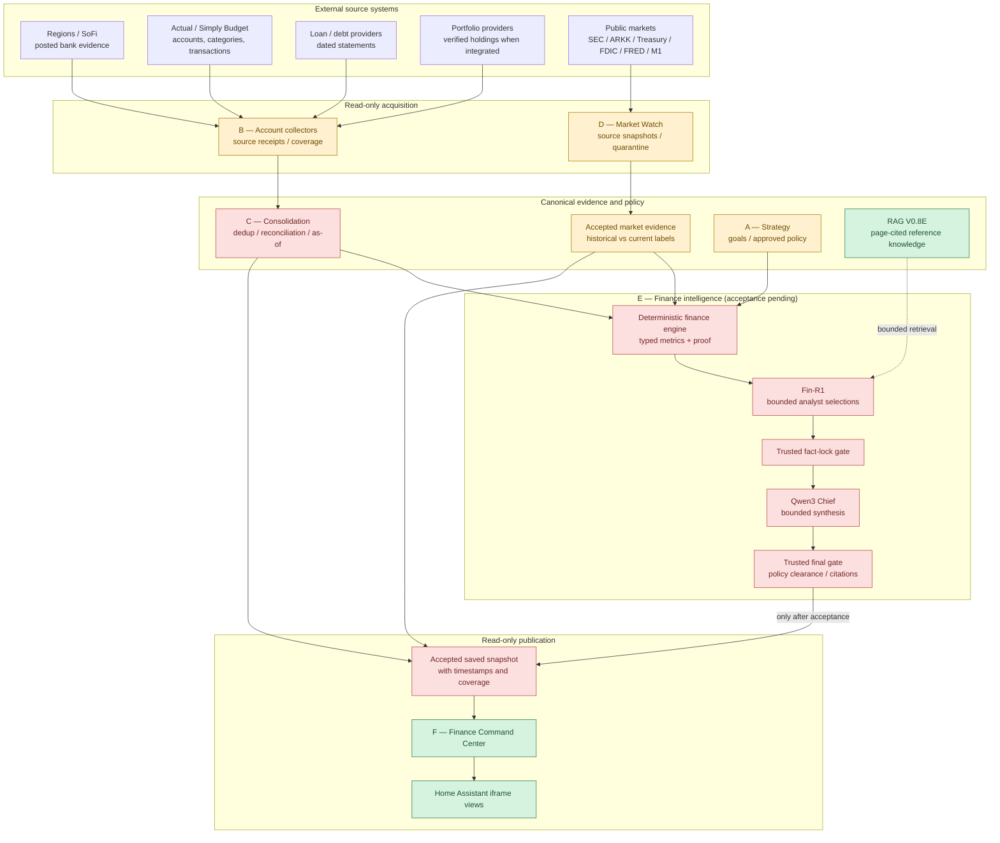

**Diagram key:** green = delivered within a limited scope; amber = partial or source-dependent; red = integrated acceptance not yet established. These colors represent documented status, not service health telemetry.

### Architectural boundaries

1. **B** ingests private account evidence. **D** ingests public-market evidence. Both produce provenance-aware observations.
2. **C** deduplicates and reconciles private financial facts. Market events retain their separate identity, date basis, and publication restrictions.
3. **A** contributes approved goals and policy, never fictitious balances.
4. **RAG** contributes reference explanations and citations, not current account data or fresh quotes.
5. **E** reasons only over facts and bounded retrieved passages accepted by trusted adapters. Models cannot grant themselves policy approval.
6. **F** reads previously saved validated outputs; it does not run acquisition or inference on an HTTP page request.

---

## 4. Central JARVIS control plane

Finance should register domain work in the **existing** control and orchestration framework rather than adding Finance-specific replacements.

### Existing architecture (target integration path)

```mermaid
flowchart LR
    TRIG["User / event / timer"] --> JOB["jarvis-job<br/>job registry"]
    JOB --> ROUTE["jarvis-route<br/>router"]
    ROUTE --> POLICY["jarvis-policy<br/>policy gate"]
    POLICY --> SCHED["jarvis-schedule<br/>scheduler"]
    SCHED --> DISPATCH["jarvis-dispatch<br/>dispatcher"]
    DISPATCH --> CAP["jarvis-model<br/>capability resolver"]
    CAP --> WORK["Finance domain task"]
    WORK --> RESULT["Immutable result<br/>and evidence receipt"]
    RESULT --> CONF["jarvis-confidence<br/>assessment"]
    CONF --> ESC["jarvis-escalation<br/>escalation / review"]
```

Other existing interfaces include `jarvis-service`, `jarvis-confidence-observe`, `jarvis-confidence-source`, and `jarvis-confidence-scan`. Their **actual production names, versions, policy bindings, and receipt semantics must be verified on SKYNET** before a Finance Chief report can be centrally cleared. Historical CLI names are discovery hints, not approval receipts.

### AI capabilities, not hard-coded model dependencies

| Capability | Model or subsystem mentioned in project design | Intended role | Authority |
|---|---|---|---|
| `finance-analysis` | Fin-R1 7B | Analyze verified financial facts and propose bounded decisions | Advisory proposals only |
| `chief` | Qwen3-30B-A3B-Instruct-2507 | Cross-domain prioritization and explanations | Advisory proposals only |
| `coding-local` | DeepSeek Coder | Build scripts, tests, validators, connectors | Development capability; not financial authority |
| Embedding / retrieval | EmbeddingGemma + central JARVIS RAG | Find passages and prior evidence | Retrieved text remains lower-trust data |
| T0 trusted calculators | Python / SQL / validated deterministic rules | Totals, debt math, unit conversion, schedule and threshold checks | Trusted only after implementation and test acceptance |

**No second Finance model router, policy system, or confidence evaluator should be created.** The Finance-specific decision contract may enforce additional domain invariants; it cannot replace central JARVIS approval.

---

## 5. B — Financial account collectors

**Role:** Observe and normalize *actual, dated financial records* while preserving account provenance, source freshness, and collection uncertainty. Collectors are not debt advisers or transaction executors.

### Source inventory and current evidence

| Source / lane | Intended evidence | Most recent documented result | Production-readiness qualification |
|---|---|---|---|
| **Regions** | Posted bank deposits, debit/credit transactions, available balances | Selected as primary cash-received payroll evidence | Actual recurring feed freshness and payroll mapping **not yet proven** |
| **SoFi** | Posted deposits, savings/checking, split payroll and transfers | Selected as primary cash-received payroll evidence | Must prove source timestamps, status, split-paycheck matching and dedup |
| **Actual / Simply Budget** | Ledger, categorized spending, budgets, account views | Private read-only snapshot on Oct 25: **10 accounts / 315 transactions**; v0.2 bridge is offline `GETTERS_ONLY_NO_BANK_SYNC` | **Daily unattended extraction and upstream bank-sync freshness not demonstrated**; snapshot is historical |
| **Nelnet** | Student-loan groups, statements, balances, payment obligations | Historical evidence and validator exist | **Monthly authenticated collector, timer and fresh receipt not demonstrated** |
| **Gusto Stage 1** | Time-clock / schedule dispatcher | Existing container and dispatcher timer running | Preserve unchanged; **not** payroll or payslip acquisition |
| **Gusto Stage 2** | Optional PDF paystub source for earnings reconciliation | Staged runner and UI inspection; no accepted paystub PDF | **Explicitly deferred**; not a blocker to verified bank-based cash-received reporting |
| **Other debt/bank sources** | Cards, vehicle, mortgage, project obligations | Included in source inventory / desired coverage | Live per-source acceptance must be demonstrated, not inferred |
| **Investment / HSA providers** | Private holdings, contributions, statements | Included in longer-term integration plan | Do not infer live holdings from market reference PDFs |
| **Rocket Money** | Older aggregator proposal | Removed from preferred Collector B architecture | **Out of scope**; do not quietly reintroduce |

**Ledger decision:** The most recent Collector B closeout identifies **Actual/Simply Budget as the preferred aggregation / ledger path**, subject to verified data freshness. The historical architecture notes also contain a *Firefly III-first proposal*; that older proposal is **not evidence of an accepted Firefly ledger migration**. Avoid two conflicting authoritative ledgers.

### Income and payroll reconciliation

Bank postings determine **cash received**, while an authentic payroll record—if available—determines **gross earnings** and documented deductions. Splits across accounts must be joined to **one payroll event**, not counted independently as additional salaries.

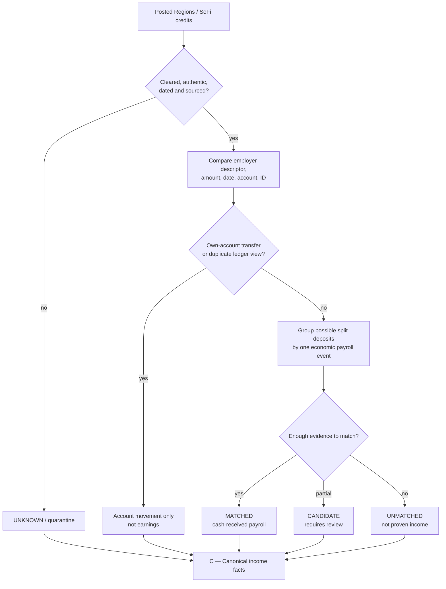

**Required invariants**

- Preserve original transaction IDs, posting dates, source account IDs, and observed timestamps.
- Reconcile gross, net, and destination amounts separately; **never** treat the first destination deposit as total take-home pay.
- Exclude bank-to-bank transfers, refunds, duplicates, and unconfirmed credits from earned income.
- Emit `MATCHED`, `CANDIDATE`, or `UNMATCHED` with supporting evidence. A previously discussed **95% matching target is aspirational**, not a measured confidence result.
- If no authentic gross-pay source exists, report **`gross_pay_status = UNKNOWN`**. Estimates must be explicitly hypothetical.
- Treat incomplete ledger coverage as **unknown scope**, not proof that other accounts or bills do not exist.
- Do not restart Gusto Stage 2 Chromium/CDP debugging as a mandatory prerequisite for the bank-based V1 pipeline.

**Collector B specialist closeout:** **CLOSED WITH EXCEPTIONS**. Its deferred freshness/coverage obligations move to Master integration; they are **not** successful end-to-end tests.

---

## 6. D — Market Watch and public-data acquisition

**Role:** Collect original public-market observations and preserve source-specific meanings. D is an evidence producer, **not** a trading engine, holdings importer, Finance Chief opinion, or dashboard publisher.

### Observed evidence through October 29, 2026

| Feed | Dated collection evidence | What it actually represents | Remaining gate |
|---|---|---|---|
| **ARKK official holdings** | **46 rows / 100% weight**, observed Oct 29; live run passed | ETF holdings, **not** any private person's positions | Freshness/receipt publication and schedule acceptance |
| **U.S. Treasury par-yield curve** | **14 maturities**, observed Oct 29; live run passed | Published reference par yields, not a personal executable quote | Retain `SHADOW_REVIEW_REQUIRED` if emitted by source |
| **FDIC national CD reference** | **8 terms**, source as-of Oct 19; live run passed | National reference averages, **not** available bank offers | Freshness by source period; monthly source cadence |
| **FRED S&P 500 / Nasdaq-100** | Both through Oct 28; **2,512** exact common-date observations | Price-index series; no implied dividends / total return | Confirm terms of use and downstream publication basis |
| **SEC Form 13F** | **22/22** XML exact parity; **12** full-key historical comparisons | Delayed filed institutional holdings; not real-time manager trades | Quarantined ARK partials, amendments and quarterly discovery |
| **M1 public pies** | Target/label validation previously passed | Public allocation targets; not verified client account holdings | Unattended browser/session collection, dedup, retry |
| **SEC Form 4 (Musk / Ternus)** | Prior historical rows/filings collected | Insider filing observations with transaction-code context | Unattended accession discovery, amendment handling and dedup |

### Why 13F treatment is intentionally conservative

- Reported rows with repeated nominal security identity are **not summed or silently merged**.
- XML manager, discretion, and voting fields may distinguish rows. Partial or ambiguous comparisons are **quarantined**.
- Original/amended `13F-HR/A` quarters need explicit amendment context; a missing comparison is not a signal.
- A previous isolated v1.1 diagnostic evaluated **22 filings** and generated **1,376 candidate event records with 0 publishable events**. Candidates do **not** become buy/sell alerts because a test returned zero exit.
- Price-level returns must not be represented as dividends-inclusive total returns.

### Market Watch source processing

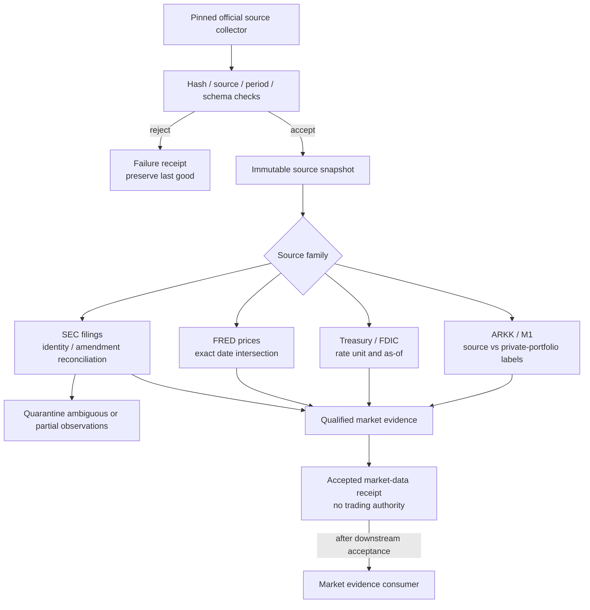

### Market Watch D v1.8.1 deployment boundary

The **timer wrapper release is prepared and locally tested** (**11/11** local tests). As of the October 29 handoff, **its SKYNET timers were not yet shown as installed, enabled, or successful unattended jobs**. A schedule in a ZIP file is not an active scheduler.

Unfinished work includes: first and second unattended receipts, M1 public-pie recurring ingestion, Form 4 live accession discovery, 13F quarterly discovery, failure recovery, dashboard source mapping, and explicit Master ownership/policy reconciliation.

---

## 7. C — Consolidation and canonical financial state

**C is the primary remaining integration dependency.** It must translate accepted collector output into consistent, traceable facts without erasing uncertainty or confusing account cash with portfolio, market, or hypothetical values.

### Target responsibilities

1. Load accepted source records and integrity receipts; never interpret an absent source as a zero balance.
2. Normalize money, account identity, loan obligations, transaction units, time zones, and reporting periods.
3. Deduplicate economic events across bank views and aggregators.
4. Match split deposits and two-sided own-account transfers; preserve unmatched single legs for review.
5. Reconcile statement balances against available/cleared amounts according to the fact being asserted.
6. Separate **cash received**, **gross compensation**, **available liquidity**, **earmarks**, **debt**, **private holdings**, and **public market observations**.
7. Preserve data-as-of, observed-at, source hash, coverage, reconciliation status, and missing parents.
8. Produce a validated, read-only financial state for calculations and a separate saved dashboard-view snapshot.

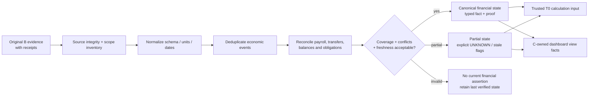

### Required accounting rules

| Category | Invariant |
|---|---|
| Transfers | Both sides refer to one economic event; household income and net worth do **not** increase. |
| Payroll | One pay event may have multiple destination credits; gross payroll is not inferred from net bank receipts. |
| Credit cards | Avoid counting both card purchase and later card payment as separate household expense on a cash-flow basis. |
| Debt | Principal, interest, posted charges, and future scheduled obligations remain separate. |
| Savings buckets | Earmarking cash is an allocation movement, not new income; reserve release at payment must avoid double subtraction. |
| Investments | Contributions and principal redemptions are not investment earnings by definition. |
| Public market data | ARKK, 13F, M1 public pies, rate references, and benchmark indices are not private asset positions. |
| Coverage | A valid extract from one account cannot prove all household accounts, payroll destinations, or expenses have been collected. |
| Data timing | Source effective/as-of time and collection time are separate; re-ingesting an old statement does not refresh its balance. |
| Unknowns | Missing balances, APRs, legal terms, or fund availability remain UNKNOWN rather than fabricated constants. |

### Canonical evidence model (illustrative, not an implemented wire schema)

The approved strict schema lives in the Decision Contract package. This diagram is **conceptual**, not a substitute schema for that package.

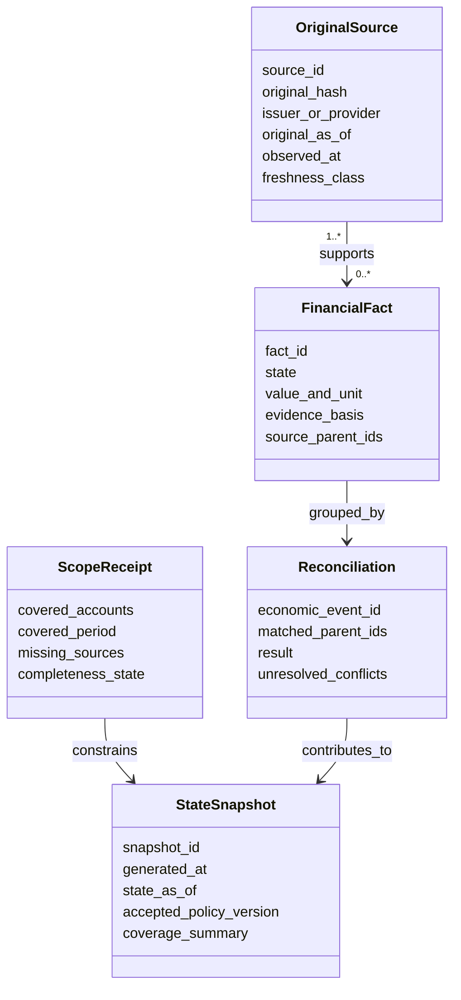

### Acceptance proof required from C

A reproducible **same-input → same-result** run with complete provenance, cross-account reconciliation receipts, explicit partial-coverage handling, and a saved snapshot that the dashboard can consume **without re-running collectors or models**.

---

## 8. A — Strategy, constraints, and long-term planning

A stores the *reason for decisions*: financial goals, priorities, risk boundaries, and the constraints that should govern suggestions. It is **not** a substitute for actual account evidence.

### Strategy and policy topics

- Required current bills and debt minimums before optional allocations.
- Emergency reserve and project/operating earmarks as **separate accounting buckets**.
- Expensive-debt identification and approved prioritization, conditioned on verified rates and balances.
- Financial health under baseline income and separately modeled variable-income scenarios.
- Future allocation to reserves, project funds, debt, retirement, HSA, dividends, and longer-term assets.
- Investment recommendations subordinated to liquidity and debt commitments.
- Home preservation, real-estate cash-flow readiness, and loan-financing constraints.
- No automatic modification of priorities, payment schedules, project-purpose labels, or financial accounts.

**Approved contract technical defaults (design approval only):** maximum **24-hour age** for spendable-cash evidence used in affected decisions; maximum **24-hour age** for quoted-rate evidence; when otherwise qualifying debts have equal balances, tie-break **higher APR**, then **stable debt ID**. These do not imply that all source feeds refresh every 24 hours or that a stale fact may be used for current advice.

### Real-estate strategy V1.4 — policy-level view

The private strategy outlines **four roles**: preserve the family home, acquire a first income property, consider a second only after proven performance, and eventually establish a final long-term residence. Planning milestones include a **first-rental target around 2030** and a **family-home payoff target around 2031**, subject to verified finances. Exact property balances, family terms, contribution amounts, and acquisition budgets belong in the **private policy profile**, not this public README.

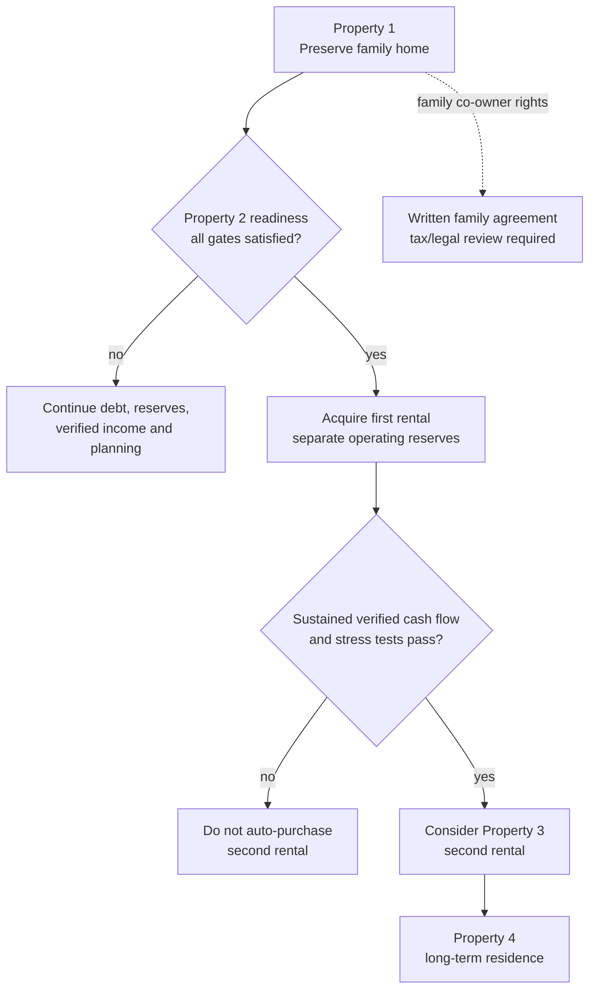

**Property purchase gates:** verified sustainable income, debt reduction progress, preserved existing mortgage plan, ongoing baseline investing where affordable, separately funded down payment/closing/repairs/emergency reserves, realistic positive property cash flow, stress tests for vacancy/repairs/income disruption, and actual lender eligibility.

**Co-owner contributions are not automatically third-party rental income.** Track them as a distinct family-property contribution until a qualified legal/tax treatment has been established. A financial model cannot determine that status from a family arrangement alone.

---

## 9. Reference knowledge and RAG

**V0.8E document registration, indexing and search retrieval: ACCEPTED.** The corpus supports explanation, evidence discovery, historical filings and context. It does **not** establish live balances, current rates, eligibility, or automatic Chief retrieval.

### Accepted corpus

| Source ID | Document/context | Physical / indexed pages | Authority boundary |
|---|---|---:|---|
| `sec_form4` | SEC Form 4 reporting interpretation | 12 / 12 | Filing mechanics, not live private holdings |
| `sec_form13f` | SEC Form 13F reporting interpretation | 14 / 14 | Historical lag, omissions, disclosures |
| `berkshire_2025_annual` | Berkshire Hathaway annual report | 154 / 151 | Period-specific historical issuer facts |
| `pershing_2026_interim` | Pershing Square interim report | 59 / 59 | Published historical fund context |
| `arkk_2026_annual` | ARKK annual report | 3 / 3 | Fund reporting, not current private positions |
| `arkk_2025_prospectus` | ARKK prospectus | 13 / 13 | Product structure, fees, risks as of source period |
| `fidelity_dividends_2026` | Fidelity dividend / distribution reference | 14 / 13 | Educational/disclosure context |
| `jarvis_bonds_fixed_income` | Bonds and fixed income | 4 / 4 | JARVIS-authored education only |
| `jarvis_cds_hsa_investing` | CDs and HSA investing | 4 / 4 | JARVIS-authored education only |
| `jarvis_blended_hsa_strategies` | Blended strategies and HSA playbook | 6 / 6 | JARVIS-authored hypothetical examples only |
| **Total** | **10 PDFs; 46 chunks newly indexed** | **283 / 279** | **Retrieval accepted; model consumption not yet accepted** |

**Registry:** `finance/source_of_truth/market_watch/manifest_v08e.json` (10-document extension); original seven-document `manifest.json` is preserved unchanged. **Central search interface:** `/usr/local/bin/jarvis-search`. **Central vector DB:** `/var/lib/jarvis/vector/jarvis_vectors.db`. These paths are architectural references, not GitHub-hosted database content.

### Required RAG consumption path

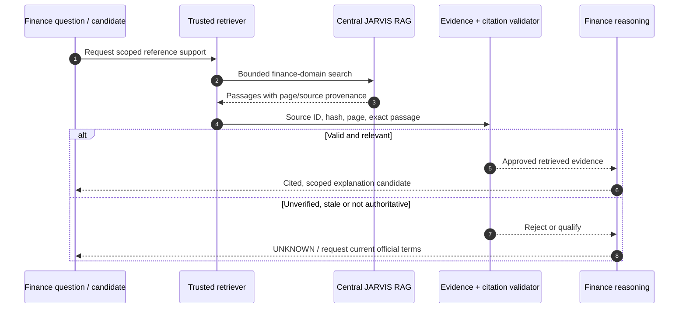

Official current rules and actual custodian/provider documents outrank JARVIS-authored examples. Page citations must resolve to exact bytes and entail the claims they support. **Indexed ≠ cited ≠ correct ≠ production approved.**

---

## 10. E — Finance AI, deterministic decision contract, and Chief

**E is an assurance pipeline**, not a free-form prompt chained directly to a dashboard. Its general decision runtime remains unaccepted even though the contract design was approved for isolated testing.

### Approved design basis

- **Candidate:** authoritative typed financial-decision contract `v1.0.0-rc.1`.
- **User-approved scope:** isolated implementation and testing only.
- **Candidate archive SHA-256:** `ae45300455c23cd4bc7832598a366900740a251acc2d6e92a025e5892f3c41d3`.
- **Approved technical defaults:** 24-hour spendable cash, 24-hour quoted-rate ceilings, debt tie-break higher APR then stable ID.
- **Version rule:** preserve candidate bytes and separate approval receipt; approval does not rewrite historical draft metadata.
- **Financial execution authority:** always **false**.

### Typed contract components

| Document type | Role |
|---|---|
| `FINANCE_INPUT` | Trusted adapter's validated facts and policy references |
| `MODEL_PROPOSAL` | Bounded Fin-R1 or Qwen3 candidate/template/proof selections |
| `FINANCE_OUTPUT` | Trusted deterministic gate's validated metrics, decisions and proof certificates |
| `USER_PROFILE` | Versioned intentions and separately labeled user-reported facts |

Money is represented as **exact integer cents**; financial rates as typed decimal strings with explicit units (APR, APY, YTM, etc.); evidence uses state/basis/citations; unsupported numbers remain null with the correct typed reason. Date/cadence logic distinguishes weekly, biweekly, semimonthly, monthly, irregular and unknown schedules.

### Required reasoning sequence

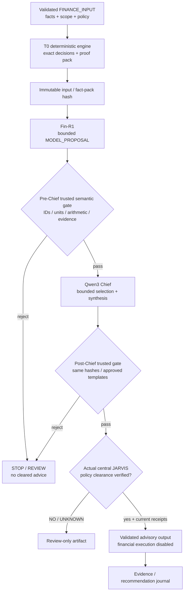

**The two AI models should select from validated decisions; they must not manufacture source facts, monetary amounts, rates, approval receipts, eligibility claims, or arbitrary executable instructions.** A syntactically valid JSON proposal can still be semantically wrong.

### Evidence from previous experiments

| Validation event | Evidence and limitation |
|---|---|
| V0.9C.3 | A live synthetic failure **stopped before Chief** when Fin-R1 output contained cadence, currency, and transfer-classification defects. |
| V0.9C.4 | Synthetic fact-locked Fin-R1 → Qwen3 targeted gates passed; one analyst/Chief attempt each. Saved result remained **`REVIEW_REQUIRED`**. |
| V0.9C.4 quality | Internal heuristic **100/100** did **not** measure independent benchmark lift. Human review found misleading cash-flow explanation and a savings-cadence discrepancy requiring correction. |
| V0.9C.5 R2.1 | Independent adversarial set yielded **5/14 correct classifications**; 9 semantic mismatches remained despite later unit-test improvements. |
| R3 Stage 1 | Case-specific typed-decision/rendering protection for a pinned synthetic fixture, not a general finance engine. |
| Contract archive | **40 synthetic cases**, **15 semantic negatives**, schema and source-integrity checks in an offline specification package. Passing package consistency does not establish runtime semantic rejection. |

### E's remaining mandatory gates

1. Verify host-local source/policy/version hashes and exact dependency environment.
2. Implement a **general** deterministic engine independent of fixture case IDs.
3. Pass **100%** of required deterministic arithmetic and decisions, reject **all 15** semantic counterexamples, and pass independent boundary/adversarial tests.
4. Verify actual central router/policy/confidence/escalation bindings; no `TEST_STUB` for production clearance.
5. Prove bounded, page-cited use of V0.8E references in real Chief responses.
6. Separately authorize and perform a guarded synthetic Fin-R1 → Qwen3 run, after offline engine acceptance.
7. Compare performance with an independent same-input baseline, rather than equating prompt compliance to reasoning improvement.
8. Return a separate tested handoff for Master end-to-end acceptance. **Design approval alone does not grant production approval.**

---

## 11. Five finance intelligence lanes

These are the desired *consumer capabilities*. Their existence in this README does **not** claim all five are implemented or continuously operating.

| Lane | Core question | Deterministic inputs | Potential advisory output |
|---|---|---|---|
| **F1 — Market Intelligence** | What changed publicly? | Qualified public source events, period-consistent index/rate data | Important changes, provenance, uncertainty, expiration |
| **F2 — Debt Strategy** | What repayment action is affordable? | Verified balances, APR types, due dates, income, protected reserves | Scenario comparison, contractual-risk flags, debt priority |
| **F3 — Future Allocation** | Where should *verified available* funds go next? | Cash headroom, obligations, goals, portfolio constraints | Bounded alternatives, gaps and tradeoffs |
| **F4 — Portfolio Opportunities** | Which opportunities merit research or monitoring? | Verified private exposure + independently labeled market context | Up to four research/hold/rebalance/avoid candidates, **not orders** |
| **F5 — Financial Health** | Can the current plan actually work? | Posted income, spending, scheduled bills, debt, reserves | Cash-flow trends, forecast risks, missing-evidence flags |

### Cross-lane arbitration

A possible market opportunity can be objectively attractive yet currently **unaffordable**. Debt, reserve, and investment lanes should not issue mutually conflicting spending instructions. A future Capital Arbiter will compare **validated** priorities against policy and liquidity, then present a review-only explanation.

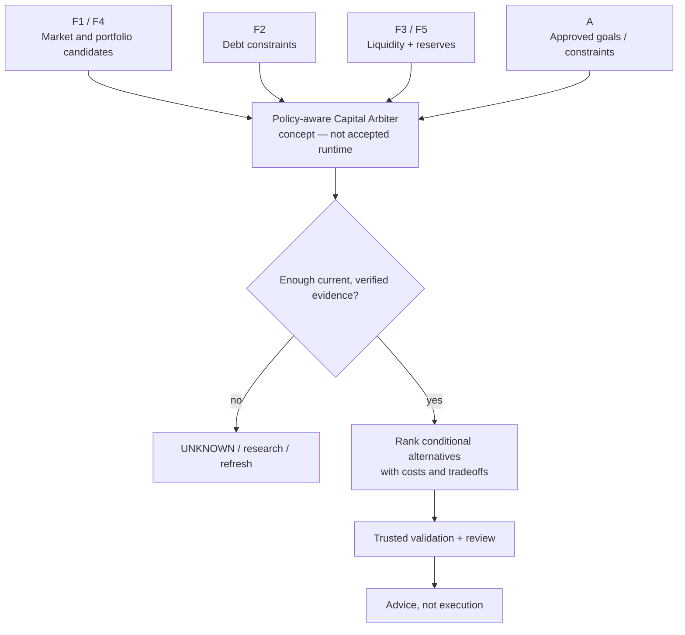

### Learning and accountability — planned

An eventual **Decision Journal** should record accepted evidence hashes, source dates, calculations, alternative options, explanation, expiration, actual user-approved action (if any), and later outcomes. A **paper portfolio** may test the quality of investment ideas without trading real assets. These are design goals, not accepted live capabilities.

---

## 12. F — Finance Command Center and Home Assistant

**F dashboard UI and local Home Assistant deployment: ACCEPTED.** **Live current financial snapshot mapping: PENDING.** This separation is intentional.

### Delivered interface

| View | Intended presentation | Accepted evidence |
|---|---|---|
| **Finance Chief** | Trusted analysis, limitations, limited review-only recommendations | UI verified; no accepted current Chief feed yet |
| **Market Watch** | Public market snapshots, filings, source dates, review/quarantine state | UI verified; D source mapping not accepted |
| **Cash Flow & Debt** | Inflows, spending, reserves, debt by verified as-of date | UI verified; B/C current snapshot absent |
| **Strategy Lab** | Deterministic scenario comparisons and allocations | UI verified; live validated scenario engine not accepted |

**Deployment architecture:** `jarvis-finance-command-center.service` is installed on SKYNET-CORE; the dashboard is served at **port 8792** on the local network and embedded as Home Assistant iframe views. The deployed project directory is `finance/dashboard/command_center/v0_1`. Historic deployment evidence recorded an enabled/active service, health checks, 44 Python passes and 7 JavaScript passes.

> [!NOTE]
> A sanitized dashboard screenshot can be added at `assets/finance-command-center.png` next to this README and enabled by uncommenting the image link near the top. Do not publish internal hostnames, IPs, personal balances or account identities.

### Publication contract

- **Schema:** `jarvis.finance.dashboard_snapshot.v0_1`.
- **Default private saved file:** `~/.local/share/jarvis-finance-private/dashboard/latest.json`.
- **Reader:** local Finance dashboard only.
- **Producer:** an accepted, trusted snapshot publishing step that consumes validated C/D/E outputs.
- **Required metadata:** original as-of dates, observation times, scope coverage, reconciliation status, source lineage, last-good vs latest-attempt state, staleness and advisory clearance.
- **Forbidden on page refresh:** new bank pulls, live market collection, model inference, financial transactions, scheduler changes, or source edits.

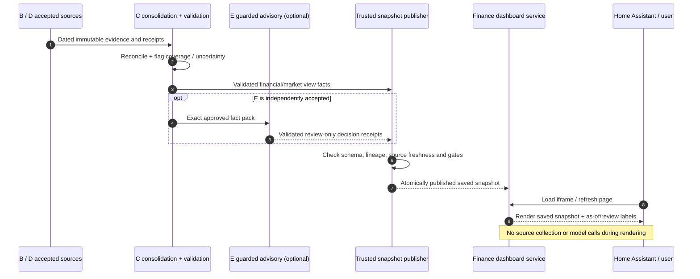

### Dashboard acceptance boundary

A green web service is **not** proof that the displayed amounts are verified, recent, or complete. The legacy May CSV is expressly unsuitable as a current snapshot. Until a validated file is published, empty financial panels and a waiting Chief report are correct behavior.

---

## 13. Data contracts, provenance, and freshness

### Evidence hierarchy is claim-specific

For a particular claim, compare source subject/account, fact type, unit, period, jurisdiction, integrity and relationship to original records **before** claiming one document outranks another. Examples:

- Authenticated issuer statement → authoritative for its own statement-period balance.
- Posted bank record → authoritative for a specified settled receipt/availability claim.
- Payroll source record → authoritative for earnings/deductions; bank posting → authoritative for actual cash receipt.
- Accepted user policy → authoritative for preferences and goals, **not** current cash or APR.
- Deterministic computed fact → inherits the authority and uncertainty of its parents.
- Research PDF → explanatory context only, unless it is itself the relevant original source.

### Facts need more than values

A trusted number must remain attached to a **source**, **original period**, **observation time**, **basis**, **unit**, **coverage state**, and **reconciliation state**. The consumer must know whether a value is `VERIFIED`, `USER_REPORTED`, `SCENARIO_ASSUMPTION`, or unknown/conflicted.

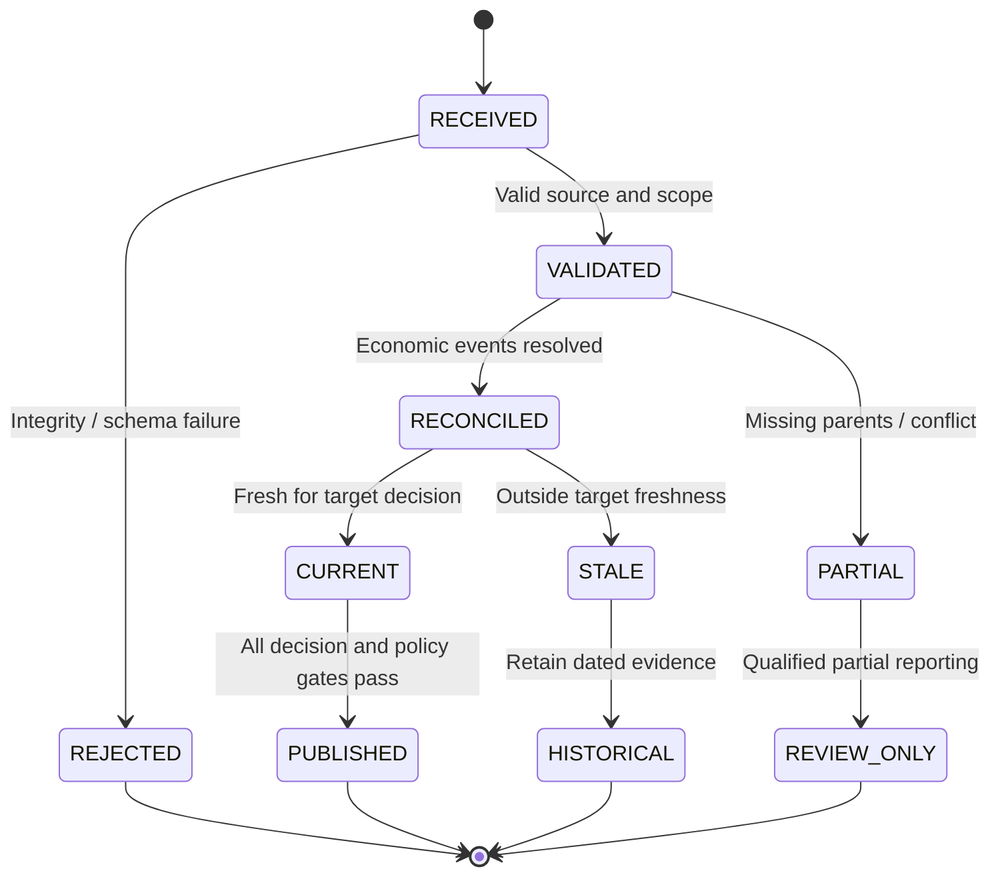

**Do not conflate the document's validity with currency.** A correctly parsed six-month-old account extract is still old. A fresh scraper execution timestamp does not make old reference rates executable or old loans current.

### Freshness classes

| Class | Meaning | Correct behavior |
|---|---|---|
| `FRESH` | Source current within the claim's configured window | May be considered with other completeness, suitability and policy gates |
| `AGING` | Approaching expiry (where defined) | Warn; review before important downstream decisions |
| `STALE` | Outside the applicable window | Keep historical label; do not silently use as current decision input |
| `UNKNOWN` | Timing/source cannot be established | Block affected determinate claims |
| `UNAVAILABLE` | Collection failed or source absent | Retain last-good with its old as-of; report missing coverage |
| `CONFLICT` | Two material claims disagree unresolved | Block dependent decision until reconciled |

The accepted **24-hour** technical ceilings apply only to the approved decision-contract categories **spendable cash** and **quoted rates**, not indiscriminately to Treasury historical curves, monthly loan statements, quarterly 13F filings, or source-appropriate publication cycles.

### Publication is a separate trust gate

A snapshot should be marked publishable only when its sources, contract version, immutable receipts, reconciliation, scope, policy clearance and destination permissions pass. A source can be *valid for historical display* but *not usable for a present-tense recommendation*.

---

## 14. Scheduling and unattended operations

**Schedule policy:** use `America/Chicago` consistently, retain Tuesday as a discretionary JARVIS rest day, and reserve weekends for separately inventoried heavy processing. The presence of a schedule in documentation does not prove it is installed.

### D v1.8.1 collection-only timer proposal — prepared, not commissioned

| Unit / step | Proposed local schedule | Activity | Acceptance status |
|---|---|---|---|
| `jarvis-marketd-check.timer` | Monday / Wednesday / Friday **08:15, 12:00, 15:45** | Deterministic on-disk snapshot-age check; no fetch | Local tests only; not shown installed |
| `jarvis-marketd-refresh.timer` | Monday / Wednesday / Friday **21:15**, Thursday **22:00** | Pinned official ARKK / Treasury / FRED collectors and alignment | Local tests only; unattended run not proven |
| FDIC step within refresh | **Fourth Thursday** inside Thursday 22:00 job | Published FDIC reference collection | No separate competing timer |
| Tuesday | **No D timer work** | Rest-day policy | Prepared schedule design only |
| Saturday / Sunday | **Unscheduled heavy work** | Must be inventoried and explicitly approved | No inferred jobs |

Timer wrapper behavior: explicit Central timezone, exclusive lock to prevent concurrent runs, no Tuesday catch-up from missed timers (`Persistent=false`), pinned collector hashes, and immutable success/failure receipts. The handoff documents a collection-only policy exception to a broader `READ_ONLY_SHADOW` source policy; **Master must reconcile this exception with the central JARVIS policy record** before sign-off.

### Other desired cadences (not evidence of installed automation)

| Source / workload | Desired or source-appropriate refresh | Open operational proof |
|---|---|---|
| Actual/Simply Budget | **Daily** extraction if bank sync is fresh | Timer/job, complete scope, upstream bank sync and receipt |
| Regions / SoFi | Refresh suitable for posted deposit reporting | Authenticated date/ID evidence and de-dup across refreshes |
| Nelnet | **Monthly** | Authenticated monthly worker and loan-group comparison |
| SEC 13F | New filings/amendments when published; quarter-aware | Discovery, idempotency, amendment reconciliation |
| SEC Form 4 | Event/filing cadence | Live accession discovery, persistent dedup and retry |
| M1 public pies | Weekly public target updates | Session-resilient unattended browser/flattening and dedup |
| Finance Chief | Only from validated evidence and approved route | Deterministic engine + central policy + guarded model acceptance |
| Dashboard | Saved-read refresh | No evidence-producing side effects during page requests |

The authoritative scheduler inventory should be obtained from **actual SKYNET unit states and central JARVIS job registry**, not inferred from old design notes or a packaged timer manifest.

---

## 15. Normal processing and failure recovery

### Desired end-to-end operation

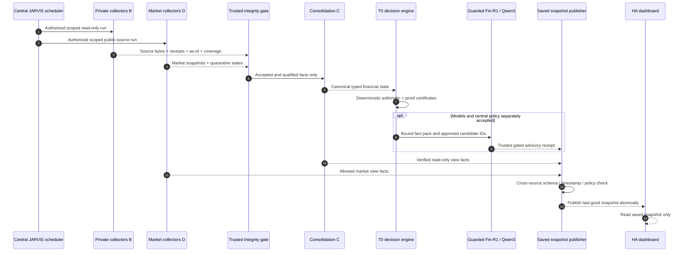

### Fail-closed behavior

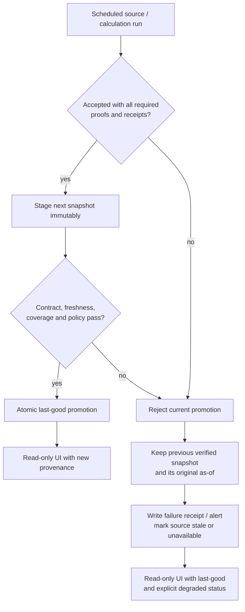

A failed refresh must not destroy or relabel the previous result as current. A model timeout must not turn an unvalidated free-text recommendation into a report. Every retry must be idempotent, and the acceptance test must demonstrate that no duplicate alerts or phantom events were introduced.

---

## 16. Privacy, integrity, and trust boundaries

> [!CAUTION]
> GitHub is **not** the private financial evidence store. Do not commit personal account exports, paystubs, real balances, loan statements, cookies, browser profiles, `.env`, authentication tokens, bank credentials, local raw snapshots, central vector data, or real unredacted dashboard screenshots.

### Public repository versus SKYNET private storage

| May belong in public `03-RDP-VM-Infrastructure/Subsystems/Jarvis_Finance/` | Must stay in private SKYNET storage |
|---|---|
| Architecture diagrams, schemas without private examples | Actual bank/loan/payroll records and bank transaction IDs |
| Sanitized screenshots and illustrative fixtures | Real income, balances, debt principal, family property agreement |
| Test code, redacted test outcomes and design receipts | Browser session cookies, Gusto PDFs, credential material |
| Public RAG document IDs and safe code/documentation references | Private source receipts, account mapping, source originals |
| Nonsecret service/interface descriptions | `.env`, secrets, live backup dumps, tokenized URLs, private LAN topology |

### Design-level trust boundaries

- Source receipts should carry original-byte SHA-256 and actual source effective dates.
- Source-document text, even retrieved through RAG, is **untrusted content** and may contain prompt-injection instructions. Ignore those instructions.
- Model processes must not write trusted approvals, alter manifests, fabricate source receipts, or promote snapshot publication.
- Required financial evidence and central policy clearance must be checked by independently trusted code.
- Preserve **read-only finance V1** even if a model proposes a purchase, payment, account change, or additional borrowing.
- Treat public market reference rates and synthetic examples as **not executable** and **not current user holdings**.

**Safe configuration examples** should use `SKYNET_HOST`, `FINANCE_ROOT`, and other placeholders rather than real credentials or private LAN information.

---

## 17. Observability and operations

### Operational signals the Master should display or log

| Signal | Why it matters |
|---|---|
| Collector last **attempt** and last **success** | A service can run without producing valid evidence. |
| Source original `as_of` / observed time | Separates an old rate or balance from fresh ingestion. |
| Source/account coverage | Identifies missing Regions, SoFi, budget or loan families. |
| Reconciliation status | Prevents duplicated income, cross-account transfers and loan double counting. |
| Quarantine count/reason | Makes ambiguous SEC filing identity and failed schema checks visible. |
| Last-good snapshot hash and age | Supports precise failure recovery. |
| Decision contract/policy/model versions | Ensures replayability and correct approval lineage. |
| RAG citation/source validity | Prevents merely retrieved text from becoming an authoritative claim. |
| Chief acceptance state | Distinguishes draft, review-only and cleared advisory. |
| Timer/lock/run receipt | Demonstrates true unattended operation and prevents duplicate jobs. |
| Dashboard snapshot status | A healthy UI can still be empty or show dated historical evidence. |

### Safe, read-only operator checks (examples)

```bash
# Run from SKYNET-CORE in an authenticated shell. These commands inspect only.
systemctl status jarvis-finance-command-center.service --no-pager
systemctl is-enabled jarvis-finance-command-center.service
systemctl list-timers --all | grep -E 'jarvis-marketd|gusto|finance' || true

# Check specific Market Watch units without enabling or starting them.
systemctl is-enabled jarvis-marketd-check.timer jarvis-marketd-refresh.timer 2>&1 || true
systemctl is-active jarvis-marketd-check.timer jarvis-marketd-refresh.timer 2>&1 || true

# A timestamp on a local snapshot is not proof of its upstream source's as-of time.
# Never paste raw private snapshot contents into public issue threads.
```

The canonical Market Watch v1.8.1 specialist handoff contains a scoped, hash-checked `install.sh` process. **Do not run `activate` from this README alone**; activation and acceptance are separate operational approvals.

---

## 18. Implementation roadmap

We use **two functional finish lines** to avoid making valuable read-only financial reporting wait on optional payroll PDFs or every market/AI feature.

### Delivery sequence and dependencies

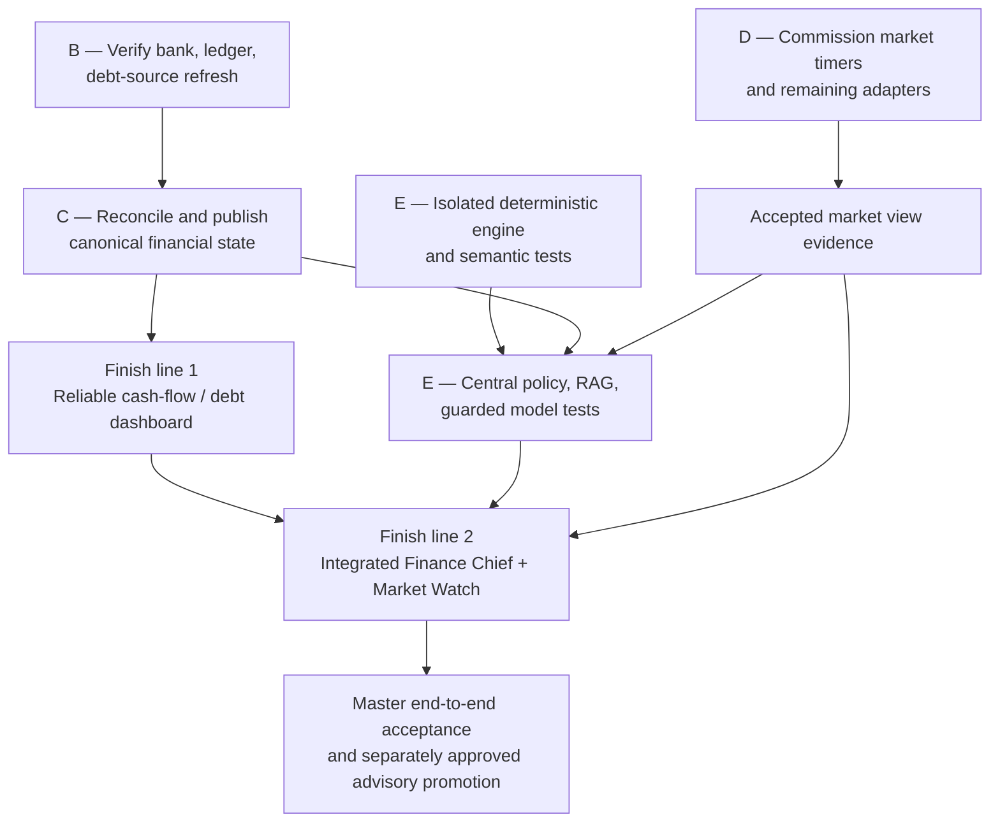

### Finish line 1 — useful, validated financial visibility

- [ ] Verify Regions and SoFi posted deposits with original posting time/account provenance.
- [ ] Prove Actual/Simply Budget **fresh upstream bank sync**, daily read-only extraction and complete scope receipts.
- [ ] Prove Nelnet monthly source evidence or show its balance **last verified as of** the previous authenticated date.
- [ ] Establish C's canonical normalization, economic-event dedup, transfer and payroll reconciliation.
- [ ] Publish **only** typed, current-or-qualified financial view facts to `jarvis.finance.dashboard_snapshot.v0_1`.
- [ ] Verify Cash Flow & Debt / non-AI parts of the Dashboard using accurate as-of, coverage and degradation labels.

**This milestone does not require Gusto Stage 2 PDF capture**, Fin-R1 production acceptance, or completion of every optional Market Watch adapter.

### Finish line 2 — full evidence-backed Finance Intelligence

- [ ] Complete D's timer activation, first and second unattended receipts, remaining M1/Form 4/13F discovery, and failure recovery.
- [ ] Complete E's general decision engine; pass all mandatory cases and semantic negatives.
- [ ] Bind exact real JARVIS router/policy/confidence/escalation contracts and immutable approval receipts.
- [ ] Integrate the accepted RAG corpus through bounded, page-cited retrieval.
- [ ] Pass authorized guarded synthetic Fin-R1/Qwen3 inference and independent holdout evaluation.
- [ ] Connect accepted Chief outputs to the existing Finance Chief / Strategy Lab views.
- [ ] Prove end-to-end scheduler → evidence → C → T0 → guarded Chief → stored snapshot → HA behavior.
- [ ] Run adverse-case and restart/recovery acceptance before requesting production advisory authorization.

### Defer rather than block V1

- Gusto Stage 2 payslip-PDF automation (optional; separately preserved).
- Ghostfolio/portfolio engine and OpenBB research integration unless needed to establish a verified current holdings/rates claim.
- Firefly migration: historical proposal only; avoid a competing ledger without explicit approval.
- Paper portfolio, automated learning, and broader capital arbitration until deterministic and policy gates have passed.
- Automated execution of trades, loans, transfers and payments: **out of scope** for Finance V1.

---

## 19. End-to-end acceptance criteria

**Master acceptance** requires operational evidence—not a consolidated screenshot, passing archive verifier, or one-off successful script.

| Gate | What must be proved | Status from handoffs |
|---|---|---|
| **G0 — Specialist contracts** | Exact version/hash, accepted source ownership, no incompatible changes | Partial; RAG, F UI and contract design have bounded acceptances |
| **G1 — Collector health** | Real unattended successful source refresh, correct source time and source scope | **OPEN** for B recurring freshness and D timers |
| **G2 — Reconciliation** | No duplicate paycheck/transfer/credit-card or loan counting; traceable parents | **OPEN** |
| **G3 — Canonical snapshot** | Correct schema, coverage, source lineage, stale/unknown handling and last-good state | **OPEN** |
| **G4 — Deterministic engine** | 40 specified cases + all semantic negatives + independent boundaries with zero hard failures | **OPEN** |
| **G5 — RAG + AI** | Exact cited retrieval, guarded Fin-R1/Qwen3, independent scoring | **OPEN** (RAG indexing itself accepted) |
| **G6 — Central policy** | Real route/confidence/escalation binding and approval receipt | **OPEN** |
| **G7 — Dashboard evidence** | Four views read saved truthful data; no data collection on refresh | UI **DONE**; data wiring **OPEN** |
| **G8 — Recovery** | Failure, timeout, missing account, stale data, restart, idempotent second run | **OPEN** |
| **G9 — Release authorization** | Separate Master review and explicit advisory-only approval | **NOT GRANTED** |

### Mandatory adverse-case tests

- Duplicate aggregator view of the same deposit; own-account transfer with one missing leg.
- Biweekly versus semimonthly payroll, partial destination coverage, missing gross-pay document.
- Overlapping statement periods and stale current-cash observations.
- Incorrect money units, APR versus APY confusion, one-cent threshold boundaries and invalid JSON.
- Missing Nelnet refresh or a loan-group disagreement; insufficient debt APR coverage.
- Ambiguous SEC 13F repeated identity/amendment and zero publishable alerts.
- Historical FRED price levels mistaken for investment total returns.
- Model-generated unsupported balance, interest rate, eligibility, HSA rule, or fabricated citation.
- Model timeout, stale RAG response, missing policy binding, altered fact-pack hash.
- Second scheduled run, last-good checkpoint after a forced failed refresh, duplicate-alert suppression.
- Restart of scheduler/dashboard without a silent restart of prohibited models or source acquisition.

**Acceptance means:** the system can produce reproducible, current-or-honestly-qualified reports end to end, with source lineage, bounded advice, appropriate degraded behavior, and **zero financial execution authority**.

---

## 20. Repository layout and documentation maintenance

The following tree distinguishes **known paths** from **documentation or future integration targets**. It is not a claim that every proposed folder or file exists on SKYNET.

```text
<repository-root>/
└── 03-RDP-VM-Infrastructure/
    └── Subsystems/
        └── Jarvis_Finance/
            ├── README.md                      # this page
            └── assets/
                └── finance-command-center.png # ADD sanitized image when ready

SKYNET-CORE (separate working tree and private state)
$HOME/rdp-scripts/Jarvis/
└── finance/
    ├── dashboard/command_center/v0_1/        # deployed UI
    ├── source_of_truth/market_watch/
    │   ├── manifest.json                    # seven-document historical registry
    │   └── manifest_v08e.json               # accepted ten-document extension
    ├── market_watch/ops/v1_8_1/             # proposed collection-timer receipts
    ├── ops/tools/                           # versioned lab and collector utilities
    └── _staging/                            # isolated candidate evidence; not public

$HOME/.local/share/jarvis-finance-private/
└── dashboard/latest.json                    # intended accepted private snapshot

/var/lib/jarvis/vector/jarvis_vectors.db     # central private RAG store
```

### Screenshot instructions

1. Capture the approved four-view Finance Command Center screenshot.
2. Mask financial figures, names, account identities, device IPs, internal hostnames, private folders and service tokens.
3. Save it as `03-RDP-VM-Infrastructure/Subsystems/Jarvis_Finance/assets/finance-command-center.png`.
4. Commit the sanitized screenshot, then uncomment the Markdown image line near the top of this README to display it on GitHub.

### Updating this document

On every accepted specialist handoff, update: **as-of date**, workstream status table, latest proven evidence, outstanding gates, and any changed contract or source schema. Do not convert a planned feature into a green status just because code was uploaded or a demo passed. Major implementation changes require their own specialist records and Master review.

---

## 21. Evidence and provenance

This README is based on specialist documentation and terminal evidence through **October 29, 2026**, not a fresh authenticated query to SKYNET. The dated source set includes:

| Record | Scope and disposition |
|---|---|
| **Finance Architecture & Build Plan** | Original control plane, model capabilities, five lanes, software integration options and safety philosophy; contains historic options that do not all represent accepted implementation |
| **Real Estate Strategy V1.4** | Private four-property intent and policy gates, not verified present-tense account facts |
| **JARVIS Finance RAG V0.8E OneNote Handoff** | Ten-document registration/index/retrieval **accepted**; Chief citation and automatic retrieval **not accepted** |
| **Finance Dashboard V0.1 Handoff** | Local service and HA UI **accepted**; schema-driven current financial content **pending** |
| **Finance Decision Contract v1.0.0-rc.1 + approval receipt** | Exact candidate archive hash, separately recorded **design-only approval**, technical defaults and no execution rights |
| **Finance AI Validation Master Handoff — Oct 25** | Offline candidate proof with outstanding semantic, runtime, policy and model acceptance gates |
| **Collector B OneNote Closeout — Oct 29** | Specialist chat closed with Gusto Stage 2 deferred; recurring bank/Actual/Nelnet collection still unverified |
| **Market Watch D v1.8.1 Rebuilt Handoff — Oct 29** | Live source-collection evidence and prepared timer release; **server activation/unattended acceptance not yet verified** |
| **Market Watch D v1.1 shadow README / SKYNET transcript — Oct 27** | Historical staged SEC alignment and 15/15 regression tests, with zero publishable SEC events |

Where these sources disagree in maturity, use the **latest explicit acceptance claim** in the relevant specialist lane. For example, the historical Firefly-first proposal does not override the later Collector B Actual/Simply Budget preference; similarly the Market Watch v1.8.1 live source successes do not prove timers were activated.

**Recommended documentation policy:** preserve detailed unredacted handoffs privately; publish summaries, schema names, sanitized test results and selected nonsecret hashes here. Do not link to private source documents with public repository URLs unless their disclosure has been reviewed.

---

## 22. Glossary and project principles

| Term | Meaning |
|---|---|
| **As-of** | When the underlying financial or market fact was valid/effective. Not the time the parser ran. |
| **Observed at** | When JARVIS collected or inspected a source. Does not refresh old source facts. |
| **Last-good** | Most recent verified accepted snapshot; not necessarily current. |
| **Scope coverage** | Which accounts, dates, transactions, obligations, markets or providers a result actually includes. |
| **Fact lock** | Independent trusted gate that prevents model proposals from altering verified facts or validated decision options. |
| **Typed decision** | Validated structured decision with units, proof, uncertainty and permitted recommendation meaning. |
| **Synthetic fixture** | Artificial test inputs, not actual user holdings, earnings or debts. |
| **Shadow-only** | Data staging or evaluation without production publication, advice clearance or execution authority. |
| **Review-only** | Human-inspectable candidate; not a fully cleared current recommendation. |
| **RAG** | Retrieval-augmented generation using a cited, source-identified reference corpus. |
| **Public portfolio target** | Published allocation example (e.g., M1 pie or ETF holdings); not authenticated ownership by the user. |
| **Central policy clearance** | Verified result of actual JARVIS governance checks; not something Fin-R1/Qwen3 can self-declare. |

### The project in one sentence

> **Actual/Simply Budget and verified financial sources explain what happened; Market Watch explains what public markets reported; deterministic code proves what the numbers mean; Fin-R1 and Qwen3 propose what may matter; JARVIS validates and prioritizes those proposals; Home Assistant displays only what has passed the appropriate trust gates.**

**JARVIS Finance remains an evidence-first, human-controlled advisory subsystem.** Its successful future integration will be measured by verified source coverage, reliable reconciliation, transparent uncertainty, reproducible decisions, resilient scheduling, and honest dashboard publication—not by the number of connected services or model outputs.
