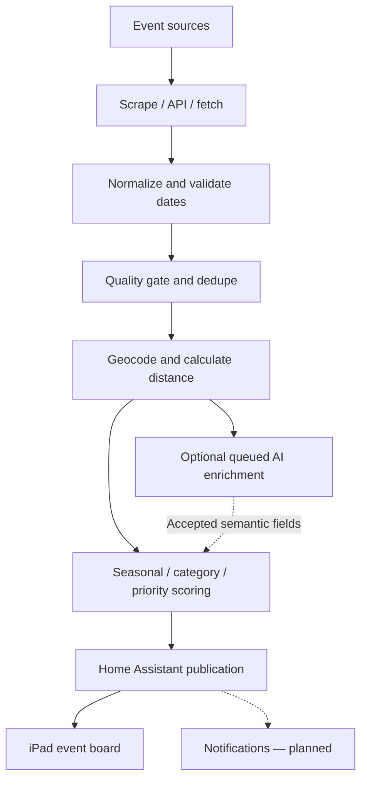
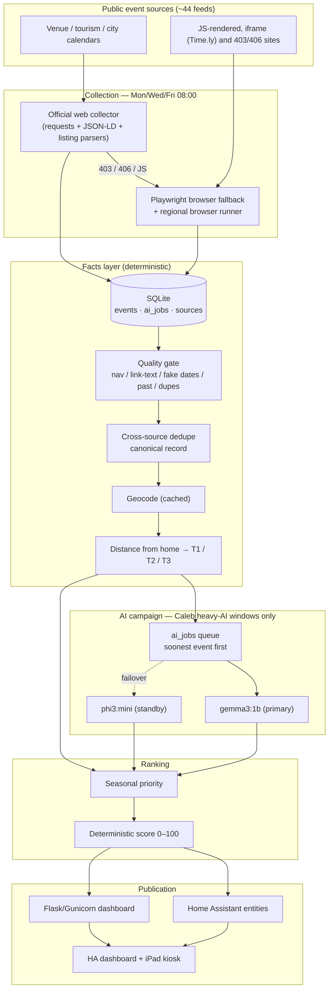
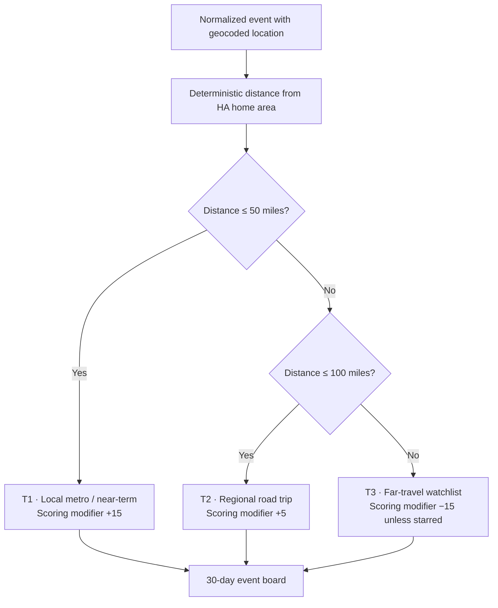
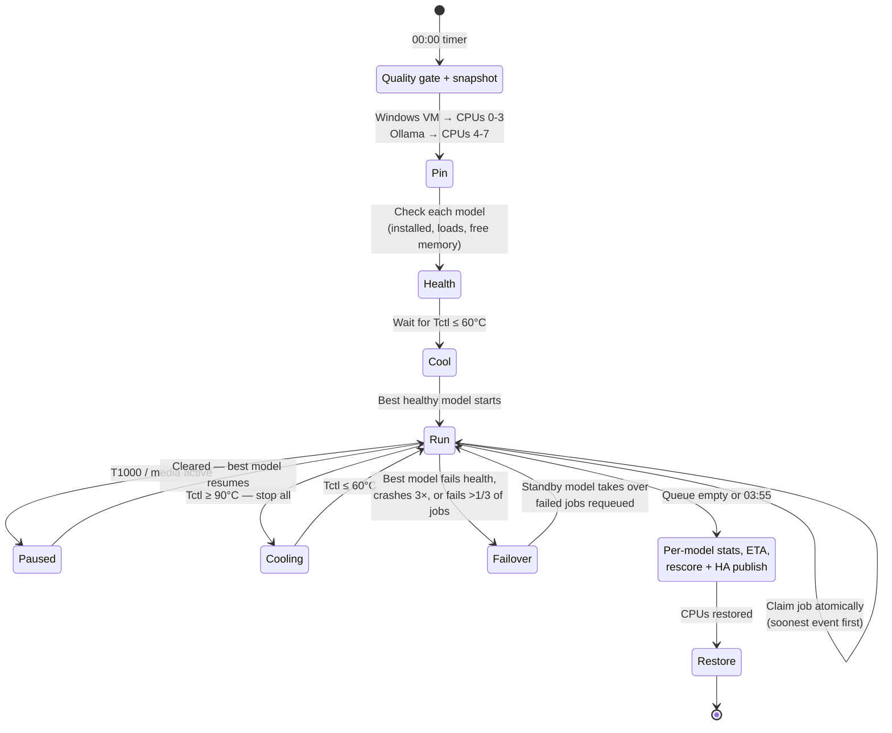

# Local Events Intelligence Board

> **A rolling 30-day, distance-aware event discovery and recommendation board for SKYNET / JARVIS**<br>
> Public event sources · Data-quality gating · Deduplication · Geocoding · Optional, queued AI enrichment · Deterministic scoring · Home Assistant and iPad kiosk

**Documentation checkpoint:** November 3, 2026 · **System:** SKYNET / JARVIS · **Repository location:** `03-RDP-VM-Infrastructure/Subsystems/Local-Events/README.md`<br>
**Owner:** Tyrone · **Primary area:** Dolomite / Birmingham, Alabama<br>
**Platform:** Home Assistant Green · Python collectors/application services on SKYNET · iPad kiosk<br>
**Documented state (Nov 3–4, 2026):** **Core board and deterministic pipeline operational in recorded tests** · **AI campaign hardening / backlog processing ongoing**

> [!IMPORTANT]
> Statuses summarize the dated checks in [Evidence and provenance](#14-evidence-and-provenance); they are **not live health checks**. Verify exact schedules with installed systemd timers. A test PASS does not guarantee a currently running service. Home coordinates, LAN addresses, credentials, tokens, and other private host details must not be committed.

---

## Table of contents

1. [Purpose](#1-purpose)
2. [Executive status](#2-executive-status)
3. [End-to-end pipeline](#3-end-to-end-pipeline)
4. [Sources and coverage](#4-sources-and-coverage)
5. [Distance model](#5-distance-model)
6. [Data-quality gate](#6-data-quality-gate)
7. [AI classification campaign](#7-ai-classification-campaign)
8. [Scoring, seasonality and categories](#8-scoring-seasonality-and-categories)
9. [Home Assistant and dashboard](#9-home-assistant-and-dashboard)
10. [Scheduling](#10-scheduling)
11. [Failure handling and recovery](#11-failure-handling-and-recovery)
12. [Operations runbook](#12-operations-runbook)
13. [Open items and roadmap](#13-open-items-and-roadmap)
14. [Evidence and provenance](#14-evidence-and-provenance)
15. [Design principles and lessons](#15-design-principles-and-lessons)

---
## Local Events Intelligence Dashboard

<p align="center">
  
</p>

<p align="center">
  <em>Local Events Intelligence Board — automated event discovery,
  geographic prioritization, seasonal scoring, and event recommendations
  integrated with Home Assistant.</em>
</p>

## 1. Purpose

The Local Events Intelligence Board automatically discovers events for weekend plans, nearby outings and regional road trips, reducing the need to search multiple websites manually. It prioritizes what is nearby or upcoming without hiding worthwhile longer-distance events.

The board is designed to show:

- a **rolling 30-day list** sorted by relevance, distance and date;
- **three distance columns**: within 50 mi, 50–100 mi, and a 100+ mi travel watchlist;
- **Top Picks**, event scoring, scraper health and quick stats;
- per-event details: title, date/time, city/venue, tier, category, source and link.

**Planning intent:** surface fresh local options before each weekend, maintain a regional road-trip shortlist, and keep a far-travel watchlist. The goal of attending **2+ local events per month** and planning a regional trip every few months is a project success target, **not a measured usage metric**.

**Operating rule:** collection, normalization, deduplication, geocoding, distance calculations, deterministic scoring and publication must continue even when AI is unavailable. Notifications are a planned output and should not be described as delivered until their timer and delivery evidence is verified.

---

## 2. Executive status

| Area | State as of Nov 3, 2026 | Notes |
|---|---|---|
| Collection (HTTP + Playwright fallback) | **Production** | Mon/Wed/Fri 08:00 refresh |
| Data-quality gate | **Production (new)** | Runs inside every refresh and nightly at 00:20; reversible |
| Date parser hardening | **Production (new)** | No more invented "today at noon" dates |
| Dedupe / geocode / distance tiers | **Production** | Geocode cache keeps public lookups near zero |
| Scoring v1.6.0 + seasonal priority | **Production** | Deterministic; independent of AI |
| Home Assistant publish (11 entities) | **Production** | Last verified PASS on Nov 3 |
| Web dashboard (Flask/Gunicorn) | **Production** | "Time TBA" and "Other" fallbacks added |
| AI classification backlog | **Processing** | First scheduled window started Nov 4 00:00 (gemma3:1b); ~325 jobs pending at start |
| Parallel multi-model AI | **Tested; not adopted** | Measured slower on this hardware; standby/failover mode chosen instead |

### November 2026 hardening changes (recorded)

- Navigation links ("See all shows", "Newsletter Signup"), link text ("Learn More : …"), fabricated dates and past events were reaching the board. Root cause and fix: [section 6](#6-data-quality-gate).
- **271 junk or stale rows suppressed** on the first gate run, and the matching AI jobs skipped, so the model no longer spends time on them.
- The AI backlog moved from one-off chunk scripts to a **scheduled, thermal-aware campaign** with atomic job claiming, retry caps, model failover and an end-of-window summary.

---

## 3. End-to-end pipeline

### At a glance



### Detailed acquisition and publication architecture

Python owns facts: dates, times, venues, coordinates, distance, tier, dedupe and the final score. The language model only adds semantic fields (clean title, category, tags, interest), and **everything before and after AI keeps working when AI is unavailable**.



**Main code paths** (under the project root on SKYNET):

| Stage | Module / script |
|---|---|
| Fast collector | `app/collectors/official_web_events.py` |
| Browser fallback | `app/collectors/browser_fallback_events.py`, `regional_browser_runner.py` |
| Source registry | `app/collectors/regional_source_pack.py`, `specialty_source_pack.py` |
| Quality gate | `app/services/quality_gate.py` |
| Dedupe / geocode / distance | `app/services/deduplicate.py`, `geocode_events.py`, `distance.py` |
| AI (single batch) | `app/services/ai_batch.py`, `ai_worker.py` |
| AI campaign supervisor | `app/services/ai_parallel.py`, `bin/run_ai_parallel.sh` |
| Seasonal / scoring | `app/services/seasonal_priority.py`, `scoring.py` |
| Publish | `app/services/ha_publish.py` |
| Dashboard | `app/web/dashboard.py` |
| Refresh orchestration | `bin/refresh_local_events.sh` |

---

## 4. Sources and coverage

Sources are tracked like integrations: name, method, reliability and health. Health distinguishes **healthy + events**, **healthy + seasonally empty** and **degraded**.

| Market | Tier | Sources |
|---|---|---|
| **Birmingham metro** | T1 | BHMSTR, BJCC, Alys Stephens Center / UAB Arts, Saturn, Avondale Brewing, Iron City, Birmingham Zoo, Botanical Gardens, Railroad Park, McWane Science Center, Alabama Symphony, Hueytown High Football |
| **Pelham** | T1 | Oak Mountain State Park |
| **Tuscaloosa** | T1 (~40 mi) | Visit Tuscaloosa |
| **Huntsville** | T2 (~89 mi) | Huntsville CVB, We Are Huntsville (Time.ly iframe), Von Braun Center, Lowe Mill, Rocket City Mom, MidCity District, U.S. Space & Rocket Center, Ditto Landing |
| **Nashville** | T3 | Visit Music City (403 → Playwright) |
| **Gatlinburg / Smokies** | T3 | Gatlinburg CVB, Ober Mountain, Dollywood |
| **Mobile** | T3 | Visit Mobile, City of Mobile, Downtown Mobile Alliance, Mobile Carnival Museum, Saenger Theatre, USS Alabama |
| **Pensacola / Beach** | T3 | Visit Pensacola, Seafood Festival, Pensacola Mardi Gras, Pensacola Beach calendar, Bands on the Beach |
| **Daytona Beach** | T3 | Daytona CVB, Daytona International Speedway, Ocean Center, Peabody Auditorium / Bandshell, Bike Week |
| **Orlando** | T3 | Visit Orlando |

Some feeds surface events outside their home city (for example Lake Buena Vista or Hartford, TN). Tier always comes from the **event's own coordinates**, never from the parent source.

> [!NOTE]
> "Healthy + empty" is only trustworthy if the parser can't invent rows. Before the November fix, several seasonal sources reported events out of season because undated text was being stamped with today's date. See [section 6](#6-data-quality-gate).

---

## 5. Distance model

The project moved from named city lists to **deterministic distance from the Home Assistant home location**. The home coordinates are fetched privately from HA and never sent to public geocoders.

| Tier | Distance | Board column | Scoring modifier |
|---|---|---|---|
| **T1** | 0–50 mi | Within 50 miles (green) | +15 |
| **T2** | >50–100 mi | 50–100 miles (blue) | +5 |
| **T3** | >100 mi | Travel watchlist (purple) | −15 (unless starred) |



City-level geocodes produce identical distances for every event in a city (for example every Huntsville event at ~89 mi). That's accurate for tiering. Venue-level geocoding is used when a venue is available.

---

## 6. Data-quality gate

### Root cause found in November

`parse_dt()` in the fast collector called `dateutil.parse(..., fuzzy=True, default=today@12:00)`. With fuzzy parsing, a string that contains no date at all ("See all shows", "Fall", "Newsletter Signup") silently comes back as **today at noon**. That one behavior produced:

- navigation and boilerplate rows appearing as events dated today;
- every time on some sources showing as 12:00 PM (117 of 117 for one source);
- seasonal sources (for example Mardi Gras) reporting events out of season.

**Fix:** the parser now also parses each string against two different probe dates. If the two results disagree, the text didn't contain a real date and the parser returns `None` instead of inventing one. Verified: junk strings → `None`; `Nov 14`, `Sat, Dec 5` and `November 14, 2026 7:30 PM` parse correctly.

### The gate (`app/services/quality_gate.py`)

Runs before dedupe in every refresh, nightly at 00:20, and at the start of each AI window. It is **idempotent and reversible**: rows are never deleted, only set `active=0` with a `suppressed_reason`. Starred events are never suppressed.

| Rule | Catches | Example |
|---|---|---|
| `past` | Events whose end (or start) is before today | Previous weekend's concerts |
| `nav` | Navigation / boilerplate titles | "Events", "See all shows", "Privacy Policy" |
| `linktext` | Link text scraped as a title | "Learn More : Glow Wild" |
| `no_date` | No parseable start | — |
| `date_smear` | One listing page stamping the same noon date on many rows, with listing-page evidence (or ≥10 rows) | A week of Nashville events on one date |
| `fake_date` | Noon, no venue, no end, dated the day it was first seen | Undated Huntsville CVB items |
| `dup_same_source` | Same source, same normalized title, same day | Duplicate "Fall Color Special" rows |

The gate also:

- stores `time_known = 0` for date-only events (the dashboard shows **Time TBA**, not a made-up noon);
- fills a **rule-based category** when AI hasn't run yet, mapped to the dashboard's category keys;
- triages AI jobs: suppressed events → `skipped`, beyond the 30-day window → `deferred`, duplicate jobs → `skipped`.

**First run (Nov 2):** 271 rows suppressed, AI jobs for those rows skipped, and a second run changed nothing, which confirms it's idempotent. Board after the gate: T1 97 · T2 129 · T3 121.

```bash
# dry run (report only) / apply
.venv/bin/python -m app.services.quality_gate
.venv/bin/python -m app.services.quality_gate --apply

# undo every suppression
sqlite3 data/local_events.db "UPDATE events SET active=1, suppressed_reason=NULL WHERE suppressed_reason IS NOT NULL;"
```

---

## 7. AI classification campaign

### Policy

- AI runs **only inside Caleb heavy-AI windows**, enforced by `/usr/local/bin/jarvis-caleb-ai-window-open`.
- **T1000-Topology and loaded AI models are mutually exclusive.** If T1000 runs, AI pauses and jobs stay queued.
- Media work (disc ripping, transcoding) also pauses AI.
- Requests go through the **Jarvis AI shared-pool router** (`X-Jarvis-Workload: local_events`), a credit-based pool in front of Ollama.

### Windows

| Window | Purpose |
|---|---|
| Wed 00:00–04:00 | Clears jobs from Monday's refresh |
| Fri 00:00–04:00 | Clears jobs from Wednesday's refresh |
| Sun 00:00–04:00 | Clears jobs from Friday's refresh |

The shared guard allows Wed/Sun 00:00–06:00 and Fri 00:00–04:00 for all heavy-AI jobs; Local Events stops at 04:00 through its own stop timer.

### How a window runs



### Models

| Model | Role | Evidence |
|---|---|---|
| **gemma3:1b** | Primary | Nov 3 test: 44 events, about 82 s/job at 2 threads, average confidence 79; about 67 s/job with full threads in earlier runs |
| **phi3:mini** | Standby / failover | Nov 3 test: 0 of 8 completed at 2 threads (each timed out at 180 s); retired automatically by the quality guard |

"Best" is **measured, not assumed**: every job records which model handled it (`ai_jobs.model`, `events.ai_version`). Models are ranked by successful jobs per hour once they have 8 jobs of history.

### Parallel vs. solo: tested and decided

Both models were tested **in parallel** on the 4-core AI lane in a 2-hour run on Nov 3. Splitting the CPU made both models time out in the first 10 minutes, and running alone was clearly faster. The campaign therefore runs with `max_parallel: 1`: one model at a time with full threads, and the other on standby. Running both at once remains a one-line setting for a second server or measured spare capacity.

### Safety features

- **Atomic job claiming** (`BEGIN IMMEDIATE`): verified with 4 concurrent claimers over 370 jobs, 0 duplicates.
- **Retry cap:** crashes count toward a 3-strike limit. Intentional stops (heat, pauses, window end) requeue the job without counting it.
- **Quality guard:** a model failing more than a third of at least 8 jobs is retired for the window, and its failed jobs are requeued for the standby model.
- **Thermal ladder:** start ≤ 60 °C · shed a worker at 86 °C (parallel mode) · stop all at 90 °C · re-add ≤ 76 °C.
- **Zero-progress guard:** two thermal cycles with no completions end the window.
- **Summary:** printed to the journal and saved in `project_meta` (`ai_parallel_last`, `ai_campaign_last`).

### Thermal basis (strict core-split test, Sep 2)

| Workload on CPUs 4–7 at 400% | Peak | Result |
|---|---|---|
| llama3.2:3b | 92.1 °C in 28 s | Thermal stop |
| embeddinggemma | 87.9 °C | Completed, too close to the limit for long runs |
| phi3:mini + embeddinggemma | 74.6 °C | Completed comfortably |

### Backlog

The large backlog is a one-time effect of the regional source expansion (300+ new events at once). Normal refreshes should only create jobs for new or changed events.

| Date | Pending | Note |
|---|---|---|
| Nov 2 (before gate) | ~640 | Includes junk and stale rows |
| Nov 2 (after gate) | 373 | 271 jobs skipped |
| Nov 3 (after 2 h test) | 324 | 44 classified; failed jobs requeued |

---

## 8. Scoring, seasonality and categories

**Scoring v1.6.0 (0–100, deterministic):**

| Factor | Points |
|---|---|
| Personal interest | 0–35 |
| Category match | 0–20 |
| Keyword relevance | 0–15 |
| Popularity / buzz | 0–10 |
| Weekend bonus | 0–10 |
| Free / value | 0–5 |
| Novelty | 0–5 |
| Distance modifier | T1 +15 · T2 +5 · T3 −15 |

**Seasonal logic:** the year is split into quarters (Q1 winter, Q2 spring, Q3 summer, Q4 fall/holiday). Events relevant to the current season get a one-level priority boost **without changing their distance tier**.

**Categories (dashboard keys):** `music`, `anime`, `technology`, `family`, `food`, `community`, `outdoors`, `arts`, `sports`, `education`, `nightlife`, `film`, `health`.

Examples include concerts and live music; anime and conventions; technology and UAB campus events; family/kids activities; food, markets and festivals; community activities; and outdoor outings. Major Birmingham venues and cultural institutions are preferred sources, **not hard exclusions** for other relevant events. When AI has not classified an event, the quality gate's rule-based category is used; unmatched items display **Other** instead of "Pending".

---

## 9. Home Assistant and dashboard

**Published entities:** `sensor.local_events_total`, `_50mi`, `_100mi`, `_travel`, `_seasonal`, `sensor.event_ai_queue`, `sensor.event_ai_processed`, `sensor.event_duplicates_removed`, `sensor.event_sources_online`, `sensor.local_events_top_pick`, `binary_sensor.event_system_healthy`.

**Dashboard:** Flask behind Gunicorn (2 workers, 2 threads) as `local-events-dashboard.service`, embedded in the HA **Local Events** dashboard (`mdi:calendar-star`) and shown on the iPad kiosk. The page refreshes itself every 5 minutes, so database changes appear without restarting the service. Endpoints: `/`, `/api/events`, `/api/stats`, `/health`.

<!-- Add a sanitized kiosk screenshot at Screenshots/Local-Events-Board.png
     (crop out the status bar and anything showing LAN addresses), then
     uncomment the line below. -->
<!--  -->

---

## 10. Scheduling

| Timer | Schedule (America/Chicago) | Does |
|---|---|---|
| `local-events-refresh.timer` | Mon/Wed/Fri 08:00 | Collect → gate → dedupe → geocode → distance → seasonal → score → publish |
| `local-events-quality.timer` | Daily 00:20 | Gate + publish (no AI) |
| `local-events-ai-backlog.timer` | Wed/Fri/Sun 00:00 | AI campaign window |
| `local-events-ai-backlog-stop.timer` | Wed/Fri/Sun 04:00 | Hard stop for the window |

The documented refresh pipeline keeps an inline AI step behind the same Caleb guard. Because 08:00 is always outside the window, AI work effectively happens only in the campaign windows. All timers use `Persistent=true`. The refresh uses `flock` on `/run/lock/local-events-refresh.lock`, and the campaign shares one lock between the old and new runners so they can never overlap.

---

## 11. Failure handling and recovery

| Situation | Behavior |
|---|---|
| A source returns 403/406 or needs JS | Playwright fallback |
| A parser yields junk or invented dates | Parser returns `None`; gate suppresses what slips through |
| AI unavailable / outside window / T1000 running | Scraping, scoring and publishing continue; jobs stay queued |
| Model times out or returns invalid output | One retry, then failed; repeated failures retire the model and requeue its jobs |
| Overheating | Stop, cool to 60 °C, resume |
| Window ends mid-job | Job requeued without a strike; models unloaded; CPU layout restored |
| A bad patch | Each install backs up the DB and files first (`backups/`, `*.bak-<timestamp>`) |

**Rollback points:**

```bash
# AI campaign back to the original single-model runner
sudo rm /etc/systemd/system/local-events-ai-backlog.service.d/30-parallel.conf && sudo systemctl daemon-reload

# full database restore
cp backups/local_events-pre-hardening-<stamp>.db data/local_events.db
```

---

## 12. Operations runbook

```bash
cd /path/to/local-events-project  # replace with your actual SKYNET project directory

# health
curl -s http://127.0.0.1:8787/health
systemctl list-timers 'local-events-*' --no-pager

# AI queue
sqlite3 -header -column data/local_events.db "SELECT status, COUNT(*) jobs FROM ai_jobs GROUP BY status;"

# last campaign summary
sqlite3 data/local_events.db "SELECT value FROM project_meta WHERE key='ai_parallel_last';"

# campaign plan (read-only, loads no model) / claim-race self-test on a DB copy
.venv/bin/python -m app.services.ai_parallel --plan
.venv/bin/python -m app.services.ai_parallel --claim-test

# per-model results
sqlite3 -header -column data/local_events.db "SELECT model, status, COUNT(*) FROM ai_jobs WHERE model IS NOT NULL GROUP BY 1,2;"

# window logs
journalctl -u local-events-ai-backlog --since today --no-pager | grep -vE "PASS job"
```

Config for the campaign lives in `config/ai-parallel.json` (models, enabled flags, timeouts, `max_parallel`, thermal thresholds).

---

## 13. Open items and roadmap

| Item | Priority | Notes |
|---|---|---|
| Confirm the solo/failover update is deployed (`update_ai_parallel.sh`) | High | Adds the 300 s timeout, standby failover and post-pause resume; until then the campaign runs gemma-only via config |
| Visit Music City listing parser | High | Strips "Learn More :" wrongly and stamps one date on a week of events; the gate hides the symptom, the parser needs the fix |
| Router concurrency | Medium | The credit pool may serialize two `local_events` requests; needs reading before any `max_parallel: 2` use |
| MidCity District (Time.ly) | Medium | Reachable but 0 parsed events, the only degraded source |
| Parser regression fixtures | Medium | Saved HTML per source so site redesigns fail loudly |
| Content-based source health | Medium | Flag out-of-season or "all on today" output as suspect, not healthy |
| Prompt path | Low | `ai_worker` still reads its prompt from the phi3-mini worker folder |
| Notifications | Later | Friday 6 PM weekend digest, 24 h reminders, high-score alerts |

---

## 14. Evidence and provenance

| Date | Evidence |
|---|---|
| Sep 2, 2026 | Strict core-split thermal test (table in section 7) |
| Nov 2, 2026 | Schema audit and suspect-row scan; per-source noon-time counts; parser probe test; gate dry run then apply (271 suppressed, idempotent re-run); HA publish PASS on all 11 entities; dashboard health OK |
| Nov 3, 2026 01:21 | Campaign installer: compile, config, wrapper and drop-in PASS; plan shows both models installed; claim race 370/370, 0 duplicates |
| Nov 3, 2026 01:24–03:25 | 2 h parallel test: gemma 44 pass / 2 timeouts, ~82 s avg, confidence 79; phi3 0/8, retired; queue 370 → 324; rescore and publish OK; CPU layout restored |
| Nov 4, 2026 00:00 | First scheduled campaign window running: gemma3:1b loaded alone (1.2 GB, CPU); results pending |

---

## 15. Design principles and lessons

| Principle | In practice |
|---|---|
| Facts are deterministic | Dates, distance, tier, dedupe and score never come from the model |
| Never invent data | Unknown date → `None`; unknown time → "Time TBA" |
| Reversible by default | Suppress with a reason instead of deleting; back up before every install |
| AI is a queued stage | The board stays current without AI; AI only enriches it |
| Respect the host | Caleb windows, T1000 exclusivity, media pause, thermal ladder, CPU pinning that's restored afterward |
| Measure before choosing | Parallel AI looked good on paper; the measured result chose solo plus failover |

**Lessons from the hardening pass:**

- `fuzzy=True` date parsing with a default date is a silent data generator: always check that the text contained a date.
- A "healthy" HTTP 200 isn't the same as healthy content.
- In SQLite, `"pending"` is an identifier and `'pending'` is a string. Use single quotes for values.
- When patching shell scripts, insert whole commands, never between `\`-continued lines; `bash -n` won't catch that.
- Read a timer's unit before disabling it.
- Read the router and the measured throughput before assuming more workers mean more speed.

