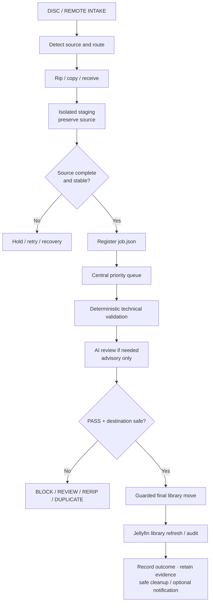
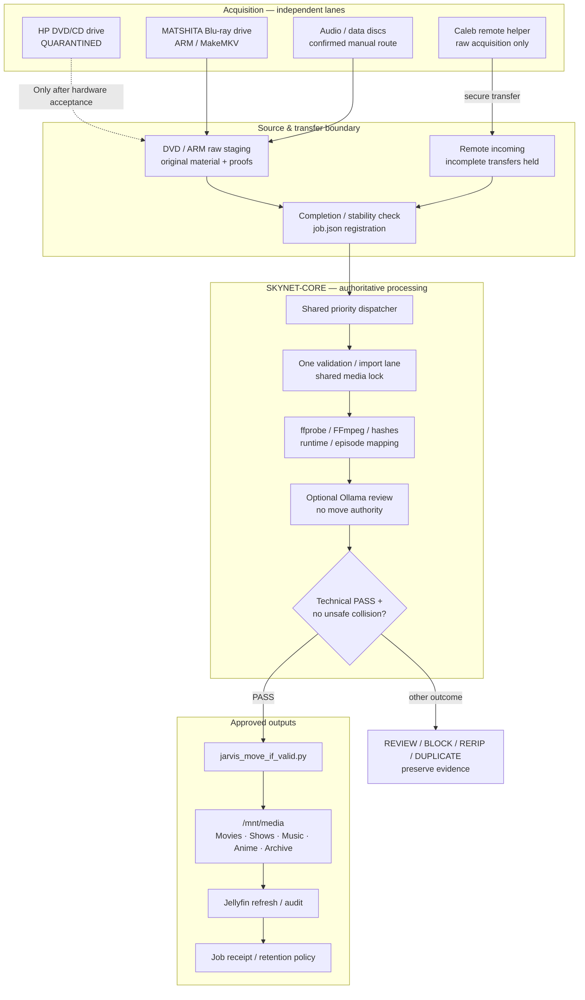
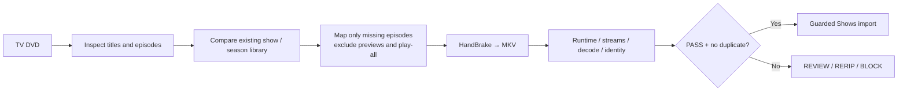
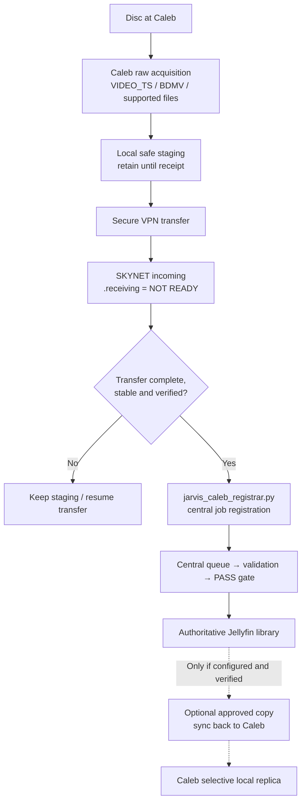
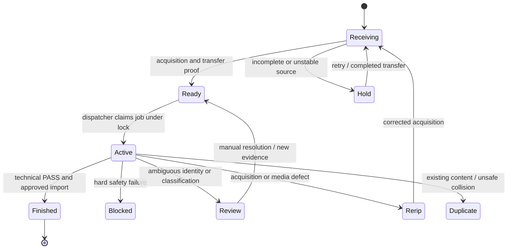

# JARVIS Media Pipeline

> **A rules-first, AI-assisted physical-media ingestion and Jellyfin publishing subsystem for SKYNET / JARVIS**  
> DVD / Blu-ray / CD acquisition · Caleb remote intake · Verified staging · Priority queue · Technical validation · Advisory AI review · PASS-gated import · Retention and recovery

**Documentation checkpoint:** November 4, 2026 · **Primary platform:** SKYNET-CORE / Ubuntu 24.04 LTS  
**Repository location:** `03-RDP-VM-Infrastructure/Subsystems/Media-Pipeline/README.md`  
**Runtime codebase:** `~/rdp-scripts/Jarvis/media/` · **Library:** `/mnt/media` · **Working storage:** `/mnt/appdata`  
**Documented state:** **Core pipeline substantially implemented; DVD drive quarantined; full unattended end-to-end acceptance pending**  
**DVD recovery target:** **November 27, 2026**, after Thanksgiving

> [!IMPORTANT]
> This document merges the subsystem overview with the October 26 DVD-repair and media-architecture handoff. Implementation and health statements are **historical evidence**, not a live audit of the server. In particular, the HP optical drive is deliberately deauthorized and its watcher disabled. **Do not restart, reauthorize, or probe the drive as part of README work.**
>
> **Sacred move rule: NO VALIDATION PASS = NO FINAL LIBRARY MOVE.** A language model cannot approve its own filesystem changes, overwrite existing media, or bypass deterministic checks.

> [!NOTE]
> “Disk burning” is the project's historical name. The documented pipeline primarily **reads, rips, copies, preserves, validates, and imports** physical media. **Writing to blank optical discs is not verified** and is not presented here as an operational feature.

---

## Table of contents

1. [Mission, boundaries and success criteria](#1-mission-boundaries-and-success-criteria)
2. [Executive status and acceptance](#2-executive-status-and-acceptance)
3. [End-to-end media pipeline](#3-end-to-end-media-pipeline)
4. [Distributed architecture and Caleb's remote node](#4-distributed-architecture-and-calebs-remote-node)
5. [Media sources and hardware routing](#5-media-sources-and-hardware-routing)
6. [Local DVD raw acquisition and watcher](#6-local-dvd-raw-acquisition-and-watcher)
7. [October DVD incident and safety hardening](#7-october-dvd-incident-and-safety-hardening)
8. [TV, movie and music-video DVD routes](#8-tv-movie-and-music-video-dvd-routes)
9. [Blu-ray and ARM / MakeMKV](#9-blu-ray-and-arm--makemkv)
10. [Audio CDs, data discs and preservation archives](#10-audio-cds-data-discs-and-preservation-archives)
11. [Caleb transfer, storage pressure and return sync](#11-caleb-transfer-storage-pressure-and-return-sync)
12. [Central job registration and concurrency](#12-central-job-registration-and-concurrency)
13. [Technical validation and AI review](#13-technical-validation-and-ai-review)
14. [Final import, Jellyfin and retention](#14-final-import-jellyfin-and-retention)
15. [Scheduling, resource policy and observability](#15-scheduling-resource-policy-and-observability)
16. [Failure handling and recovery](#16-failure-handling-and-recovery)
17. [Read-only operations runbook](#17-read-only-operations-runbook)
18. [Outstanding work and acceptance tests](#18-outstanding-work-and-acceptance-tests)
19. [Evidence and provenance](#19-evidence-and-provenance)
20. [Repository navigation and design principles](#20-repository-navigation-and-design-principles)

---

## 1. Mission, boundaries and success criteria

The Media Pipeline turns **local optical discs** and **securely received remote media** into validated entries in the authoritative Jellyfin library. The long-term appliance experience is:

**Insert disc → Detect → Rip / preserve → Register → Validate → Import → Refresh → Archive → Notify → Eject.**

That is the **target workflow**, not an assertion that every lane runs unattended today. The system also supports manual, reviewed, and recovery paths for unreadable or ambiguous media.

### Engineering contract

| Principle | Required behavior |
|---|---|
| **Source preservation** | Keep raw material or a safe recovery copy where feasible; do not destroy an unverified source. |
| **Deterministic authority** | Python, media probes, manifests, hashes, locks and policy determine whether a final move is allowed. |
| **AI is advisory** | Models can help classify a title or flag suspicious results; they cannot override a failed test or move files. |
| **One authoritative library** | SKYNET-CORE controls canonical names, accepted destinations, duplicate decisions and Jellyfin publication. |
| **Multiple acquisition lanes** | Independent healthy drives and Caleb can acquire concurrently, but downstream validation is controlled. |
| **No silent overwrite** | A collision or suspected duplicate becomes an explicit reviewed state, never an unguarded replacement. |
| **Recoverability** | Incomplete transfers, failed discs, logs, raw source, staging and job receipts remain inspectable. |
| **Safe automation** | Hardware with unresolved faults stays isolated; unattended mode requires a known-good positive-path test. |

**Acceptance standard:** a source is not considered published merely because a rip or copy completed. The entire path—source identity, completed transfer, job registration, technical validation, destination collision check, approved move, Jellyfin visibility and retained evidence—must pass.

---

## 2. Executive status and acceptance

These labels summarize the documented system and October 26, 2026 repair handoff; they are **not a November 4 runtime inspection**.

| Component / lane | Documented state | Qualification |
|---|---|---|
| SKYNET-CORE + Jellyfin | **Implemented** | Jellyfin runs as a Docker service; current library scan status not audited here. |
| Local HP DVD watcher | **Software hardened; paused** | Faulty USB optical device quarantined and watcher timer disabled. |
| DVD hardware recovery | **Blocked** | Must inspect/repair/replace hardware and complete positive-path retest. |
| Local movie / TV DVD routes | **Substantially implemented** | Historical validators and examples exist; current unattended execution not established. |
| Music-video DVD ingestion | **Implemented historically** | Runtime/title safeguards documented; recheck integration. |
| Audio CD / data-disc capture | **Confirmation required** | Not accepted as unattended insert-and-walk-away lanes. |
| MATSHITA Blu-ray + ARM | **Installed; acceptance pending** | Persistent device identity and full disc-to-Jellyfin test still needed. |
| Priority registrar / dispatcher | **Implemented; live audit needed** | One-job validation gate and shared lock are architectural requirements. |
| AI-assisted review | **Available / advisory** | Current model selection and central harness binding need verification. |
| Final PASS-gated move | **Implemented** | Must be exercised with current staged output and collision tests. |
| Caleb remote intake | **Partially implemented** | Central receive/registration path documented; full round trip not proven. |
| Automatic return sync to Caleb | **Planned / unverified** | Synchronization option, not accepted live behavior. |
| HA status / notifications / eject | **Partial or planned** | Do not imply end-to-end automation. |
| Blank optical-disc writing | **Not verified** | Outside the accepted ingest path. |

### Operational caution

The previous USB fault could put processes in uninterruptible kernel I/O wait. A hardened script cannot guarantee recovery from a stuck kernel/USB operation. **Software repair does not equal hardware acceptance.**

---

## 3. End-to-end media pipeline

### At a glance



A failure or inconclusive review may keep source files in staging or preservation storage. It may **not** silently take the PASS branch.

### Detailed source-to-library architecture



**Diagram boundaries:** solid arrows show intended processing responsibility; a dashed line from the quarantined HP drive is **not permission to operate it**. The source handoff does not prove all paths above have passed a current live end-to-end test.

---

## 4. Distributed architecture and Caleb's remote node

### Ownership matters

**SKYNET-CORE is the central authority. Caleb is an edge helper/media source.** Caleb's laptop can physically read discs and transfer completed raw material, but is not a second competing queue controller, final validator, or owner of the canonical Jellyfin filesystem.

| Responsibility | SKYNET-CORE | Caleb remote laptop |
|---|---|---|
| Physical disc reading | Local DVD / Blu-ray lanes | Remote DVD / Blu-ray source acquisition |
| Raw-source preservation | Authoritative receipt + central staging | Retain local copy until central completion is proven |
| Transport | Receive and verify VPN transfer | Send raw `VIDEO_TS` / `BDMV` or supported files over VPN |
| Incomplete transfer detection | Reject `.receiving`, unstable and partial files | Mark completion only after transfer genuinely finishes |
| Job registration | **Authority** (`jarvis_caleb_registrar.py`) | Supplies source identity / manifest inputs |
| Priority scheduling | **Authority** | Not a separate central scheduler |
| Technical and AI validation | **Authority** | No independent final library approval |
| Final Jellyfin import | **Authority** | Never writes directly to canonical library |
| Library catalog visibility | Core Jellyfin library / authorized views | May view catalog over supported access |
| Approved media copy returned | Potential outbound sync | Optional selective local replica; **not verified automated** |

### Why this separation exists

Remote acquisition can happen without consuming the main server's optical drive. But **a remote rip is only source evidence**; it does not become an accepted media-library item until CORE confirms integrity, stable transfer, identity, validation and collision safety.

The design separates three concepts that must not be conflated:

- **Catalog visibility:** a library listing or item metadata may be visible remotely without a full local file.
- **Physical storage location:** source files, preserved masters, validated library copies and optional Caleb replicas can reside in different places.
- **Import authority:** only the central PASS gate authorizes the canonical Jellyfin move.

Syncthing and a secure VPN are **documented architectural options**, not proof that bidirectional synchronization and remote availability are currently live.

---

## 5. Media sources and hardware routing

| Input | Tools / role | Hardware and route constraints |
|---|---|---|
| **HP DVD/CD** | `dvdbackup`, local raw watcher | HP HLDS `DVDRW_GUD0N` · USB path `6-1.3` in last repair · **isolated**. |
| **MATSHITA Blu-ray** | ARM 2.24.0 / MakeMKV | `BD-MLT UJ260F`; verify device identity before routing. |
| **TV DVDs** | Title analysis / HandBrake / validator | Episode mapping and existing-library matching are required. |
| **Movie / music-video DVDs** | Title selection / HandBrake / ffprobe | Must distinguish feature/extras/play-all and individual music videos. |
| **Audio CDs** | `cd-discid`, `abcde` | FLAC preferred; explicit user confirmation documented. |
| **Data discs** | ISO9660/UDF / read-only mount / `rsync` | Confirm before copying; archive with source identity. |
| **Caleb remote** | Raw rip + secure transfer | Complete, stable transfer registered at CORE before processing. |

### Persistent optical identity

Do **not** assume `/dev/sr0`, `/dev/sr1` or `/dev/sgN` maps to the same physical drive after reboot. Planned stable Blu-ray aliases are `/dev/jarvis-bluray` and `/dev/jarvis-bluray-sg`; the handoff does **not** certify them as validated and persistent.

**Routing rule:** MATSHITA + verified Blu-ray may enter ARM; the HP DVD drive must never be misrouted to ARM. ARM's configured device mappings should eventually expose only the intended MATSHITA hardware.

---

## 6. Local DVD raw acquisition and watcher

**Primary script:** `jarvis_local_dvd_raw_watch.py`  
**Staging root:** `/mnt/appdata/jarvis-burner-staging/local-dvd-raw/` with `Movies/` and `TV/` subdirectories.

### Required acquisition sequence

1. Confirm physical drive identity, expected USB authorization and lack of quarantine.
2. Detect disc only when the hardware is authorized for a controlled read.
3. Gather optical identity and metadata, including settling where required.
4. Compare fingerprint against completed-disc index and detect busy devices.
5. Create isolated working directory and record `disc.json`.
6. Perform bounded, full `dvdbackup -M` acquisition where appropriate.
7. Verify DVD file structure; retain original source/metadata as feasible.
8. Write `.raw_proof` and `.rip_complete` **only after successful checks**.
9. Finalize atomically, update the completed index and register the downstream job.

`blkid`, `dvdbackup -I`, `dvdbackup -M`, `fuser` and SHA-256 supply acquisition facts. An incomplete `.receiving` directory or missing proof marker must not be treated as ready.

> [!WARNING]
> **Do not run a manual disc scan on the quarantined HP drive.** The steps above document the accepted *intended* process and the installed software behavior—not permission to restart it before the hardware investigation.

---

## 7. October DVD incident and safety hardening

### Fault and effect

During October 2026 the HP optical drive at USB `6-1.3` repeatedly reset, triggered kernel I/O stalls and created uninterruptible D-state processes. The watcher's userspace timeout alone could not free those operations. **Deauthorizing the problem USB device restored host responsiveness.**

### Recorded repair evidence (October 26, 2026)

| Control / check | Recorded result |
|---|---|
| Hardened watcher installed | **PASS** |
| Offline hardware-failure regression tests | **PASS** |
| Rollback copy and SHA-256 verified | **PASS** |
| systemd service/timer drop-ins installed | **PASS** |
| HP USB authorization | `0` (deauthorized at last check) |
| `jarvis-local-dvd-raw-watch.timer` | Disabled / inactive at last check |
| Watcher service | Historical failed state; not running |
| Short-term I/O pressure | 0% during final verification |
| D-state processes | None reported at final verification |
| New physical DVD rip and positive-path validation | **NOT ACCEPTED** |

**Installed watcher SHA-256:** `27b3f9ff4d9c53cf0d0a14788903ac4fe71d3fd52a8acd82ac84ae29fc4248fc`  
**Rollback source:** `_staging/dvd_watcher_harden_v1/rollback_original_before_v1.py`  
**Rollback SHA-256:** `b02196762efb6be78a31d257c5c0ea6fc059a9138097157d9c128b2f641ce77b`

### Documented service hardening

| Operation | Bounded limit |
|---|---|
| Optical probe helper | 20 seconds |
| `fuser` busy-device check | 5 seconds |
| `dvdbackup` full acquisition | 6 hours |
| systemd service start | 7 hours |
| systemd graceful stop | 45 seconds |

The drop-in `90-jarvis-dvd-guard-v1.conf` applies to `jarvis-local-dvd-raw-watch.service` and `.timer`. The documented timer values are `OnBootSec=10min` and `OnUnitInactiveSec=15min`, **but the timer remains intentionally disabled until hardware acceptance**.

**Reboot caveat:** the sysfs USB authorization value may reset after reboot. Physical disconnection or separately tested persistent isolation is needed before claiming reboot-safe quarantine.

---

## 8. TV, movie and music-video DVD routes

### Television episode extraction

**Script:** `jarvis_disc_ingest_guarded_v2.py`.



Required checks include series/season/disc identity, missing-episode calculation, episode title mapping, runtimes, complete audio/video streams, truncation and unexpected duplicates. Historical test discs included *The Originals*, *The Boondocks* and *Hogan's Heroes*.

**Historical command example — documentation only, not to execute on quarantined hardware:**

```bash
python3 ~/rdp-scripts/Jarvis/media/jarvis_disc_ingest_guarded_v2.py \
  --show "SHOW NAME" --season 1 --disc 1 \
  --library "/mnt/media/Shows" --ai phi3:mini --device /dev/srN
```

Known options include `--stage-only`, `--no-auto-rerip` and `--allow-extra-candidates`. The last option bypasses an episode-mapping safeguard and should not be used casually.

### Movie DVDs

**Script:** `jarvis_movie_dvd_ingest.py`. Scan main titles, distinguish full feature from extras, encode, run `ffprobe`/technical verification and import only with a canonical destination. Avoid accidental job-ID-suffixed duplicate folders.

### Music-video DVDs

**Script:** `jarvis_generic_dvd_ingest.py`. Extract individual short videos while rejecting play-all compilation candidates. Historical runtime selection used roughly 2–20 minutes, but **runtime alone is not proof of content identity**. Target destination: `/mnt/media/Music Videos/`.

---

## 9. Blu-ray and ARM / MakeMKV

**Hardware:** MATSHITA `BD-MLT UJ260F` · **ARM:** 2.24.0 · **Extractor:** MakeMKV  
**ARM data root:** `/mnt/appdata/arm`

| Storage area | Purpose |
|---|---|
| `/mnt/appdata/arm/media/raw` | Raw extraction |
| `/mnt/appdata/arm/media/transcode` | Conversion work |
| `/mnt/appdata/arm/media/completed` | Completed ARM output |
| `/mnt/appdata/arm/media/failed-hold` | Failed content retained for inspection |
| `/mnt/appdata/arm/media/personal-staging` | Specialized staging |
| `/mnt/appdata/jarvis-burner-staging/local-bluray` | Downstream JARVIS registration |

### Two supported routing designs

| Blu-ray lane | Documented handoff |
|---|---|
| **Movie** | `jarvis-arm-autostart.timer` → ARM/MakeMKV → `jarvis_arm_movie_registrar.py` → `job.json` → central queue → `jarvis_bluray_one_job.py` / `jarvis_movie_arm_router.py` → PASS gate → Movies |
| **Television** | ARM completed output → `jarvis_arm_handoff_worker.py` → file-stability check + SHA-256 → FFmpeg full decode → `jarvis_validate_rip.py` → `jarvis_move_if_valid.py` → Shows |

### Acceptance gate not yet closed

Older hardware tests found unstable drive enumeration and an unsuccessful full positive-path disc read. Do not equate the presence of ARM or MakeMKV with a verified live disc-to-library pipeline. Before closure: establish stable MATSHITA aliases; remove HP exposure from ARM; verify Compose mappings after reboot; complete known-good Blu-ray read; prove registrar, queue, validation and final import.

---

## 10. Audio CDs, data discs and preservation archives

| Lane | Script | Destination | Current safety boundary |
|---|---|---|---|
| **Audio CD** | `jarvis_cd_ingest.py` using `cd-discid` + `abcde` | `/mnt/media/Music/Albums/` (FLAC); untagged to `_Unsorted_Audio_CDs/` | Explicit `YES` confirmation documented; unattended mode not accepted. |
| **Data disc** | `jarvis_data_disc_ingest.py` | `/mnt/media/Archive/Data_Discs/` | Identify ISO9660/UDF; read-only mount, `rsync`, unmount; explicit confirmation. |
| **Raw archive** | Preservation route | `/mnt/media/Archive/Raw_Rips/` | Preserve damaged, rare or ambiguous DVD/BDMV/ISO source; first-class automation incomplete. |

Preservation and optimization are separate products. A verified encoded MKV does not automatically justify deletion of the physical-source master.

---

## 11. Caleb transfer, storage pressure and return sync

### Normal remote intake

Caleb can rip remotely so acquisition does not depend on SKYNET's local optical hardware. SKYNET takes responsibility once a complete, stable transfer arrives.



### When Caleb's local disk space is constrained

**Intended strategy:** transfer verified completed raw batches to available central SKYNET staging, preserve them on CORE and free Caleb's local source only **after a durable CORE receipt and retention check**. Processing can then proceed centrally. Later, selected **validated** titles may synchronize back to Caleb if a separate return-sync workflow is configured and verified.

**The handoff does not confirm that this storage-pressure fallback is already unattended.** It is an operational design that still needs capacity-aware control and a positive-path transfer test. Never delete Caleb's sole remaining copy merely because a network transfer started or a Jellyfin catalog entry appeared.

| Pressure / event | Required decision |
|---|---|
| Caleb source storage running low | Identify complete raw batch and available CORE capacity; stage a safe transfer. |
| Transfer still active | Keep `.receiving` or equivalent incomplete marker; no registrar job. |
| Transfer complete | Verify stable size, source identity and hashes/receipts as applicable. |
| CORE disk low / destination unavailable | Hold safely; do **not** discard the edge original or force a final library move. |
| CORE retains a verified safe copy | Source may be eligible for separate, policy-approved cleanup on Caleb. |
| Caleb wants selected titles locally again | Use approved selective return sync only after the central PASS state; preserve canonical library ownership. |
| Caleb cannot connect | Queue or hold source locally; resume over VPN without creating duplicate jobs. |

**Unverified feature:** fully automatic bidirectional syncing, capacity-triggered delete-after-transfer and post-import return-to-Caleb are *not* accepted production behaviors in this documentation.

---

## 12. Central job registration and concurrency

**Documented components:** `jarvis_media_priority_cycle.sh`, `jarvis_media_priority_dispatcher.py`, `jarvis-media-priority.service`, `jarvis-media-priority.timer`.

### Contract for job registration

Every completed source lane should register **one stable `job.json`** containing at least: job ID; source and source type; original and staged paths; priority; registration time; current status; worker/adapter; validation receipt; and outcome metadata.

**Dispatch ordering:** priority → registration time → job name. Physical ripping can happen concurrently on independent healthy sources, but **a shared validation/import lane processes only one eligible job at a time**.

**Historical shared lock:** `/run/user/1000/jarvis-media-ingest.lock`. Confirm that its configured location, ownership and enforcement remain current before changing concurrency.



An AI classifier may enrich a job already in the lane; it does not get a second unmanaged move lock or a competing scheduler.

---

## 13. Technical validation and AI review

**Technical authority:** `jarvis_validate_rip.py`, `jarvis_move_if_valid.py`, `jarvis_library_audit.py`.

### Validation matrix

| Check | Why it matters |
|---|---|
| Stable source and required completion markers | Reject incomplete rips and network transfers. |
| `ffprobe` stream / container inspection | Confirm usable video/audio streams and metadata. |
| Full FFmpeg decode where required | Catch truncation and decode corruption that superficial probes miss. |
| Size, length, structure and expected title identity | Detect empty files, previews, wrong episodes and play-all confusion. |
| SHA-256 / source receipts | Verify copied content and maintain provenance. |
| Existing library and duplicate matching | Avoid reimporting equivalent media. |
| Destination path and collision check | Block unsafe overwrites or unintended duplicate folders. |
| Canonical `PASS` outcome | Required for `jarvis_move_if_valid.py` to run. |

**AI review is optional and subordinate to technical checks.** Historical local model roles were `phi3:mini` for lightweight review, `llama3:8b` for deeper assessment, and `qwen2.5:14b` for manual escalation. These are **historical roles, not a fresh inventory of the currently selected production model**.

When media AI is connected to the central JARVIS harness, it should inherit the platform's single control plane, model router, resource windows, VM/media exclusivity and thermal policies. **The precise current binding of this lane to that harness needs runtime verification.** Do not claim the integration is approved merely because the models or control utilities exist.

### Outcome meanings

| Decision | Required handling |
|---|---|
| **PASS** | Eligible for guarded final import after collision and policy checks. |
| **BLOCK** | Keep out of the library; preserve evidence for correction. |
| **REVIEW** | Human investigation required; no import by default. |
| **RERIP** | Reacquire from original/raw source and revalidate. |
| **DUPLICATE** | Quarantine or skip; never silently overwrite. |

The historical optimization target was MKV, often HEVC/H.265 with suitable playback audio (for example AC3 5.1) and 1080p where appropriate. **These are output preferences, not prerequisites for destroying raw masters.**

---

## 14. Final import, Jellyfin and retention

**Canonical storage:** `/mnt/media` on the host, exposed as `/media` inside the Jellyfin container per the documented mapping.

| Library destination | Content |
|---|---|
| `/mnt/media/Movies` | Feature films |
| `/mnt/media/Shows` | Series / seasons / episodes |
| `/mnt/media/Music Videos` | Individual music videos |
| `/mnt/media/Music` | Albums / FLAC sources |
| `/mnt/media/Anime` | Anime titles |
| `/mnt/media/Archive` | Data discs / preserved raw media |

After an approved move: confirm destination and naming; audit library; refresh Jellyfin; preserve validation receipt; archive job state; and optionally notify/eject **only when the corresponding services and device behavior are verified**.

**Documented retention components:** `jarvis-purge`, `jarvis-retention-cleanup.service`, `jarvis-retention-cleanup.timer`. Historical cleanup uses a **seven-day delay after an explicit safe-to-purge marker**, with interactive treatment of ambiguous cases.

Retention must exclude active jobs, unknown transfers, sole original copies, quarantined sources, essential logs, and authoritative Jellyfin media. It cannot become an alternate bypass around the PASS gate.

---

## 15. Scheduling, resource policy and observability

| Mechanism | Documented behavior / validation need |
|---|---|
| Local raw watcher | `jarvis-local-dvd-raw-watch.timer` was **disabled** as of Oct 26. Do not reenable until physical repair is accepted. |
| Blu-ray startup | `jarvis-arm-autostart.timer` is part of the intended ARM route; current enablement and actual device mapping need audit. |
| Priority dispatcher | `jarvis-media-priority.timer` / `.service` select one eligible job; verify installed live schedule. |
| Shared lock | One technical validation/final move lane; inspect actual lock enforcement. |
| Resource arbitration | Avoid heavy FFmpeg / MakeMKV / HandBrake / Ollama contention where policy requires it. |
| Cooldown / storage guard | Historical ~20-minute idle/cooling and ~85% storage guard; **reverify current thresholds** before adjustment. |
| Cleanup | `jarvis-retention-cleanup.timer` and purge policy; no unverified deletion. |
| Dashboard / notifications | Operational visibility and end-of-job alerts are partial or planned. |

**Concurrency rule:** parallel disc *acquisition* is not permission for parallel *validation, AI and canonical file moves*. The latter converge through one managed lane to avoid I/O, CPU and filesystem races.

**No duplicate control planes:** the subsystem must use existing JARVIS governance and the shared media dispatcher rather than introducing a new competing model router, scheduler or autonomous file mover.

---

## 16. Failure handling and recovery

| Failure mode | Safe system response |
|---|---|
| HP USB reset / kernel D-state stall | Keep drive quarantined; retain journal and fault evidence; do not continuously retry. |
| Unreadable disc / invalid structure | Keep in RERIP/REVIEW; do not publish. |
| Crash mid-acquisition | Retain incomplete staging markers; verify before retry. |
| Remote VPN drop | Treat `.receiving` as incomplete; resume transfer and check integrity before registration. |
| Duplicate source / same episode | Skip or REVIEW rather than overwrite. |
| Incorrect title mapping | Require manual verification or corrected source/encoder policy. |
| ffprobe / FFmpeg failure | BLOCK or RERIP; retain logs and source. |
| Ollama unavailable / throttled | Continue deterministic checks; queue/defer optional review, never invent PASS. |
| CORE disk pressure | Hold pending work and preserve source; do not force destination movement or cleanup. |
| Mid-job stop / power failure | Preserve `job.json`, proof/receipt and staged source for restart-aware recovery. |
| Unsafe cleanup candidate | Leave source untouched and flag for manual inspection. |

### Controlled DVD hardware-recovery sequence

**Resume target: November 27, 2026.** Inspect HP drive, USB cable, adapter/enclosure and power. Verify physical device identity; preserve quarantine while collecting host baseline evidence. Test a known-good disc only after the hardware problem has been addressed and a controlled test is explicitly approved. Inspect kernel logs, I/O pressure, raw proofs, dedupe and indexes. Reenable unattended scanning **only after a successful positive-path test and no renewed kernel stalls**.

The October software hardening should not be rebuilt or discarded without new defect evidence. Keep original source, rollback, systemd overrides, disabled watcher state and quarantine intact through the pause.

---

## 17. Read-only operations runbook

Run these **inspection-only** checks on SKYNET-CORE. They do not authorize reactivating the HP drive. Use the actual service account and permissions in your environment.

```bash
# Containers / Jellyfin
docker ps --format "table {{.Names}}\t{{.Image}}\t{{.Status}}"
docker logs --tail 50 jellyfin

# Mounted storage, pressure and blocked tasks
df -h /mnt/appdata /mnt/media
cat /proc/pressure/io
vmstat 2 5
ps -eo pid,stat,comm | awk 'NR==1 || $2 ~ /^D/'

# Optical device inventory (do not access disc media)
lsblk -o NAME,TYPE,SIZE,FSTYPE,MOUNTPOINTS
ls -l /dev/sr* /dev/sg* 2>/dev/null

# DVD watcher and last failure evidence
systemctl status jarvis-local-dvd-raw-watch.service --no-pager
systemctl status jarvis-local-dvd-raw-watch.timer --no-pager
systemctl cat jarvis-local-dvd-raw-watch.service
systemctl cat jarvis-local-dvd-raw-watch.timer
sudo journalctl -u jarvis-local-dvd-raw-watch.service -n 50 --no-pager

# Confirm quarantine state only if the same physical USB path exists
cat /sys/bus/usb/devices/6-1.3/authorized

# Downstream queue, ARM, retention (read-only)
systemctl status jarvis-media-priority.service --no-pager
systemctl status jarvis-retention-cleanup.timer --no-pager
systemctl list-timers --all --no-pager

# Existing local status helpers (if available)
node-status
~/rdp-scripts/Jarvis/media/jarvis_staging_status.sh
```

> [!CAUTION]
> Do **not** run `dvdbackup`, reauthorize USB, restart the watcher, delete staging, eject a disc, alter ARM device mappings, or run purge commands during the paused hardware-recovery period. `ls -l /dev/sr*` lists device nodes; it does not test a disc.

---

## 18. Outstanding work and acceptance tests

| Priority | Work | Closure evidence required |
|---|---|---|
| **A — Paused hardware recovery** | Inspect, repair/replace, safely re-test HP DVD path after Nov 27 | No USB resets / D-state stalls; raw acquisition complete, proofs valid, dedupe and safe unattended watcher verified. |
| **B — Blu-ray hardening** | Stable MATSHITA aliases, ARM-only correct mappings, reboot identity | Known-good Blu-ray → MakeMKV → registrar → queue → validation → Jellyfin item. |
| **C — Unified orchestration** | Exercise all source registrations; lock / priorities / storage checks | One eligible validator at a time, deterministic failure state, correct finished-job receipt. |
| **C — Remote intake** | Prove Caleb completed transfer and registrar state | Hash/stability check; ignored incomplete transfer; CORE can safely take ownership. |
| **C — Storage-pressure contingency** | Implement/test Caleb → CORE preservation when edge low on space | Original retained until acknowledged; CORE capacity gate; no data loss or duplicate registration. |
| **C — Selective return sync** | Defined approved item selection and transfer path to Caleb | Verified post-PASS copy; catalog and local storage state accurately distinguished. |
| **D — Data hygiene** | Normalize staging layout and output naming | No unwanted job-ID duplicate folders; correct series / feature metadata. |
| **D — Visibility** | HA status, alerts, queue metrics, safe eject | Evidence-backed dashboard and successful notifications; no alert claims without delivery. |
| **D — Retention** | Audit safe-purge eligibility and storage floor | No deletion of sole originals, unverified transfers or quarantined media. |

### End-to-end acceptance checklist

- [ ] Positive-path optical acquisition on each healthy intended drive
- [ ] Source and transfer integrity receipts present
- [ ] Duplicate and destination-collision negative tests pass
- [ ] Only one validation/import worker owns the shared lane
- [ ] AI unavailability cannot manufacture PASS or move data
- [ ] Canonical Jellyfin library item appears correctly
- [ ] Failed jobs preserve evidence and can recover safely
- [ ] Caleb transfer and optional return sync tested independently
- [ ] DVD watcher quarantine cleared only after hardware acceptance
- [ ] Retention, dashboard, notification and eject behavior documented by live receipts

---

## 19. Evidence and provenance

| Date / source | What it establishes | What it does **not** establish |
|---|---|---|
| Earlier media implementation handoffs | Existence and intended behavior of disc routes, staging, registrars, queue, validator and move gate | Current timers, container health or unattended acceptance |
| **October 26, 2026** HP DVD watcher hardening | Installed guarded script + rollback; service/timer overrides; offline failure tests; USB quarantine; host recovered from I/O stalls | Reliable physical HP drive or accepted automatic DVD ripping |
| Local TV/movie/music-video validation history | Practical safeguards for runtime, episode mapping and duplicate handling | Every current disc title or mapping will be correct |
| ARM/MakeMKV configuration and earlier hardware checks | MATSHITA lane and defined movie/TV handoffs | A fully proven post-repair Blu-ray disc-to-library import |
| Caleb remote architectural handoff | Edge raw acquisition, transfer/registrar intent and central authority | Completed automatic bidirectional syncing or safe delete-after-transfer |
| **November 4, 2026** documentation merge | Consolidates subsystem overview and recorded operational handoff into one technical master page | A new runtime scan or any change to deployed services |

**Evidence boundary:** a running Jellyfin Docker container is evidence of a running media server, **not** proof that every disc acquisition or import job succeeded.

---

## 20. Repository navigation and design principles

This page is the **Media Pipeline subsystem master README**, not a replacement for the overall infrastructure, JARVIS harness, or remote-node documentation.

| Related documentation | Purpose |
|---|---|
| [`../../README.md`](../../README.md) | RDP / SKYNET-CORE infrastructure master architecture |
| [`../../Jarvis/`](../../Jarvis/) | JARVIS platform, orchestration and shared AI harness documentation |
| [`../Caleb-Remote-Node.md`](../Caleb-Remote-Node.md) | Caleb node ownership, maintenance windows and remote support details |
| [`../Home-Assistant-Integration.md`](../Home-Assistant-Integration.md) | Home Assistant presentation and future media status integration |
| [`../Jarvis_Finance/README.md`](../Jarvis_Finance/README.md) | Example of another domain sharing central JARVIS governance |

> [!TIP]
> If your repository has migrated `Caleb-Remote-Node.md` or `Home-Assistant-Integration.md` into folders, update these relative links to their actual `README.md` destinations. The current paths reflect the supplied directory listing, not a fresh remote repository audit.

### Permanent design rules

1. **Acquire independently, validate centrally.** Healthy drives and Caleb can work in parallel; final decisions remain coordinated.
2. **One source of truth.** SKYNET-CORE maintains canonical acceptance, library naming and movement authority.
3. **No validation PASS, no final library move.** A successful copy, encoder process or AI guess is insufficient.
4. **Catalog ≠ storage.** Media visible in Jellyfin may not be physically stored on Caleb; optional replicas require their own verification.
5. **AI advises; deterministic safeguards decide.** Never use a model to bypass an integrity, mapping or collision failure.
6. **Preserve before deleting.** A source's safe cleanup requires independently verified retention and receipt.
7. **Do not mistake a software fix for hardware recovery.** The faulty HP drive stays isolated until accepted testing.
8. **Document what was proved.** Keep proposed, installed, tested, and end-to-end accepted states visibly separate.

**Long-term operating experience:** **Insert disc. Let JARVIS handle the rest.**  
**Current engineering conclusion:** the architecture is substantially built, but hardware recovery and an accepted unattended disc-to-Jellyfin positive path remain open.
