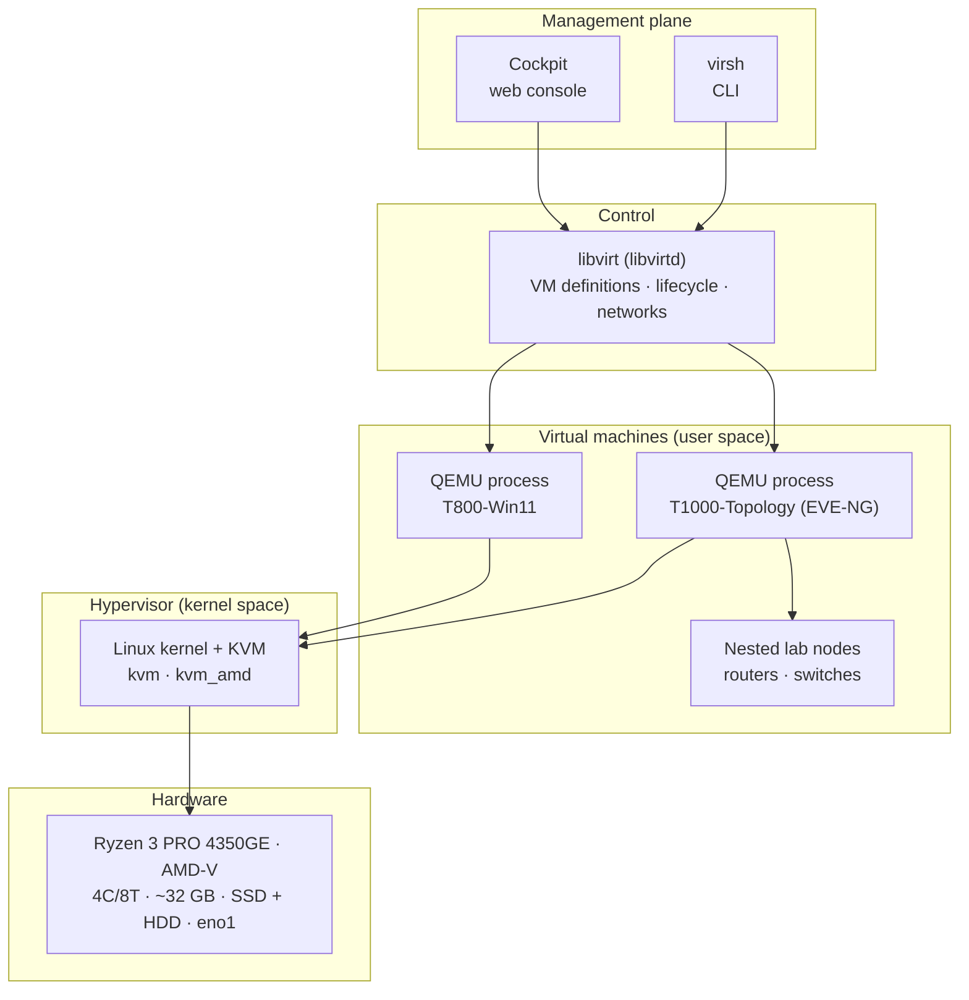
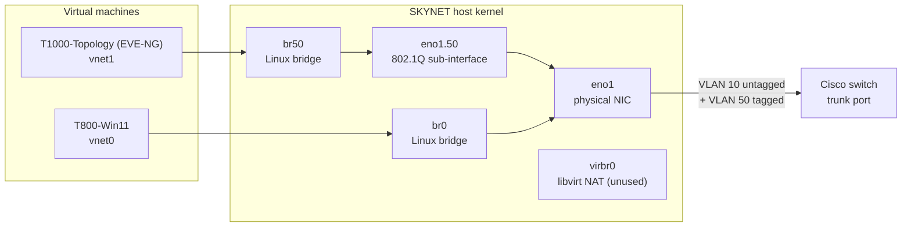
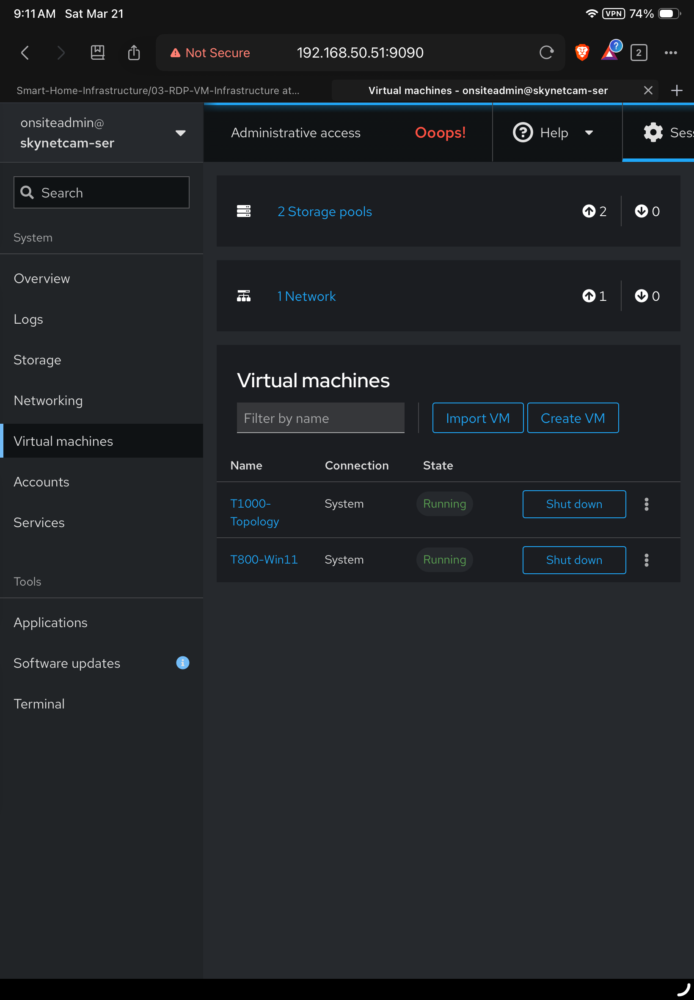

# Virtualization

This directory documents the **virtualization layer** of the RDP infrastructure server (SKYNET).

Virtualization separates workstation, lab, and infrastructure roles while running them all on a single physical server. Virtual machines are used where **full operating-system isolation** is more appropriate than containerization; lightweight always-on services run as Docker containers instead.

> Part of the [RDP / VM / JARVIS infrastructure](../README.md) · see also [Host System](../Host-System/README.md)

---

## Table of Contents

1. [Purpose](#purpose)
2. [Virtualization Classification](#virtualization-classification)
3. [Hypervisor: KVM (Type 1)](#hypervisor-kvm-type-1)
4. [Virtualization Stack](#virtualization-stack)
5. [Types of Virtualization in Use](#types-of-virtualization-in-use)
6. [Virtual Machine Inventory](#virtual-machine-inventory)
7. [Virtual Networking](#virtual-networking)
8. [Resource Allocation and Isolation](#resource-allocation-and-isolation)
9. [Virtual Machine Management (Cockpit)](#virtual-machine-management-cockpit)
10. [Virtual Machines](#virtual-machines)
11. [Subsystems](#-subsystems)
12. [Glossary](#glossary)

---

## Purpose

The virtualization layer is used to:

- preserve a dedicated Windows administration environment
- support a full network simulation lab
- isolate major workloads from the host operating system
- allow testing and experimentation without risking infrastructure services
- centralize management on one physical platform

This creates a cleaner separation between always-on infrastructure and user-facing administrative workflows.

---

## Virtualization Classification

| Attribute | SKYNET |
|---|---|
| **Hypervisor** | KVM (Kernel-based Virtual Machine) |
| **Hypervisor type** | **Type 1** (bare-metal class): the hypervisor is part of the Linux kernel itself |
| **Virtual machine monitor (VMM)** | QEMU, one process per running VM |
| **Hardware assist** | AMD-V (AMD Virtualization) on the Ryzen 3 PRO 4350GE |
| **Virtualization method** | Hardware-assisted full virtualization |
| **Management layer** | libvirt (`virsh`) + Cockpit web console |
| **Additional virtualization** | OS-level virtualization (Docker containers) and nested virtualization (inside EVE-NG) |
| **Virtual networking** | Linux bridges with 802.1Q VLAN tagging |

---

## Hypervisor: KVM (Type 1)

A **hypervisor** (also called a virtual machine monitor) is software that pools a computer's CPU, memory, storage, and network and divides them among **guest** virtual machines running on a physical **host**.

There are two classic types:

| | Type 1: bare metal | Type 2: hosted |
|---|---|---|
| Runs | Directly on the hardware | As an application on a normal OS |
| Examples | VMware ESXi, Microsoft Hyper-V, Proxmox VE, **KVM** | VirtualBox, VMware Workstation |
| Typical use | Servers, data centers, home labs | Desktops and laptops |
| Overhead | Very low (near-native) | Higher; competes with the host OS |

**Why KVM counts as Type 1 even though Ubuntu was installed first:**
KVM is not an application running *on* Ubuntu. It is a module built into the Linux kernel (`kvm` + `kvm_amd`) that turns the kernel itself into the hypervisor. Guest CPU instructions run directly on the processor through AMD-V, with the kernel in control. That is bare-metal behavior. The rest of Ubuntu (Docker, Ollama, JARVIS, systemd services) runs alongside the VMs on the same hypervisor kernel.

This is the same engine used by **Proxmox VE**. SKYNET is effectively a hand-built KVM platform (Ubuntu + KVM + QEMU + libvirt + Cockpit) that also runs containers and local AI natively.

---

## Virtualization Stack



| Layer | Component | Role |
|---|---|---|
| Hardware | AMD Ryzen with **AMD-V** | CPU support that lets guests run directly on the processor |
| Hypervisor | **KVM** kernel modules | Schedules guest vCPUs, isolates guest memory |
| VMM | **QEMU** | Gives each VM its virtual hardware: disks, NICs, display, firmware |
| Control | **libvirt** | Stores VM definitions (XML), starts and stops VMs, attaches networks and storage |
| Management | **Cockpit**, **virsh** | Web and command-line control for the administrator |

On the host, each running VM appears as one `qemu-system-x86_64` process. For example, the Windows admin VM shows up as a single QEMU process holding its ~10 GB of guest memory.

---

## Types of Virtualization in Use

SKYNET runs three kinds of virtualization side by side:

| Type | Used for | How it works | Isolation |
|---|---|---|---|
| **Hardware-assisted full virtualization** | Windows 11 admin VM, EVE-NG VM | Each VM runs its own complete OS and kernel on virtual hardware; KVM + AMD-V execute guest code directly on the CPU | Strong: separate kernel, memory, and disks |
| **OS-level virtualization (containers)** | Jellyfin, eufy_ws, Open WebUI, Actual Budget, WatchState, Gusto agent, ARM | Docker isolates processes, filesystems, and networks but **shares the host kernel** | Moderate: lighter and faster to start, but not a full OS boundary |
| **Nested virtualization** | Router and switch images inside EVE-NG | EVE-NG is itself a hypervisor running inside a KVM guest; lab devices are VMs inside that VM | Contained inside the lab VM and VLAN 50 |

**Rule of thumb used here:**

- Needs its own operating system (Windows) or its own hypervisor (EVE-NG) → **virtual machine**
- A single Linux service → **container**

That is why the Windows VM uses ~10 GB of memory while most containers use well under 1 GB.

> Nested virtualization requires the host to expose AMD-V to the guest (`kvm_amd` nested support). Check with:
> `cat /sys/module/kvm_amd/parameters/nested` → `1` or `Y` means enabled.

---

## Virtual Machine Inventory

| | Windows 11 Admin VM | EVE-NG Lab VM |
|---|---|---|
| **libvirt name** | `T800-Win11` | `T1000-Topology` |
| **Classification** | Persistent administrative workstation | On-demand lab / nested hypervisor |
| **Guest OS** | Windows 11 Pro | EVE-NG (Linux-based) |
| **Virtualization type** | Full virtualization (KVM + QEMU) | Full virtualization **+ nested** virtualization |
| **Memory** | ~10 GB | ~14 GB (only while running) |
| **vCPU** | 2 | 4 |
| **Disk** | ~150 GB image on the VM/app-data SSD | ~170 GB image on the VM/app-data SSD |
| **Network attachment** | `br0` → home network (VLAN 10) | `br50` → isolated lab network (VLAN 50) |
| **Lifecycle** | Normally running | Started for lab sessions, shut off otherwise |
| **Access** | RDP (over the LAN or the VPN) | EVE-NG web UI + device consoles from the Windows VM |
| **Priority** | Kept responsive during AI jobs (CPUs 0–3 during AI windows) | Lab has priority over AI campaigns while running |

---

## Virtual Networking

VMs connect to the physical network through **Linux bridges**, software switches inside the host kernel:



| Interface | Type | Purpose |
|---|---|---|
| `eno1` | Physical NIC | Single gigabit link to the switch, configured as a trunk |
| `br0` | Linux bridge | Puts the host and the Windows VM directly on the home network (VLAN 10), as if it were a physical PC |
| `eno1.50` | 802.1Q VLAN sub-interface | Carries tagged VLAN 50 traffic on the same physical cable |
| `br50` | Linux bridge | Attaches the EVE-NG VM to the isolated lab network (VLAN 50) |
| `vnet0`, `vnet1` | Virtual NICs (tap devices) | Each VM's "network cable," plugged into its bridge |
| `virbr0` | libvirt default NAT network | Not used; bridged networking is used instead |

**Key point:** both VLANs share one physical cable. The switch port is a trunk (VLAN 10 untagged, VLAN 50 tagged), and the host separates them into different bridges. Attachment to both VLANs does **not** mean the host routes between them; VLAN 50 stays an isolated lab segment.

Traffic between the host, VMs, and containers that stays on SKYNET never leaves the machine. It is switched in software by the bridges.

---

## Resource Allocation and Isolation

| Resource | How it is divided |
|---|---|
| **CPU** (8 threads) | Windows VM 2 vCPU · EVE-NG 4 vCPU · host, Docker, and AI share the rest. During AI maintenance windows the Windows VM is pinned to CPUs 0–3 and AI to CPUs 4–7 (`virsh vcpupin` + systemd `AllowedCPUs`), then restored. |
| **Memory** (~32 GB) | Windows ~10 GB · EVE-NG ~14 GB while running · host + Docker + AI the remainder |
| **Storage** | VM disk images live on the dedicated VM/app-data SSD, separate from the OS drive and the media/backup HDD |
| **Network** | Bridged per VLAN; the lab is isolated on VLAN 50 |

**What isolation buys:**

- Windows updates or crashes stay inside the VM; infrastructure keeps running.
- Lab experiments stay inside EVE-NG and VLAN 50.
- A VM can be stopped, restarted, or rebuilt from Cockpit without touching the host.

---

## Virtual Machine Management (Cockpit)

<p align="center">
  
</p>

Cockpit is the primary virtualization management interface. It talks to **libvirt**, so anything done in Cockpit is the same as using `virsh` on the command line.

It provides:

- VM lifecycle control (start / stop / restart / force off)
- resource allocation visibility (vCPU, memory, disks, network interfaces)
- graphical console access to each VM
- host and guest system monitoring
- integration with libvirt storage pools and networks

Equivalent command-line checks:

```bash
virsh list --all            # VMs and their state
virsh dominfo T800-Win11    # vCPU, memory, autostart
virsh domiflist T800-Win11  # which bridge each VM NIC uses
virsh vcpupin T800-Win11    # current CPU pinning
```

This lets virtual machines be managed alongside the host from a single interface.

---

## Virtual Machines

### 1. Windows 11 Administration VM

<p align="center">
  
</p>

**Purpose:** primary administrative workstation
**Classification:** persistent, hardware-assisted full virtualization guest on the home network (VLAN 10)

This VM is used for:

- VS Code development
- GitHub repository management
- MobaXterm (SSH / RDP / access hub), including remote switch access
- browser-based infrastructure access
- Windows-only tools and workflows

### Access Model

```text
Administrator → (Instant Guard VPN if remote) → RDP → Windows 11 VM
```

### 2. EVE-NG Lab VM

**Purpose:** network simulation and CCNA / CCNP practice
**Classification:** on-demand guest that is itself a hypervisor (nested virtualization), attached to the isolated lab network (VLAN 50)

This VM is used for:

- building and testing virtual router and switch topologies
- hybrid labs that connect virtual devices to physical lab equipment over VLAN 50
- experimentation that must never affect the home network

### Access Model

```text
Windows 11 VM → browser → EVE-NG web UI → lab device consoles (MobaXterm)
```

---

## 📁 Subsystems

This virtualization layer is divided into two primary virtual machine environments:

- **Windows 11 Admin VM**  
  Administrative workstation used for infrastructure management, development tools, and centralized access  
  → [`Windows 11Pro/README.md`](./Windows%2011Pro/README.md)

- **EVE-NG Lab Environment**  
  Network simulation platform supporting CCNA / CCNP labs and hybrid virtual + physical testing (VLAN 50)  
  → [`EVE-NG/README.md`](./EVE-NG/README.md)

---

## Glossary

| Term | Meaning |
|---|---|
| **Host** | The physical server (SKYNET) that runs the hypervisor |
| **Guest** | An operating system running inside a virtual machine |
| **Hypervisor / VMM** | Software that creates and runs VMs and divides hardware between them |
| **Type 1 hypervisor** | Runs directly on the hardware (bare metal): KVM, ESXi, Hyper-V |
| **Type 2 hypervisor** | Runs as an application on a normal OS: VirtualBox, VMware Workstation |
| **KVM** | Linux kernel module that turns the kernel into a Type 1 hypervisor |
| **QEMU** | Provides each KVM guest's virtual hardware (disks, NICs, display) |
| **libvirt** | Management API and service for defining and controlling VMs |
| **AMD-V** | AMD's CPU virtualization extensions that make hardware-assisted virtualization possible |
| **Full virtualization** | The guest runs an unmodified OS on complete virtual hardware |
| **OS-level virtualization** | Containers: isolated processes sharing the host kernel (Docker) |
| **Nested virtualization** | Running a hypervisor inside a VM (EVE-NG on KVM) |
| **vCPU** | A virtual CPU core assigned to a guest |
| **Linux bridge** | A software switch in the host kernel connecting VMs to the network |
| **802.1Q / VLAN tagging** | Carrying several isolated networks over one physical link |
| **CPU pinning** | Binding a VM's vCPUs to specific physical CPU threads |
