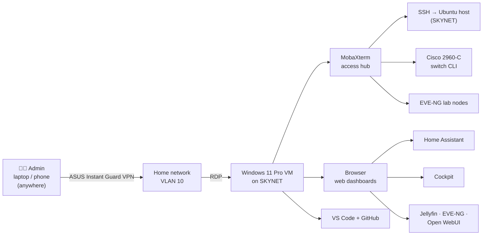
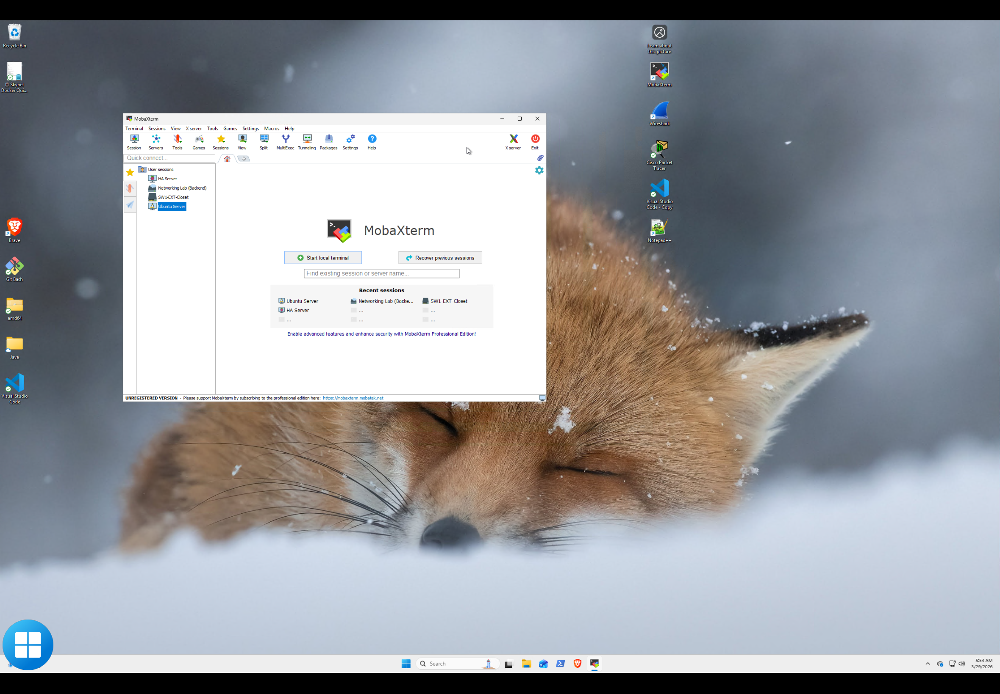
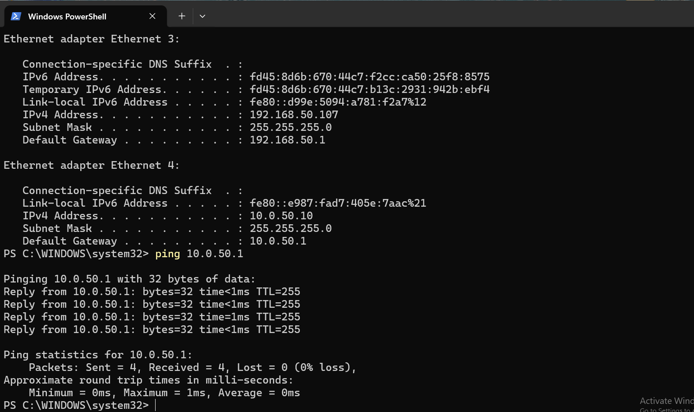
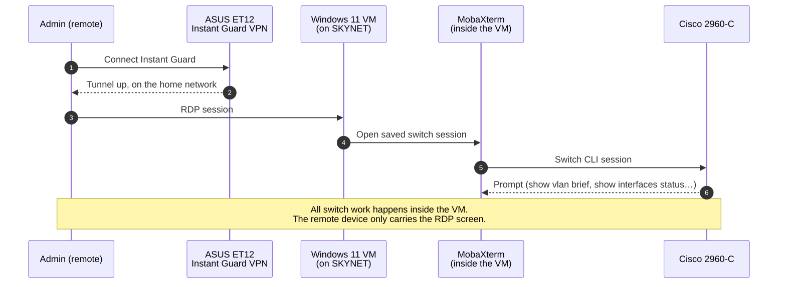

# Windows 11 Administration VM

This virtual machine is the **primary administrative workstation** for the whole infrastructure. Every management task, including the server, Home Assistant, the network switch, the EVE-NG lab, and code and GitHub work, starts here.

Windows is virtualized instead of running directly on the hardware, so user workflows stay separate from the infrastructure layer underneath.

> Part of the [RDP / VM / JARVIS infrastructure](../../README.md) · see the [master README](../../../README.md) for the full system.

---

## Table of Contents

1. [How It Works](#how-it-works)
2. [Live Environment](#live-environment-windows-admin-vm)
3. [Purpose](#purpose)
4. [VM Specifications](#vm-specifications)
5. [Access Model](#access-model)
6. [Remote Switch Access (Cisco 2960-C)](#remote-switch-access-cisco-2960-c)
7. [MobaXterm: The Access Hub](#mobaxterm-the-access-hub)
8. [What the VM Reaches](#what-the-vm-reaches)
9. [Network Placement and Lab Isolation](#network-placement-and-lab-isolation)
10. [Resource Sharing with Local AI](#resource-sharing-with-local-ai)
11. [Why Virtualize the Workstation](#why-virtualize-the-workstation)
12. [Security Model](#security-model)
13. [Typical Workflows](#typical-workflows)

---

## How It Works

1. **Connect to the home network.** From anywhere, the admin laptop or phone connects through **ASUS Instant Guard VPN**. At home, the LAN is already trusted.
2. **Remote into the VM.** Open a **Remote Desktop (RDP)** session to the Windows 11 Pro VM running on the SKYNET server.
3. **Work from one desktop.** Inside the VM, **MobaXterm** holds every saved session (server SSH, the Cisco switch, the EVE-NG lab), and the browser holds every web dashboard (Home Assistant, Cockpit, Jellyfin, EVE-NG, Open WebUI).
4. **Close the session.** Nothing is left running on the remote device. All tools, sessions and credentials stay inside the VM.



---

## Live Environment (Windows Admin VM)

<p align="center">
  
  
  
</p>

The Windows VM is the **daily control interface** for the infrastructure.

**First screenshot:** MobaXterm acting as the unified access dashboard, with active infrastructure sessions and centralized access to:

- the Ubuntu host (SSH)
- networking lab environments
- Home Assistant backend systems

**Second screenshot:** the **VLAN 50 isolation check**, run from this VM. It documents that the EVE-NG lab segment is separate from the home network, so lab experiments can't reach production devices.

---

## Purpose

The Windows VM is used for:

- daily system administration of SKYNET, Home Assistant and the network
- **remote access to the Cisco switch** through MobaXterm
- VS Code development and GitHub repository management, GitBash functions as the sudo backend for github access
- MobaXterm as the SSH / RDP / serial access hub
- browser access to every infrastructure web service
- running Windows-only tools

It is the **human interface layer** of the system. The server, Home Assistant and the network run on their own; this VM is where a person steps in to manage them.

---

## VM Specifications

| Item | Value |
|---|---|
| Guest OS | Windows 11 Pro |
| Hypervisor | KVM / libvirt on the SKYNET Ubuntu host |
| Memory | ~10 GB |
| vCPU | 2 |
| Disk | ~150 GB on the VM/app-data SSD |
| Network | Home network (VLAN 10) |
| Management | Cockpit (start / stop / console), `virsh` |
| Access | RDP over the LAN or the VPN |

---

## Access Model

```text
Administrator → (Instant Guard VPN if remote) → RDP → Windows 11 VM → MobaXterm / browser → target system
```

- **At home:** RDP straight to the VM over the LAN.
- **Away from home:** connect **ASUS Instant Guard VPN** first, then RDP. The VM is never exposed to the internet; there is no public port forward.
- **Fallback:** if RDP is unavailable (for example, the VM is stopped or Windows is updating), Cockpit's VM console or SSH to the Ubuntu host from MobaXterm on any device can still reach and restart it.

---

## Remote Switch Access (Cisco 2960-C)

When the Cisco Catalyst 2960-C needs attention from off-site (checking a port, verifying VLANs, reading the uplink on `G0/1`), **the path always goes through this VM** and its built-in MobaXterm.



**Why route switch access through the VM:**

- **One entry point.** Switch management is done from a single trusted machine, not from whatever laptop or phone happens to be in use.
- **Saved, consistent sessions.** MobaXterm keeps the switch session, terminal settings and logs in one place, so every session starts the same way.
- **No tools needed on the remote device.** Any device that can run VPN + RDP can manage the switch; it doesn't need an SSH client, serial drivers or stored credentials.
- **Nothing exposed.** The switch's management access is never published to the internet; it is reachable only from inside the home network.
- **Session logs.** MobaXterm can log a session, which gives a record of what was checked or changed (useful for the network audit and CCNA practice).

Common checks from this session:

```text
show vlan brief            ! VLAN 10 / VLAN 50 membership
show interfaces status     ! port state, speed, duplex
show interfaces g0/1       ! uplink to the AiMesh node (1 Gb/s)
show mac address-table     ! which device is on which port
show running-config        ! review before any change
```

---

## MobaXterm: The Access Hub

MobaXterm is the **single dashboard** for every terminal-style connection:

| Session type | Target | Used for |
|---|---|---|
| SSH | Ubuntu host (SKYNET) | `skynet-check`, `jarvis-status`, Docker, systemd, logs |
| Switch session | Cisco 2960-C | VLANs, ports, uplink checks, configuration |
| SSH / Telnet | EVE-NG lab nodes | Router and switch labs on the isolated VLAN 50 |
| RDP | Other Windows hosts (if needed) | Nested remote sessions |
| SFTP (built in) | Ubuntu host | Moving scripts and files alongside the SSH session |

Keeping all of these in one tool means one place for saved sessions, one place for keys, and one consistent terminal.

---

## What the VM Reaches

| System | How | Purpose |
|---|---|---|
| SKYNET Ubuntu host | MobaXterm SSH | Server administration and health checks |
| Cockpit | Browser | VMs, containers, storage, resource graphs |
| Home Assistant | Browser | Automations, dashboards, configuration |
| Cisco 2960-C | MobaXterm | Switch administration |
| EVE-NG | Browser + MobaXterm | Network lab topologies and device consoles |
| Jellyfin | Browser | Media server administration |
| Open WebUI | Browser | Local AI chat (read-only JARVIS tools) |
| GitHub | VS Code + browser | Repository and documentation work, including this repo |

---

## Network Placement and Lab Isolation

- The VM sits on the **home network (VLAN 10)** with the rest of the infrastructure.
- The **EVE-NG lab** runs on **VLAN 50**. The VM reaches the lab through the EVE-NG web interface and lab consoles, not by joining the lab network.
- The VLAN 50 isolation check (second screenshot) was run from this VM to confirm the separation. Being able to *manage* the lab doesn't mean lab traffic can reach the home network.

---

## Resource Sharing with Local AI

The VM shares the server's 8 CPU threads with Docker and local AI. The host's AI harness protects it:

- **Normal operation:** the VM has its 2 vCPU, and AI is capped at 4 threads.
- **AI maintenance windows** (Wed 00:00–06:00, Fri 00:00–04:00, Sun 00:00–06:00): the VM is pinned to **CPUs 0–3** and AI to **CPUs 4–7**, then everything is restored afterward.

The admin desktop stays responsive even while a heavy AI job runs, and the windows fall overnight, when the VM is rarely in use.

---

## Why Virtualize the Workstation

| Benefit | What it means here |
|---|---|
| **Separation** | Windows updates, reboots or a broken app affect only the VM; the server, containers and Home Assistant keep running |
| **Always available** | The workstation runs on the 24/7 server, so it is reachable from anywhere through VPN + RDP |
| **Recoverable** | It can be restarted, reconfigured or rebuilt from Cockpit without touching the host |
| **Fixed resources** | 10 GB / 2 vCPU are reserved; it can't starve the infrastructure, and the infrastructure can't starve it |
| **One hardware box** | No separate admin PC to power, patch and secure |

---

## Security Model

- **VPN first.** Remote access always starts with ASUS Instant Guard or OpenVPN; RDP is never port-forwarded.
- **Single jump point.** Switch, server and lab administration go through this VM, which keeps tools and credentials in one controlled place.
- **Least exposure.** The remote device only displays the RDP session; no infrastructure credentials are stored on it.
- **Updates contained.** Windows updates run inside the VM and can't take down production services.
- **Lab separation.** Lab work happens on VLAN 50; the VM manages the lab but isn't part of it through Trunk port with Vlan 10,50 allowed.

---

## Typical Workflows

| Task | Steps |
|---|---|
| **Morning server check** | RDP → MobaXterm → SSH to SKYNET → `jarvis-status` |
| **Remote switch check** | Instant Guard → RDP → MobaXterm switch session → `show interfaces status` |
| **Update documentation** | RDP → VS Code → edit README → commit and push to GitHub |
| **Network lab** | RDP → browser to EVE-NG → open a lab → MobaXterm to the lab devices |
| **Home Assistant change** | RDP → browser to HA → edit → commit the config to Git |
| **Check a VM or container** | RDP → browser to Cockpit → VMs / containers / logs |

---

## Summary

The Windows 11 Pro VM is the **front door for the person running the system**. VPN gets you onto the network, RDP gets you to this desktop, and from here MobaXterm and the browser reach everything else, **including the Cisco switch**. Keeping that front door in a VM means it is always on, always the same, easy to recover, and fully separated from the infrastructure it manages.
