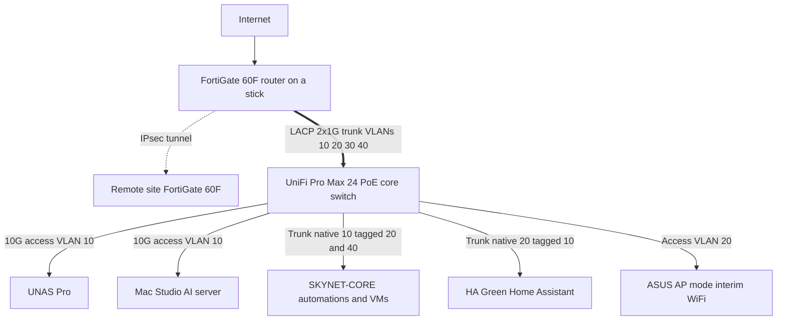
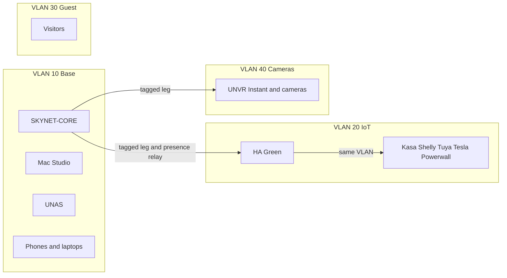

# SKYNET Core Rack & Network Upgrade

> Replacing a flat consumer network with a segmented, firewall-routed core built around a 10U rack, four VLANs, and a dedicated AI server.

**Status:** Designed, build scheduled for spring 2027 (after HVAC and energy hardening)
**Scope of this phase:** Core rack only. Access points, cameras, and remote cabinets follow in a later end-device phase.

---

## Table of contents

1. [Why this upgrade](#why-this-upgrade)
2. [Before and after](#before-and-after)
3. [Architecture](#architecture)
4. [Core rack](#core-rack)
5. [Bill of materials](#bill-of-materials)
6. [VLAN design](#vlan-design)
7. [Port and trunk design](#port-and-trunk-design) (all trunk ports and the access matrix)
8. [LACP port channel](#lacp-port-channel)
9. [Device roles](#device-roles)
10. [SKYNET-CORE virtual machines](#skynet-core-virtual-machines)
11. [Layer 0 safety design](#layer-0-safety-design)
12. [Security hardening](#security-hardening)
13. [Backup and recovery](#backup-and-recovery)
14. [Migration plan](#migration-plan)
15. [Interim state](#interim-state)
16. [Future phases](#future-phases)
17. [Remote site](#remote-site)
18. [Design decisions](#design-decisions)
19. [Open items](#open-items)

---

## Why this upgrade

The current network is flat. The ASUS router cannot tag VLANs (802.1Q), so servers holding sensitive data share one network with cloud-connected IoT devices, cameras, and guests. A compromised smart plug could reach the server.

This upgrade:

- **Segments the network** into four VLANs behind a FortiGate firewall with default-deny rules between them
- **Retires end-of-life gear.** The Catalyst 3650 reached end of support on Oct 31, 2026, and the 2960-C is older still
- **Offloads AI work** from SKYNET-CORE to a Mac Studio, so the Linux server can focus on automations
- **Centralizes storage and backups** on a 10G NAS instead of a single USB drive
- **Keeps life-safety automations local**, so they never depend on the firewall

---

## Before and after

| Area | Before | After |
| --- | --- | --- |
| Routing and firewall | ASUS consumer router | FortiGate 60F, router on a stick over an LACP port channel |
| Network model | Single flat consumer LAN | Two-tier collapsed core |
| Segmentation | One flat network | Four VLANs, default-deny between them |
| Core switching | Catalyst 3650 (end of support) | UniFi Pro Max 24 PoE |
| AI compute | Shared with automations on SKYNET-CORE | Mac Studio M4 Max, 64 GB |
| Storage | Single USB drive on the server | UniFi UNAS Pro on 10G |
| Firewall logging | None | FortiAnalyzer VM |
| Management | Cisco, ASUS, and Eufy managed separately | One UniFi controller plus FortiGate |
| Power | Whole-home Powerwall 3 backup | Unchanged (no rack UPS needed) |

---

## Architecture

### Network model

This is a **two-tier collapsed-core network** with routing between VLANs on a FortiGate in a **router-on-a-stick** configuration, connected to the core switch by an **LACP port channel**.

| Tier | Enterprise role | In this build |
| --- | --- | --- |
| Core + distribution (collapsed) | Backbone, routing between VLANs, policy | FortiGate 60F (routing and policy) + Pro Max 24 PoE (core switching) |
| Access | Where end devices connect | Pro Max 16 PoE remote cabinets (later phase) and the core switch's edge ports |

A full three-tier design (separate core, distribution and access layers) pays off at multi-building scale. At home scale, collapsing core and distribution is the standard pattern. Routing stays on the firewall rather than the L3 switch on purpose: every packet between VLANs is checked against firewall policy. Speed is traded for security.

### Topology

### Traffic flow

- **SKYNET-CORE** is the only device that can see every working VLAN. It relays camera presence to Home Assistant and feeds the dashboards.
- **HA Green** sits on the IoT VLAN natively, next to the devices it controls.
- **Guest** reaches only the internet.
- **Cameras** have no internet path. SKYNET-CORE is their only bridge.

---

## Core rack

10U, 19-inch wall-mount cabinet with a roof fan, vented door, and swing-out hinge, anchored into studs.

| U | Device | Notes |
| --- | --- | --- |
| U10 | PDU | Metered, reused from the current rack |
| U9 | FortiGate 60F | Rack tray; two cables only (WAN in, trunk to switch) |
| U8 | 48-port keystone patch panel | Directly above the switch; existing keystones and labels move over |
| U7 | UniFi Pro Max 24 PoE | Core switch, 2 × 10G SFP+ |
| U6 | UniFi UNAS Pro | 10G to the core |
| U5 | Spare | Heat buffer; room for growth |
| U4–U2 | 3U vented shelf | Mac Studio, SKYNET-CORE (standing vertical), HA Green |
| U1 | Spare | Airflow under the shelf |

**Why this order:** power on top, the firewall needing only two cables, the patch panel directly above the switch for short patch runs, heavy and hot gear low, and spare units placed for airflow rather than left over.

**Cabinet sizing:** depth must fit the deepest device plus about 3 in. for cabling.

---

## Bill of materials

| Status | Items |
| --- | --- |
| **Buy** | 10U wall cabinet + roof fan, UniFi Pro Max 24 PoE, UniFi UNAS Pro + drives, 3U vented shelf, 10GBase-T SFP+ module, vertical stand for the HP mini, Mac Studio (M4 Max, 64 GB), RAM upgrade for SKYNET-CORE, 0.5 ft slim patch cables, FortiCare contract |
| **Already owned** | FortiGate 60F, metered PDU, patch panel keystones, SKYNET-CORE (HP mini), HA Green |
| **Retire** | Catalyst 3650, ASUS router role, old USB backup drive (after NAS backups are running) |
| **Later phase** | UniFi access points, UNVR Instant, cameras, 2 × Pro Max 16 PoE |

---

## VLAN design

| VLAN | Name | Members | Internet |
| --- | --- | --- | --- |
| 10 | Base | SKYNET-CORE, Mac Studio, UNAS, phones, laptops, switches, APs | Yes |
| 20 | IoT | HA Green, smart plugs, sensors, mini-split controllers, EV, battery | Yes, limited |
| 30 | Guest | Visitor devices | Yes, isolated |
| 40 | Cameras | UNVR Instant, Protect cameras | **No** |

Routing between VLANs happens on the FortiGate as a **router on a stick**: one trunk to the core switch, one subinterface per VLAN. Every allowed path between VLANs is an explicit rule. Everything else is denied.

---

## Port and trunk design

| Switch port | Device | Speed | Mode |
| --- | --- | --- | --- |
| SFP+ 1 | UNAS Pro | 10G | Access: VLAN 10 |
| SFP+ 2 | Mac Studio (via 10GBase-T module) | 10G | Access: VLAN 10 |
| 2 × 2.5G (adjacent) | FortiGate LACP port channel | 2 × 1G (60F ports are 1G) | Aggregate trunk: 10, 20, 30, 40 |
| 2.5G | Remote cabinets (later) | 2.5G | Trunk: 10, 20, 30, 40 |
| 1G | SKYNET-CORE | 1G | Trunk: 10 (native) + 20, 40 |
| 1G | HA Green | 1G | Trunk: 20 (native) + 10 |
| 1G | ASUS (AP mode, interim) | 1G | Access: VLAN 20 |

### Trunk-port hosts: native and tagged legs

SKYNET-CORE and HA Green each sit on a trunk port. Each host's **native (untagged) VLAN is the network it belongs to**. Its **tagged legs reach the other networks it needs to talk to directly**, so that traffic stays inside the switch and never hairpins through the firewall.

| Host | Native (untagged) | Tagged | Default gateway |
| --- | --- | --- | --- |
| SKYNET-CORE | **VLAN 10**, home network with the Mac Studio, UNAS and user devices | VLAN 20 (HA Green and IoT), VLAN 40 (cameras) | VLAN 10 only |
| HA Green | **VLAN 20**, beside the Kasa safety plugs and IoT devices | VLAN 10 (home devices, Apple Home discovery) | VLAN 20 only |

**How the two talk:** SKYNET-CORE's tagged VLAN 20 leg and HA Green's native VLAN 20 leg share one VLAN. Dashboards, polling and the camera presence relay therefore run directly between them over layer 2 inside the core switch, with no firewall hop.

**Why each native VLAN was chosen**

- **SKYNET-CORE native on 10:** most of its work is with home devices and the Mac Studio, which live on VLAN 10. Its management, SSH and VMs sit there too.
- **HA Green native on 20:** its main job is controlling IoT devices, including the Layer 0 safety plugs. Being native on that VLAN keeps safety commands local even if the firewall is down. The tagged VLAN 10 leg lets phones, the Mac Studio and Apple Home reach it directly.

**HA Green fallback:** Home Assistant OS supports tagged VLANs only from its command line (`ha network vlan`), and multi-VLAN routing on it is known to be fragile. If the tagged VLAN 10 leg misbehaves, drop it and run HA Green as a plain VLAN 20 access port. Nothing critical changes: SKYNET-CORE still reaches HA through its own VLAN 20 leg, and Layer 0 stays local. Only VLAN 10 user devices (phones, Mac Studio) then reach HA through one FortiGate rule (VLAN 10 to HA's address), which is light traffic. An Apple home hub (Apple TV or HomePod) on VLAN 20 keeps Apple Home working without cross-VLAN discovery.

**One gateway per host:** each host gets its default route on its native VLAN only. The tagged legs carry an address on their own subnet but no gateway. Two gateways on one host cause asymmetric routing, where replies leave by a different leg than requests arrived on, and the FortiGate drops those as invalid sessions.

### All trunk ports

| Trunk port | Native (untagged) | Tagged VLANs | Purpose |
| --- | --- | --- | --- |
| FortiGate LACP port channel (2 × 1G) | None | 10, 20, 30, 40 | Router on a stick: routes all traffic between VLANs and to the internet |
| SKYNET-CORE | 10 | 20, 40 | Hub: reaches home, IoT and camera networks directly |
| HA Green | 20 | 10 | Lives with IoT and safety plugs; reachable by home devices |
| Remote cabinet uplinks (later) | None | 10, 20, 30, 40 | Extend every VLAN to the access switches |
| UniFi APs (later) | 10 | 20, 30 | Management on 10; Wi-Fi networks for IoT and Guest |

Every other port is an access port on a single VLAN.

### Access matrix

**Direct** = same VLAN, switched inside the core switch, no firewall hop. **Via FortiGate** = routed by the router on a stick over the LACP port channel and checked against a firewall rule. **Blocked** = default deny.

| From ↓ / To → | VLAN 10 Base | VLAN 20 IoT | VLAN 30 Guest | VLAN 40 Cameras | Internet |
| --- | --- | --- | --- | --- | --- |
| **SKYNET-CORE** | Direct (native) | Direct (tagged) | Blocked | Direct (tagged) | Via FortiGate |
| **HA Green** | Direct (tagged) | Direct (native) | Blocked | Blocked (camera data comes from SKYNET-CORE) | Via FortiGate |
| **Mac Studio** | Direct | HA Green only, via HA's VLAN 10 leg | Blocked | Blocked | Via FortiGate |
| **UNAS** | Direct | Blocked | Blocked | Blocked | Via FortiGate (updates) |
| **Phones / laptops (10)** | Direct | HA Green direct; other IoT via FortiGate | Blocked | UNVR only, via FortiGate (viewing) | Via FortiGate |
| **IoT devices (20)** | Replies only | Direct | Blocked | Blocked | Via FortiGate |
| **Cameras + UNVR (40)** | Replies only | Blocked | Blocked | Direct | **Blocked** |
| **Guest (30)** | Blocked | Blocked | Isolated | Blocked | Via FortiGate |
| **Remote site laptop** | Via tunnel, SKYNET-CORE named services only | Blocked | Blocked | Blocked | Its own site |

**Reading the matrix**

- SKYNET-CORE reaches almost everything directly, so its dashboards, polling and camera relay never touch the firewall. It is blocked only from Guest.
- Everything that is not direct goes through the router on a stick over the LACP port channel, where a rule decides it.
- "Replies only" means devices there cannot start a connection into VLAN 10, but answer connections VLAN 10 starts. The FortiGate allows return traffic automatically.
- If HA Green's tagged VLAN 10 leg is dropped (see the fallback), phones, laptops and the Mac Studio reach HA via FortiGate instead of directly.

**Rules for trunked hosts**

- Tag only the VLANs the host needs, and set the native VLAN deliberately
- IP forwarding **off**, so a multi-homed host can never bridge VLANs around the firewall
- A host firewall on every interface

---

## LACP port channel

The firewall-to-core link is an IEEE 802.3ad (LACP) aggregate of two 1G ports.

**Why**

- **Redundancy:** a cable, port, or transceiver failure on one member leaves the trunk up on the other. Routing between VLANs never drops to zero.
- **Headroom:** about 2 Gbps of aggregate capacity for routing between VLANs and internet traffic.
- **Capstone value:** demonstrates link aggregation across vendors (Fortinet and Ubiquiti).

**What it does not do:** a single connection still tops out at 1 Gbps. LACP balances by flow, not by packet. Bulk transfers such as Mac Studio to UNAS stay inside VLAN 10 at 10G and never use this link.

**Compatibility**

| Side | Support |
| --- | --- |
| FortiGate 60F | LACP supported since FortiOS 6.2.4 (802.3ad aggregate interface) |
| UniFi Pro Max 24 PoE | LACP only; static LAG is not supported |

### Configuration design

| Setting | FortiGate | UniFi switch |
| --- | --- | --- |
| Members | Two LAN ports, removed from the default internal hardware switch | Two adjacent 2.5G ports |
| Mode | 802.3ad aggregate, LACP **active** | Port aggregation (LACP) |
| Link speed | 1G per member | Auto (negotiates 1G) |
| VLANs | Subinterfaces 10, 20, 30, 40 built **on the aggregate** | Aggregate profile tagged 10, 20, 30, 40 |
| Native VLAN | None used for user traffic | Matches the FortiGate side |
| Admin access | VLAN 10 subinterface only | Managed on VLAN 10 |

### Setup procedure

Do this during the Phase 1 install, before any production traffic moves. Keep a console cable or a laptop on a spare FortiGate port, because the uplink drops while the aggregate forms.

1. **Free the member ports on the FortiGate.** The 60F groups its LAN ports into one hardware switch interface by default, and a port can't join an aggregate while it is in that switch. Remove the two chosen ports from it.
2. **Create the aggregate on the FortiGate.** Make a new interface of type 802.3ad Aggregate with the two ports as members, and set LACP mode to active. Active mode makes the FortiGate start the negotiation instead of waiting for the switch.
3. **Build the VLAN subinterfaces on the aggregate.** Create VLANs 10, 20, 30 and 40 as subinterfaces of the aggregate, not of a physical port. This is the router-on-a-stick part: one logical link carrying every VLAN.
4. **Create the aggregate on the UniFi switch.** In the UniFi controller, select the two adjacent 2.5G ports and enable port aggregation. Apply a trunk profile carrying VLANs 10, 20, 30 and 40.
5. **Cable both members,** then confirm the bundle is up. The FortiGate's aggregate diagnostic should show both members negotiated, and the controller should show both ports as aggregated.
6. **Test failover.** Unplug one member cable and confirm traffic continues on the other. Plug it back in and confirm it rejoins the bundle.
7. **Record it.** Export the FortiGate config and UniFi backup to the NAS.

**Troubleshooting**

- Bundle won't form: check that both sides are LACP (UniFi does not do static LAG) and that the FortiGate side is active.
- One member stays down: check that both members negotiated the same speed and duplex.
- VLANs missing: the subinterfaces must sit on the aggregate, and the UniFi aggregate must carry the same tagged VLANs.

---

## Device roles

| Device | Role |
| --- | --- |
| **FortiGate 60F** | Firewall, routing between VLANs over the LACP port channel, IPsec hub for the remote site |
| **Pro Max 24 PoE** | Core switching and PoE |
| **SKYNET-CORE** (HP mini, Ubuntu) | Hub: automations, dashboards, camera presence relay, VM host |
| **HA Green** | Home Assistant: HVAC, energy, Layer 0 safety |
| **Mac Studio** | Local AI models and AI review pipelines |
| **UNAS Pro** | Central storage, backups, snapshots |

The Mac Studio sits on a plain VLAN 10 access port. It can reach VLAN 10 devices and the VLAN 10 legs of SKYNET-CORE and HA Green. Anything else has to pass the firewall.

---

## SKYNET-CORE virtual machines

SKYNET-CORE is the most critical box in the design. Each VM attaches only to the VLAN bridges it needs.

| Workload | Network | RAM (approx.) | Notes |
| --- | --- | --- | --- |
| FortiAnalyzer VM | VLAN 10 | ~8 GB | Free trial license (3 devices, 1 GB/day of logs); collects logs from both FortiGates |
| Windows VM | VLAN 10 only | 4–8 GB | Never bridged to IoT or Cameras |
| UniFi OS Server VM | VLAN 10 | 2–4 GB | Network controller; the network keeps running if it is offline |
| Host: automations, camera relay | VLANs 10, 20, 40 | Remainder | Host firewall per interface |

**Target:** at least 32 GB RAM.

---

## Layer 0 safety design

Layer 0 is the life-safety tier of the home automation system: heaters that protect a pet and freeze protection for exposed plumbing.

- **Local by design:** HA Green's native VLAN is IoT, the same VLAN as the safety smart plugs. Safety commands stay inside the switch and never pass through the firewall, so a firewall reboot or firmware update cannot interrupt them.
- **Radio sensors:** Z-Wave sensors are unaffected by any network change.
- **Command verification and safety logging** (from the HVAC hardening project) double as migration tests during the cutover.
- **Hardware last resort:** a standalone plug-in thermostat in line with the freeze-protection heater, independent of all software.

---

## Security hardening

### FortiGate

- [ ] FortiCare active (firmware and support); mature patch releases, not the newest
- [ ] No admin access on WAN; admin restricted to trusted hosts on VLAN 10
- [ ] Two-factor login for admin
- [ ] SSL-VPN disabled; IPsec only
- [ ] Default-deny between VLANs, explicit allow rules only
- [ ] IPS, antivirus, and web filtering off (no FortiGuard subscription; avoids running on stale signatures)
- [ ] Scheduled config backup to the NAS

### UniFi

- [ ] Managed on VLAN 10; two-factor on the UI account
- [ ] Unused switch ports moved to an unused VLAN; loop protection on

### Servers

- [ ] **SKYNET-CORE:** automatic security updates, host firewall per interface, SSH only from VLAN 10, IP forwarding off
- [ ] **Mac Studio:** disk encryption and firewall on; the local AI API has no login, so no rule may ever open IoT or Guest into VLAN 10
- [ ] **UNAS:** scheduled snapshots, backup account that cannot delete snapshots

### HA Green

- [ ] Automatic backups to the NAS plus an off-site copy
- [ ] Tested restore path (spare unit or standby VM); Z-Wave stays on its USB stick so it moves with a restore
- [ ] Recorder trimmed to limit flash wear
- [ ] SKYNET-CORE monitors an HA heartbeat and alerts outside HA

### Physical

- [ ] Cabinet locked, anchored into studs, roof fan powered from the PDU

---

## Backup and recovery

| What | Where | How |
| --- | --- | --- |
| Automation and project folders | UNAS | Frequent scheduled backups + snapshots |
| SKYNET-CORE VMs | UNAS | Whole-VM backups |
| Home Assistant | UNAS + off-site | Built-in automatic backups |
| FortiGate configs (both sites) | UNAS | Scheduled export |
| UniFi controller | UNAS | Built-in backups |
| Offline copy | Old USB drive | Periodic, kept disconnected |

### Failure scenarios

| If this fails | Impact | Recovery |
| --- | --- | --- |
| SKYNET-CORE | Dashboards, camera presence, VMs stop; network keeps running | Restore VMs from the NAS; presence logic fails open by design |
| HA Green | Automations stop; Z-Wave radios unaffected | Restore backup to spare or standby VM; hardware thermostat covers freeze protection |
| Core switch | Most of the network stops | Replace and restore config |
| FortiGate | Internet and routing between VLANs stop; Layer 0 unaffected | Restore config |
| One port-channel member | None; trunk continues on the other link at 1G | Replace the cable or port; it rejoins the bundle |
| ISP | Internet down; local control continues | Optional future 5G backup WAN |

---

## Migration plan

Scheduled for a mild-weather window in spring 2027, after the HVAC and energy software work is complete. Each step leaves a working network.

1. **Prep SKYNET-CORE.** Upgrade RAM, then bring up the UniFi OS Server and FortiAnalyzer VMs so the switch has a controller to adopt into.
2. **Install the rack.** Cabinet, PDU, patch panel, core switch, and FortiGate. Build the LACP port channel and the VLAN subinterfaces on it, test member failover, then adopt the switch (see [LACP port channel](#lacp-port-channel)).
3. **Cut over routing.** The FortiGate becomes the router. The ASUS switches to access-point mode on a VLAN 20 access port. Set DHCP reservations so Home Assistant integrations keep their addresses.
4. **Migrate wired devices.** Move devices off the 3650 one at a time, running the Layer 0 command checks after each move.
5. **Add the Mac Studio.** Move the local AI models and AI review pipelines off SKYNET-CORE.
6. **Add the UNAS Pro.** Point every backup at it.
7. **Retire.** Keep the old ASUS and 3650 configs as a rollback until every device is verified, then retire the 3650 and the ASUS's router role.

---

## Interim state

Until UniFi access points arrive in the end-device phase:

- The ASUS provides Wi-Fi in access-point mode on VLAN 20. It cannot tag VLANs, so all Wi-Fi clients land on IoT.
- Phones and laptops on Wi-Fi share VLAN 20 with IoT devices.
- No guest Wi-Fi yet. VLAN 30 exists but has nothing broadcasting it.
- **Wired devices are fully segmented from day one.**

---

## Future phases

**End devices**

- UniFi access points with one SSID per VLAN (Base, IoT, Guest)
- UNVR Instant and UniFi Protect cameras on VLAN 40, replacing Eufy
- Two remote cabinets (Pro Max 16 PoE), uplinked over 2.5G copper

**Possible later improvements**

- 5G/LTE backup internet on the FortiGate's second WAN
- A camera recorder with drive redundancy

---

## Remote site

A second FortiGate 60F protects a remote site that inherits the retired gear. It is managed from the home site.

| Part | Role |
| --- | --- |
| ISP gateway | IP passthrough mode (keeps VoIP working), Wi-Fi off |
| FortiGate 60F | Firewall; IPsec tunnel to the home site (home is the hub) |
| Catalyst 3650 | Site switch with VLANs |
| Linux laptop | Local server; connects to SKYNET-CORE for specific services only |
| CloudKey Gen2+ | Local UniFi Protect recording |

- No support contract on this unit. It relies on automatic patch upgrades, with firmware kept matched to the home unit before configs are synced.
- No WAN admin access and no SSL-VPN; managed only through the tunnel.
- The tunnel lands in its own firewall zone at home, allowing only specific services.

---

## Design decisions

| Decision | Reason |
| --- | --- |
| FortiGate 60F over 60E | The 60E reached end of support on Dec 29, 2026 |
| UniFi OS Server + UNVR Instant over CloudKey | OS Server runs Network on existing hardware; Protect requires a UniFi console |
| Retire the 3650 instead of keeping it as an access layer | End of support, separate management, 1G only, power and noise |
| Core-switch uplinks instead of connecting remotes to the firewall | 60F ports are 1G; keeps traffic between cabinets on the switch |
| Two-tier collapsed core | Standard for a single site; a separate distribution layer adds cost with no benefit at this scale |
| Router on a stick | One logical trunk carries all VLANs; routing between them stays on the firewall |
| Routing on the firewall, not the L3 switch | Every packet between VLANs is checked against policy; security over speed |
| LACP port channel (2 × 1G) to the core | Link redundancy plus headroom; both vendors support 802.3ad LACP |
| SKYNET-CORE on a trunk, native VLAN 10, tagged 20 and 40 | Lives with home devices and the Mac Studio; direct reach to HA, IoT and cameras for dashboards and the camera relay |
| HA Green on a trunk, native VLAN 20, tagged 10 | Life-safety traffic never depends on the firewall; SKYNET-CORE reaches it over VLAN 20; home devices reach it over VLAN 10 |
| One default gateway per trunked host | Prevents asymmetric routing across VLAN legs |
| Four VLANs, cameras isolated | Cameras have no internet; SKYNET-CORE is their only bridge |
| FortiCare only (no FortiGuard bundle) | Firmware and support are what matter; IPS and web filtering are not used |
| FortiAnalyzer on the free VM trial | Covers both FortiGates within its 3-device, 1 GB/day limits |
| No rack UPS | Whole-home Powerwall backup |
| 10U instead of 12U | Fits the gear with two spare units for airflow and growth |

---

## Open items

- [ ] Final budget
- [ ] Measure cabinet location and confirm device depths
- [ ] Write the FortiGate firewall policy set
- [ ] List the services the remote site needs on SKYNET-CORE
- [ ] Map end devices to remote cabinets (end-device phase)
