# 🌐 Home Network Infrastructure Master Architecture

> **Smart Home Infrastructure · Network engineering · VLAN-isolated lab · Secure remote access**
> Spectrum bridge · ASUS ZenWiFi Pro ET12 · Cisco Catalyst 2960-C · Home Assistant · SKYNET / JARVIS
---
## Table of contents

1. [Mission and design goals](#1-mission-and-design-goals)
2. [Executive architecture summary](#2-executive-architecture-summary)
3. [Physical network topology](#3-physical-network-topology)
4. [Physical deployment and screenshots](#4-physical-deployment-and-screenshots)
5. [Hardware roles and network inventory](#5-hardware-roles-and-network-inventory)
6. [Logical topology and VLAN separation](#6-logical-topology-and-vlan-separation)
7. [Routing, NAT, DHCP and DNS](#7-routing-nat-dhcp-and-dns)
8. [Capacity and performance design](#8-capacity-and-performance-design)
9. [Security and trust boundaries](#9-security-and-trust-boundaries)
10. [SKYNET, VMs, Docker and JARVIS](#10-skynet-vms-docker-and-jarvis)
11. [Home Assistant, Apple Home and IoT](#11-home-assistant-apple-home-and-iot)
12. [Remote access and Caleb edge node](#12-remote-access-and-caleb-edge-node)
13. [Operational workflows and diagnostics](#13-operational-workflows-and-diagnostics)
14. [Failure domains and recovery](#14-failure-domains-and-recovery)
15. [Acceptance checks and documentation gaps](#15-acceptance-checks-and-documentation-gaps)
16. [Repository navigation](#16-repository-navigation)
17. [Design principles and glossary](#17-design-principles-and-glossary)

---

## 1. Mission and design goals

The network is the **transport and security foundation** for a local-first smart home and engineering lab. It must support Home Assistant, Apple Home, Eufy cameras, wired and wireless devices, the SKYNET virtualization host, JARVIS services, and a restricted network-simulation environment without unnecessary complexity.

Design goals:

- **Single residential NAT boundary:** ISP gateway in bridge mode; ASUS primary handles residential NAT and gateway duties.
- **Predictable home network:** Keep ordinary automation and consumer devices on a simple primary LAN.
- **Lab isolation:** Maintain VLAN 50 for experiments rather than extending lab broadcast traffic through the home network.
- **Wired backhaul:** Use the 2.5 Gb/s ET12-to-ET12 connection to reduce dependence on wireless mesh hops.
- **Appropriate links:** Reserve gigabit-capable connections for demanding endpoints and use lower-speed switch ports for low-bandwidth equipment where adequate.
- **Local-first operation:** Local automation and monitoring should not require publicly reachable services.
- **Restricted remote management:** Reach private infrastructure over authenticated VPN rather than unsolicited WAN access.
- **Documented recovery:** Separate physical connectivity, VLAN policy, IP routing, application health, and remote-service faults during troubleshooting.

---

## 2. Executive architecture summary

| Layer | Component | Function | Key boundary |
|---|---|---|---|
| ISP edge | Spectrum gateway, bridge mode | Internet handoff | Avoid unintended second NAT gateway |
| Residential Layer 3 | ASUS ZenWiFi Pro ET12, primary | WAN, NAT, firewall, DHCP, DNS and Wi-Fi | Primary residential gateway |
| Wired mesh distribution | ASUS ET12 AiMesh node | Wi-Fi coverage and Ethernet distribution | 2.5 Gb/s wired backhaul (reported) |
| Access switching | Cisco Catalyst 2960-C, Layer 2 | Wired device access and VLAN switching | 1 Gb/s uplink reported on `G0/1` |
| Primary LAN | VLAN 10 | Home automation, infrastructure and typical endpoints | Home-facing broadcast domain |
| Lab LAN | VLAN 50 | EVE-NG network experiments | Separate broadcast domain; routing policy not presumed |
| Compute | SKYNET / Ubuntu host | Docker, KVM, JARVIS and internal tools | Host participates in home + lab connectivity as configured |
| Automation | Home Assistant Green | Automations, sensors, integrations and views | Local data-plane consumer and publisher |
| Presentation | Apple Home and client devices | User-facing control and monitoring | Uses Home Assistant bridges and LAN reachability |
| Remote edge | Caleb laptop/node | Remote acquisition, telemetry and managed media cache | VPN-separated site; SKYNET remains authoritative |

**Simplified physical path:** `Internet → Spectrum bridge → ASUS primary → ASUS AiMesh node → Cisco 2960-C → wired devices`.

The physical path does **not** by itself describe the VLAN or IP routing policy: those are separate logical layers.

---

## 3. Physical network topology

### 3.1 Reported cabling and access links

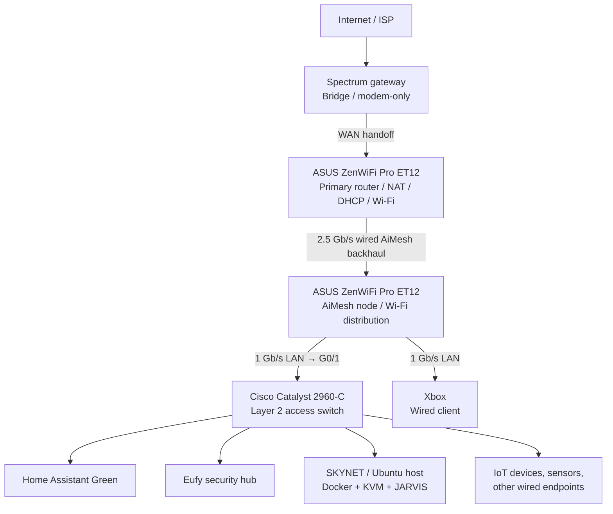

**Notes:** Port-level device assignments beyond the reported `G0/1` uplink are intentionally omitted. Exact port mappings, duplex settings and negotiated speeds require a switch audit. The original description places the Cisco switch **behind the AiMesh node**, not directly behind the primary router.

### 3.2 ASCII wiring reference

```text
Internet
   |
   v
Spectrum gateway [bridge / modem-only]
   |  WAN
   v
ASUS ET12 primary [routing, NAT, DHCP, firewall, Wi-Fi]
   |  2.5 Gb/s wired backhaul
   v
ASUS ET12 AiMesh node
   |-- 1 Gb/s LAN --> Xbox
   |
   +-- 1 Gb/s LAN --> Cisco Catalyst 2960-C (G0/1 uplink)
                         |-- Home Assistant Green
                         |-- Eufy security hub
                         |-- SKYNET / Ubuntu host
                         |-- IoT / other low-bandwidth wired equipment
                         +-- isolated VLAN 50 lab attachment (switch / host)
```

---

## 4. Physical deployment and screenshots

The following eight image references are **preserved from the original master README**. Their filenames and relative `Screenshots/` directory remain unchanged. Review photographs for public details such as SSIDs, MAC addresses, serial numbers, and externally reachable addresses before publishing updates.

### 4.1 Equipment, cabling and layout

<p align="center">
  
  
</p>
<p align="center">
  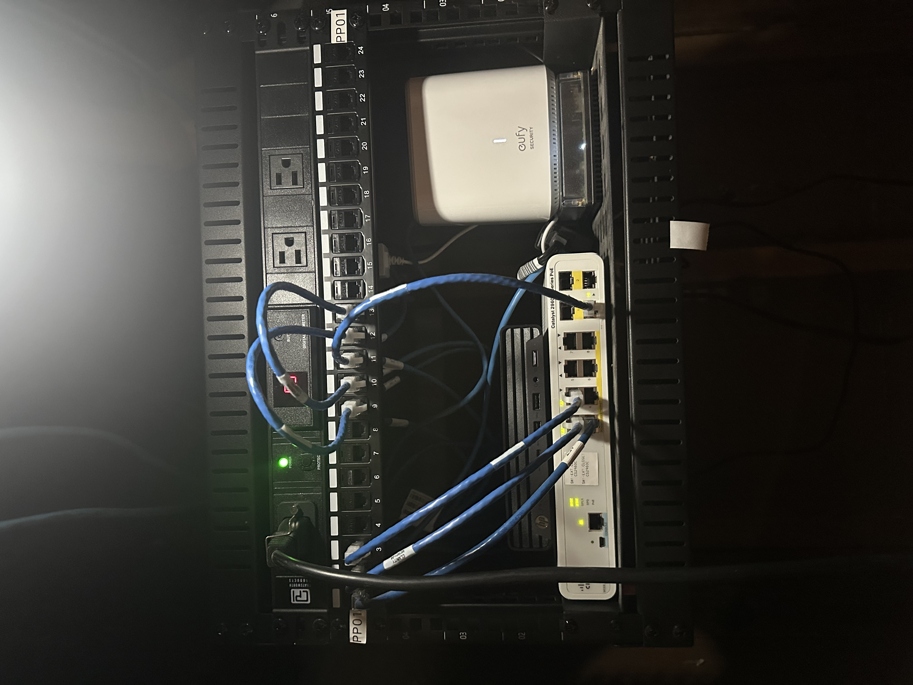
  
  
</p>

<p align="center"><em>Physical implementation reference: network equipment, patching and placement.</em></p>

### 4.2 Configuration and security reference images

<p align="center">
  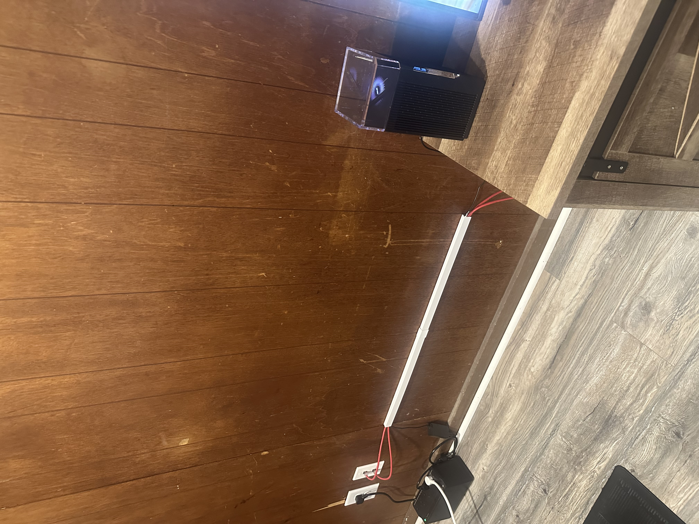
  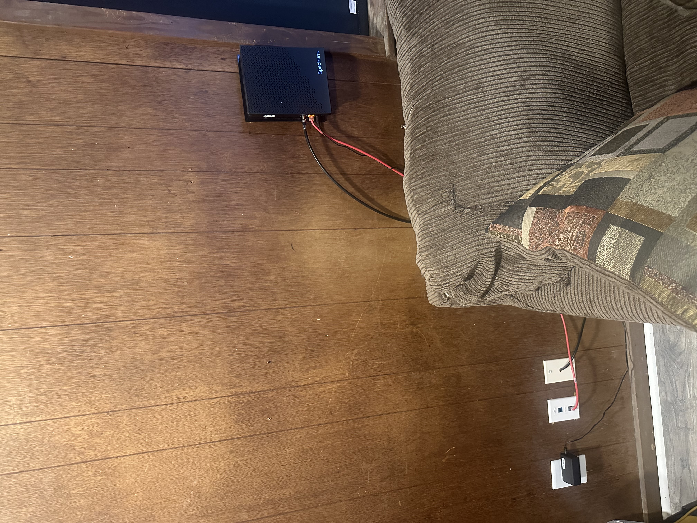
  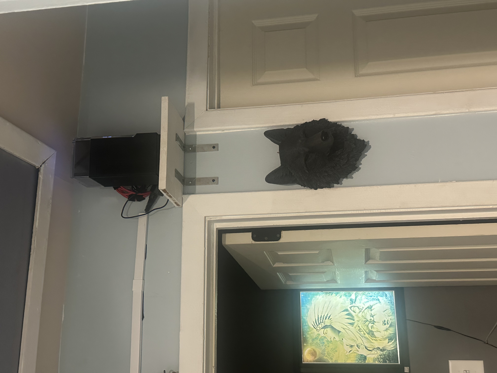
</p>

<p align="center"><em>Existing configuration and security reference images retained from the original README.</em></p>

---

## 5. Hardware roles and network inventory

### Spectrum gateway

- Reported to run in **bridge mode** and provide the WAN handoff to the ASUS primary.
- It should not also operate as a second residential NAT router in the intended topology.
- Verify the ASUS WAN lease and the ISP device's actual bridge configuration if double NAT is suspected.

### ASUS ZenWiFi Pro ET12 — primary

- Residential **default gateway**, NAT/firewall and DHCP authority.
- Wi-Fi 6E coverage, local DNS policy and the primary AiMesh controller role.
- Original DHCP design states a pool of `192.168.x.100–199` (placeholder notation; confirm the effective scope before using it as a runbook value).
- DNS-over-TLS is reported enabled; check the live setting and upstream resolver behavior when auditing.

### ASUS ZenWiFi Pro ET12 — AiMesh node

- Wired backhaul to the primary ET12, reported at **2.5 Gb/s**.
- Extends wireless coverage and provides wired LAN distribution.
- One reported gigabit LAN connection serves the Xbox; another serves the Cisco switch uplink.
- **Switch traffic shares the node's 1 Gb/s switch-facing link**, even though the upstream backhaul is faster.

### Cisco Catalyst 2960-C — Layer 2

- Acts as the managed access switch, not the residential IP gateway.
- Reported uplink: `G0/1` toward the AiMesh node at 1 Gb/s.
- VLAN 10 serves the home-side access network; VLAN 50 is reserved for EVE-NG lab isolation.
- Low-bandwidth endpoints may use Fast Ethernet access ports; critical or heavy-throughput endpoints need negotiated-speed checks.
- Patch leads are kept short where appropriate and cable colors are used as an operational identification convention—not as a substitute for port documentation.

### Network-connected services

| Device / role | Why it needs reliable connectivity |
|---|---|
| Home Assistant Green | Local automation logic, sensor state and dashboard access |
| Eufy security hub | Camera/security integration and HA-facing bridge workflows |
| SKYNET / Ubuntu server | JARVIS, Docker services, systemd workers, KVM and administrative tools |
| Windows administration VM | Administrative workstation and Windows-based utilities |
| EVE-NG VM | Isolated router/switch/firewall network experiments |
| Xbox / user workstations | Higher-bandwidth client traffic |
| Sensors and other IoT endpoints | Low-bandwidth, availability-sensitive automation events |

---

## 6. Logical topology and VLAN separation

The network design uses a **simple home VLAN plus a separate lab VLAN**, not a single universal VLAN. VLAN assignment is Layer 2 segmentation; routing between VLANs requires an actual Layer 3 forwarding path and access policy.

| Segment | VLAN | Intended contents | Routing expectation |
|---|---|---|---|
| Primary home LAN | `10` | HA Green, Eufy, normal infrastructure and household devices | Residential gateway access as configured |
| EVE-NG test / lab | `50` | Lab-only simulated networks and test endpoints | **No presumed route to the home LAN** |
| SKYNET host | VLAN 10 and VLAN 50 attachment | Host networking and lab interface(s) | Dual access **does not automatically authorize forwarding** |

### 6.1 Logical switching model

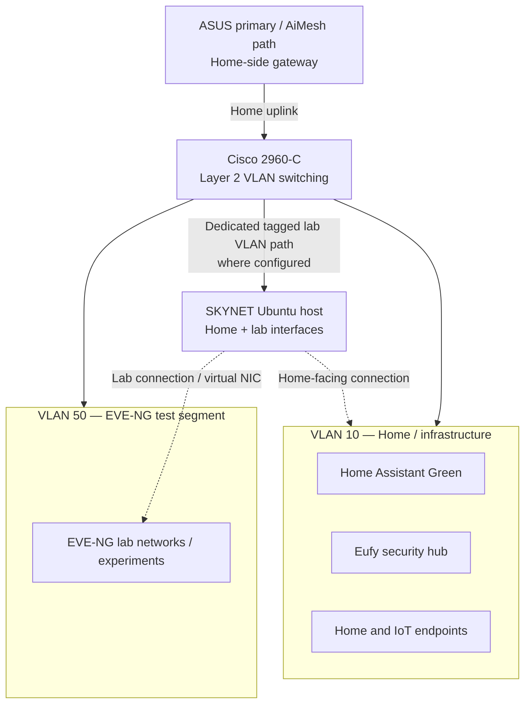

**Critical distinction:** Saying that SKYNET is attached to both VLANs through a trunk or virtual interfaces does **not** prove that VLAN 50 has a DHCP server, gateway, NAT access or permission to reach VLAN 10. Those capabilities must be documented and verified separately. The ASUS AiMesh uplink should not be assumed to carry VLAN 50 tags without explicit configuration evidence.

### 6.2 Router-on-a-stick clarification

The former README called this an *augmented router-on-a-stick* design. Strictly, **router-on-a-stick** requires an 802.1Q trunk terminating on a Layer 3 router/firewall with per-VLAN routed interfaces. The currently documented configuration establishes a **trunk-assisted lab connection on a Layer 2 switch**, with SKYNET connected to home and lab networks. It does not establish that the ASUS router or SKYNET actually routes between them, but as im currently learning VLSM and layer 3 routing this will be corrected later.

---

## 7. Routing, NAT, DHCP and DNS

| Control | Intended owner | Verification focus |
|---|---|---|
| Residential WAN and NAT | ASUS ET12 primary | WAN lease, single NAT boundary, no unintended ISP NAT |
| Residential DHCP | ASUS ET12 primary | Scope, lease table, default gateway, reservations |
| Residential DNS | ASUS/router policy | Effective resolver and DNS-over-TLS behavior |
| Primary LAN forwarding | Cisco Layer 2 switching and ASUS gateway | Correct VLAN membership and default-gateway reachability |
| Lab addressing and DHCP | EVE-NG/test environment, if explicitly configured | Prevent leakage of lab DHCP onto the home LAN |
| Inter-VLAN forwarding | **Not yet verified** | Routing table, host IP forwarding, ACL/firewall rules |

**Do not** treat VLAN presence, a trunk port, or a virtual machine NIC as proof of Layer 3 reachability or isolation. The device providing any VLAN 50 gateway should be identified explicitly before adding routes or policies.

---

## 8. Capacity and performance design

- **2.5 Gb/s wired AiMesh backhaul:** limits wireless-hop overhead and supports traffic between the primary and mesh node.
- **1 Gb/s node-to-switch uplink:** the shared potential bottleneck for devices behind the 2960-C, even when the backhaul is 2.5 Gb/s.
- **1 Gb/s Xbox path:** reduces reliance on Wi-Fi and supports high-demand client traffic.
- **Fast Ethernet access ports:** appropriate for some IoT, security and control devices when their throughput and power requirements fit.
- **Server and VM workloads:** Docker, Jellyfin, image pulls, backups, AI model transfers and EVE-NG can compete for physical network capacity; coordinate heavy activity where needed.
- **Wi-Fi performance:** dependent on placement, channels, client capability and the real negotiated backhaul speed—not only router specifications.

### Traffic-path planning

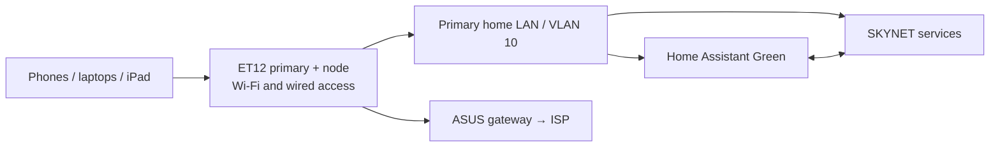

Local HA ↔ SKYNET flows can stay on the LAN; external downloads and remote sessions cross additional boundaries. Actual paths depend on the endpoint's switch port, Wi-Fi association and VLAN.

---

## 9. Security and trust boundaries

The design favors **one residential firewall/NAT edge and carefully separated lab traffic**, with no requirement to publish management services to the public internet.

- **Residential WAN:** Spectrum bridge → ASUS firewall/NAT is the intended boundary.
- **Home network:** Home Assistant, security integrations and service dashboards remain on private addressing.
- **VLAN 50:** Experimental lab traffic should not have unreviewed access to household controllers or production services.
- **SKYNET:** Docker and VMs are separate execution environments, **not automatic network security boundaries**; verify bridges, bound ports and guest NICs.
- **JARVIS:** AI model runtimes and command interfaces should remain behind the central harness and internal policy controls.
- **Remote access:** ASUS Instant Guard VPN provides private-network access without intended public port forwarding.
- **Credential hygiene:** Never commit router exports, device credentials, VPN profiles, private IP/device maps with sensitive annotations, or unredacted administrative screenshots.

### Trust-boundary diagram

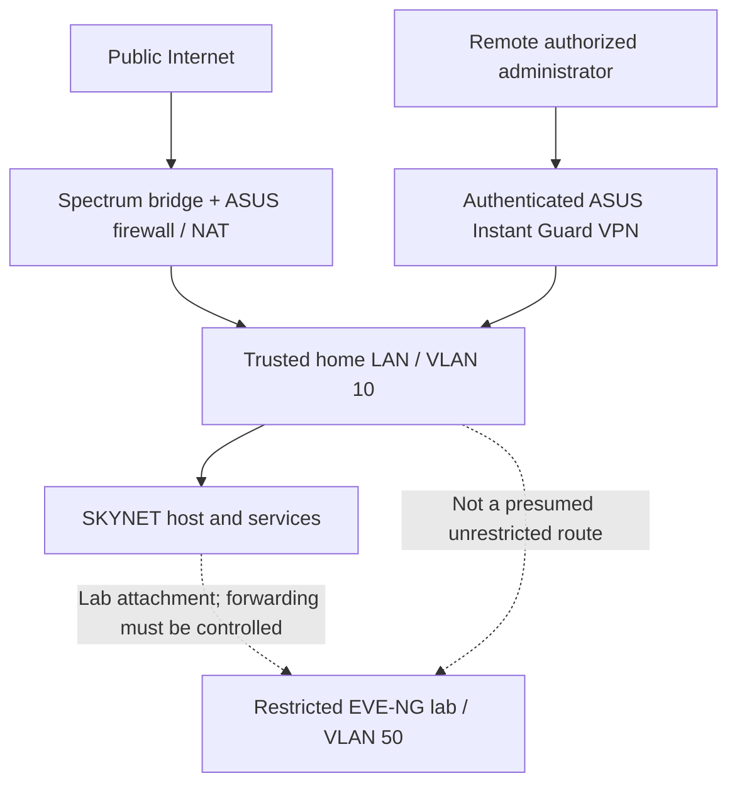

The dashed relationships are **potential interfaces/policy paths**, not evidence of permitted inter-VLAN routing.

### Security configuration photographs

The original security-related image set is retained in [section 4](#4-physical-deployment-and-screenshots) so photographs remain in one organized gallery.

---

## 10. SKYNET, VMs, Docker and JARVIS

The networking layer supplies connectivity to the **Ubuntu infrastructure host** described in the separate RDP/VM master README. It does not replace the host's application orchestration or JARVIS control plane.

| Execution layer | Function | Network dependency |
|---|---|---|
| Ubuntu host | Network interfaces, bridges, storage and systemd services | Correct VLAN/bridge and host reachability |
| KVM / libvirt | Windows administration VM and EVE-NG lab VM | Per-VM NIC attachment, bridge choice and VLAN policy |
| Docker | Container-hosted tools and persistent applications | Correct host binds, published ports and local service discovery |
| JARVIS central harness | Schedules, routes, policy checks, model choice, confidence and approvals | Internal host/service access; no bypass of approval boundaries |
| Home Assistant integration | Sensors, iframe dashboards and automation state | Stable private LAN access and authorized API calls |

Examples of Docker-hosted tools include Jellyfin, Eufy bridge, Open WebUI, Actual Budget and WatchState. A scheduled Alabama Power importer runs as an **ephemeral cron-launched Docker job**; its historical data is published into HA long-term statistics. Docker hosts services; **JARVIS remains the authority for governed jobs and final actions**.

Ghostfolio is a **planned investment/CD tracking component**, not a currently verified running container. Gusto Agent has appeared in historical Docker snapshots; its present service state should be checked independently.

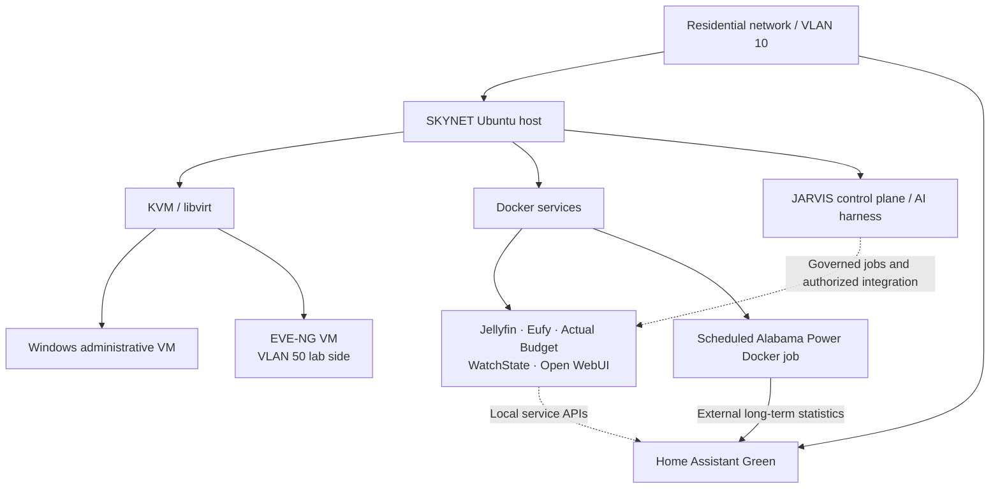

**Architecture ownership:** Network README = physical and logical connectivity; [RDP infrastructure README](../03-RDP-VM-Infrastructure/README.md) = host/VM/JARVIS architecture; [Docker README](../03-RDP-VM-Infrastructure/Docker/README.md) = container inventory and execution models.

---

## 11. Home Assistant, Apple Home and IoT

- **Home Assistant Green** is the local automation engine for HVAC, energy, sensors, presence, alerts and dashboards.
- **Apple Home** is a user-facing control layer via HomeKit bridges and supported local integrations.
- **Eufy hub + bridge** contribute camera/security status to Home Assistant, subject to integration health.
- **SKYNET services** provide processing, dashboards and scheduled collectors that Home Assistant can consume.
- **Alabama Power** publishes utility readings to Home Assistant **external long-term statistics**, so historical charts may exist without a corresponding `sensor.*` entity.
- **Wi-Fi and wired IoT** can use the ordinary home LAN unless explicitly placed in another supported VLAN/SSID design; do not imply per-device isolation solely from cable labels.

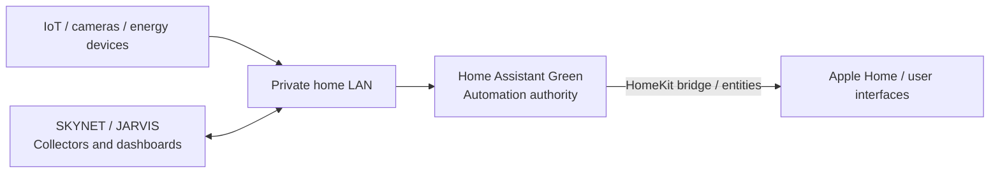

Home Assistant operates **on the network**; it does not provide the residential router's DHCP/NAT functions.

---

## 12. Remote access and Caleb edge node

### ASUS Instant Guard administration path

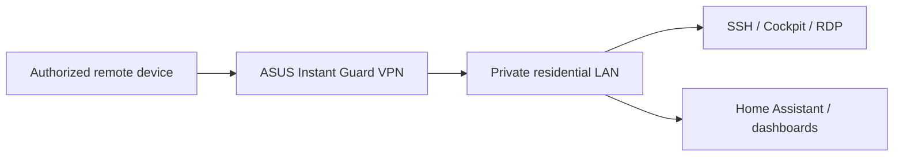

VPN access provides a controlled route into private services. Verify the effective routing and any firewall/VPN rules before assuming every guest, lab or container network is reachable.

### Caleb — separate remote edge site

Caleb is a **remote media and support edge node**, documented as a separate site. Its role is local intake, telemetry, client playback and storage-constrained cache operation; it is **not** the primary JARVIS data or library authority. Raw/received media can flow securely to SKYNET for registration and validation, and validated copies may later synchronize back to Caleb when appropriate.

See [Caleb Edge Node](./Edge-Node/README.md) and the [JARVIS Media Pipeline](../03-RDP-VM-Infrastructure/Subsystems/Media-Pipeline/README.md). The Caleb remote link is not a physical segment of the Alabama ET12 ↔ Cisco switching topology.

---

## 13. Operational workflows and diagnostics

The network is administered through a combination of the ASUS interface, SSH, the Cisco switch CLI and server-side tools. These **read-only diagnostics** should be collected before changing any VLAN or routing configuration.

### Cisco 2960-C: switching and uplink

```text
show interfaces status
show interfaces gigabitEthernet0/1
show interfaces gigabitEthernet0/1 counters errors
show vlan brief
show interfaces trunk
show mac address-table
show spanning-tree summary
show running-config interface gigabitEthernet0/1
```
### Ubuntu / SKYNET: local interface inventory

```bash
hostnamectl
ip -br link
ip -br address
ip route
ip -d link show
bridge link
sudo virsh list --all
sudo virsh net-list --all
docker ps --format 'table {{.Names}}\t{{.Status}}\t{{.Ports}}'
```

These commands inspect current state. Do not enable IP forwarding, change libvirt bridges, alter switch trunks, or restart network services merely to match a diagram.

### Suggested troubleshooting order

1. **Physical:** Cable, link lights, negotiated speed/duplex, errors and port status.
2. **Layer 2:** Correct access VLAN, trunk tags, MAC learning and loop/spanning-tree behavior.
3. **Layer 3:** IP, mask, default gateway, DNS and routing from the affected endpoint.
4. **Security:** ACL/firewall/VPN route and host forwarding policy.
5. **Application:** Docker binding, VM network adapter, Home Assistant integration and service health.

---

## 14. Failure domains and recovery

| Symptom | First checks | Avoid assuming |
|---|---|---|
| No internet, LAN still works | Spectrum bridge, ASUS WAN lease, upstream outage | The Cisco switch or HA is the cause |
| Mesh clients are slow | ET12 backhaul, roaming, channel load, link negotiation | 2.5 Gb/s WAN-to-client end-to-end throughput |
| Wired devices behind Cisco lose connectivity | Node-to-switch 1 Gb/s link, `G0/1`, VLAN assignment | A global ISP outage |
| Home Assistant unavailable | HA power/network, host route, integration state | The ASUS router must be rebooted |
| EVE-NG lab cannot reach test segments | VLAN 50 membership, host bridges/VM NICs | Lab should be routed to the home LAN |
| Home services reachable but remote VPN fails | Instant Guard authentication, WAN/vpn routes | Public ports should be opened |
| Docker service unhealthy | Container health, ports, volumes and app logs | Physical LAN failure |
| Alabama Power graph shows `Entity not found` | Recorder statistic ID versus entity registry | The statistics importer is necessarily broken |

For major changes, preserve a sanitized switch configuration, record old/new port roles, and validate **home automation and lab isolation** separately before declaring success.

---

## 15. Acceptance checks and documentation gaps

The following are **verification items**, not claims that tests have been passed in the current session.

| Check | Acceptance evidence |
|---|---|
| ISP bridge and NAT boundary | ASUS WAN addressing and confirmed gateway mode |
| Primary-node backhaul | Wired link mode and negotiated speed in ET12 management |
| Cisco uplink | `G0/1` status/counters and matching switch configuration |
| VLAN 10 access | `show vlan brief`, per-port configs and endpoint reachability |
| VLAN 50 isolation | Negative test: lab cannot reach protected household services without authorized route |
| SKYNET dual-VLAN arrangement | Host NIC/bridge/VLAN configuration and forwarding firewall review |
| Lab VM attachment | EVE-NG libvirt/VM NIC path verified against VLAN 50 |
| VPN-only remote management | Internet-side exposure review and successful authorized VPN access |
| Critical local services | HA and Eufy reachability independent of external internet |
| Photographic records | All eight README links resolve, with sensitive details redacted |

**Open questions:** Is VLAN 50 confined to the Cisco/SKYNET lab path? Is the host using a tagged 802.1Q subinterface, a Linux bridge, or multiple physical NICs? Are there any approved routes/ACLs between lab and home? These details should come from configurations, not inferred from the topology drawing.

---

## 16. Repository navigation

| Document | Purpose |
|---|---|
| [Smart Home Infrastructure — repository root](../README.md) | Overall portfolio and system overview |
| [Network Edge Node](./Edge-Node/README.md) | Caleb remote node, VPN, cache and operational roles |
| [RDP / VM infrastructure master](../03-RDP-VM-Infrastructure/README.md) | Ubuntu, KVM, Docker and JARVIS architecture |
| [Docker infrastructure](../03-RDP-VM-Infrastructure/Docker/README.md) | Persistent and ephemeral container services |
| [Host system](../03-RDP-VM-Infrastructure/Host-System/README.md) | Ubuntu resource and service ownership |
| [Virtualization](../03-RDP-VM-Infrastructure/Virtualization/README.md) | Windows workstation and EVE-NG lab |
| [Home Assistant](../02-Home-Assistant/README.md) | Automation logic, energy, sensors and dashboards |
| [Apple Home](../01-Apple-Home/README.md) | User-facing HomeKit control |
| [JARVIS Media Pipeline](../03-RDP-VM-Infrastructure/Subsystems/Media-Pipeline/README.md) | Controlled media ingestion, validation and Jellyfin publication |

---

## 17. Design principles and glossary

| Term / principle | Meaning in this environment |
|---|---|
| **Bridge mode** | Spectrum hands traffic to ASUS rather than adding a second residential NAT layer |
| **Wired backhaul** | Cable path connecting mesh nodes to reduce wireless hop overhead |
| **Access port** | A switch port normally carrying one untagged VLAN for an endpoint |
| **802.1Q trunk** | One link carrying multiple VLANs with tags; it is not inherently an IP router |
| **VLAN 10** | Main household access segment, per the documented switch design |
| **VLAN 50** | Dedicated Layer 2 lab segment for EVE-NG experiments |
| **Layer 2 isolation** | Broadcast-domain separation; secure cross-network isolation additionally depends on routing/host policies |
| **Router-on-a-stick** | A real Layer 3 device routes between tagged VLAN subinterfaces; not established by a switch trunk alone |
| **SKYNET** | Ubuntu compute host for container services, KVM and JARVIS workloads |
| **JARVIS harness** | Shared job policy/scheduling/routing and governed model execution—not the router or switch control plane |
| **Local-first** | Automation and internal services do not require public exposure for routine operation |

> **Architectural rule:** Keep household networking straightforward, give the lab a deliberate trust boundary, and never treat physical connectivity, VLAN membership, IP routing, or application permission as interchangeable.
