# Smart-Home-Infrastructure
Residential smart home lab integrating Home Assistant, network infrastructure, virtualization, local AI, and energy automation. This home was originally built in 1963 and completely remodeled over the past 2 years. This is my capstone and the culmination of my technical knowledge.

# Smart Home Infrastructure & Automation Lab

<p align="center">
  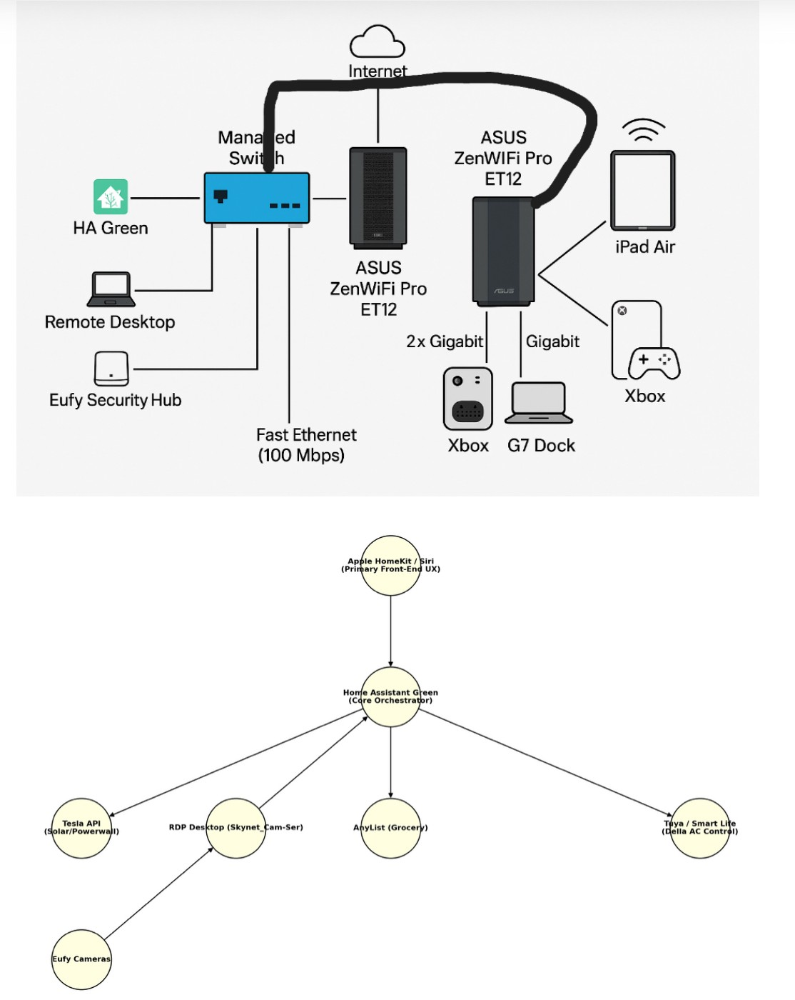
    
</p>

A portfolio repository documenting the architecture and automation systems used in my residential smart home lab.

This project integrates **Home Assistant, network engineering, virtualization, local AI (JARVIS), automation, and energy management** to create a fully automated residential infrastructure platform.

The system demonstrates real-world applications of:

- Infrastructure automation
- IoT system integration
- Energy optimization
- Network engineering (VLAN design, Cisco switching, mesh backhaul)
- Virtualization and containerized services
- Local-first AI with a governed execution harness
- DevOps-style configuration management, monitoring, and disaster recovery

> **Documentation checkpoint:** November 12, 2026. Energy and cost figures were re-checked against current Alabama pricing on this date (see [Sources](#sources-for-cost-figures)).

---

## Core Engineering Objective

This project was originally motivated by a practical engineering question:

**How much can residential cost of living be reduced through infrastructure automation and energy system optimization?**

The system was designed to minimize two major household operating costs:

- grid electricity consumption
- fossil fuel energy usage

To achieve this, the home was converted into a **fully electric, energy-aware automation platform** using solar generation, battery storage, and intelligent device orchestration.

Key strategies implemented include:

- shifting appliance usage to low-cost utility time windows
- maximizing solar self-consumption
- using battery storage to avoid peak grid pricing
- automating HVAC operation based on occupancy and environmental conditions
- coordinating EV charging with energy pricing and solar production

By treating the house as an **engineering system rather than a collection of smart devices**, the project explores how infrastructure automation can materially reduce the long-term cost of living.

This repository documents the architecture, automation design, and infrastructure used to operate this system.

---
## Table of Contents

1. [How It All Works](#how-it-all-works)
2. [Engineering Methodology](#engineering-methodology-sdlc-informed-design)
3. [Project Areas](#project-areas) · [Explore the System](#explore-the-system) · [Technology Stack](#technology-stack)
4. [Physical Network Topology](#physical-network-topology)
5. [SKYNET Server Stack](#skynet-server-stack) · [JARVIS Review Pipeline](#jarvis-review-pipeline-jarvis-core-v1)
6. [Control Architecture](#control-architecture)
7. [Operations, Monitoring & Disaster Recovery](#operations-monitoring--disaster-recovery)
8. [Economic Impact](#economic-impact-of-infrastructure-automation) · [RTA Rate Plan](#rate-plan-alabama-power-rta-residential-time-advantage) · [Projected Bill](#projected-annual-electric-bill-for-this-home-rta--ev-discount) · [Cost Reduction](#estimated-cost-reduction)
9. [Home Energy Policy](#-home-energy-policy-operational-spec)
10. [Battery Runtime Model](#-battery-runtime-model-night--peak-coverage-strategy) · [Extended Operation](#-extended-operation-247-off-grid-capability)
11. [Sources](#sources-for-cost-figures)

---

## How It All Works

The house runs as **one system in four layers**. Each layer has one job and passes its result to the next.

| Layer | What it is | Its job |
|---|---|---|
| **1 · Physical energy** | ~6 kW east/west solar array, Tesla Powerwall 3, Model 3, 4-zone mini-splits, Alabama Power grid on the RTA plan | Make, store, and use the energy |
| **2 · Transport** | Spectrum (bridge) → ASUS ET12 mesh → Cisco 2960-C, VLAN 10 home / VLAN 50 lab, VPN-only remote access | Move data reliably and keep the lab isolated |
| **3 · Control** | Home Assistant Green (logic) + HomeKit Bridge → Apple Home (interface) | Decide what runs and when, and give the family a simple front end |
| **4 · Compute & intelligence** | SKYNET Ubuntu server: Docker services, KVM VMs, JARVIS local AI, health checks, encrypted backups | Collect data, host services, review how the system really behaved, and recommend improvements |

### The core idea: control *when* energy is used, not just *how much*

Alabama Power's RTA plan sets the price by the clock. With the EV discount, overnight power is cheap (~11.9¢). Summer weekday afternoons are expensive (~28.6¢). The rest is in between (~13.6¢). Home Assistant turns those windows into three modes (**CHEAP / STRICT / NORMAL**) and moves every large load into the cheapest window that still keeps the dogs safe and the people comfortable.

### A day in the life of the house (winter weekday)

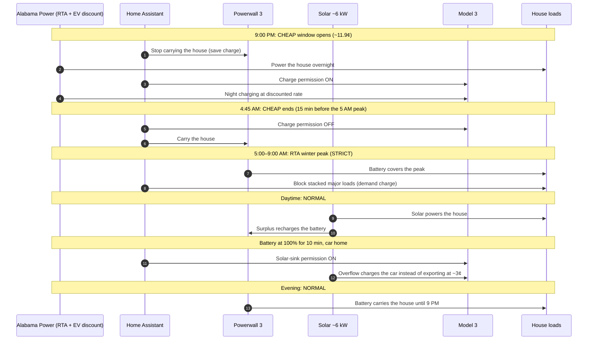

In **summer** the same loop runs, but the STRICT window moves to **1–7 PM weekdays**, the most expensive hours of the year (~28.6¢). The battery and blinds work hardest then. On **weekends and RTA holidays** there is no peak, which is why the four battery fill days fall on holidays.

### How decisions are made

1. **Safety first:** freeze protection, leak sensors, and dog temperature limits (49–86 °F) always win, whatever the cost.
2. **Presence decides permission:** away means bedroom and den zones turn off; the living room holds the dog-safe band.
3. **The time engine sets the mode:** CHEAP, STRICT, or NORMAL, from the RTA tariff.
4. **Template sensors hold the logic:** "Powerwall may carry home," "Tesla may charge," "load may start." Automations just follow the sensor, so each rule lives in one place and is easy to test.
5. **Load shedding protects the demand charge:** major loads never stack, because each extra kW in the month's worst 15 minutes costs $1.50.
6. **Overrides stay respected:** if Tesla Storm Watch activates, Home Assistant backs off and the Powerwall manages itself.

### How the system watches itself

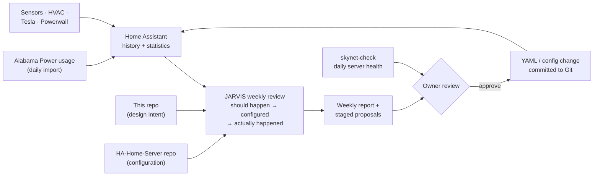

- **Home Assistant** records what every device did.
- **JARVIS** compares three things: what this README says should happen, what the HA configuration says to do, and what actually happened over the last 9 days. It flags the gaps, such as high humidity in a zone, a missing helper history, or the car charging outside its allowed window.
- **Nothing changes automatically.** JARVIS writes reports and staged proposals. I review and approve every production change, and it is committed to Git so it can be rolled back.
- **The server checks itself** with `skynet-check` and keeps one encrypted recovery backup, refreshed every 183 days.

### How the savings happen

| Mechanism | How it saves |
|---|---|
| **EV instead of gasoline** | ~4,000 kWh/yr of mostly night-discounted or solar charging replaces 400–500 gallons of gas. This is the biggest single saving. |
| **Efficient all-electric remodel** | Mini-splits and a remodeled envelope keep the house near ~16 kWh/day (~13 in winter) vs ~37 kWh/day for a typical Alabama home. |
| **No natural gas** | No gas bill and no gas fixed charges. |
| **Time-shifting on RTA** | Battery covers peaks, the grid is bought at night at ~11.9¢, and solar overflow fuels the car. |
| **Solar + Powerwall** | Covers daytime and peak load. After the $390/yr solar capacity charge its direct value is modest, so its real role is time-shifting, outage protection, and fueling the car. |

**Result:** a projected **$65–97/month** single electric bill for the house, the HVAC, and the car, about **$2,950–4,250/yr** less than a typical Alabama household spends on electricity, gas, and gasoline. The full math is in [Economic Impact](#economic-impact-of-infrastructure-automation).

---

## Engineering Methodology (SDLC-Informed Design)

This system was developed using a simplified **Software Development Lifecycle (SDLC)** approach adapted to residential infrastructure.

Instead of building isolated automations, the project follows a structured workflow:

- **Problem Definition** → reduce cost of living through energy and infrastructure optimization  
- **System Design** → separate responsibilities across Home Assistant (logic), Apple Home (interface), SKYNET/JARVIS (compute, services, AI), and network infrastructure (transport)  
- **Implementation** → YAML automations, Docker services, KVM virtual machines, systemd timers, and network configuration  
- **Testing & Validation** → real-world verification of automation behavior, energy savings, remote access, and daily health checks (`skynet-check`)  
- **Documentation** → modular repository structure with architecture breakdowns  
- **Iteration** → continuous refinement based on live system performance  

This approach ensures the system behaves as a **cohesive engineered platform**, not a collection of smart devices.

---

## Project Scope

The system manages a live residential automation environment including:

- Multi-zone HVAC automation
- Energy optimization using solar and battery storage
- EV charging coordination
- Security camera integration
- Appliance scheduling based on energy pricing
- Network infrastructure supporting automation servers, IoT devices, and an isolated network lab
- A self-hosted server (SKYNET) running Docker services, virtual machines, and the JARVIS local AI platform

---

## Project Areas

- **Home Assistant Automation Architecture**  
  Modular automation design using Home Assistant packages.

- **SKYNET Server: RDP / VM / Docker / JARVIS**  
  Ubuntu host running Docker services, a Windows 11 admin VM, an EVE-NG network lab, and JARVIS, a local-first AI platform with its own subsystems (Finance, Local Events, Media Pipeline, HVAC audits, CCNA lab assistant).

- **Network Topology & Infrastructure**  
  Spectrum (bridge) → ASUS ET12 primary → 2.5 Gb/s wired AiMesh backhaul → Cisco Catalyst 2960-C, with VLAN 10 (home) and VLAN 50 (EVE-NG lab).

- **Energy Automation & Load Management**  
  Smart control of HVAC, EV charging, and appliances based on energy pricing and solar production.

- **Backup, Monitoring & Disaster Recovery**  
  Git-based Home Assistant configuration backups, plus an encrypted SKYNET recovery backup on a rolling 183-day refresh and one-command health checks.

---

## Featured Highlights

- Multi-zone HVAC automation with occupancy awareness
- GitHub-based Home Assistant configuration backup pipeline
- Encrypted SKYNET recovery backup (AES-256 GPG) with a rolling 183-day refresh, tracked by `skynet-check` and `node-status`
- Residential network with a Cisco-switched VLAN design and an isolated EVE-NG lab VLAN
- Remote desktop / VM environment for automation and development
- JARVIS weekly review: compares design intent, HA config, and 9 days of runtime history, and stays advisory-only
- JARVIS local AI harness with time windows, a thermal ladder, and CPU core split so AI never starves the VMs
- Energy-aware device orchestration and load shifting (CHEAP / STRICT / NORMAL time engine, tiered load shedding)
- Dog-safety-first energy policy: safety layers always override cost
- Presence detection system design
- Server bridge architecture integrating automation services
- Apple HomeKit bridge integration with Home Assistant
- VPN-only remote access (ASUS Instant Guard); no public port forwarding

---

## Explore the System

- [Frontend Overview](01-Apple-Home/README.md)
- [Home Assistant Design](02-Home-Assistant/README.md)
- [Network Design](04-Network-Infrastructure/README.md)
- [RDP / VM / JARVIS Server (SKYNET)](03-RDP-VM-Infrastructure/README.md)
- [Energy Automation](02-Home-Assistant/04-Energy-Optimization/README.md)
- [Home Energy Policy (in this README)](#-home-energy-policy-operational-spec)

**SKYNET / JARVIS subsystems**

- [JARVIS Finance](03-RDP-VM-Infrastructure/Subsystems/Jarvis_Finance/README.md)
- [Local Events](03-RDP-VM-Infrastructure/Subsystems/Local-Events/README.md)
- [Media Pipeline](03-RDP-VM-Infrastructure/Subsystems/Media-Pipeline/README.md)
- [Caleb Remote Node](03-RDP-VM-Infrastructure/Subsystems/Caleb-Remote-Node/README.md)
- [CCNA-Jarvis](03-RDP-VM-Infrastructure/Subsystems/CCNA-Jarvis/README.md)
- [Home Assistant Integration](03-RDP-VM-Infrastructure/Subsystems/Home-Assistant-Integration/README.md)
- [Caleb Edge Node (network side)](04-Network-Infrastructure/Edge-Node/README.md)

---
### 🔍 Featured Deep Dive

- **Windows 11 Admin VM (Operational Workstation)**  
  Real-world administrative environment used to manage infrastructure, automation systems, and development workflows  
  → [`Windows 11 Pro VM`](03-RDP-VM-Infrastructure/Virtualization/Windows%2011Pro/README.md)

---
## Technology Stack

### Automation & IoT
- Home Assistant (Home Assistant Green)
- Apple HomeKit (via HomeKit Bridge)
- HomeKit Controller
- Tuya / Smart Life
- Eufy Security (via the `eufy_ws` bridge on SKYNET)

### Network Infrastructure
- ASUS ZenWiFi Pro ET12 mesh system (primary + AiMesh node, 2.5 Gb/s wired backhaul)
- Cisco Catalyst 2960-C Layer 2 switch (1 Gb/s uplink on `G0/1`)
- VLAN 10 (home / infrastructure) and VLAN 50 (EVE-NG lab)
- Spectrum gateway in bridge mode
- ASUS Instant Guard VPN for remote access

### Server Infrastructure (SKYNET)
- Mini desktop Ryzen server: 4 cores / 8 threads, ~32 GB RAM, 2 × 512 GB SSD + 1 TB HDD
- Ubuntu Server with systemd services and timers
- Docker: Jellyfin, eufy_ws, Open WebUI, Actual Budget, WatchState, Gusto agent, ARM (on demand), Alabama Power importer (scheduled job)
- KVM / libvirt: Windows 11 Pro admin VM, EVE-NG lab VM
- Cockpit and MobaXterm for management

### Local AI (JARVIS)
- Ollama model runtime (localhost only)
- Shared AI harness: window gate, thermal ladder, CPU core split, shared-pool router, failure guards
- Open WebUI front end with read-only JARVIS tools

### Energy Systems
- Tesla Powerwall 3 integration
- Solar generation monitoring
- EV smart charging automation
- Time-of-use energy optimization
- Daily Alabama Power usage import into Home Assistant long-term statistics

### Development & Operations
- Git / GitHub configuration management
- Python and Bash automation scripts
- YAML-based Home Assistant packages
- One-command health checks: `skynet-check`, `jarvis-status`, `node-status`
- Encrypted rolling server backups (GPG, AES-256)

---
HOME NETWORK + HA ⇄ APPLE HOME

HA – Home Assistant

HK – HomeKit Bridge

AH – Apple Home

SKYNET – Ubuntu server (RDP / Docker / KVM / JARVIS)

JARVIS – Local AI platform running on SKYNET

---

## Physical Network Topology

```text
ASCII DIAGRAM (real cabling)

 Internet
   │
┌──▼──────────────────────────┐
│ Spectrum Gateway (BRIDGE)   │  modem-only
└──┬──────────────────────────┘
   │ WAN
┌──▼──────────────────────────────────┐
│ ASUS ZenWiFi Pro ET12  (PRIMARY)    │  Router / NAT / DHCP / Wi-Fi / Instant Guard VPN
└──┬──────────────────────────────────┘
   │  Wired backhaul 2.5G ↔ 2.5G
┌──▼──────────────────────────────────┐
│ ASUS ZenWiFi Pro ET12  (AiMesh NODE)│  Wi-Fi coverage + Ethernet distribution
│ • LAN 1G → Xbox                     │
│ • LAN 1G → Cisco switch uplink      │
│ • WAN unused                        │
└──┬──────────────────────────────────┘
   │  1G uplink → G0/1
┌──▼───────────────────────────────────────────┐
│ Cisco Catalyst 2960-C (Layer 2)              │
│                                              │
│ ─── VLAN 10 · Home / Infrastructure ──────── │
│  • Home Assistant Green                      │
│  • Eufy Security Hub                         │
│  • SKYNET server (host, Docker, Windows VM)  │
│  • Wired IoT / low-bandwidth endpoints       │
│                                              │
│ ─── VLAN 50 · EVE-NG Lab (isolated) ──────── │
│  • SKYNET lab interface → EVE-NG VM          │
│  • No routing to VLAN 10 assumed             │
└──────────────────────────────────────────────┘

 Remote: Caleb edge node ──VPN──► home network (separate site, not on this switch)
```

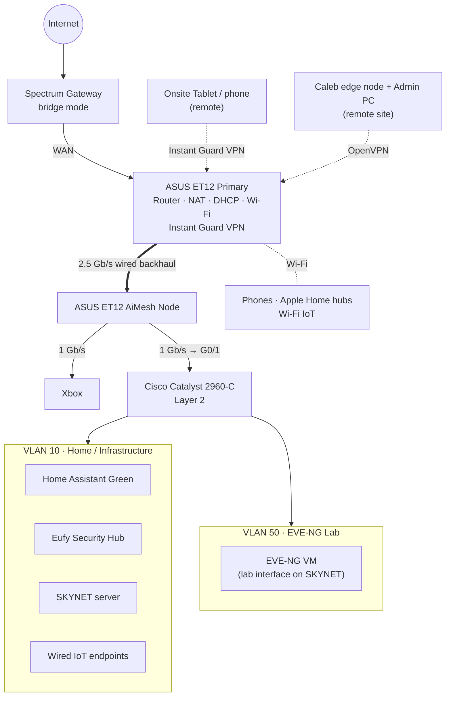

> VLAN 50 is a separate broadcast domain for lab work. Being attached to both VLANs does **not** mean SKYNET routes between them; any VLAN 50 gateway or route must be documented and verified on its own. See [Network Design](04-Network-Infrastructure/README.md).

---

## SKYNET Server Stack

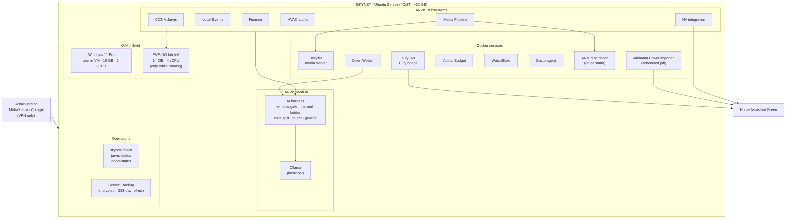

**Storage layout**

| Device | Role |
|---|---|
| System SSD | Ubuntu, Docker runtime, AI models, application data |
| Second SSD | VM disks and app data (Windows 11 ≈ 150 GB, EVE-NG ≈ 170 GB) |
| 1 TB HDD | Jellyfin media library and the `Server_Backup` recovery archive |

---

### JARVIS Review Pipeline (Jarvis-Core V1)

JARVIS works as an **advisory operations assistant** for the house. It collects evidence, compares it against the design, and writes a weekly report. It does not control the house.

Before it suggests anything, it checks three sources:

| Source | Answers |
|---|---|
| Smart-Home-Infrastructure repo (this repo) | What the system is **supposed** to do |
| HA-Home-Server repo | What Home Assistant is **configured** to do |
| Home Assistant History API (9-day window) | What **actually happened** |

```text
Should happen → Is configured → Actually happened
```

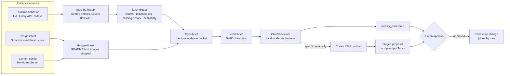

**Model roles (V1)**

| Role | Model | Gets |
|---|---|---|
| Normal Chief Reviewer | llama3:8b | `chief_brief.md` only |
| Deep Chief (manual) | qwen2.5:14b | `chief_brief.md`, run by hand when the server is cool |
| Code / YAML worker | deepseek-coder:6.7b | One specific task from the Chief, never the 9-day history |
| Server status summarizer | phi3:mini | Server health output only |
| Tiny helper | deepseek-coder:latest | Formatting and parsing |

**Lessons from testing:** the main problem was too much context, not model size. A 17,827-character prompt pushed the CPU to about 94–95 °C on both 8B and 14B models. The fix is to let Python read and compress everything and give the model only a small brief.

- **Data-heavy in Python, context-light in AI.** Raw history JSON (the HVAC file alone was 8.8 MB) stays local and is never sent to a model.
- **Missing history ≠ broken entity.** An entity can exist in HA but return no history (no state changes, recorder exclusions, helpers, timers).
- **Advisory only.** JARVIS never edits production HA files, restarts services, pushes to Git, changes Tesla or Powerwall settings, deploys automations, or deletes files. Everything is staged as a proposal for me to approve.

---


## Control Architecture

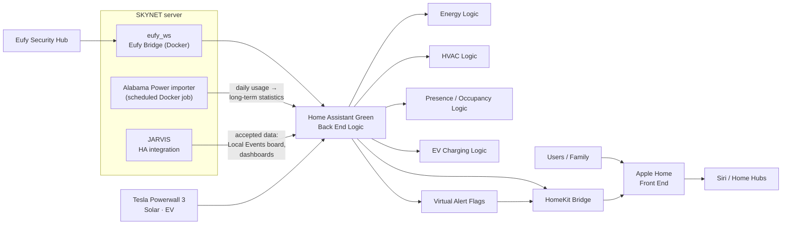

JARVIS publishes only accepted, saved data into Home Assistant. Production Home Assistant changes still require approval; JARVIS does not take control actions on its own.

### Implementation
- YAML-based automation architecture (Home Assistant packages)
- Python and Bash automation scripts
- Docker Compose services and systemd timers on SKYNET
- Allowlist-based exposure to Apple Home

---

## Operations, Monitoring & Disaster Recovery

### Health check commands

| Command | Purpose |
|---|---|
| `skynet-check` | One-screen OK / WARN / FAIL summary: load, memory, disks, CPU temperature, failed units, Gusto, Docker, VMs, backups, updates. `-v` adds detail; `--full` also runs the full legacy report. Exit code 0 / 1 / 2 for scripting. |
| `jarvis-status` | Compact node status: runs `skynet-check`, shows upcoming JARVIS timers, and lists every shortcut command grouped by area (Gusto, Finance, HVAC, Media/ARM, AI, Jarvis control, System). |
| `node-status` | The original detailed system report, including primary and secondary backup status. |

### Backup and recovery

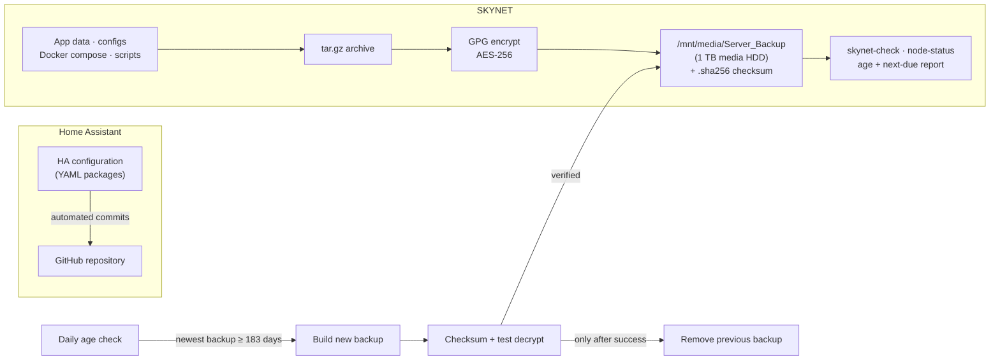

- **One rolling recovery backup** is kept in `Server_Backup` on the media drive. It is refreshed every **183 days** (about twice a year), and the old copy is removed only after the new one passes checksum and test-decrypt, so at least one good backup always exists.
- `skynet-check` reports the backup's age and days until the next refresh, and warns if it becomes overdue.
- The automated 183-day job is being finalized; the current backup was moved into `Server_Backup` and is tracked by both health checks.
- Home Assistant configuration is backed up separately to GitHub.

---

## Economic Impact of Infrastructure Automation

A primary objective of this project is reducing the long-term **cost of living** through infrastructure automation and energy system optimization.

Rather than treating automation as a convenience feature, the system treats the home as an **energy-managed residential infrastructure platform** designed to minimize operating costs across electricity, heating, and transportation.

The home operates as a **fully electric household**, eliminating natural gas usage and integrating solar generation, battery storage, and EV charging automation into a unified energy system.

---

### Energy Infrastructure

The residential energy platform currently integrates:

- **~6 kW solar generation system** (5.98 kW-DC: 13 × REC 460 W Pure-RX modules, upgraded from 5.81 kW)
- **Tesla Powerwall 3 battery storage (13.5 kWh usable, 11.5 kW continuous) with built-in solar inverter and Tesla Gateway 3**
- **Fully electric multi-zone mini-split HVAC system**
- **Tesla Model 3 Long Range (used as a managed electrical load)**
- **Home Assistant automation platform coordinating energy usage**

Estimated solar generation:

- **~7,800 kWh annually** (≈ 1,300 kWh per installed kW, scaled from the original 7,553 kWh estimate for 5.81 kW)
- **~21.4 kWh per day on average** (more in summer, less in winter)

**Array design (from the installer's design drawings)**

| Item | Detail |
|---|---|
| Modules | 13 × REC 460 W Pure-RX = 5.98 kW-DC (STC) |
| Orientation | East/west split: azimuth 92° and 272°, 18° tilt, roof-mounted |
| Strings | 3 strings of 6, 4 and 3 modules, one per Powerwall 3 MPPT input |
| Inverter / storage | 1 × Tesla Powerwall 3 (11.5 kW / 13.5 kWh), Tesla Gateway 3, whole-home backup |
| Rapid shutdown | Module-level MCI-2 devices |

The east/west layout spreads production across the morning and afternoon instead of one midday peak, which suits a battery-first, time-shifted system.

   

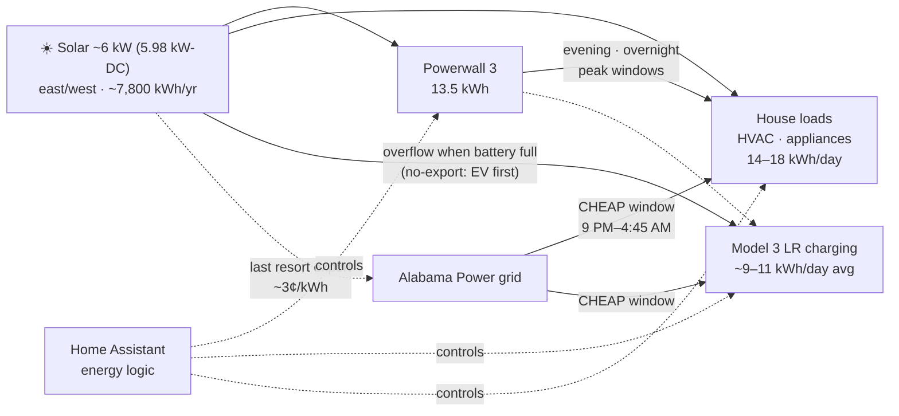
  
---

### Typical Household Energy + Transportation Costs (Regional Baseline)

For a typical Alabama household using electricity, natural gas, and a gasoline vehicle (2026 pricing):

| Category | Assumption | Typical Annual Cost |
|--------|----------------|----------------|
| Electricity | ~13,700 kWh/yr at ~16–17¢/kWh | ~$2,150 – $2,300 |
| Natural Gas | ~$40 – $70/month | ~$480 – $840 |
| Gasoline vehicle fuel | 12,000 – 15,000 mi at 30 mpg, ~$3.75/gal | ~$1,500 – $1,875 |
| **Total energy + transportation** | | **~$4,100 – $5,000 / year** |

These costs vary depending on energy prices, driving distance, and heating demand. Gasoline in Alabama has swung widely in 2026 (about $2.55 in January to a ~$4.17 peak in May), so fuel savings move with the pump price.

---

### EV Charging as an Energy-Controlled Load

The Tesla Model 3 Long Range acts as a **high-capacity controllable electrical load** within the automation system.

At ~0.27 kWh per mile, 12,000 – 15,000 miles a year is about **3,200 – 4,050 kWh/yr** (roughly 9 – 11 kWh/day on average). This is on top of the 14 – 18 kWh/day house load used in the battery model below.

Charging is coordinated through automation rules that:

- prioritize charging during low-cost overnight electricity windows
- avoid peak energy pricing periods
- coordinate with other large electrical loads in the home
- integrate with solar generation and battery state when available

This allows the EV to function as part of the home’s **managed energy ecosystem** rather than as an uncontrolled power demand.

#### Alabama Power EV Night Charging Discount (Rate Rider PEV)

The home is enrolled in Alabama Power's **EV Night Charging Discount**, an optional rider that works alongside the RTA time-of-use plan:

| Item | Detail |
|---|---|
| Discount | **1.7155¢ per kWh** off the energy rate |
| Window | **9 PM – 5 AM**, every day |
| Applies to | **All** household kWh in that window, not just the car |
| Not applied to | Fuel charge (Rate ECR), tax adjustments (Rate T), gross receipts tax |
| Waived | In any month billed at the minimum bill |
| Enrollment | Must be renewed every year with proof of EV ownership |

**How the automation uses it:**

- The **CHEAP window (9 PM – 4:45 AM)** sits inside the discount window. The 15-minute early cutoff keeps EV charging and deferred loads from spilling into the 5 AM STRICT winter peak.
- During CHEAP the Powerwall stops carrying the house. The house and the car run on discounted grid power, and the battery is saved for the STRICT window and the evening.
- Tesla charge permission defaults to CHEAP, so nearly all EV energy is bought at the discounted rate.

```mermaid
gantt
    title Daily energy windows (winter)
    dateFormat HH:mm
    axisFormat %H:%M
    section Alabama Power
    EV Night Discount 9 PM–5 AM     :done, d1, 00:00, 5h
    RTA winter peak 5–9 AM (weekdays) :crit, p1, 05:00, 4h
    EV Night Discount 9 PM–5 AM     :done, d2, 21:00, 3h
    section Home Assistant
    CHEAP (grid + EV charging)      :active, c1, 00:00, 4h45m
    Battery carries house           :b1, 04:45, 16h15m
    CHEAP (grid + EV charging)      :active, c2, 21:00, 3h
```

In summer the STRICT window moves to 1 – 7 PM on weekdays, matching the RTA summer peak (25.6092¢ base). The CHEAP window and the discount window stay the same. Weekends have no peak period.

---

### Rate Plan: Alabama Power RTA (Residential Time Advantage)

The home is on Alabama Power's optional **Rate RTA** time-of-use plan, with the **EV Night Charging Discount** stacked on top. The JARVIS/Home Assistant time engine (CHEAP / STRICT / NORMAL) is built directly from these windows.

| Season | Peak (weekdays) | Peak base rate | Economy (all other hours) |
|---|---|---|---|
| Summer · Jun 1 – Sep 30 | 1 PM – 7 PM | **25.6092¢/kWh** | 10.6092¢/kWh |
| Winter · Nov 1 – Mar 31 | 5 AM – 9 AM | **12.6092¢/kWh** | 10.6092¢/kWh |
| Shoulder · Oct, Apr – May | none | n/a | 10.6092¢/kWh, all hours |

**Fixed charges:** $14.50/month base charge, plus a **$1.50/kW demand charge** on the highest 15-minute demand of the month. Weekends and the RTA holidays (New Year's Day, Independence Day, Labor Day, Thanksgiving, Christmas) are economy all day.

The rates above are base energy charges. Fuel (Rate ECR), the natural disaster reserve (NDR) and taxes are added on top. Comparing Alabama Power's 17.91¢ all-in average to its standard rate suggests these add-ons total **about 3¢/kWh**. That gives these modeled all-in prices:

| Window | All-in estimate |
|---|---|
| Economy | ~13.6¢/kWh |
| Economy, 9 PM – 5 AM with EV discount (−1.7155¢) | **~11.9¢/kWh** |
| Winter peak | ~15.6¢/kWh |
| Summer peak | **~28.6¢/kWh** |

**What this means for the design:**

- **The summer peak is the expensive hour.** At ~28.6¢ it costs more than twice economy power, so the Powerwall's main job is to carry the house through weekday summer afternoons.
- **The winter peak is mild** (only 2¢ above economy). In winter the battery is mostly about independence and outage protection, not price.
- **The demand charge rewards load shedding.** Each extra kW in the worst 15 minutes costs $1.50/month. A dryer (~5 kW) running alongside EV charging adds about $7.50 to that month's bill, which is why the policy never stacks major loads.
- **The fill days were picked on purpose.** All four (New Year's, Labor Day, Thanksgiving, Christmas) are RTA holidays with no peak period, so refilling the battery from the grid on those days costs only the economy rate.
- **Night grid use keeps the discount active.** The EV discount is waived in months billed at the minimum bill. The house and car always use grid power overnight, so the bill stays above the minimum and the discount always applies.

---

### Projected Annual Electric Bill for This Home (RTA + EV Discount)

The model below runs a full year through the actual policy: the house is on grid during CHEAP, solar and battery carry the rest, and the EV charges at night or from solar overflow.

**Assumptions**

- House load: ~16 kWh/day average (~5,840 kWh/yr). About 32% of it falls in the CHEAP window (9 PM – 4:45 AM) and is bought at ~11.9¢.
- Solar and battery cover ~90% of the remaining daytime and evening load. The rest comes from the grid at economy rates in winter.
- Solar: ~7,800 kWh/yr. Overflow goes to the EV first and is exported at ~3¢ only if the car can't take it.
- EV: 0.27 kWh/mile. Charging not covered by solar overflow is bought at ~11.9¢.
- Demand charge: modeled at ~10 kW (EV charging plus base load).
- Not modeled: battery round-trip losses.

| | Low case | High case |
|---|---|---|
| Miles driven per year | 12,000 | 15,000 |
| EV energy needed | 3,240 kWh | 4,050 kWh |
| EV energy from solar overflow | 30% | 60% |
| Base charge ($14.50 × 12) | $174 | $174 |
| Demand charge (~10 kW × $1.50 × 12) | $180 | $180 |
| Solar capacity charge (6 kW × $5.41 × 12) | $390 | $390 |
| Grid energy (house nights + EV + winter shortfall) | $548 | $471 |
| Export credit | −$98 | −$54 |
| **Modeled annual electric bill (conservative)** | **~$1,195 (~$100/mo)** | **~$1,160 (~$97/mo)** |

This conservative model lands at the top of the projected range.

**Projected monthly bill: ~$65 – $97** (≈ $780 – $1,165 per year)

- **~$65/mo:** strong-solar and shoulder months, when the EV runs mostly on solar overflow and the bill sits close to the fixed floor.
- **~$97/mo:** winter and summer-peak months, when more EV charging and winter shortfall come from the grid.
- **Fixed floor:** about $62/mo whatever the energy use: $14.50 base charge + ~$15 demand charge + $32.46 solar capacity charge.

That one bill covers the whole house, all heating and cooling, and the car. There is no gas bill and no gasoline.

---

### Estimated Cost Reduction

Compared against the regional baseline above (electricity, natural gas and gasoline for a typical Alabama household):

| | Low case | High case |
|---|---|---|
| Typical household: electricity + natural gas + gasoline | ~$4,130 | ~$5,015 |
| This home: one electric bill (house + HVAC + EV), $65 – $97/mo | ~$780 – $1,165 | ~$780 – $1,165 |
| **Estimated annual reduction** | **~$2,965 – $3,350** | **~$3,850 – $4,235** |

**Bottom line: roughly $2,950 – $4,250 per year** less than a typical Alabama household spends on electricity, natural gas and gasoline.

**Where the savings come from** (shown for the conservative model at ~$97 – $100/mo; bills closer to $65/mo add up to ~$385 – $415/yr more, mostly from EV charging on solar)

| Source | Low case | High case |
|---|---|---|
| Gasoline replaced by EV (gasoline minus EV grid charging at ~11.9¢) | ~$1,230 | ~$1,680 |
| Lower usage + RTA time-of-use pricing (efficient all-electric remodel at ~5,800 kWh/yr vs ~13,700 kWh/yr typical) | ~$855 | ~$830 |
| Natural gas eliminated | ~$480 | ~$840 |
| Solar + Powerwall, net of the $390/yr solar capacity charge | ~$370 | ~$500 |
| **Total (conservative model)** | **~$2,935** | **~$3,855** |

The EV Night Charging Discount alone is worth about **$60 – $70/yr** (1.7155¢ on ~3,500 – 4,200 kWh of night use). It is already included in the ~11.9¢ night rate above.

**How these numbers were calculated**

1. **Baseline:** a typical Alabama home's yearly electricity (EIA average use × current price), plus a typical gas bill, plus gasoline for 12,000–15,000 miles at 30 mpg.
2. **This home's load:** about 16 kWh/day for the house, plus 0.27 kWh/mile for the car.
3. **Split by the clock:** about 32% of house load falls in the 9 PM–4:45 AM CHEAP window and is bought from the grid. Solar and the Powerwall cover about 90% of the rest.
4. **Solar balance:** about 7,800 kWh/yr serves the house first. The overflow charges the car (30% or 60% of its energy in the two cases), and any leftover is exported at ~3¢.
5. **Price it on the real tariff:** RTA energy rates plus ~3¢ of add-ons, minus the 1.7155¢ EV discount at night, plus the base, demand, and solar capacity charges.
6. **Compare:** the baseline minus this home's single electric bill gives the reduction. The source table splits that difference by cause.

**Notes on the estimate:**

- **Solar's direct dollar value is modest here.** RTA economy power is cheap (~13.6¢), exports pay only ~3¢, and the $5.41/kW capacity charge takes about $390/yr. Most of solar's value comes from covering summer-peak hours and from fueling the car, which is why the policy uses the EV as the solar sink instead of exporting.
- **The car and the efficient house deliver most of the savings.**
- **Gasoline price matters.** At ~$4.15/gal (May 2026 peak), the EV line rises by about $160 – $200.
- **Assumptions to verify:** the add-on charges (~3¢) and the 10 kW demand figure come from the model, not from my bills. Actual Alabama Power bills, already imported into Home Assistant, are the source of truth for checking this projection.
- **About the earlier figures:** previous versions of this table (~$3,200 – $4,200, then ~$2,200 – $2,950) were priced at a flat 17¢ and treated solar, gas and the EV separately. This version uses the actual RTA tariff and a whole-home bill.

---

## System Design Philosophy

The smart home is designed using core engineering principles typically applied to distributed systems:

- **Separation of Concerns**
  - Home Assistant → automation and logic  
  - Apple Home → user interface and communication  
  - SKYNET / JARVIS → compute, services, AI, and data collection  
  - Network infrastructure → connectivity and security  

- **Local-First Architecture**
  - all critical systems operate on the local network  
  - AI models run locally through Ollama, bound to localhost  
  - remote access is achieved securely via VPN (ASUS Instant Guard)  
  - no direct exposure of internal services to the public internet  

- **Controlled Exposure (Allowlist Model)**
  - only human-relevant entities are exposed to Apple Home  
  - backend logic, telemetry, and system internals remain isolated

- **One Control Plane for AI**
  - every AI job goes through the same harness (time windows, thermal limits, CPU core split)  
  - AI work never competes uncontrolled with the VMs, media services, or the network lab

- **System-as-Infrastructure Mindset**
  - HVAC, EV charging, and appliances are treated as coordinated system components  
  - energy usage is orchestrated, not reactive  
  - automation decisions are based on state, timing, and cost conditions  
 
---

## 🏠 Home Energy Policy (Operational Spec)

A battery-first, automation-governed residential microgrid. Home Assistant enforces the policy; the grid is the fallback.

### Priority order

1. Dogs' safety
2. Human comfort
3. Energy efficiency
4. Grid cost optimization
5. Battery preservation

Safety overrides cost. **Layer 0 always wins.**

### Control layers

| Layer | Purpose | Key rules |
|---|---|---|
| **0 · Safety** (always on) | Protect the house regardless of occupancy, cost, or battery | Laundry freeze heater, leak sensors, extreme-cold logic, power-failure recovery, dog temperature limits |
| **1 · Dog baseline** | Keep the dogs safe | Safe range 49–86 °F; living room eco band ≈ 64–78 °F; living room mini-split, dog heater, dog fan. Strict mode never overrides this. |
| **2 · Human comfort** | Condition only occupied zones | Bedroom 1, Bedroom 2, Den. Away → bedrooms and den off. Bedrooms use adaptive recovery; den follows TV activity and mirrors the living room mode. |
| **2.5 · Blinds** | Use sunlight and shade before loads run | Closed 5 PM–6 AM. Strict window: winter → open for passive heat; summer → closed to block heat. Minimal movement (battery-powered motors). |
| **3 · Energy optimization** | Cost, grid interaction, battery, load coordination | Time engine, Powerwall governance, Tesla charge permission, load shedding |

### Time engine (Alabama Power RTA plan)

| Window | Hours | Strategy |
|---|---|---|
| **CHEAP** | ~9 PM → 4:45 AM (inside the 9 PM – 5 AM EV discount; cutoff kept early on purpose) | Grid used here on purpose at ~11.9¢: EV charging, major loads |
| **STRICT** (expensive) | Winter 5–9 AM · Summer 1–7 PM (weekdays, matching RTA peak) | Battery carries the house; major loads blocked |
| **NORMAL** | All other hours | Battery and solar first |

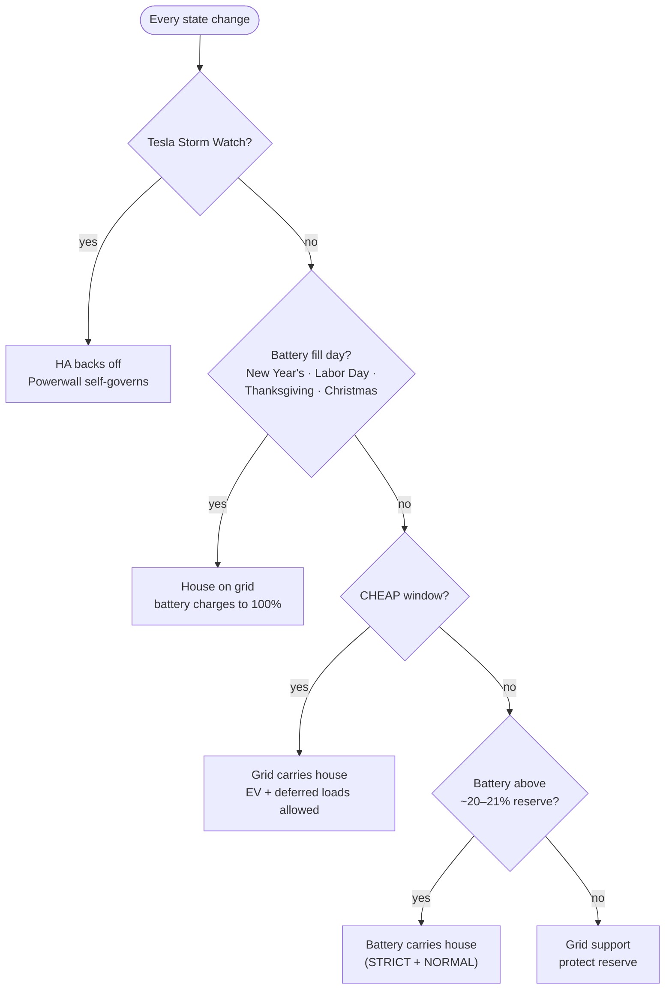

### Tesla Model 3 charge permission

The car is the house's flexible load and solar overflow sink. Charging is allowed only when one of these is true:

1. **CHEAP window** (main charging period)
2. **Emergency:** car below 10% → charge until it reaches 30%
3. **Solar sink:** Powerwall at 100% and stable for 10 minutes, solar still producing, car at home

Permission on → charging on. Permission off → charging off. The logic lives in template sensors so the automations stay simple.

### Load shedding

**Never stack major loads during expensive windows.** Major loads are EV charging, dryer, dishwasher, washer, oven/cooktop, water heater, and HVAC spikes.

| Tier | Loads | Rule |
|---|---|---|
| **Tier 0 · Always on** | Fridge, network, cameras, one mini-split, dog safety | Never shed |
| **Tier 1 · Solar only** | Washer, dishwasher, cooking, extra HVAC zones | Run on solar |
| **Tier 2 · Off during peak** | EV charging, dryer, space heaters | Blocked in STRICT windows |

**No-export strategy:** when the battery is full, surplus solar goes to the EV first, then HVAC pre-conditioning, then optional loads, instead of being sold back at ~3¢/kWh.

### HVAC policy

4-zone Della mini-split. The living room is the baseline zone, bedrooms use adaptive recovery, and the den is activity-driven and mirrors the living room mode. Pre-condition before peak, avoid AUX heat, and prefer daytime heating and cooling.

### Outage plan

- **Summer:** 1–2 AC zones, run loads midday
- **Winter:** mini-splits only, no resistive heat
- **Extended outage:** Tier 0 only

> Presence decides permission. Dogs override cost. Battery protects independence. Solar replaces grid — not discipline. Automation enforces — never traps.

---


## 🔢 Battery Runtime Model (Night & Peak Coverage Strategy)

The Powerwall is operated as a **time-shifting energy system**, primarily covering:

* nighttime consumption
* high-cost (peak) utility windows

rather than attempting full 24-hour load coverage.

---

### Assumptions

* **Battery Capacity:** 13.5 kWh usable (Tesla Powerwall 3)
* **Daily Consumption:** 14–18 kWh (about 13 kWh/day in winter now; EV charging is scheduled separately)
* **Load Profile:** Evenly distributed across 24 hours
* **Reserve Policy:** ~20% retained for outage protection and battery longevity

---

### Continuous Load Model

Daily usage is converted into a constant demand:

* 13 kWh/day (winter) → ~0.54 kW
* 14 kWh/day → ~0.58 kW
* 18 kWh/day → ~0.75 kW

This provides a stable baseline for runtime modeling.

---

### Battery Coverage Window

Because solar supplies daytime load, the battery is responsible for:

* evening
* overnight
* early morning
* peak-rate utility periods

This typically represents:

```
~10–16 hours of required coverage per day
```

---

### Practical Runtime Capacity

With a 20% reserve:

* usable energy ≈ 13.5 × 0.8 = **10.8 kWh**

Runtime capability:

* 10.8 ÷ 0.75 ≈ **14.4 hours**
* 10.8 ÷ 0.58 ≈ **18.6 hours**
* 10.8 ÷ 0.54 ≈ **20 hours** (winter baseline)

**Result:**

```
~14–19 hours available battery runtime (up to ~20 h at the winter baseline)
```

At ~13 kWh/day the battery covers nearly a full day, so the system is now **timing-limited, not energy-limited**.

---

### System Fit

This aligns directly with system needs:

* Required coverage → **~10–16 hours**
* Available battery runtime → **~14–19 hours**

This creates a buffer margin that allows for:

* HVAC demand spikes
* cloudy day carryover
* automation inefficiencies
* reserve protection

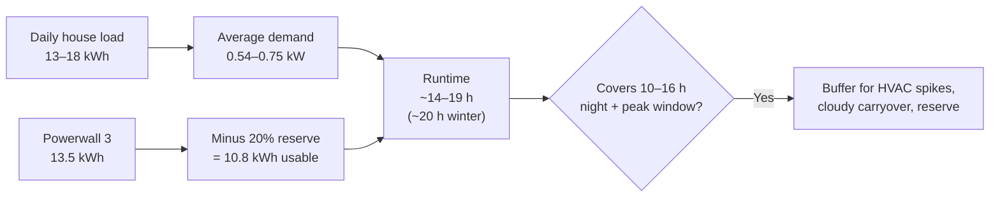

---

### Operational Outcome

Because the battery is not responsible for daytime load:

* solar handles generation + recharge
* battery handles time-shifted demand

This allows the system to reliably achieve:

* **15–17 hours off-grid daily baseline**
* **22–24 hours off-grid during strong solar conditions**

---

### Summary

The Powerwall is intentionally used for **night and peak-rate coverage, not full-day supply**.

This design:

* maximizes cost savings (avoiding expensive grid usage)
* preserves battery health (reserve-aware operation)
* aligns runtime capacity with actual demand windows

Resulting in a stable, energy-efficient, automation-governed residential microgrid behavior.

---


## 🔄 Extended Operation (24/7 Off-Grid Capability)

While optimized for time-shifted usage, the system can be evaluated for **continuous off-grid operation over multiple days**.

---

### ☀️ Summer Operation (High Solar Availability)

* Estimated solar generation: **~20–30 kWh/day** (annual average is ~21.4 kWh/day)
* Daily load: **14–18 kWh/day**

```
Solar ≥ Load → Battery replenished daily
```

**Outcome:**

* Solar covers daytime load and recharges battery
* Battery covers nighttime demand

**1-Week Capability:**

```
Sustained multi-day / near-continuous off-grid operation possible
(house load; EV charging is shifted to the grid or to surplus solar)
```

Battery acts as:

* overnight buffer
* stability layer

Solar acts as:

* primary energy source

---

### ❄️ Winter Operation (Reduced Solar Availability)

* Estimated solar generation: **~8–15 kWh/day**
* Daily load: **~13 kWh/day** (current winter baseline)

```
Solar < Load → Daily energy deficit
```

Deficit range:

* **up to ~5 kWh per day** (13 kWh load − 8 kWh solar on a poor day; none on a good day)

Battery usable capacity (with reserve):

* **~10.8 kWh**

**Outcome:**

* Battery can absorb about 2 worst-case days of deficit (10.8 kWh ÷ ~5 kWh)
* Multi-day 24/7 off-grid operation is not sustainable through a long cloudy stretch
* System uses the CHEAP window and fill days for grid support

---

### 🔋 Periodic Battery Fill Days

To maintain long-term stability, the system uses scheduled **battery reset events**:

* New Year’s Day
* Labor Day
* Thanksgiving
* Christmas

These days are used to:

* recharge the battery to 100% from grid
* eliminate accumulated energy deficits
* stabilize winter performance

All four are RTA holidays with **no peak period**, so the refill is billed at the economy rate all day.

**Function:**

```
Fill Days = System Reset Points
```

---

### 🎯 Engineering Interpretation

* **Summer:**
  Solar-driven system capable of extended off-grid operation

* **Winter:**
  Time-constrained system with controlled grid dependency

* **Battery Role:**
  Time-shifting energy, not full-time supply

* **Fill Days:**
  Strategic resets to maintain system equilibrium

This design allows the home to function as a **stable, scalable, and production-like infrastructure system**.

---

## Sources for Cost Figures

Checked November 12, 2026. Statewide averages; actual bills depend on the utility, rate plan, and usage.

- Alabama residential electricity, 17.15¢/kWh (EIA Electric Power Monthly, March 2026): [electricity-cost.pages.dev](https://electricity-cost.pages.dev/state/alabama/)
- Alabama average household ~1,121 kWh/month, ~$2,136/yr (EIA, April 2026): [Voltflow](https://www.voltflow.net/electricity-cost-calculator/state/alabama)
- Alabama gasoline, AAA state average: [AAA Gas Prices – Alabama](https://gasprices.aaa.com/?state=AL)
- Alabama 2026 gas price peak of $4.17 in May: [The Bama Buzz](https://thebamabuzz.com/alabamas-average-gas-price-drops-40-cents-in-a-month/)
- Alabama Power capacity reservation charge ($5.41/kW, Rider RGB) upheld in federal court, March 2026: [Inside Climate News](https://insideclimatenews.org/news/31032026/alabama-power-solar-fee-ruling/), [EcoFlow explainer](https://www.ecoflow.com/us/blog/alabama-power-solar-fee)
- Alabama Power Rate RTA tariff (Residential Time Advantage), January 2025 billing rates: [alabamapower.com rates](https://www.alabamapower.com/residential/residential-pricing-and-rate-plans.html)
- Alabama Power all-in average of 17.91¢/kWh (2025, EIA-861M): [GreenCalculus](https://greencalculus.com/data/alabama-electricity-rates/)
- Rate ECR fuel factor held at its interim level through 2027: [Yellowhammer News](https://yellowhammernews.com/alabama-power-no-rate-hikes-planned-through-2027)
- EV Night Charging Discount, 1.7155¢/kWh, 9 PM – 5 AM: [Alabama Power Rate Rider PEV](https://www.alabamapower.com/content/dam/alabama-power/pdfs-docs/Rates/pev.pdf), [Alabama Power EV rate program](https://www.alabamapower.com/smart-energy/emerging-technology/electric-transportation/ev-rate-program.html)
- Export (avoided-cost) rate of about 3.65¢/kWh: [News From The States](https://www.newsfromthestates.com/article/alabama-power-gets-green-light-cut-payments-third-party-energy-producers)
