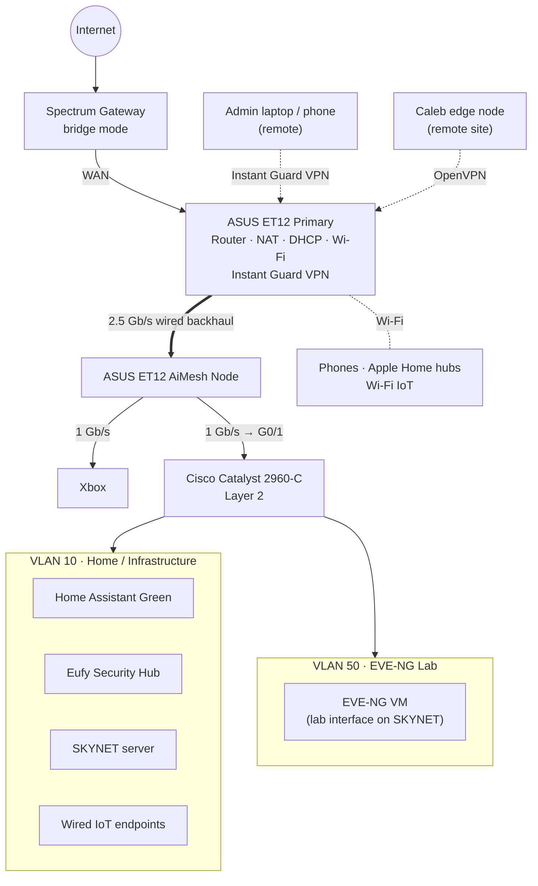
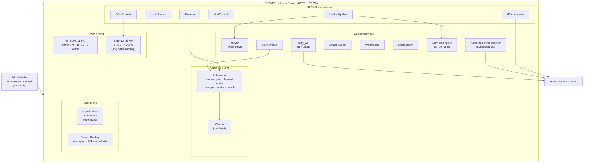
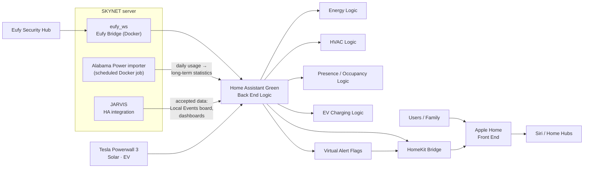
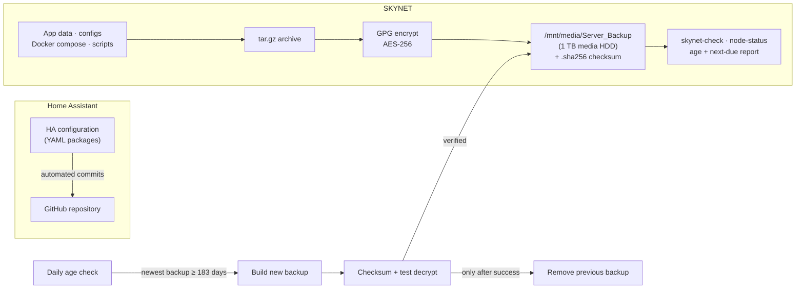
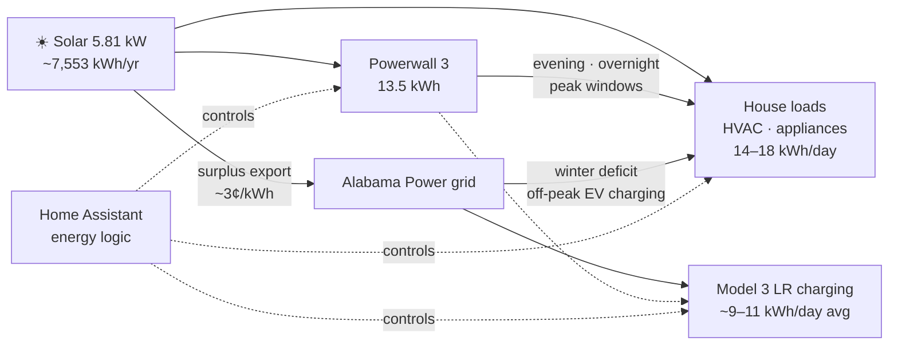
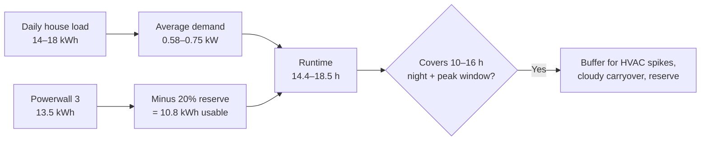

# Smart-Home-Infrastructure
Residential smart home lab integrating Home Assistant, network infrastructure, virtualization, local AI, and energy automation. This home was originally built in 1963 and completely remodeled over the past 2 years. This is my capstone and the culmination of my technical knowledge.

# Smart Home Infrastructure & Automation Lab

<p align="center">
  
    
</p>

A portfolio repository documenting the architecture and automation systems used in my residential smart home lab.

This project integrates **Home Assistant, network engineering, virtualization, local AI (JARVIS), automation, and energy management** to create a fully automated residential infrastructure platform.

The system demonstrates real-world applications of:

- Infrastructure automation
- IoT system integration
- Energy optimization
- Network engineering (VLAN design, Cisco switching, mesh backhaul)
- Virtualization and containerized services
- Local-first AI with a governed execution harness
- DevOps-style configuration management, monitoring, and disaster recovery

> **Documentation checkpoint:** November 12, 2026. Energy and cost figures were re-checked against current Alabama pricing on this date (see [Sources](#sources-for-cost-figures)).

---

## Core Engineering Objective

This project was originally motivated by a practical engineering question:

**How much can residential cost of living be reduced through infrastructure automation and energy system optimization?**

The system was designed to minimize two major household operating costs:

- grid electricity consumption
- fossil fuel energy usage

To achieve this, the home was converted into a **fully electric, energy-aware automation platform** using solar generation, battery storage, and intelligent device orchestration.

Key strategies implemented include:

- shifting appliance usage to low-cost utility time windows
- maximizing solar self-consumption
- using battery storage to avoid peak grid pricing
- automating HVAC operation based on occupancy and environmental conditions
- coordinating EV charging with energy pricing and solar production

By treating the house as an **engineering system rather than a collection of smart devices**, the project explores how infrastructure automation can materially reduce the long-term cost of living.

This repository documents the architecture, automation design, and infrastructure used to operate this system.

---
## Engineering Methodology (SDLC-Informed Design)

This system was developed using a simplified **Software Development Lifecycle (SDLC)** approach adapted to residential infrastructure.

Instead of building isolated automations, the project follows a structured workflow:

- **Problem Definition** → reduce cost of living through energy and infrastructure optimization  
- **System Design** → separate responsibilities across Home Assistant (logic), Apple Home (interface), SKYNET/JARVIS (compute, services, AI), and network infrastructure (transport)  
- **Implementation** → YAML automations, Docker services, KVM virtual machines, systemd timers, and network configuration  
- **Testing & Validation** → real-world verification of automation behavior, energy savings, remote access, and daily health checks (`skynet-check`)  
- **Documentation** → modular repository structure with architecture breakdowns  
- **Iteration** → continuous refinement based on live system performance  

This approach ensures the system behaves as a **cohesive engineered platform**, not a collection of smart devices.

---

## Project Scope

The system manages a live residential automation environment including:

- Multi-zone HVAC automation
- Energy optimization using solar and battery storage
- EV charging coordination
- Security camera integration
- Appliance scheduling based on energy pricing
- Network infrastructure supporting automation servers, IoT devices, and an isolated network lab
- A self-hosted server (SKYNET) running Docker services, virtual machines, and the JARVIS local AI platform

---

## Project Areas

- **Home Assistant Automation Architecture**  
  Modular automation design using Home Assistant packages.

- **SKYNET Server: RDP / VM / Docker / JARVIS**  
  Ubuntu host running Docker services, a Windows 11 admin VM, an EVE-NG network lab, and JARVIS, a local-first AI platform with its own subsystems (Finance, Local Events, Media Pipeline, HVAC audits, CCNA lab assistant).

- **Network Topology & Infrastructure**  
  Spectrum (bridge) → ASUS ET12 primary → 2.5 Gb/s wired AiMesh backhaul → Cisco Catalyst 2960-C, with VLAN 10 (home) and VLAN 50 (EVE-NG lab).

- **Energy Automation & Load Management**  
  Smart control of HVAC, EV charging, and appliances based on energy pricing and solar production.

- **Backup, Monitoring & Disaster Recovery**  
  Git-based Home Assistant configuration backups, plus an encrypted SKYNET recovery backup on a rolling 183-day refresh and one-command health checks.

---

## Featured Highlights

- Multi-zone HVAC automation with occupancy awareness
- GitHub-based Home Assistant configuration backup pipeline
- Encrypted SKYNET recovery backup (AES-256 GPG) with a rolling 183-day refresh, tracked by `skynet-check` and `node-status`
- Residential network with a Cisco-switched VLAN design and an isolated EVE-NG lab VLAN
- Remote desktop / VM environment for automation and development
- JARVIS local AI harness with time windows, a thermal ladder, and CPU core split so AI never starves the VMs
- Energy-aware device orchestration and load shifting
- Presence detection system design
- Server bridge architecture integrating automation services
- Apple HomeKit bridge integration with Home Assistant
- VPN-only remote access (ASUS Instant Guard); no public port forwarding

---

## Explore the System

- [Frontend Overview](01-Apple-Home/README.md)
- [Home Assistant Design](02-Home-Assistant/README.md)
- [Network Design](04-Network-Infrastructure/README.md)
- [RDP / VM / JARVIS Server (SKYNET)](03-RDP-VM-Infrastructure/README.md)
- [Energy Automation](02-Home-Assistant/04-Energy-Optimization/README.md)

**SKYNET / JARVIS subsystems**

- [JARVIS Finance](03-RDP-VM-Infrastructure/Subsystems/Jarvis_Finance/README.md)
- [Local Events](03-RDP-VM-Infrastructure/Subsystems/Local-Events/README.md)
- [Media Pipeline](03-RDP-VM-Infrastructure/Subsystems/Media-Pipeline/README.md)
- [Caleb Remote Node](03-RDP-VM-Infrastructure/Subsystems/Caleb-Remote-Node/README.md)
- [CCNA-Jarvis](03-RDP-VM-Infrastructure/Subsystems/CCNA-Jarvis/README.md)
- [Home Assistant Integration](03-RDP-VM-Infrastructure/Subsystems/Home-Assistant-Integration/README.md)
- [Caleb Edge Node (network side)](04-Network-Infrastructure/Edge-Node/README.md)

---
### 🔍 Featured Deep Dive

- **Windows 11 Admin VM (Operational Workstation)**  
  Real-world administrative environment used to manage infrastructure, automation systems, and development workflows  
  → [`Windows 11 Pro VM`](03-RDP-VM-Infrastructure/Virtualization/Windows%2011Pro/README.md)

---
## Technology Stack

### Automation & IoT
- Home Assistant (Home Assistant Green)
- Apple HomeKit (via HomeKit Bridge)
- HomeKit Controller
- Tuya / Smart Life
- Eufy Security (via the `eufy_ws` bridge on SKYNET)

### Network Infrastructure
- ASUS ZenWiFi Pro ET12 mesh system (primary + AiMesh node, 2.5 Gb/s wired backhaul)
- Cisco Catalyst 2960-C Layer 2 switch (1 Gb/s uplink on `G0/1`)
- VLAN 10 (home / infrastructure) and VLAN 50 (EVE-NG lab)
- Spectrum gateway in bridge mode
- ASUS Instant Guard VPN for remote access

### Server Infrastructure (SKYNET)
- Mini desktop Ryzen server: 4 cores / 8 threads, ~32 GB RAM, 2 × 512 GB SSD + 1 TB HDD
- Ubuntu Server with systemd services and timers
- Docker: Jellyfin, eufy_ws, Open WebUI, Actual Budget, WatchState, Gusto agent, ARM (on demand), Alabama Power importer (scheduled job)
- KVM / libvirt: Windows 11 Pro admin VM, EVE-NG lab VM
- Cockpit and MobaXterm for management

### Local AI (JARVIS)
- Ollama model runtime (localhost only)
- Shared AI harness: window gate, thermal ladder, CPU core split, shared-pool router, failure guards
- Open WebUI front end with read-only JARVIS tools

### Energy Systems
- Tesla Powerwall 3 integration
- Solar generation monitoring
- EV smart charging automation
- Time-of-use energy optimization
- Daily Alabama Power usage import into Home Assistant long-term statistics

### Development & Operations
- Git / GitHub configuration management
- Python and Bash automation scripts
- YAML-based Home Assistant packages
- One-command health checks: `skynet-check`, `jarvis-status`, `node-status`
- Encrypted rolling server backups (GPG, AES-256)

---
HOME NETWORK + HA ⇄ APPLE HOME

HA – Home Assistant

HK – HomeKit Bridge

AH – Apple Home

SKYNET – Ubuntu server (RDP / Docker / KVM / JARVIS)

JARVIS – Local AI platform running on SKYNET

---

## Physical Network Topology

```text
ASCII DIAGRAM (real cabling)

 Internet
   │
┌──▼──────────────────────────┐
│ Spectrum Gateway (BRIDGE)   │  modem-only
└──┬──────────────────────────┘
   │ WAN
┌──▼──────────────────────────────────┐
│ ASUS ZenWiFi Pro ET12  (PRIMARY)    │  Router / NAT / DHCP / Wi-Fi / Instant Guard VPN
└──┬──────────────────────────────────┘
   │  Wired backhaul 2.5G ↔ 2.5G
┌──▼──────────────────────────────────┐
│ ASUS ZenWiFi Pro ET12  (AiMesh NODE)│  Wi-Fi coverage + Ethernet distribution
│ • LAN 1G → Xbox                     │
│ • LAN 1G → Cisco switch uplink      │
│ • WAN unused                        │
└──┬──────────────────────────────────┘
   │  1G uplink → G0/1
┌──▼───────────────────────────────────────────┐
│ Cisco Catalyst 2960-C (Layer 2)              │
│                                              │
│ ─── VLAN 10 · Home / Infrastructure ──────── │
│  • Home Assistant Green                      │
│  • Eufy Security Hub                         │
│  • SKYNET server (host, Docker, Windows VM)  │
│  • Wired IoT / low-bandwidth endpoints       │
│                                              │
│ ─── VLAN 50 · EVE-NG Lab (isolated) ──────── │
│  • SKYNET lab interface → EVE-NG VM          │
│  • No routing to VLAN 10 assumed             │
└──────────────────────────────────────────────┘

 Remote: Caleb edge node ──VPN──► home network (separate site, not on this switch)
```



> VLAN 50 is a separate broadcast domain for lab work. Being attached to both VLANs does **not** mean SKYNET routes between them; any VLAN 50 gateway or route must be documented and verified on its own. See [Network Design](04-Network-Infrastructure/README.md).

---

## SKYNET Server Stack



**Storage layout**

| Device | Role |
|---|---|
| System SSD | Ubuntu, Docker runtime, AI models, application data |
| Second SSD | VM disks and app data (Windows 11 ≈ 150 GB, EVE-NG ≈ 170 GB) |
| 1 TB HDD | Jellyfin media library and the `Server_Backup` recovery archive |

---

## Control Architecture



JARVIS publishes only accepted, saved data into Home Assistant. Production Home Assistant changes still require approval; JARVIS does not take control actions on its own.

### Implementation
- YAML-based automation architecture (Home Assistant packages)
- Python and Bash automation scripts
- Docker Compose services and systemd timers on SKYNET
- Allowlist-based exposure to Apple Home

---

## Operations, Monitoring & Disaster Recovery

### Health check commands

| Command | Purpose |
|---|---|
| `skynet-check` | One-screen OK / WARN / FAIL summary: load, memory, disks, CPU temperature, failed units, Gusto, Docker, VMs, backups, updates. `-v` adds detail; `--full` also runs the full legacy report. Exit code 0 / 1 / 2 for scripting. |
| `jarvis-status` | Compact node status: runs `skynet-check`, shows upcoming JARVIS timers, and lists every shortcut command grouped by area (Gusto, Finance, HVAC, Media/ARM, AI, Jarvis control, System). |
| `node-status` | The original detailed system report, including primary and secondary backup status. |

### Backup and recovery



- **One rolling recovery backup** is kept in `Server_Backup` on the media drive. It is refreshed every **183 days** (about twice a year), and the old copy is removed only after the new one passes checksum and test-decrypt, so at least one good backup always exists.
- `skynet-check` reports the backup's age and days until the next refresh, and warns if it becomes overdue.
- The automated 183-day job is being finalized; the current backup was moved into `Server_Backup` and is tracked by both health checks.
- Home Assistant configuration is backed up separately to GitHub.

---

## Economic Impact of Infrastructure Automation

A primary objective of this project is reducing the long-term **cost of living** through infrastructure automation and energy system optimization.

Rather than treating automation as a convenience feature, the system treats the home as an **energy-managed residential infrastructure platform** designed to minimize operating costs across electricity, heating, and transportation.

The home operates as a **fully electric household**, eliminating natural gas usage and integrating solar generation, battery storage, and EV charging automation into a unified energy system.

---

### Energy Infrastructure

The residential energy platform currently integrates:

- **5.81 kW solar generation system**
- **Tesla Powerwall 3 battery storage (13.5 kWh usable capacity)**
- **Fully electric multi-zone mini-split HVAC system**
- **Tesla Model 3 Long Range (used as a managed electrical load)**
- **Home Assistant automation platform coordinating energy usage**

Estimated solar generation:

- **~7,553 kWh annually** (≈ 1,300 kWh per installed kW)
- **~20.7 kWh per day on average** (more in summer, less in winter)

   


  
---

### Typical Household Energy + Transportation Costs (Regional Baseline)

For a typical Alabama household using electricity, natural gas, and a gasoline vehicle (2026 pricing):

| Category | Assumption | Typical Annual Cost |
|--------|----------------|----------------|
| Electricity | ~13,700 kWh/yr at ~16–17¢/kWh | ~$2,150 – $2,300 |
| Natural Gas | ~$40 – $70/month | ~$480 – $840 |
| Gasoline vehicle fuel | 12,000 – 15,000 mi at 30 mpg, ~$3.75/gal | ~$1,500 – $1,875 |
| **Total energy + transportation** | | **~$4,100 – $5,000 / year** |

These costs vary depending on energy prices, driving distance, and heating demand. Gasoline in Alabama has swung widely in 2026 (about $2.55 in January to a ~$4.17 peak in May), so fuel savings move with the pump price.

---

### EV Charging as an Energy-Controlled Load

The Tesla Model 3 Long Range acts as a **high-capacity controllable electrical load** within the automation system.

At ~0.27 kWh per mile, 12,000 – 15,000 miles a year is about **3,200 – 4,050 kWh/yr** (roughly 9 – 11 kWh/day on average). This is on top of the 14 – 18 kWh/day house load used in the battery model below.

Charging is coordinated through automation rules that:

- prioritize charging during low-cost overnight electricity windows
- avoid peak energy pricing periods
- coordinate with other large electrical loads in the home
- integrate with solar generation and battery state when available

This allows the EV to function as part of the home’s **managed energy ecosystem** rather than as an uncontrolled power demand.

---

### Estimated Cost Reduction

By combining:

- solar electricity generation
- elimination of natural gas
- EV fuel cost replacement
- automation-driven energy management

the system significantly reduces overall household operating costs.

| Category | How it is calculated | Estimated Annual Reduction |
|--------|----------------|----------------|
| Solar electricity offset | 85 – 90% of 7,553 kWh used on-site at ~17¢, the rest exported at ~3¢, **minus** Alabama Power's $5.41/kW capacity reservation charge (5.81 kW → ~$31/mo, ~$377/yr) | ~$750 – $800 |
| Eliminated natural gas usage | Gas bill removed (heat-pump electricity is already inside the house load) | ~$480 – $840 |
| Gasoline replaced by EV charging | $1,500 – $1,875 of gasoline **minus** ~$550 – $690 of EV charging electricity at the full grid rate | ~$950 – $1,190 |
| **Total estimated reduction** | | **~$2,200 – $2,800 annually** |

These estimates assume moderate driving distances and typical 2026 regional fuel and utility pricing. They are intentionally conservative:

- EV charging is priced at the full grid rate; charging on solar or off-peak lowers it further.
- The earlier version of this table (~$3,200 – $4,200) did not subtract the solar capacity charge or the electricity the EV uses, so it overstated the savings.
- If gasoline returns to ~$4.15/gal, the EV line rises by roughly $150 – $190.

---

## System Design Philosophy

The smart home is designed using core engineering principles typically applied to distributed systems:

- **Separation of Concerns**
  - Home Assistant → automation and logic  
  - Apple Home → user interface and communication  
  - SKYNET / JARVIS → compute, services, AI, and data collection  
  - Network infrastructure → connectivity and security  

- **Local-First Architecture**
  - all critical systems operate on the local network  
  - AI models run locally through Ollama, bound to localhost  
  - remote access is achieved securely via VPN (ASUS Instant Guard)  
  - no direct exposure of internal services to the public internet  

- **Controlled Exposure (Allowlist Model)**
  - only human-relevant entities are exposed to Apple Home  
  - backend logic, telemetry, and system internals remain isolated

- **One Control Plane for AI**
  - every AI job goes through the same harness (time windows, thermal limits, CPU core split)  
  - AI work never competes uncontrolled with the VMs, media services, or the network lab

- **System-as-Infrastructure Mindset**
  - HVAC, EV charging, and appliances are treated as coordinated system components  
  - energy usage is orchestrated, not reactive  
  - automation decisions are based on state, timing, and cost conditions  
 
---

## 🔢 Battery Runtime Model & Extended Operation

The Powerwall is operated as a **time-shifting energy system**, primarily covering:

* nighttime consumption
* high-cost (peak) utility windows

rather than attempting full 24-hour load coverage.

---

### Assumptions

* **Battery Capacity:** 13.5 kWh usable (Tesla Powerwall 3)
* **Daily Consumption:** 14–18 kWh (house only; EV charging is scheduled separately)
* **Load Profile:** Evenly distributed across 24 hours
* **Reserve Policy:** ~20% retained for outage protection and battery longevity

---

### Continuous Load Model

Daily usage is converted into a constant demand:

* 14 kWh/day ÷ 24 h → ~0.58 kW
* 18 kWh/day ÷ 24 h → ~0.75 kW

This provides a stable baseline for runtime modeling.

---

### Battery Coverage Window

Because solar supplies daytime load, the battery is responsible for:

* evening
* overnight
* early morning
* peak-rate utility periods

Typical required coverage:

```
~10–16 hours per day
```

---

### Practical Runtime Capacity

With a 20% reserve:

* usable energy ≈ 13.5 × 0.8 = **10.8 kWh**

Runtime capability:

* 10.8 ÷ 0.583 ≈ **18.5 hours**
* 10.8 ÷ 0.75 ≈ **14.4 hours**

**Result:**

```
~14–18.5 hours available battery runtime
```

---

### System Fit

* Required coverage → **~10–16 hours**
* Available runtime → **~14–18.5 hours**

This creates a buffer for:

* HVAC demand spikes
* cloudy day carryover
* automation inefficiencies
* reserve protection



---

### Operational Outcome

Because the battery is not responsible for daytime load:

* solar supplies active demand
* solar recharges the battery

This allows:

* **15–17 hours off-grid daily baseline**
* **22–24 hours off-grid during strong summer conditions**

---

## 🔄 Extended Operation (24/7 Off-Grid Capability)

While optimized for time-shifted usage, the system can be evaluated for **continuous off-grid operation over multiple days**.

---

### ☀️ Summer Operation (High Solar Availability)

* Estimated solar generation: **~20–30 kWh/day** (annual average is ~20.7 kWh/day)
* Daily load: **14–18 kWh/day**

```
Solar ≥ Load → Battery replenished daily
```

**Outcome:**

* Solar covers daytime load and recharges battery
* Battery covers nighttime demand

**1-Week Capability:**

```
Sustained multi-day / near-continuous off-grid operation possible
(house load; EV charging is shifted to the grid or to surplus solar)
```

Battery acts as:

* overnight buffer
* stability layer

Solar acts as:

* primary energy source

---

### ❄️ Winter Operation (Reduced Solar Availability)

* Estimated solar generation: **~8–15 kWh/day**
* Daily load: **14–18 kWh/day**

```
Solar < Load → Daily energy deficit
```

Deficit range:

* **up to ~10 kWh per day** (18 kWh load − 8 kWh solar on a poor day; near zero on a good one)

Battery usable capacity (with reserve):

* **~10.8 kWh**

**Outcome:**

* Battery can absorb about 1 worst-case day of deficit
* Multi-day 24/7 off-grid operation is not sustainable
* System requires periodic grid support

---

### 🔋 Periodic Battery Fill Days

To maintain long-term stability, the system uses scheduled **battery reset events**:

* New Year’s Day
* Labor Day
* Thanksgiving
* Christmas

These days are used to:

* recharge the battery to 100% from grid
* eliminate accumulated energy deficits
* stabilize winter performance

**Function:**

```
Fill Days = System Reset Points
```

---

### 🎯 Engineering Interpretation

* **Summer:**
  Solar-driven system capable of extended off-grid operation

* **Winter:**
  Time-constrained system with controlled grid dependency

* **Battery Role:**
  Time-shifting energy, not full-time supply

* **Fill Days:**
  Strategic resets to maintain system equilibrium

This design allows the home to function as a **stable, scalable, and production-like infrastructure system**.

---

## Sources for Cost Figures

Checked November 12, 2026. Statewide averages; actual bills depend on the utility, rate plan, and usage.

- Alabama residential electricity, 17.15¢/kWh (EIA Electric Power Monthly, March 2026): [electricity-cost.pages.dev](https://electricity-cost.pages.dev/state/alabama/)
- Alabama average household ~1,121 kWh/month, ~$2,136/yr (EIA, April 2026): [Voltflow](https://www.voltflow.net/electricity-cost-calculator/state/alabama)
- Alabama gasoline, AAA state average: [AAA Gas Prices – Alabama](https://gasprices.aaa.com/?state=AL)
- Alabama 2026 gas price peak of $4.17 in May: [The Bama Buzz](https://thebamabuzz.com/alabamas-average-gas-price-drops-40-cents-in-a-month/)
- Alabama Power capacity reservation charge ($5.41/kW, Rider RGB) upheld in federal court, March 2026: [Inside Climate News](https://insideclimatenews.org/news/31032026/alabama-power-solar-fee-ruling/), [EcoFlow explainer](https://www.ecoflow.com/us/blog/alabama-power-solar-fee)
- Export (avoided-cost) rate of about 3.65¢/kWh: [News From The States](https://www.newsfromthestates.com/article/alabama-power-gets-green-light-cut-payments-third-party-energy-producers)
